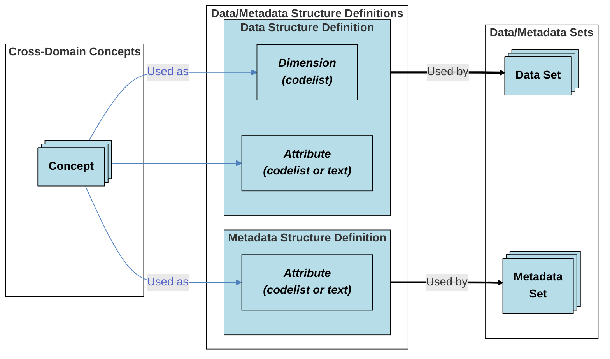
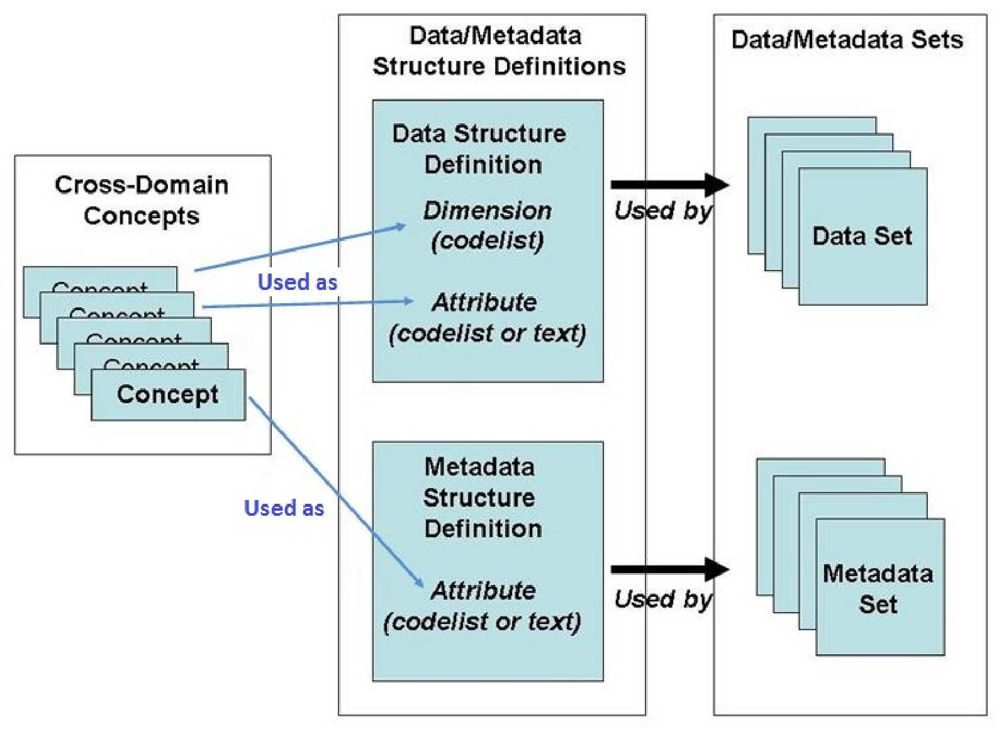

**SDMX GUIDELINES** **STATISTICAL WORKING GROUP (SWG)**

**SDMX**

**CONTENT-ORIENTED GUIDELINES**

**INTRODUCTION**

**FEBRUARY 2016**

© 2016 SDMX

http://sdmx.org/

# CONTENTS

[1. INTRODUCTION](#1-introduction)

[1.1. Background](#11-background)

[1.2. Cross-domain and domain-specific guidelines](#12-cross-domain-and-domain-specific-guidelines)

[1.3. Scope of the Content-Oriented Guidelines](#13-scope-of-the-content-oriented-guidelines)

[1.4. Maintenance of the Content-Oriented Guidelines](#14-maintenance-of-the-content-oriented-guidelines)

[1.5. Scope of the Other Statistical Guidelines](#15-scope-of-the-other-statistical-guidelines)

[2. CROSS-DOMAIN CONCEPTS](#2-cross-domain-concepts)

[2.1. Introduction](#21-introduction)

[2.2. Cross-Domain Concepts in data/metadata exchange](#22-cross-domain-concepts-in-datametadata-exchange)

[2.3. Describing Cross-Domain Concepts](#23-describing-cross-domain-concepts)

[2.4. Using Cross-Domain Concepts in structure definitions](#24-using-cross-domain-concepts-in-structure-definitions)

[2.5. Cross-Domain Concepts and code lists](#25-cross-domain-concepts-and-code-lists)

[3. STATISTICAL SUBJECT-MATTER DOMAINS](#3-statistical-subject-matter-domains)

[3.1. Introduction](#31-introduction)

[3.2. Classification of International Statistical Activities](#32-classification-of-international-statistical-activities)

[3.3. Using SDMX Statistical Subject-Matter Domains](#33-using-sdmx-statistical-subject-matter-domains)

[4. SDMX GLOSSARY](#4-sdmx-glossary)

[4.1. Introduction](#41-introduction)

[4.2. Structure of the Glossary](#42-structure-of-the-glossary)

[5. GOVERNANCE, MAINTENANCE AND OUTREACH](#5-governance-maintenance-and-outreach)

[5.1. SDMX Cross-domain developments](#51-sdmx-cross-domain-developments)

[5.2. Domain-specific developments](#52-domain-specific-developments)

[5.3. Outreach](#53-outreach)

[6. CONTACT ADDRESS](#6-contact-address)

# 1. INTRODUCTION

## 1.1. Background

The Statistical Data and Metadata eXchange (SDMX) initiative (http://sdmx.org) sets technical standards and statistical guidelines to facilitate the exchange of statistical data and metadata using modern information technology, with an emphasis on aggregated data.

### Technical standards

Version 1.0 specification of the technical standards was approved in 2005 by the International Organization for Standardization (ISO) as a Technical Specification (ISO/TS 17369: 2005 SDMX).

Version 2.0 specification (November 2005) broadens the framework to support wider coverage of metadata exchange as well as a more fully articulated architecture for data and metadata exchange.

Version 2.1 specification, issued in 2011 and consolidated in 2013, was officially published by the International Organization for Standardization (ISO) as International Standard (IS) 17369<a href="#fn-1" id="fnref-1">1</a> on 8 January 2013. This ensures that SDMX technical standards build on other recognized standards and provide the basis for interoperability with them.

### Statistical guidelines

The statistical guidelines cover mainly two aspects: a) harmonisation of terminology, code lists and statistical subject-matter domains (Content-Oriented Guidelines), and b) development of specific guidelines for a proper implementation of the SDMX standard.

The SDMX Content-Oriented Guidelines facilitate mutual understanding of the content of the SDMX data and metadata files through the use of common statistical concepts in the underlying metadata.

The guidelines for SDMX artefacts are more implementation-oriented, for example: the treatment of confidentiality and embargo in SDMX; the versioning of SDMX artefacts. The aim of these guidelines is to promote harmonisation across statistical domains.

Unlike the technical specifications, the development of the SDMX statistical guidelines is being undertaken outside the ISO framework. This should facilitate steps by the SDMX sponsoring institutions to broadly involve content-oriented efforts of a wide range of experts that are already working in many subject-matter domains within the global statistical community.

## 1.2. Cross-domain and domain-specific guidelines

The SDMX Content-Oriented Guidelines recommend practices for creating interoperable data and metadata sets using the SDMX technical standards. They are envisaged to be applicable generically across statistical subject-matter domains. The guidelines focus on the harmonization of specific concepts and terminology that are common to a large number of statistical domains (hence the name "cross-domain"). Such harmonisation is useful for achieving even more efficient exchange of comparable data and metadata and builds on the experience gained in implementations to date.

In addition to proposing cross-domain content-oriented guidelines, the SDMX initiative also provides a structure for the development of domain-specific content-oriented guidelines. Within that framework, recognized international agencies and bodies involved in setting standards for particular statistical domains will play an important role in developing domain-specific content guidelines and related terminologies.

While the SDMX Technical Standards and the SDMX Content-Oriented Guidelines can be used independently of each other, it is especially conducive to standardisation when they are used together. The evolving work associated with concept harmonization can be supported by a known technical framework, with exchange processes already taking place on a more efficient basis.

SDMX Technical Standards allow the exchange of data (and of metadata closely associated to these data) among statistical institutions based on known Data Structure Definitions (DSDs). Using the commonly understood DSDs allows mapping or translating the exchanged data messages from and to internal statistical databases and systems. Similarly, when metadata messages are exchanged, this involves using commonly understood Metadata Structure Definitions (MSDs) that allow mapping metadata from and to internal representations.<a href="#fn-2" id="fnref-2">2</a>

What is most important is that there be sufficient granularity and terminological consistency in the set of cross-domain concepts to allow for mapping to internal data and metadata structures at institutions. This permits institution-specific definitions to be maintained while using a common "transport" structure for data and metadata exchange between institutions, whether bilaterally (e.g. point-to-point transmissions) or multilaterally (e.g. web disseminations).

To advance on these common structures, SDMX sponsoring institutions are collectively identifying cross-domain concepts that are commonly used in SDMX messages. Domain experts in existing groups and institutions are working to provide common structures for those parts of the messages that are domain-specific (e.g. national accounts, balance of payments, labour statistics, education statistics, millennium development goals indicators, external debt statistics). In addition, SDMX sponsoring institutions will facilitate information-sharing about these domain-specific developments through the SDMX website (e.g. announcement of new activities, maintenance activities, opportunities to provide expert input and links to domain-specific websites).

While all of these common efforts are evolving, the SDMX technical framework can already support bilateral and multilateral exchanges because the structures used in SDMX conformant messages need to contain a clear indication of the data and metadata being transported - whether they come from an institution's own structure or from an agreed set of mappings or from a mix of both.

## 1.3. Scope of the Content-Oriented Guidelines

The SDMX Content-Oriented Guidelines comprise

- an SDMX Glossary, covering
  - a) cross-domain concepts,
  - b) other metadata concepts used in data and metadata exchanges,
  - c) technical terms from the SDMX Information Model,
- SDMX cross-domain code lists associated to cross-domain concepts
- a list of statistical subject-matter domains.

The Content-Oriented Guidelines are designed to be used within the framework of SDMX Technical Standards to produce maximum interoperability in the exchange of data and metadata. The intent is to encourage their use where possible across statistical domains in the following three areas:

1\) “Cross-Domain Concepts” (a sub-set of the SDMX Glossary)

This list is based on the concepts used by the contributing international organisations. It is not exhaustive and it is expected to grow in the future.

2\) Classification of domains, as described in the “Statistical Subject-Matter Domains” guideline.

This classification is based on the work of the United Nations Economic Commission for Europe (UNECE) to produce a high-level classification of statistical areas. It offers a starting point for organising the exchange of statistical data and metadata, for instance using a registry which provides information needed for locating data and metadata over the Internet.

3\) Statistical metadata terminology, as described in the “SDMX Glossary”.

The terms which do not have the "cross-domain" status are in many cases taken from other sources, or they consist of harmonised terms used in the SDMX Technical Specifications. The SDMX Glossary comprises a standard terminology related to statistical metadata across statistical domains. The SDMX Glossary, like the other content guidelines, is seen as a living document which will continue to grow and will regularly be updated over time.

Statistical domains cover a very broad field of activities. Thus, there will always be some domain-specific elements in each of the three areas covered by the SDMX Content-Oriented Guidelines. It is not the intent of these guidelines to harmonize everything across all statistical domains. The guidelines provide harmonization where possible: for the instances where various domains use slightly different concepts, or classifications, or terms, the Content-Oriented Guidelines intend to provide a single, harmonized concept, classification, or term to use when exchanging data and metadata across domain boundaries.

It is important to understand what is meant by the term "cross-domain", as this appears in several places within these guidelines. By "cross-domain", the guidelines indicate that a statistical concept is used in more than one different statistical domain in a materially similar form. This distinction is important, because of the process by which these guidelines are intended to be created and maintained. Identifying all the concepts, classifications, and terms which are potentially "cross-domain" according to this definition is a continuous task. As statistical domains change and expand, new terms and concepts and classifications may come into existence and need to be added.

## 1.4. Maintenance of the Content-Oriented Guidelines

The development and maintenance of the content-oriented guidelines is under the responsibility of the SDMX Statistical Working Group (SWG), which is made of 20 members from national and international organisations from the statistical and central banking worlds.

## 1.5. Scope of the Other Statistical Guidelines

The other statistical guidelines cover various governance documents necessary to ensure a consistent implementation and maintenance of SDMX artefacts. They cover issues such as the content policy of the Global Registry, the versioning of SDMX artefacts or the creation and management of SDMX Cross-Domain Code Lists.

These documents are available from the SDMX official website.

# 2. CROSS-DOMAIN CONCEPTS

## 2.1. Introduction

Cross-domain concepts in the SDMX framework describe concepts relevant to many, if not all, statistical domains. SDMX recommends using these concepts whenever feasible in SDMX structures and messages to promote re-usability and exchange of statistical information and their related metadata between organizations. Whenever used, these concepts should conform to the specified names, roles, and representations defined in the SDMX Content-Oriented Guidelines.

In SDMX, the term “metadata” is very broad<a href="#fn-3" id="fnref-3">3</a>. A distinction is made between “structural” and "reference" metadata.

*Structural metadata* define the structure of statistical data sets and metadata sets (e.g. names of variables or dimensions of a statistical cube). Data must be linked to structural metadata; without these data identifiers and descriptors, they cannot be identified, retrieved or browsed.

*Reference metadata* describe the contents and quality of the statistical data (They include but are not limited to the following types of metadata):

  - conceptual metadata, describing the concepts used and their practical implementation;
  - methodological metadata, describing methods used for generation of the data; and,
  - quality metadata, describing the different quality dimensions of the resulting statistics, e.g. timeliness, accuracy.

While these reference metadata exist and may be exchanged independently of the data and their structural metadata, they are linked to the data. Reference metadata may refer to specific statistical data, to entire data collections or even to the institution that provides the data. The level at which a particular concept descriptor applies is called the "attachment level" of the concept. An example of this is the concept of "frequency" which may not be meaningful at the observation level but only when applied to a higher level (e.g. to a time series of observations).

The cross-domain concepts are used in:

- *Data Structure Definitions* (DSDs), which define the valid content of data sets in a given domain in terms of the concepts used to structure the data set. Each concept is assigned to represent either an attribute or dimension, and a valid type is defined; for example, a concept can have a code list or free text representation, or other types.
- *Metadata Structure Definitions* (MSDs), which define the valid content of metadata sets in a given domain in terms of the concepts contained in the metadata sets, the role and the valid content of each of the concepts when used in a metadata set.
- Data and metadata messages used for the exchange of data and metadata.

The list of cross-domain concepts is expected to grow and to be regularly updated as SDMX Technical Standards and Content-Oriented Guidelines are utilized in more and more statistical domains. The Cross-Domain Concepts include not only the names of the concepts and their content description but also, where appropriate, their representation with supporting code lists and the roles they can play within the data structure definition and/or metadata structure definition.

The use of the SDMX Cross-Domain Concepts is not a prerequisite for technical conformance, but provides a framework to facilitate data and metadata sharing among those who are conformant with the Technical Standards. This promotes, in particular, the exchange of consistent metadata that can be used by different international organizations and national and regional data-producing agencies to compare concepts and practices.

## 2.2. Cross-Domain Concepts in data/metadata exchange

As mentioned above, cross-domain concepts are used in SDMX Data Structure Definitions for supporting the exchange of data (and their associated metadata); and Metadata Structure Definitions for supporting the exchange of additional (usually, “high level”) metadata.

The following illustration provides a simplified view of how concepts are used for the purposes of data and metadata exchange in the SDMX framework.

<!-- figure: f01-concepts-in-exchange -->

Original figure

The illustration shows that cross-domain concepts have three basic roles:

1\) As *Dimensions* in a Data Structure Definition. Dimensions, when taken together, serve to **identify** each statistical observation. For example, a dimension named “Reference Area” would explain which country a specific statistical observation refers to (e.g. United States, New Zealand, or Italy). Dimension values are typically taken from code lists (in this example, a code list of countries).

2\) As *Attributes* in a Data Structure Definition. Attributes provide information about the data, thus **qualifying** the data further. For example, an attribute named “Unit of Measure” might provide information about whether statistical data are measured, for example, in currency units, and if so, which currency, or as a pure number. Attributes are sometimes coded, but can also have free-text values<a href="#fn-4" id="fnref-4">4</a>.

3\) As *Attributes* in a Metadata Structure Definition. Here the concepts can be used to report metadata about, for example, a Data Flow or a Data Provision Agreement (which may embrace a set of Data Sets) with concepts such as timeliness, reference period, classification system and data compilation. The values of these concepts may be coded, but are often free text.

Each Data Set or Metadata Set uses a structure definition of the appropriate type, so that systems that exchange data and metadata can understand what the Data or Metadata Set contains.

Concepts may be reused in various structure definitions. Thus, a concept such as “Reference Area” might be used in a Data Structure Definition and in a Metadata Structure Definition. The existence of a single concept with a single representation for the purposes of exchange across several domains is crucial.  Data and metadata structures which re-use this single concept can be easily associated, because they are referring to the same idea in the same terms.

## 2.3. Describing Cross-Domain Concepts

The concepts (used in Data and Metadata Structure Definitions) must have a specific set of properties according to the SDMX Information Model<a href="#fn-5" id="fnref-5">5</a>. These properties include:

1\) a mandatory description of the concept. Definitions of and comments to general SDMX Cross-Domain Concepts are included in the SDMX Glossary.

2\) a unique identifier of the concept within the list of Cross-Domain Concepts maintained by the same Maintenance Agency<a href="#fn-6" id="fnref-6">6</a>.

3\) If the concept is “coded”, a link to a code list containing valid values that may be reported for the concept.

4\) The Maintenance Agency maintains the concept for use within Data and Metadata Structure Definitions. For the SDMX Cross-Domain Concepts, the Maintenance Agency is SDMX and they will be labelled “SDMX”. For other domain-specific concepts (not or not yet included in the SDMX cross-domain concepts) there are various different Maintenance Agencies.

The “Maintenance Agency” concept is important for many different purposes; therefore, it is a cross-domain concept in its own right and should be coded in a uniform way.

## 2.4. Using Cross-Domain Concepts in structure definitions

A cross-domain concept may be used as an attribute (in a DSD or MSD) or as a dimension (DSD only).

If the concept is used as an attribute, the “attachment level” must be indicated, i.e. the target object or structure to which the attribute is linked. Examples of such objects in a DSD are Data Set, group of Time Series, Time Series, or Observation; apart from the Data Set, they are referenced by a key, which in itself is made up of some or all the dimensions used in the DSD. In an MSD, the target objects may be the same objects as for attributes, or, for example, a Code List, a member of a Code List, a Data Provision Agreement or an Agency. The MSD will define the components that make up the target object identifier key.

In case a concept can be represented as coded, there must be a link to the code list containing valid values that may be reported.

## 2.5. Cross-Domain Concepts and code lists

The "Guidelines" page of the SDMX website presents the list of presently available cross-domain Code Lists that can be used to support Cross-Domain Concepts. It should be noted that a Code List must always have an associated concept. The list of available Code Lists is continuously extended.

The creation and management of cross-domain code lists are ruled by the "Guidelines for the Creation and Management of SDMX Cross-Domain Code Lists" (to be found on the SDMX official website).

# 3. STATISTICAL SUBJECT-MATTER DOMAINS

## 3.1. Introduction

A statistical subject-matter domain refers to a statistical activity that has common characteristics with respect to variables, concepts and methodologies for data collection and the whole statistical data compilation process. Examples of statistical domains are price statistics, national accounts, environment statistics or education statistics.

In some cases, statistical information may be linked to several Subject-Matter Domains. This should be highlighted when the list of domains is used as a navigation aid.

In the SDMX Content-Oriented Guidelines, the list of Statistical Subject-Matter Domains has three functions:

1\) as a standard scheme against which similar domain lists of national and international organizations can be mapped to facilitate the exchange of data and metadata;

2\) as an identifier framework for registering and searching statistical data on SDMX registries, the architecture of which has been developed in SDMX Technical Standards Version 2.0 (and in later versions); and

3\) as a navigation aid for identification and organization of corresponding “domain groups” playing an active role in the use of SDMX technical standards and content-oriented guidelines for the exchange of statistics and related metadata.

## 3.2. Classification of International Statistical Activities

For this part of the Content-Oriented Guidelines, advantage has been taken of an existing categorization scheme, namely the United Nations Economic Commission for Europe (UNECE) Classification of International Statistical Activities and the Database of International Statistical Activities in the UNECE Region (DISA).

The UNECE framework (Version 2007<a href="#fn-7" id="fnref-7">7</a>) has two levels of classification. The first level comprises five “Statistical Domains” that relate to the broad type of statistical activities. The second level specifies the Statistical Areas within the Domains and also provides, in some cases, more detail.

SDMX makes use of the subject-matter framework in Statistical Domains 1-3<a href="#fn-8" id="fnref-8">8</a>, which cover:

1\) Demographic and social statistics

2\) Economic statistics

3\) Environmental and multi-domain statistics

The detailed list of SDMX Statistical Subject-Matter Domains (supplemented with detailed explanatory notes) is provided on the "Guidelines" page of the SDMX website.

## 3.3. Using SDMX Statistical Subject-Matter Domains

The SDMX Statistical Subject-Matter Domain classification provides a high-level scheme for organising statistical data and metadata in many types of applications.

It is anticipated that this classification will be used for one of the basic functions of SDMX at a technical level, namely the organization of SDMX registries (see SDMX Technical Specifications, version 2.0 and onwards). Moreover, for this purpose, it is possible that in future some registries will require a more detailed classification in their areas of focus.

The SDMX Technical Standards version 2.0 (and onwards) provide a mechanism for increasing the granularity (level of detail) of a classification scheme while still making clear where the SDMX Statistical Subject-Matter Domains stop and the sub-classification begins. This provides for a high-level interoperability between different SDMX registries, while allowing specific SDMX registries to have the granularity they need. The mappings can be exchanged in the form of SDMX-ML Structure Messages.

In addition to its key role in supporting categorization of data and metadata flows, the development of a list of statistical domains allows the identification of “domain groups”. These groups comprise organizations, working parties, expert groups, task forces, inter-secretariat working groups, UN city groups, etc, that are responsible for the development of statistical guidelines and recommendations and identification of best practice for statistics falling within the scope of a particular statistical domain.

# 4. SDMX GLOSSARY

## 4.1. Introduction

The SDMX Glossary is an SDMX guideline containing concepts and related definitions that are useful for building and understanding data and metadata exchange arrangements based on SDMX. The Glossary provides definition of terms found in the SDMX Information Model, Data Structure Definitions (DSDs) and Metadata Structure Definitions (MSDs) and in use at the time of its release. It is recommended as a single entry point to a common SDMX terminology to be used in order to facilitate communication and understanding of the standard.

The Glossary does not impose specific concepts and code lists to be used in SDMX structures; it is rather a vocabulary that recommends a common terminology to be used in order to facilitate communication and understanding. The overall message of the Glossary is: if a term is used, then its precise meaning should correspond to the Glossary definition; and any reference to a particular phenomenon described in the Glossary should use the appropriate term. The Glossary is closely linked to the cross-domain concepts as it also contains all these concepts, stating their definitions and context descriptions.

The Glossary is not intended to cover the whole range of statistical terminology, as this area is already covered by other general or domain-specific glossaries. The focus of the Glossary is largely those terms that are normally used for building and understanding metadata systems and SDMX data exchange arrangements.

The metadata concepts defined in the Glossary are also regularly discussed by international organisations within their respective constituencies; as a consequence, this list will grow and be updated as the SDMX guidelines are used in more and more statistical domains. The Glossary should thus be considered as a "living" document, open to contributions and improvement derived from the use of its concepts within SDMX and in national frameworks. For instance, a change in the Content-Oriented Guidelines involving SDMX Cross-Domain Concepts implies updating the Glossary to reflect these changes. In addition, since the Cross-Domain Concepts will be revised and expanded, the Glossary will have to follow as new terms need to be included, existing definitions need to be refined and more detailed information needs to be added.

A value added of the Glossary is also in the opportunity of having one single entry point for accessing a variety of terms, sometimes not available or hard to find. In some cases, the Glossary deliberately presents one definition linked to several context explanations, sometimes providing additional explanations; other times highlighting peculiarities in how a certain definition is applied within a certain domain or geographical context. Users can live with different metadata models, as long as each concept is well identified and transparent to users. In other words, transparency is a prerequisite for a correct interpretation (and for convergence) of the different statistical frameworks.

## 4.2. Structure of the Glossary

The Glossary builds on work already undertaken by several organizations. Where possible, definitions have been drawn from existing international standards or from recommended statistical practices. Where standard definitions were not available or needed adjustment, suitable national definitions have been considered or new definitions formulated.

As mentioned above, "context" information is provided extensively throughout the glossary, sometimes to offer additional explanations, other times highlighting peculiarities in how a certain definition is applied within a particular domain or geographical context.

In particular, the Glossary also provides information authored as "SDMX", e.g. terms used within the SDMX Technical Specification and Cross-Domain Concepts. This subset of terms is directly maintained by SDMX, while the wider set of metadata terms of more general use with more detailed explanations is linked to external sources and glossaries.

The latest version of the Glossary is available from the "Guidelines" page of the SDMX website or using the corresponding quick link.

The SDMX Glossary replaces the Metadata Common Vocabulary (MCV) which was published in 2009.

# 5. GOVERNANCE, MAINTENANCE AND OUTREACH

## 5.1. SDMX Cross-domain developments

As part of the efforts to strengthen well-established governance processes and to foster the sustainability of SDMX, a Memorandum of Understanding<a href="#fn-9" id="fnref-9">9</a> (MoU) was signed in March 2007 by all members of the SDMX Sponsors Committee. The MoU provides a section about SDMX products, including Content-Oriented Guidelines.

In line with international best practices, the MoU notes that SDMX will consult widely and openly on the development and maintenance of its various products. The Sponsors Committee will establish adequate processes for the development and maintenance of SDMX products, including consultation and the placing of draft documents related to SDMX products on the SDMX website for public comment.

In 2013 the SDMX Secretariat drafted a document on the "Governance of Commonly Used SDMX Metadata Artefacts". The purpose of this document is to inspire trust and foster standardisation by defining a clear and openly communicated governance framework.

As a practical matter, the SDMX Secretariat provides forms on the SDMX website so that it can receive at any time comments or suggestions concerning SDMX Content-Oriented guidelines from the international statistical community (e.g. national statistical agencies, central banks, international organizations, groups) or other interested parties.

On a regular basis, the SDMX Secretariat, with the approval of the SDMX Sponsors Committee, will release suggested amendments to the guidelines for public comment via the SDMX website. As a general principle, following a comment period, the Sponsors Committee will review the changes prepared by the SDMX Secretariat and then approve the latest version of the SDMX Content-Oriented guidelines for release on the SDMX website.

## 5.2. Domain-specific developments

More generally, SDMX will facilitate the development of domain-specific content-oriented guidelines making use of the SDMX cross-domain guidelines. The Secretariat provides a contact address for information to be supplied and then posted on the SDMX website, in order to foster awareness about these SDMX-conformant domain activities as well as to encourage collaboration among statistical experts in national and international statistical agencies.

Broad-based collaboration among institutions and statistical experts has to be ensured, especially to:

- foster good practices for the development of domain-specific terminology for concepts and code lists;
- facilitate awareness of important issues and possible mapping principles that can be applied to existing classification schemes and systems of countries and international institutions.

Information about domain-specific developments are organised along the lines of the SDMX Statistical Subject-Matter Domains classification. Statistical domains conforming to SDMX good practices would be expected to proceed along the following lines:

1\) Identifying and defining concepts used in the domain and distinguishing between:

  - Concepts that are cross-domain and which should be found in, or proposed to be added to, the list of SDMX cross-domain concepts; and
  - Concepts that are domain-specific and can be articulated by the respective domain group.

2\) Providing domain-specific Data and Metadata Structure Definitions.

3\) Indicating the various code lists used for the various concepts of the domain.

4\) Preparing and maintaining a list showing the statistical agencies that agree to use SDMX standards for the statistics of the domain, in particular, distinguishing those that agree to use the data and/or metadata structure definitions provided by the domain.

5\) Indicating where all the above information is maintained and made available to users by domain.

## 5.3. Outreach

In formulating an outreach strategy to involve the international statistical community in the development of SDMX-conformant products, including content-oriented guidelines, the SDMX initiative seeks to consult widely, especially with those concerned with official statistics. Examples of actions undertaken under this strategy include:

- Creation of the SDMX website in 2001
- Recognition of SDMX as the preferred standard for data and metadata exchange by the United Nations Statistics Committee (UNSC) in 2008
- Creation of two SDMX Working Groups (SDMX Technical Working Group (TWG) and SDMX Statistical Working Group (SWG) in order to promote a global participation in the further development of the SDMX standards and guidelines
- Creation of broad capacity-building and training programs by many SDMX sponsors
- Organisation of regular SDMX meetings
- Organisation of regular Global Conferences in order to support the growing SDMX community, etc.

SDMX also regularly reports on its activities to the UN Statistical Commission (UNSC)<a href="#fn-10" id="fnref-10">10</a>. At the 39th Session of the Commission in 2008, SDMX was recognized as the preferred standard for the exchange and sharing of data and metadata. The Commission also encouraged implementation by national and international statistical organizations.

In addition, SDMX reviews its plans and achievements with the Committee for the Coordination of Statistical Activities (CCSA), which involves more than 25 international organizations and which has adopted SDMX. CCSA also reports on SDMX developments to the UNSC.<a href="#fn-11" id="fnref-11">11</a>

# 6. CONTACT ADDRESS

For any question about this document, feel free to contact the SDMX Statistical Working Group (SWG) at the following address: swg@sdmx.org.

<!-- footnotes -->

---

1 ISO 17369:2013 is applicable to any organisation that has a need to manage the reporting, exchange and dissemination of its statistical data and related metadata. The information model at the core of ISO 17369:2013 has been developed to support statistics as collected and used by governmental and supra-national statistical organisations, and this model is also applicable to other organisational contexts involving statistical data and related metadata (ISO official website, last consulted 15 April 2013).

2 This means that the standards and the guidelines, if adhered to, should make it possible to interlink statistical information systems of organisations and share or exchange data and metadata, in spite of technological or linguistic differences that might exist between them from their internal perspectives.

3 Metadata are defined as "data that define and describe other data". This information is needed for users to properly use and interpret statistics. Metadata describe data by giving definitions of populations, objects, variables, the methodology and quality.

4 Note that the term "attribute" as used here should not be confused with XML attributes, which are part of the XML syntax used in SDMX-ML.

5 For a detailed description of the SDMX Information Model, data and metadata structures, see SDMX Technical Notes, section 6 of the SDMX 2.1 Technical Specifications, available from the SDMX official website.

6 The Maintenance Agency ID is part of the concept identifier. For the Cross-Domain Concepts the Maintenance Agency is always SDMX.

7 http://unece.unog.ch/disa/

8 The UNECE classification was primarily created as a classification of activities. Activities that normally lead to the production of statistical data are covered by domains 1-3 (thus relevant to the SDMX Statistical Subject Matter Domains). Activities related to managerial and support activities that do not directly result in production of statistical data are contained in domains 4 and 5, so these are not relevant for the SDMX Statistical Subject-Matter Domains. Domain 4 covers “Methodology of data collection, processing, dissemination and analysis” and Domain 5 covers “Strategic and managerial issues of official statistics”.

9 https://sdmx.org/wp-content/uploads/sdmx-memorandum-of-understanding-mou-2007.pdf

10 See Reports to http://unstats.un.org/unsd/statcom/doc08/2008-13-SDMX.pdf, http://unstats.un.org/unsd/statcom/doc07/2007-26e-SDMX.pdf.

11 See Reports to http://unstats.un.org/unsd/statcom/doc08/2008-26-CCSA-E.pdf, http://unstats.un.org/unsd/statcom/doc07/2007-24e-CCSA.pdf.
