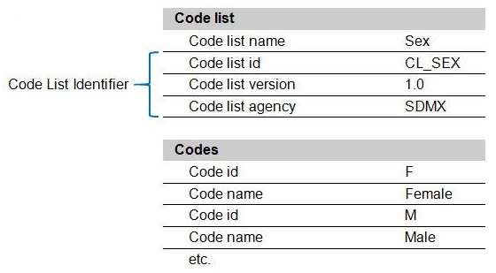

SDMX GUIDELINES

GUIDELINES FOR  
THE CREATION AND MANAGEMENT  
OF SDMX CODE LISTS

VERSION 4.0

12/2/2025

© SDMX 2025  
http://www.sdmx.org/

# CONTENTS

# Contents

[DOCUMENT HISTORY](#document-history)

[INTRODUCTION](#introduction)

[BASIC PRINCIPLES FOR THE CREATION OF SDMX CODE LISTS](#basic-principles-for-the-creation-of-sdmx-code-lists)

[BASIC CHARACTERISTICS OF SDMX CODE LISTS](#basic-characteristics-of-sdmx-code-lists)

[BASIC CRITERIA FOR THE DEVELOPMENT OF SDMX CODE LISTS](#basic-criteria-for-the-development-of-sdmx-code-lists)

[MAINTENANCE OF SDMX CODE LISTS](#maintenance-of-sdmx-code-lists)

[NEW FEATURES FROM VERSION 3.0 OF SDMX](#new-features-from-version-30-of-sdmx)

[OTHER PRACTICAL ISSUES AND RECOMMENDATIONS](#other-practical-issues-and-recommendations)

# DOCUMENT HISTORY

<table>
<colgroup>
<col style="width: 11%" />
<col style="width: 15%" />
<col style="width: 73%" />
</colgroup>
<thead>
<tr>
<th style="text-align: center;"><strong>Version</strong></th>
<th style="text-align: center;"><strong>Date</strong></th>
<th style="text-align: center;"><strong>Comment</strong></th>
</tr>
</thead>
<tbody>
<tr>
<td style="text-align: center;">1.0</td>
<td>02/12/2013</td>
<td style="text-align: left;">Initial version for cross-domain code lists.</td>
</tr>
<tr>
<td style="text-align: center;">2.0</td>
<td>15/01/2015</td>
<td style="text-align: left;">Adapted to be a guideline for all code lists, not only cross-domain</td>
</tr>
<tr>
<td style="text-align: center;">3.0</td>
<td>19/01/2018</td>
<td style="text-align: left;">Clarified text on definitions. Revised allowed characters such as leading zeroes in codes (now allowed). Removed superfluous text. Improved examples.</td>
</tr>
<tr>
<td style="text-align: center;">4.0</td>
<td>12/2/2025</td>
<td style="text-align: left;">
Added sections on:

New features from version 3.0 of SDMX

Other practical issues and recommendations

General improvements to the text
</td>
</tr>
</tbody>
</table>

# INTRODUCTION

These guidelines are intended to support the creation of SDMX code lists to be used all along the statistical business process and in particular when SDMX is implemented in statistical domains. They are strongly recommended for use when SDMX-compliant data structure definitions (DSDs) are built-up and implemented in statistical domains.

In the [SDMX Checklist for Design Projects](https://statswiki.unece.org/display/SDMXPM/Checklist+for+SDMX+Data+Providers) and the [modelling guidelines](https://sdmx.org/?page_id=4345#Modelling), the creation of code lists is done in the sub-process “Fully define code lists”.

Originally this document was named "*Guidelines for the Creation and Management of SDMX Cross-Domain Code Lists*". Later, experience showed that these guidelines were also used for the development of other types of SDMX code lists (shared code lists, domain-specific code lists). It was therefore decided to review the document in order to convert it into a guideline applicable to all types of SDMX code lists.

Code lists are created to group related codes<a href="#fn-1" id="fnref-1">1</a> in a meaningful, systematic and standard format. They provide lists of codes that objects corresponding to a specific concept can be classified into. Each code should be well described.

Code lists are primarily used to:

• collect, disseminate, exchange and organise information;

• aggregate and disaggregate datasets in a meaningful way for complex analysis;

• present statistical information in a standard way;

• support policy and decision-making;

• standardise the measurement process.

SDMX cross-domain code lists can be found at two distinct places:

1.  [SDMX official website](https://sdmx.org/?page_id=3215) (files available in MS-Word format)

2.  [SDMX Global Registry](https://registry.sdmx.org/items/codelist.html) (files available in SDMX-ML format)

Other SDMX code lists can be found in regional and other registries.

# BASIC PRINCIPLES FOR THE CREATION OF SDMX CODE LISTS

1.1 SDMX code lists should refer to clear and well-defined statistical concepts, enabling data users to understand the statistical concepts and finally the data sets. Already existing standards (e.g. international classifications) should be considered.

1.2 Consistency of the SDMX code lists across statistical domains and over time should be ensured.

1.3 Key terms

Below are the key terms used in this document to describe SDMX code lists.

- A **code list** is a predefined list from which some statistical coded concepts take their values.

  ◦ A **code list identifier** is a unique identifier given to the code list. The code list identifier consists of three mandatory elements: an **id**, a **version number** and a **reference to a maintenance agency**.

  ◦ An **id** is a language-independent set of letters, numbers and/or symbols. To give SDMX code lists a clear visual identity, the code list id should be prefixed with CL\_.

  ◦ A code list **name** describes the content of the artefact to which the name is attached in a synthetic and clear way. In principle, the default language for names is English (however exceptions are possible, e.g. when geographic entities are expressed in the national languages). Multilingual representations are possible.

  ◦ A code list **description** allows to describe the content of the artefact to which it is attached in a more detailed fashion than the artefact name. Multilingual representations are possible. In the specific case of code lists, the description is generally used to precisely define the coverage of a code, identifying what is included and what is excluded (e.g. wooden shoes are not considered as shoes but as handicraft).

A code list may also contain annotations, a uri, a description, attributes indicating the period of validity (e.g. "*valid to*" and "*valid from*") and an attribute indicating whether the code list is final.

- A **code** (basic element of the code list) is also represented by a mandatory **id** and a mandatory **name,** and an optional **description** (see the descriptions of the code list elements). The code may also contain annotations, and a uri<a href="#fn-2" id="fnref-2">2</a>.

While code names and descriptions are meant for interpretation by humans, **ids** are primarily designed to be read by machines. Nevertheless, it can often be helpful for data users that they are meaningful in accordance with the default language used for the name. When choosing the best approach implementers should also consider the possible impact on the code identifiers length.

<u>Example</u>

<!-- figure: f01-code-list-example -->

# BASIC CHARACTERISTICS OF SDMX CODE LISTS

Conceptually SDMX code lists can have the following characteristics:

- A code list (e.g. geographical entity) can be referenced by several statistical concepts (i.e. declaring country, country of birth, partner country, etc.).

<!-- -->

- The codes used should cover exhaustively the part of reality that is intended to be described by the code list.

- The codes have to be clearly defined. Codes with different coverage must have different code identifiers and names (e.g. Europe including Greenland must have a different identifier and name than Europe excluding it). Different codes should not have the same meaning or coverage.

- The coverage of the codes may however overlap partially within one code list (but may not be identical, except when code lists are based on established standard classifications where such repetitions are common (see *Unpredictable and extendable breakdowns (CUSTOM_BREAKDOWN)* at [OTHER PRACTICAL ISSUES AND RECOMMENDATIONS](#other-practical-issues-and-recommendations) section ). This means that the content of the categories is not necessarily mutually exclusive as is the established rule in statistical classifications.

- Codes may be at different levels of granularity.

- Multiple hierarchies (hierarchical code lists<a href="#fn-3" id="fnref-3">3</a>) can be defined on top of a flat code list. An SDMX code list should be flexible in terms of allowing different possible hierarchies and be extendible by additional codes that may disaggregate or aggregate codes that are already in the list as well as by codes that extend the coverage of the code list. Each possible hierarchy may use all codes from the flat code list or just a subset. A flat code list provides the reservoir of codes for the hierarchies. A forthcoming (at the time of writing) guideline on SDMX Hierarchies will be available to describe the recommended approach for creating and maintaining code list hierarchies.

- New codes or levels need to be accommodated if needed (i.e. if a new country is recognised as a sovereign state the geographical entity code list should have a new version including it).

- Re-use of code identifiers between versions of the same code list should be avoided. In ISO-2 country code CS - Czechoslovakia was suppressed in 1993 and reused as CS - Serbia and Montenegro in 2003. This change was/is extremely difficult to handle, as many data systems will contain historical data for Czechoslovakia.

# BASIC CRITERIA FOR THE DEVELOPMENT OF SDMX CODE LISTS

The following basic criteria should be respected when defining SDMX code lists:

- It is highly recommended that code lists be consistent, to the largest extent possible, with internationally agreed standards, whenever they exist, e.g. International Organization for Standardization (ISO), United Nations and other international organisations code lists. It is of no use creating a new code list where one already exists. The following order of priority is suggested when considering the use of existing code lists:

  ◦ international standard classifications or code lists;

  ◦ international classifications or code lists supplemented by other international and/or regional institutions;

  ◦ standardised classifications or code lists used by individual international institutions.

<!-- -->

- If official classifications are used for defining the SDMX code lists, totals, aggregates and other additional codes should be added following the recommendations of the issuing organisation for adding new elements (e.g. the addition of the world regions EU27, EFTA, etc to the ISO 3166 alpha 2 country list);

- When designing code lists, the needs of all phases of the statistical business process and of all statistical domains using the respective SDMX code lists should be considered. However, due to legacy systems, it may not always be possible to accommodate all needs from the start (e.g. different habits in data exchange and in dissemination). In such cases, some transition period will often be necessary before reaching convergence.

Technically, SDMX code lists should respect the principles described in the following paragraphs.

- SDMX code ids take values from uppercase A to Z, 0 to 9 and "\_" only<a href="#fn-4" id="fnref-4">4</a>. No other characters should be used.

- Even though technically allowed in the standard, it is highly recommended not to use lower case characters to avoid possible confusion and technical issues with upper case characters. Exceptions should only be made for code lists based on classifications managed by external bodies (such as ISO). In case an external classification is using lower case characters, they may also be used in the respective SDMX code lists to make their usage more intuitive for regular users of the classification. However, it is still not allowed to create two code list items that only differ by the case of the characters (e.g., "EN" and "en"). If for whatever reason an organisation opts for lower case characters, all coded information should then be in lower case characters.

- Accented characters for a code are not allowed by the standard.

<!-- -->

- Underscore ("\_") is generally used for the combination of codes (whether consecutive or not).

- A list of generic codes to be used for all SDMX code lists has been developed. This generic list includes concepts which can be expected to appear in many, if not, all code lists, e.g. "total", "non-response", "not allocated", "unknown", other, etc.

Code names should be between 1 and 254 characters. The characters used should belong to the UTF-8 character set.

- Code names are in general defined in English; other language versions may be added. Certain exceptions can be considered in the case of codes which are normally not translated (e.g. regions or territories for which the national designation could be used, agencies for which a national and English label could be used, etc.).

Descriptions could be used if more details on the contents or on the code descriptions are needed. Multilingual representations are possible.

## Meaningful code identifiers vs meaningless code identifiers

Code identifiers can be either meaningful, i.e. the identifier is a shortened representation or expression of the code name (e.g. "DE_FIN" for "German Ministry of Finance"), or meaningless, i.e. the code identifier is chosen at random and conveys no information whatsoever as to the content of the code name (e.g. "6E" standing for "European Space Agency").

In SDMX, both coding systems are acceptable, although it is recommended to use meaningful codes if possible. It is up to implementers to decide which coding system they want to use<strong>,</strong> considering that there could be a trade-off between meaningfulness of identifiers and their length which impacts the maintainability of identifiers/key series codes, size and costs of data files and databases<strong>.</strong> The choice of the coding system may be influenced by parameters like the number of identifiers to code, the complexity of the concepts to code, etc.

In cases where self-explanatory (meaningful) identifiers are chosen, implementers should pay attention not to use excessively long codes.

Meaningful codes can be self-explanatory in one language only; by default, this language is English.

### Expressing numeric ranges in code identifiers

SDMX implementers may wish to express numeric ranges in code identifiers. This is allowed but in no way imposed.

As an example, let’s take a code list dealing with age classes. The basic units used for representing age are "Y" (Year), "M" (Month), "W" (Week) and "D" (Day). To express concepts like "from 15 years to 20 years excluding 16 years", "over 30 years", "less than 50 years", "two and three months", "four days or over", "three years or less", the following set of standard "operators" is proposed:

- **"T"** for expressing ranges (from 3 to 9),

- **"\_"** for the combination of two codes, whether consecutive or not (5 and 6; A and F),

- **"X"** for expressing "except" or "excluding",

- **"GT"** for "greater than", **"LT"** for "less than", **"GE"** for "equal to or greater than" and **"LE"** for "equal to or less than".

The result for the examples mentioned in the previous paragraph is as follows:

- from 15 years to 20 years excluding 16 years: Y15T20X16

- over 30 years: Y_GT30 (in this case the "\_" is used to make a clear distinction between the unit and the "operator" "GT").

- less than 50 years: Y_LT50

- two and three months: M2_3

- four days or over: D_GE4

- three years or less: Y_LE3

Such a coding system has limits in what it can do. It will most probably not be appropriate for coding ranges with decimals (ending up in too long code identifiers) or too complex concepts. Again, it will be up to implementers to decide whether this coding system can meet their specific needs.

### Generic codes

These codes are recommended to be used when compiling code lists that require the items in the table below, e.g. when a "Not applicable" item is required. The codes provide code values for concepts referenced in a large number of code lists.

The codes proposed here are present in a very large number of SDMX code lists because they cover very general and extensively used concepts. Thus, the main purpose of this list of codes is to propose standardised code identifiers which can be extensively reused.

The leading underscore is used to avoid clashes with other codes and to singularise these concepts.

These codes should be considered as "reserved codes" or "protected codes", meaning that it is strongly recommended not to use them for other purposes than the ones described below.

The codes can also be used as suffixes or be augmented with sequential numbers, especially if a category needs to be used multiple times. For example, multiple sub-totals (e.g. CATTLE_S1, CATTLE_S2, PLANTS_S1) or multiple residual categories (e.g. CATTLE_O, PLANTS_O) may be required.

In cases where the use of the suffixes below could lead to confusions and misunderstandings, implementers may of course implement other solutions. Let us take the example of a code list where letters are used as codes (e.g. the United Nations ISIC classification): in this case, code element M_O could be interpreted either as "sections M and O" or as "section M not elsewhere classified". In this case implementers could create codes M_OTH or M_OTHER to differentiate the suffixes.

<table>
<colgroup>
<col style="width: 22%" />
<col style="width: 30%" />
<col style="width: 47%" />
</colgroup>
<thead>
<tr>
<th style="text-align: center;"><strong>Recommended Code Value</strong></th>
<th style="text-align: center;"><strong>Recommended Code Description</strong></th>
<th style="text-align: center;"><strong>Annotation</strong></th>
</tr>
</thead>
<tbody>
<tr>
<td style="text-align: center;"><strong>_L</strong></td>
<td style="text-align: center;">Local extension</td>
<td>
To be used to uniquely identify local (e.g. national, regional, sub-regional) extensions of SDMX code lists and by doing so:

<ul>
<li>
avoid conflict of local extensions with existing codes, and
</li>
<li>
avoid conflict between revisions of the underlying code lists and the local extensions in terms of coding.
</li>
</ul></td>
</tr>
<tr>
<td style="text-align: center;"><strong>_N</strong></td>
<td style="text-align: center;">Non response</td>
<td>
Failure to obtain a measurement on one or more study variables for one or more elements in a survey.
</td>
</tr>
<tr>
<td style="text-align: center;"><strong>_O</strong></td>
<td style="text-align: center;">Other</td>
<td>
Used to cover residual information not contained in other categories of the code list (in some contexts, e.g. classifications, referred to as n.e.s., not elsewhere specified, n.e.c., not elsewhere classified, etc.)
</td>
</tr>
<tr>
<td style="text-align: center;"><strong>_S</strong></td>
<td style="text-align: center;">Subtotal</td>
<td>
Used for expressing intermediate totals
</td>
</tr>
<tr>
<td style="text-align: center;"><strong>_T</strong></td>
<td style="text-align: center;">Total</td>
<td>
Used for expressing totals
</td>
</tr>
<tr>
<td style="text-align: center;"><strong>_U</strong></td>
<td style="text-align: center;">No data/unknown</td>
<td>
Failure to obtain a measurement (e.g. non response, no data available, information not known by the respondent unit, etc.)
</td>
</tr>
<tr>
<td style="text-align: center;"><strong>_X</strong></td>
<td style="text-align: center;">Not allocated/unspecified</td>
<td>
Used where the value for a particular variable falls outside the expected range. An example could be the failure to allocate a classification to a particular unit due to insufficient information, and/or if further breakdown over any related items mentioned in code list not available
</td>
</tr>
<tr>
<td style="text-align: center;"><strong>_Z</strong></td>
<td style="text-align: center;">Not applicable</td>
<td>
Used in cases where the coding of a concept is technically required (dimension or mandatory attribute), but does not have a statistical meaning for a specific series or observation.

Examples of relevant usages of _Z are:

<ul>
<li>
In a survey that has questions on “Marital Status” and “Sex of Partner”, for a response of Marital Status: Single, the relevant response for Sex of Partner is “Not applicable” (_Z)
</li>
<li>
In a labour statistics reporting framework that has a dimension “Outside Labour Force Reason”. If the observation entity is inside of the labour force, the response for Outside Labour Force Reason is “Not applicable” (_Z)
</li>
<li>
In macro-economic statistics, a DSD may contain a dimension for breakdowns of economic activity. Some series cannot be broken down by economic activity (e.g. statistical discrepancy between GDP approaches, certain taxes and subsidies, producer price index). They could be coded as “Not applicable” (_Z) for the activity dimension in the data message.
</li>
</ul>

The code _Z should be used sparsely<a href="#fn-5" id="fnref-5">5</a>, since it may complicate validation and transformation formulas or pivot visualisations based on SDMX messages. The code _T (Total) should be used instead in cases where the applicability of the concept is not entirely clear, and where the concept may be relevant only under certain circumstances, or where the applicability of a concept for a certain series or dataflow depends on the context (e.g. a tax breakdown that exists in one country but not in another) in order to simplify the coding across data flows and countries.
</td>
</tr>
</tbody>
</table>

# MAINTENANCE OF SDMX CODE LISTS

## Maintenance agency

Within SDMX, each code list requires a maintenance agency. For SDMX cross-domain code lists, the maintenance agency (marked as "SDMX") is the SDMX Statistical Working Group (SWG). For other code lists used in international data exchange this is - in general - one or several international organisation(s) linked to SDMX. Clear rules for the maintenance of the SDMX code lists need to be established. There is a guideline<a href="#fn-6" id="fnref-6">6</a> “A reference framework for SDMX structural metadata governance” that provides a best practice in establishing structural metadata governance.

Changes to a given code list will lead to a new version of the code list. SDMX code lists are stored in the SDMX Global Registry<a href="#fn-7" id="fnref-7">7</a> for making them accessible to SDMX implementers. Other code lists are stored in regional or other *ad hoc* registries.

## Versioning of code lists

A general document providing guidelines on the versioning of SDMX artefacts can be found on the SDMX official website<a href="#fn-8" id="fnref-8">8</a>.

In general, versioning is based on the impact severity for clients resulting from any change. If a code is removed from a codelist or a code’s usage context is changed (Cat -\> Dog), then backward compatibility is broken and it is a major change. If a code is added then there is no impact to backward compatibility and it is a minor change. If a code label is changed but the context remains the same (e.g. a typo fix), it is a patch change.

A recommended way to mark codes as removed without triggering a major version change is to prefix the code label with “\[Deprecated\] …”. E.g., “Cat” -\> “\[Deprecated\] Cat”. At the next major version of the codelist, these deprecated codes should be entirely removed to avoid an increasing maintenance burden.

## No retroactivity in case of implementation of new code lists

The adoption of a new code list has no retroactive effect on existing code lists. Therefore, the implementation of a new code list will not require that SDMX implementers revise existing code lists.

# NEW FEATURES FROM VERSION 3.0 OF SDMX

## Code list extensions

The aim of international statistical classifications is to provide a common framework for collecting and organising information about a particular statistical activity domain, concept or variable. Their use, either directly or through national adaptations, facilitates the exchange and comparability of data between countries. These reference data standards have generally been developed through extensive international consultation and have achieved broad acceptance and official agreement for use.

International Organizations and member countries should be able to report using international categories at least at the higher levels of a statistical classification and also having the ability to extend the classifications with additional categories representing the national context.

Where possible, a country should adopt, extend or adapt to these international standards.

a\) **Adopt** - If an international organization or country chooses to adopt an international code list then it accepts the international standard as published with no changes to the structure. This also means that the country will accept future changes to the standard as they are published.

b\) **Extend** – if an international organization or country chooses to extend an international code list then it will reference the existing international code list and add the additional codes to represent the international, regional, national or sub-national context. In most cases the extension would include minor version changes by using the reference *n*.0+.0

E.g. Extending the official ISO Country code list with Sark & Kosovo

<u>ISO Country Code List (CL_ISO3166_2)</u>

AF Afghanistan

AL Albania

AQ Antarctica

…

YE Yemen

YU Serbia and Montenegro \[former\]

ZM Zambia

<u>CA1:CL_AREA(1.0)</u>

\*inherit CL_ISO3166_2

CQ Sark

XK Kosovo

c\) **Adapt** - If a country/organization adapts an international code list, then the country will develop a derived or related standard. Under this scenario, the country will define its own code for the code list and create a crosswalk that maps the countries’ code to the international standard code list.

For the Extend and Adapt scenarios, the agency needs to take ownership of the extended/adapted artefact by assigning an appropriate maintenance agency to it, replacing the original one. The original Id (e.g. CL_ACTIVITY) should be used, however if specific domain variants are required it is recommended to suffix the Id with the domain. E.g. CL_ACTIVITY_SEEA. Note that caution should be used when creating domain variants, as having separate codelists may make interoperability and harmonisation more difficult.

## Discriminated Union of Code Lists

Combining code list extension with wildcarded constraints solves the discriminated union of code lists problem where a classification or breakdown has multiple “variants” which are all valid but mutually exclusive. A common example is the official reference area code list which combines both ISO 3166 categories to the UN M49 categories. See [chapter 6.1 of the SDMX 3.0 technical notes](https://sdmx.org/wp-content/uploads/SDMX_3-0-0_SECTION_6_FINAL-1_0.pdf) for a full description of how SDMX 3.0 can handle conflicts arising from unions.

E.g. Combining the ISO 3166-2 country code list with the UN-M49 country code list to create the official CL_AREA country code list.

**CL_ISO3166_2**

AF Afghanistan

AL Albania

AQ Antarctica

…

YE Yemen

YU Serbia and Montenegro \[former\]

ZM Zambia

**CL_UN_M49**

000 Total

001 World

002 Africa

003 North America

004 Afghanistan

…

894 Zambia

896 Areas not elsewhere specified

898 Areas not specified

899 Areas not elsewhere specified and unknown

**CL_AREA**

\* Inherit CL_ISO3166_2

\* Inherit CL_UN_M49

## Additional Code List features

a\) **Prefix** – A prefix to be used for a code list in an extension to avoid code/category conflicts. This feature is useful in developing a discriminated union of code lists. An example to demonstrate the usefulness of this feature is with the ESTAT:CL_PRODUCT(1.3.0) which combines product categories from 2 different classifications; CPA (Statistical classification of products by activity), CPC (Central Product Classification).

**ESTAT:CL_PRODUCT(1.3.0)**

\* inherit ESTAT:CL_CPA(1.0+.0) (code prefix CPA\_)

\* inherit UNSD:CL_CPC(1.0+.0) (code prefix CPC\_)

b\) **Sequence** – The order that will be used when extending a code list for resolving code conflicts. The last code list from the sequence will override the previous code lists. An example to demonstrate the usefulness of this feature is by combining different versions of the ISIC classification.

**SDMX:CL_ACTIVITY_ISIC(1.0.0)**

\* inherit SDMX:CL_ACTIVITY_ISIC_2(1.0+.0) (sequence = 1)

\* inherit SDMX:CL_ACTIVITY_ISIC_3_1(1.0+.0) (sequence = 2)

\* inherit SDMX:CL_ACTIVITY_ISIC_4(1.0+.0) (sequence = 3)

c\) **InclusiveCodeSelection / ExclusiveCodeSelection** - The subset of codes to be included/excluded when extending a code list.

a\. **<u>selectionValue</u>** - A collection of values based on codes and their children. An example to demonstrate the usefulness of this feature is when creating a code list with only the Manufacturing categories from ISIC.

**SDMX:CL_MANUF(1.0.0)**

\* inherit SDMX:CL_ACTIVITY_ISIC_4(1.0+.0)

InclusiveCodeSelection

selectionValue: C, C10, C104, …, C3290

b\. **<u>cascadeValues</u>** - A property to indicate if the child codes of the selected code shall be included in the selection. It is also possible to include children and exclude the code by using the 'excluderoot' value. An example to demonstrate the usefulness of this feature is when creating a code list with only the Manufacturing categories from ISIC.

**SDMX:CL_MANUF(1.0.0)**

\* inherit SDMX: CL_ACTIVITY_ISIC_4(1.0+.0)

InclusiveCodeSelection

Value: C, cascadeValues: True

c\. **<u>Value</u>** - The value of the code to include in the selection. It may include the ‘%’ character as a wildcard. An example to demonstrate the usefulness of this feature is when creating a code list with only the Manufacturing categories from ISIC.

**SDMX:CL_MANUF(1.0.0)**

\* inherit SDMX:CL_ACTIVITY_ISIC_4(1.0+.0)

InclusiveCodeSelection

Value: C%

# OTHER PRACTICAL ISSUES AND RECOMMENDATIONS

## Breakdowns with multiple variants

Some SDMX concepts (e.g. Economic activity) may have global, regional and/or national classifications and variants (different versions of the same classification). This means that a DSD may need to reference multiple different representations of the concept of activity, namely a global one, a regional one and a national one.

There are options for dealing with this issue:

- <u>The preferred approach</u> is to create distinct DSDs which each have one "Economic activity" concept but with a different code list attached for the required variant. Validation and reporting is simple, and is especially useful when reporters may only send data for one variant. Alternatively;

- Create a single code list containing the required variants of the classification using prefixes to distinguish between the variants, e.g. in the ISIC classification version 3 for Transportation and storage is ISIC4_H. In NACE revision 2 the same item is NACE2_H.<a href="#fn-9" id="fnref-9">9</a> This approach may be valid when reporters have to send data messages with more than one variant (however, if they can send more than one data message the preferred approach above should be used).

## Multiple breakdowns in a single concept (COMPOSITE_BREAKDOWN)

A way to represent multiple breakdowns in a DSD is to use a COMPOSITE_BREAKDOWN concept. A use case is to reduce the number of dimensions in DSDs by using a single concept to represent breakdowns that do not have to be used together in each series. The mechanism uses a COMPOSITE_BREAKDOWN concept, and a CL_COMP_BREAKDOWN code list.

The code list enumerates several breakdowns. Codes in the CL_COMP_BREAKDOWN code list are prefixed with an abbreviation of the corresponding breakdown (as in the section **Discriminated Union of Code Lists**), and code names provide the name of the breakdown followed by name of the code, e.g.

| Code     | Name                                                     |
|----------|----------------------------------------------------------|
| MOT_IWW  | Mode of Transport: Inland waterway transport             |
| MOT_SEA  | Mode of Transport: Maritime                              |
| \_IHR_01 | IHR Capacity: National legislation, policy and financing |

Note: the COMPOSITE BREAKDOWN mechanism has the limitation that only one composite breakdown can be used for a series. Therefore, all series should be verified so that each series will not require more than one breakdown. If a series requires more than one breakdown described in COMPOSITE BREAKDOWN, then another breakdown dimension would need to be added to the DSD.

## **Unpredictable and extendable breakdowns (CUSTOM_BREAKDOWN)**

The custom breakdown (CUST_BREAKDOWN) dimension serves the purpose of supporting volatile breakdowns, i.e. those whose code lists change often, lack international or even national classifications, or it can be used where a reporting framework is designed to be extendable by the reporter, e.g. new tax codes.

The CUST_BREAKDOWN dimension can be used in combination with the custom breakdown label attribute. Its generic code list (C01, C02, C03, …, C99) CL_CUST_BREAKDOWN is used to transmit the codes, while attribute CUST_BREAKDOWN_LB is used to transmit descriptions of the codes directly in the dataset. CUST_BREAKDOWN_LB should start with a description of breakdown followed by an entry description. For example, for a disaggregation by the source of light, the values of the CUST_BREAKDOWN dimension and CUST_BREAKDOWN_LB attribute in the dataset would look as follows:

| CUST_BREAKDOWN code | CUST_BREAKDOWN_LB                                |
|---------------------|--------------------------------------------------|
| C01                 | Source of light: Solar                           |
| C02                 | Source of light: Publicly-provided electricity   |
| C03                 | Source of light: Privately-generated electricity |
| C04                 | Source of light: Other C05 Source of light: None |
| C05                 | Source of light: Kerosene lamp                   |
| C06                 | Source of light: Candle                          |
| C07                 | Source of light: Battery                         |

Implementation of a breakdown through the CUST_BREAKDOWN dimension has no impact on the DSD, i.e. it does not result in any change to the DSD. The CL_CUST_BREAKDOWN code list is generic and stays intact, while the CUST_BREAKDOWN_LB attribute is set at the time the data is converted to SDMX.

Note that an uncoded dimension could be used instead of CL_CUST_BREAKDOWN; the trade-off is that there could be unlimited custom items, but the item id cannot be validated or controlled.

Please use this mechanism with care, as time series using a custom breakdown may not be consistent. The custom codes (C01, C02, C03, …, C99) might mean something different in one year than in the next year or between different reference areas in the same year. The usage should be clearly described in the respective data exchange agreement. As much as possible, the coding should be applied in such a way that time series integrity is maintained.

While the use of CUSTOM_BREAKDOWN may seem to reduce the maintenance burden and make it possible to use the DSD as support of national dissemination, it has these issues:

- It increases the complexity of the DSD, it is harder for users to understand this mechanism compared to DSDs with fixed concepts and codelists;

- If a CL_CUST_BREAKDOWN codelist is used (instead of an uncoded dimension), there should be as many codes created as reasonable needed, which may be a long list;

- It is difficult to fully validate the series, therefore use of CUSTOM BREAKDOWN places extra burden on the collector and may reduce data quality.

<!-- footnotes -->

------------------------------------------------------------------------

1 In the traditional classification sphere, the words "category" or "position" are generally preferred to the word "code"; however, the use of the term "category" could be confusing as it is already used in the SDMX information model within another context.

2 Uri: Uniform Resource Identifier

3 The "Hierarchical code list" construct used in SDMX should not be mixed up with the concept used in traditional statistical classifications. In the latter case, the codes are organised based on one strictly defined hierarchy only. In the former case, several hierarchies can be defined. An example of this is a list of codes that support the theme of geographical location. Such a hierarchical code list could be viewed according to many different hierarchies. A political hierarchy would comprise an administrative regional breakdown within a country, a geographical breakdown would comprise a placing of the countries in continents, and an economic breakdown might place the countries in one or more economic communities (e.g. many of the countries in "Europe" could be both a part of the European Union and the OECD communities).

4 It should be noted that the list of allowed characters has been restricted compared to the general provisions of the SDMX technical standards. The SDMX schema defines that valid characters for Code are \[A-z 0-9 \_@\$\\-\]. For code lists, it was felt that allowing some of these characters might generate confusion (e.g. mixing lowercase and uppercase might give the feeling that each of them has a distinct meaning) or potential problems (e.g. in validation procedures where the dash ("-") could be considered as an operator for subtraction).

5 At DSD design time the pros and cons of using \_Z should be considered carefully. The occurrences of \_Z can be reduced by:

using the semantically approximate \_T instead of \_Z;

having a larger number of compact DSDs to avoid the need to introduce \_Z;

concepts with \_Z could be defined as attributes rather than dimensions;

a dimension containing \_Z could be merged with another (conceptually related) dimension as a sub-hierarchy.

6 <https://sdmx.org/wp-content/uploads/SDMX-Structural-Metadata-Governance.docx>

7 <https://registry.sdmx.org/items/codelist.html>

8 <https://sdmx.org>/

9 Ideally, there should be a mapping created between the prefixed variant codes and the original classification codes, and made available in a SDMX public registry. This would avoid redoing the same mapping work by different institutions.
