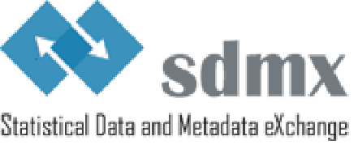

SDMX GUIDELINES

SDMX GLOSSARY

VERSION 2.1

**December 2020**

© SDMX 2020

[https://sdmx.org/](http://sdmx.org/)

<!-- figure: f01-logo -->

**SDMX GLOSSARY**<a href="#fn-1" id="fnref-1">1</a>

**VERSION 2.1 - DECEMBER 2020**

**DOCUMENT HISTORY**

| Version 1.0 | Finalised in February 2016 |
|:------------|:---------------------------|
| Version 2.0 | Finalised in October 2018  |
| Version 2.1 | Finalised in December 2020 |

**INTRODUCTION**

The SDMX Glossary is an SDMX guideline containing concepts and related definitions that are useful for building and understanding data and metadata exchange arrangements based on SDMX. The Glossary provides definition of terms found in the SDMX Information Model, Data Structure Definitions<a href="#fn-2" id="fnref-2">2</a> (DSDs), and Metadata Structure Definitions (MSDs) at the time of the present release. It is recommended as a single entry point to a common SDMX terminology to be used in order to facilitate communication and understanding of the standard.

In short, the overall message of the glossary is the following: if a term is used, then its precise meaning should correspond to the SDMX Glossary definition, and any reference to a particular phenomenon described in the SDMX Glossary should use the appropriate term.

The glossary is not intended to cover the whole range of statistical terminology, as this area is already covered by other general or domain-specific glossaries. The focus of the glossary is largely those terms that are normally used for building and understanding metadata systems and SDMX data exchange arrangements.

**BUSINESS CASE FOR THE ADOPTION OF CROSS-DOMAIN CONCEPTS (CDCS)**

In the SDMX framework "Cross-domain concepts" are Concepts relevant to several, if not all, statistical domains. SDMX recommends the use of these concepts, whenever feasible, in SDMX data and metadata structures and messages in order to promote re-usability and exchange of statistical information and their related metadata between organisations. Whenever used, these Concepts should conform to the specified names, ID, Representations and Codelists defined in the SDMX Content-Oriented Guidelines.

Cross-Domain Concepts (CDCs) are useful for exchanging data and metadata between multiple agencies and statistical subject-matter domains.

The CDCs, if adhered to by international organisations and national institutions, promote the:

- efficient and automated exchange of data and related structural and reference metadata by interlinking statistical information systems of organisations, in spite of technological or linguistic differences that might exist between them from their internal perspectives;

- exchange of consistent metadata that can be used by different international organisations and national and regional data-producing agencies to compare concepts and practices;

- re-usability of exchange messages from an institution to other institutions, thereby reducing the overall data and metadata reporting burden.

**CONTACT ADDRESS**

For any question, comment or correction feel free to contact the SDMX Statistical Working Group (SWG) at <swg@sdmx.org>.

**ATTRIBUTES USED FOR DESCRIBING CONCEPTS LISTED IN THE GLOSSARY**

**\* Denotes mandatory fields**

**Term\*** Name of the Concept. The term should preferably be entered in the singular form and upper cases should be avoided to the largest extent possible (except for Concepts which are part of the SDMX Information Model).

**Definition\*** Short statement explaining the meaning of the Concept. This textual description of the Concept should answer the question "What is it?" rather than "How is it done?" or "Why do we have it? etc. It is recommended to keep definitions short and add any explanatory text under field "Context".

**Context** Complementary information on the background, history, use, status, etc. of the Concept. This field is used to add information on how and where the term may be used. It describes SDMX use cases for the term and may contain examples of its use. This field is optional, though strongly recommended.

**Type** Used to explicitly denote Concepts which are cross-domain.

**Concept ID\*** Unique identifier for the Concept that allows it to be unambiguously used for machine-to-machine exchange.

**Recommended representation** Recommended type of value for the Concept term. Examples are "primitive" types such as string (i.e. free text), AlphaNumeric or complex types such as Codelist, that is used for those terms that have an associated Codelist in Codelist ID. There may be more than one recommended type; in this case, the first type is recommended over the others. For time types, it is possible to use a more precise representation of time than the recommended type (e.g. Reporting Time Period instead of Observational Time Period).

**Codelist ID** Unique identifier for the Codelist associated with the Concept. Most often it is the term's Concept ID prefixed by "CL\_". For example, the "Observation Status" term has the Concept ID of OBS_STATUS, and the Codelist ID of CL_OBS_STATUS. This attribute is used only if the Concept's "Recommended representation" includes "Codelist".

**Related terms** Entries in the SDMX Glossary that are closely associated with the Concept term. It is possible here to create relationships between Concepts, e.g. between "Reference metadata" and "Structural metadata". No hierarchy is created between the concepts linked, i.e. if a link is established between "Reference metadata" and "Metadata", a similar link will be established between "Metadata" and "Reference metadata".

**Source** Source information from which the definition was extracted. The reference must be as complete as possible. When available, the source is followed by a hyperlink, i.e. a link to the source material for the term.

**Other link(s)** Link<strong>(</strong>s<strong>)</strong> to material that is related<strong>,</strong> closely or loosely, to, but not directly associated with the Concept source of the term, e.g. link to a general methodological document.

# TABLE OF CONTENTS

[Accounting conventions](#accounting-conventions)

[Accuracy](#accuracy)

[Accuracy - overall](#accuracy---overall)

[Action type](#action-type)

[Adjustment](#adjustment)

[Age](#age)

[Agency Scheme](#agency-scheme)

[Annotable Artefact](#annotable-artefact)

[Annotation](#annotation)

[Artefact](#artefact)

[Attachment level](#attachment-level)

[Attribute](#attribute)

[Attribute Relationship](#attribute-relationship)

[Base period](#base-period)

[Base weight](#base-weight)

[Bilateral exchange](#bilateral-exchange)

[Break reason](#break-reason)

[Categorisation](#categorisation)

[Category](#category)

[Category Scheme](#category-scheme)

[Civil status](#civil-status)

[Classification: See "Statistical classification"](#classification-see-statistical-classification)

[Classification system](#classification-system)

[Code](#code)

[Codelist](#codelist)

[Coding Format](#coding-format)

[Coherence](#coherence)

[Coherence - cross domain](#coherence---cross-domain)

[Coherence - internal](#coherence---internal)

[Comment](#comment)

[Comparability](#comparability)

[Comparability - geographical](#comparability---geographical)

[Comparability - over time](#comparability---over-time)

[Compiling agency](#compiling-agency)

[Component](#component)

[Concept](#concept)

[Concept Scheme](#concept-scheme)

[Confidentiality](#confidentiality)

[Confidentiality - data treatment](#confidentiality---data-treatment)

[Confidentiality - policy](#confidentiality---policy)

[Confidentiality - redistribution authorisation policy](#confidentiality---redistribution-authorisation-policy)

[Confidentiality - status](#confidentiality---status)

[Constraint](#constraint)

[Contact](#contact)

[Contact email address](#contact-email-address)

[Contact fax number](#contact-fax-number)

[Contact mail address](#contact-mail-address)

[Contact name](#contact-name)

[Contact organisation](#contact-organisation)

[Contact organisation unit](#contact-organisation-unit)

[Contact person function](#contact-person-function)

[Contact phone number](#contact-phone-number)

[Content-Oriented Guidelines, COG](#content-oriented-guidelines-cog)

[Cost and burden](#cost-and-burden)

[Cost and burden - efficiency management](#cost-and-burden---efficiency-management)

[Cost and burden - resources](#cost-and-burden---resources)

[Counterpart reference area](#counterpart-reference-area)

[Coverage](#coverage)

[Coverage error](#coverage-error)

[Cross-domain Codelist, CDCL](#cross-domain-codelist-cdcl)

[Cross-domain Concept, CDC](#cross-domain-concept-cdc)

[Currency](#currency)

[Data collection method](#data-collection-method)

[Data compilation](#data-compilation)

[Data Consumer](#data-consumer)

[Data Consumer Scheme](#data-consumer-scheme)

[Data description](#data-description)

[Data exchange](#data-exchange)

[Data extraction date](#data-extraction-date)

[Dataflow](#dataflow)

[Data Provider](#data-provider)

[Data Provider Scheme](#data-provider-scheme)

[Data revision](#data-revision)

[Data revision - policy](#data-revision---policy)

[Data revision - practice](#data-revision---practice)

[Data revision - studies](#data-revision---studies)

[Data Set](#data-set)

[Data sharing](#data-sharing)

[Data Source](#data-source)

[Data Structure Definition, DSD](#data-structure-definition-dsd)

[Data Structure Definition for global use (global DSD, DSD for global use)](#data-structure-definition-for-global-use-global-dsd-dsd-for-global-use)

[Data update - last update](#data-update---last-update)

[Data update - last certified](#data-update---last-certified)

[Data validation](#data-validation)

[Decimals](#decimals)

[Degree of urbanisation](#degree-of-urbanisation)

[Dimension](#dimension)

[Dissemination agency](#dissemination-agency)

[Dissemination format](#dissemination-format)

[Dissemination format - microdata access](#dissemination-format---microdata-access)

[Dissemination format - news release](#dissemination-format---news-release)

[Dissemination format - online database](#dissemination-format---online-database)

[Dissemination format - publications](#dissemination-format---publications)

[Dissemination format - other formats](#dissemination-format---other-formats)

[Documentation on methodology](#documentation-on-methodology)

[Documentation on methodology - advance notice](#documentation-on-methodology---advance-notice)

[DSD for global use: See " Data Structure Definition for global use (global DSD, DSD for global use)"](#dsd-for-global-use-see--data-structure-definition-for-global-use-global-dsd-dsd-for-global-use)

[Economic activity](#economic-activity)

[Economic sector](#economic-sector)

[Education level](#education-level)

[Embargo time](#embargo-time)

[Employment status: See "Status in employment"](#employment-status-see-status-in-employment)

[Expenditure according to purpose](#expenditure-according-to-purpose)

[Facet](#facet)

[Fast-track change](#fast-track-change)

[Frequency of data collection](#frequency-of-data-collection)

[Frequency of dissemination](#frequency-of-dissemination)

[Frequency of observation](#frequency-of-observation)

[Geographical coverage](#geographical-coverage)

[Global DSD: See " Data Structure Definition for global use (global DSD, DSD for global use)"](#global-dsd-see--data-structure-definition-for-global-use-global-dsd-dsd-for-global-use)

[Global Registry](#global-registry)

[Group Key](#group-key)

[Group key structure](#group-key-structure)

[Hierarchical Code](#hierarchical-code)

[Hierarchical Codelist, HCL](#hierarchical-codelist-hcl)

[Hierarchy](#hierarchy)

[Hub (dissemination architecture)](#hub-dissemination-architecture)

[Identifiable Artefact](#identifiable-artefact)

[Imputation](#imputation)

[Imputation rate](#imputation-rate)

[Incremental update](#incremental-update)

[Indicator: See "Statistical indicator"](#indicator-see-statistical-indicator)

[Institutional mandate](#institutional-mandate)

[Institutional mandate - data sharing](#institutional-mandate---data-sharing)

[Institutional mandate - legal acts and other agreements](#institutional-mandate---legal-acts-and-other-agreements)

[Institutional sector](#institutional-sector)

[International String](#international-string)

[isExternalReference](#isexternalreference)

[isIncluded](#isincluded)

[Item Scheme](#item-scheme)

[Job](#job)

[Labour force status](#labour-force-status)

[Language](#language)

[Level](#level)

[Local Data Structure Definition (local DSD)](#local-data-structure-definition-local-dsd)

[Maintainable Artefact](#maintainable-artefact)

[Maintenance agency](#maintenance-agency)

[Map](#map)

[Measure](#measure)

[Measurement error](#measurement-error)

[Member Selection](#member-selection)

[Member Value](#member-value)

[Metadataflow](#metadataflow)

[Metadata Key](#metadata-key)

[Metadata Key Set](#metadata-key-set)

[Metadata key value](#metadata-key-value)

[Metadata repository](#metadata-repository)

[Metadata Set](#metadata-set)

[Metadata Structure Definition, MSD](#metadata-structure-definition-msd)

[Metadata update](#metadata-update)

[Metadata update - last certified](#metadata-update---last-certified)

[Metadata update - last posted](#metadata-update---last-posted)

[Metadata update - last update](#metadata-update---last-update)

[Model assumption error](#model-assumption-error)

[Mode of transport](#mode-of-transport)

[Multilateral exchange](#multilateral-exchange)

[Nameable Artefact](#nameable-artefact)

[Non-response error](#non-response-error)

[Non-sampling error](#non-sampling-error)

[Notification](#notification)

[Observation pre-break value](#observation-pre-break-value)

[Observation status](#observation-status)

[Observation Value](#observation-value)

[Occupation](#occupation)

[Organisation Unit Scheme](#organisation-unit-scheme)

[Ownership group](#ownership-group)

[Ownership sector](#ownership-sector)

[Periodicity: See "Frequency of observation"](#periodicity-see-frequency-of-observation)

[Population coverage](#population-coverage)

[Preferred scale](#preferred-scale)

[Price adjustment](#price-adjustment)

[Processing error](#processing-error)

[Professionalism](#professionalism)

[Professionalism - code of conduct](#professionalism---code-of-conduct)

[Professionalism - impartiality](#professionalism---impartiality)

[Professionalism - methodology](#professionalism---methodology)

[Professionalism - statistical commentary](#professionalism---statistical-commentary)

[Provision Agreement](#provision-agreement)

[Pull (reporting method)](#pull-reporting-method)

[Punctuality](#punctuality)

[Push (reporting method)](#push-reporting-method)

[Quality management](#quality-management)

[Quality management - quality assessment](#quality-management---quality-assessment)

[Quality management - quality assurance](#quality-management---quality-assurance)

[Quality management - quality documentation](#quality-management---quality-documentation)

[Recommended uses and limitations](#recommended-uses-and-limitations)

[Reference area](#reference-area)

[Reference metadata](#reference-metadata)

[Reference period](#reference-period)

[Release policy](#release-policy)

[Release policy - release calendar](#release-policy---release-calendar)

[Release policy - release calendar access](#release-policy---release-calendar-access)

[Release policy - transparency](#release-policy---transparency)

[Release policy - user access](#release-policy---user-access)

[Relevance](#relevance)

[Relevance - completeness](#relevance---completeness)

[Relevance - user needs](#relevance---user-needs)

[Relevance - user satisfaction](#relevance---user-satisfaction)

[Reporting agency](#reporting-agency)

[Reporting Category](#reporting-category)

[Reporting Taxonomy](#reporting-taxonomy)

[Representation](#representation)

[Sampling error](#sampling-error)

[SDMX-CSV](#sdmx-csv)

[SDMX-EDI](#sdmx-edi)

[SDMX Information Model, SDMX-IM](#sdmx-information-model-sdmx-im)

[SDMX-JSON](#sdmx-json)

[SDMX-ML](#sdmx-ml)

[SDMX Registry](#sdmx-registry)

[SDMX Registry Interface (in the context of registry)](#sdmx-registry-interface-in-the-context-of-registry)

[SDMX Technical Specification](#sdmx-technical-specification)

[Seasonal adjustment](#seasonal-adjustment)

[Sector](#sector)

[Sector coverage](#sector-coverage)

[Series](#series)

[Series Key](#series-key)

[Sex](#sex)

[Sibling group](#sibling-group)

[Source data type](#source-data-type)

[Standard Annotation](#standard-annotation)

[Statistical Classification](#statistical-classification)

[Statistical concepts and definitions](#statistical-concepts-and-definitions)

[Statistical Data and Metadata eXchange, SDMX](#statistical-data-and-metadata-exchange-sdmx)

[Statistical indicator](#statistical-indicator)

[Statistical population](#statistical-population)

[Statistical subject-matter domain](#statistical-subject-matter-domain)

[Statistical unit](#statistical-unit)

[Statistical variable](#statistical-variable)

[Status in employment](#status-in-employment)

[Status of worker](#status-of-worker)

[Structural metadata](#structural-metadata)

[Structural validation](#structural-validation)

[Structure Set](#structure-set)

[Subscription](#subscription)

[Technical information](#technical-information)

[Time coverage](#time-coverage)

[Time format](#time-format)

[Time lag](#time-lag)

[Timeliness](#timeliness)

[Timeliness - source data](#timeliness---source-data)

[Time period](#time-period)

[Time period - collection](#time-period---collection)

[Time series: See "Series"](#time-series-see-series)

[Time transformation](#time-transformation)

[Title](#title)

[Title complement](#title-complement)

[Transport mode: See "Mode of transport"](#transport-mode-see-mode-of-transport)

[Unit: See "Statistical unit"](#unit-see-statistical-unit)

[Unit multiplier](#unit-multiplier)

[Unit of measure](#unit-of-measure)

[Usage status](#usage-status)

[Validation and Transformation Language, VTL](#validation-and-transformation-language-vtl)

[Valuation](#valuation)

[Variable: See "Statistical variable"](#variable-see-statistical-variable)

[Version](#version)

[Versionable Artefact](#versionable-artefact)

[Vis-a-vis area: See "Counterpart reference area"](#vis-a-vis-area-see-counterpart-reference-area)

[Worker status: See "Status of worker"](#worker-status-see-status-of-worker)

# Accounting conventions

**Definition** Practical procedures, standards and other aspects used when compiling data from diverse sources under a common methodological framework.

**Context** This metadata element refers to descriptions of the types of prices used to value flows and stocks, or other units of measurements used for recording the phenomena being observed; the time of recording of the flows and stocks or the time of recording of other phenomena that are measured, including the reference period employed; and the grossing/netting procedures that are used.

Accounting conventions may refer to whether the data are recorded on a cash/accrual or mixed accounting basis, the time of their recording and the reference period (fiscal or calendar year) employed. The description could also include how consistent the practices used are with internationally accepted standards - such as the Balance of Payments Manual (BPM) or the System of National Accounts (SNA) - or good practices.

**Type** Cross-domain concept

**Concept ID** ACC_CONV

**Recommended representation** String

**Source** SDMX, "Metadata Common Vocabulary", 2009 (<https://sdmx.org/wp-content/uploads/04_sdmx_cog_annex_4_mcv_2009.pdf>)

# Accuracy

**Definition** Closeness of computations or estimates to the unknown exact or true values that the statistics were intended to measure.

**Context** The accuracy of statistical information is the degree to which the information correctly describes the phenomena it was designed to measure. It is usually characterised in terms of error in statistical estimates and is often decomposed into bias (systematic error) and variance (random error) components. Accuracy can be expressed as either measures of accuracy (numerical results of the methods for assessing the accuracy of data) or qualitative assessment indicators. It may also be described in terms of the major sources of error that potentially cause inaccuracy (e.g. accuracy is associated with the "reliability" of the data, which is defined as the closeness of the initial estimated value to the subsequent estimated value).

**Type** Cross-domain concept

**Concept ID** ACCURACY

**Recommended representation** String

**Related terms** Accuracy - overall

Non-sampling error

Sampling error

**Source** The Oxford Dictionary of Statistical Terms, Yadolah Dodge (ed.), Oxford University Press, Oxford, 2003

**Other link(s)** SDMX, "Standardising Reference Metadata Reporting in SDMX", Version 1.0 (<https://sdmx.org/wp-content/uploads/Standardising-Reference-Metadata-Reporting-in-SDMX-v1-0.pdf>)

Statistics Canada Quality Guidelines, "Defining Quality" (<http://www.statcan.gc.ca/pub/12-539-x/4147797-eng.htm>)

# Accuracy - overall

**Definition** Assessment of accuracy, linked to a certain Data Set or domain, which is summarising the various components into one single measure.

**Context** This metadata element is used to describe the main sources of random and systematic error in the statistical outputs, and provide a summary assessment of all errors with special focus on the impact on key estimates. The bias assessment can be in quantitative or qualitative terms, or both. It should reflect the producer's best current understanding (sign and order of magnitude) including actions taken to reduce bias. Revision aspects should also be included here if considered relevant.

**Type** Cross-domain concept

**Concept ID** ACCURACY_OVERALL

**Recommended representation** String

**Related terms** Accuracy

Non-sampling error

Sampling error

**Source** Eurostat, "Technical Manual of the Single Integrated Metadata Structure (SIMS)", Luxembourg, 2014 (<http://ec.europa.eu/eurostat/ramon/statmanuals/files/SIMS_Manual_2014.pdf>)

# Action type

**Definition** Behaviour to be undertaken by a system processing the information contained in a SDMX message.

**Context** The "Action type" specifies, for a data or a structure message, the action to be performed, e.g. append new data, replace or delete the data, as specified in the technical specifications.

**Concept ID** ACTION_TYPE

**Source** SDMX, "SDMX Glossary Version 1.0", February 2016 (<https://sdmx.org/wp-content/uploads/SDMX_Glossary_Version_1_0_February_2016.docx>)

# Adjustment

**Definition** Set of procedures employed to modify statistical data to enable it to conform to national or international standards or to address data quality differences when compiling specific Data Sets.

**Context** Adjustments may be associated with changes in definitions, exchange rates, prices, seasons and other factors. Adjustments are in particular applied to compile consistent time series, but the concept is also used for describing adjustments related to other types of data.

Adjustment can be distinguished from editing and imputation, in that before adjustment, the data are already of sufficient quality to be considered usable.

**Type** Cross-domain concept

**Concept ID** ADJUSTMENT

**Recommended representation** String, Codelist

**Codelist ID** CL_ADJUSTMENT

**Related terms** Price adjustment

Seasonal adjustment

**Source** SDMX, "Metadata Common Vocabulary", 2009 (<https://sdmx.org/wp-content/uploads/04_sdmx_cog_annex_4_mcv_2009.pdf>)

**Other link(s)** European Union, Commission Recommendation of 23 June 2009 on reference metadata for the European Statistical System (2009/498/EC), Official Journal of the European Union No L 168, 30.6.2009, p. 50 - 55 (<https://eur-lex.europa.eu/legal-content/EN/TXT/?uri=uriserv:OJ.L_.2009.168.01.0050.01.ENG>)

SDMX, "Standardising Reference Metadata Reporting in SDMX", Version 1.0 (<https://sdmx.org/wp-content/uploads/Standardising-Reference-Metadata-Reporting-in-SDMX-v1-0.pdf>)

# Age

**Definition** Length of time that an entity has lived or existed.

**Context** Age can be expressed as a number, e.g. 25 years old, or as a range, e.g. "between 25 and 29 years" or "6 to 11 months".

**Type** Cross-domain concept

**Concept ID** AGE

**Recommended representation** Codelist

**Codelist ID** CL_AGE

**Source** SDMX, "Metadata Common Vocabulary", 2009 (<https://sdmx.org/wp-content/uploads/04_sdmx_cog_annex_4_mcv_2009.pdf>)

**Other link(s)** Codelist CL_AGE (<https://sdmx.org/?page_id=3215>)

# Agency Scheme

**Definition** Maintained collection of maintenance agencies.

**Context** In SDMX the Agency Scheme contains a non-hierarchic list of maintenance agencies. Each maintenance agency can have a single Agency Scheme, and may have none. The agencies in the Agency Scheme are deemed to be sub agencies of the maintenance agency of the scheme in which they reside. The top-level Agency Scheme is the scheme for which SDMX is the maintenance agency (SDMX Agency Scheme), and every Agency in every Agency Scheme must be related directly or indirectly via intervening Agency Schemes, to an Agency registered in the SDMX Agency Scheme. In this way each Agency can be identified uniquely by the combination of Agencies in the path from the SDMX Agency Scheme to the Agency Scheme in which it resides, plus its own identity in that scheme.

**Concept ID** AGENCY_SCH

**Related terms** Data Consumer Scheme

Data Provider Scheme

Item Scheme

Maintenance agency

**Source** SDMX, "SDMX Glossary Version 1.0", February 2016 (<https://sdmx.org/wp-content/uploads/SDMX_Glossary_Version_1_0_February_2016.docx>)

# Annotable Artefact

**Definition** Construct capable of defining Annotations.

**Context** The Annotation in SDMX is way of extending the functionality of SDMX structural metadata.

**Concept ID** ANNOTABLE_ART

**Related terms** Annotation

Artefact

Identifiable Artefact

Maintainable Artefact

Nameable Artefact

Versionable Artefact

**Source** SDMX, "SDMX Glossary Version 1.0", February 2016 (<https://sdmx.org/wp-content/uploads/SDMX_Glossary_Version_1_0_February_2016.docx>)

# Annotation

**Definition** Construct that contains user or organisation-specific metadata.

**Context** The Annotation construct in SDMX is available to most of the SDMX structural metadata artefacts. This facility is essentially a flexible extension mechanism allowing metadata to be added to SDMX structural metadata or to a Data Set. Note that whilst the SDMX Annotation has a specific structure (Title, Type, URL, Text) individual organisations are free to use these in any way and any combination they wish. An Annotation can only be processed in a meaningful way (i.e. other than viewing it) by systems that understand the semantic of the Annotation.

**Concept ID** ANNOTATION

**Related terms** Annotable Artefact

Standard Annotation

**Source** SDMX, "SDMX Glossary Version 1.0", February 2016 (<https://sdmx.org/wp-content/uploads/SDMX_Glossary_Version_1_0_February_2016.docx>)

# Artefact

**Definition** Abstract concept denoting an element in the SDMX model having specific characteristics which are inherited by other elements.

**Context** Artefacts provide features which are reusable by derived elements to support general functionality such as identity, versioning etc.

Examples of SDMX artefacts are "Identifiable Artefacts" and "Maintainable Artefacts".

**Concept ID** ARTEFACT

**Related terms** Annotable Artefact

Identifiable Artefact

Maintainable Artefact

Nameable Artefact

Versionable Artefact

**Source** SDMX, "SDMX Glossary Version 1.0", February 2016 (<https://sdmx.org/wp-content/uploads/SDMX_Glossary_Version_1_0_February_2016.docx>)

# Attachment level

**Definition** Property of an attribute defining the object to which data or metadata are linked.

**Context** For each attribute specified in a data structure, there is a definition of whether this attribute takes a:

\- value for each observation in the Data Set;

\- value for each time series in the Data Set;

\- value for each group in the Data Set;

\- single value for the entire Data Set.

Some metadata concepts (e.g. frequency) may not be meaningful at the observation level, but only when applied to a higher level (e.g. to a time series of observations). Time, on the other hand, is meaningful at observation level, because every observation is associated with a specific point or period in time. Data Structure Definitions and Metadata Structure Definitions provide information about the level at which a particular concept descriptor is relevant: at observation level, time series level, group level, dataset level or even Agency level. This is known as the "attachment level" of the concept.

This is a version 2.0 construct. In version 2.1 this is known as the "Attribute Relationship".

**Concept ID** ATTACHMENT_LEV

**Related terms** Attribute

Attribute Relationship

**Source** SDMX, "Metadata Common Vocabulary", 2009 (<https://sdmx.org/wp-content/uploads/04_sdmx_cog_annex_4_mcv_2009.pdf>)

# Attribute

**Definition** Statistical concept providing qualitative information about a specific statistical object.

**Context** The specific statistical object in a Data Set can be a Data Set, Observation, Series Key or partial key, and in a Metadata Set can be any object in the SDMX Information Model. Concepts such as units, magnitude, currency of denomination, titles (these are all commonly specified as attributes in a data structure) and methodological comments, quality statements (commonly specified as attributes in a metadata structure) can be used as attributes in the context of an agreed data exchange.

The Attribute Value is the reported value in a Data Set or a Metadata Set such as a specific currency or a specific dissemination policy applicable to the object to which the Attribute Value is attached.

**Concept ID** ATTRIBUTE

**Related terms** Attachment level

Attribute Relationship

Constraint

Dataflow

Data Structure Definition, DSD

Metadata Structure Definition, MSD

**Source** SDMX, "SDMX Glossary Version 1.0", February 2016 (<https://sdmx.org/wp-content/uploads/SDMX_Glossary_Version_1_0_February_2016.docx>)

# Attribute Relationship

**Definition** Specification of the type of artefact to which a data attribute can be attached in a Data Set.

**Context** A part of the specification of Attribute in a Data Structure Definition denotes to which part of the data the Attribute can relate in a Data Set. This can be the entire Data Set, specific grouping of the Dimensions, or an Observation.

This is a version 2.1 construct. In version 2.0 this was known as the "attachment level".

**Concept ID** ATTRIBUTE_REL

**Recommended representation**

**Related terms** Attachment level

Attribute

**Source** SDMX, "SDMX Glossary Version 1.0", February 2016 (<https://sdmx.org/wp-content/uploads/SDMX_Glossary_Version_1_0_February_2016.docx>)

# Base period

**Definition** Period of time used as the base of an index number, or to which a constant series refers.

**Context** The base period refers to the period when the published index is 100, or to which weights or base data refer to. It can be one single year (e.g. 1995=100) but it may be as short as one day or as long as a specified number of years. "Base period" may include an indication of the value of the series in the base period (usually 1 or 100).

**Type** Cross-domain concept

**Concept ID** BASE_PER

**Recommended representation** Observational Time Period; Codelist; String

**Codelist ID** CL_BASE_PER

**Related terms** Base weight

Reference period

**Source** SDMX, "Metadata Common Vocabulary", 2009 (<https://sdmx.org/wp-content/uploads/04_sdmx_cog_annex_4_mcv_2009.pdf>)

# Base weight

**Definition** Weight of a weighting system for an index number computed according to the information relating to the base period instead, for example, of the current period.

**Type** Cross-domain concept

**Concept ID** BASE_WEIGHT

**Recommended representation** Codelist; Decimal; String

**Codelist ID** CL_BASE_WEIGHT

**Related terms** Base period

**Source** The Oxford Dictionary of Statistical Terms, Yadolah Dodge (ed.), Oxford University Press, Oxford, 2003

# Bilateral exchange

**Definition** Exchange of data and/or metadata between a sending organisation and a receiving organisation where all aspects of the exchange process are agreed between counterparties, including the mechanism for exchange of data and metadata, the formats, the frequency or schedule, and the mode used for communications regarding the exchange.

**Context** Apart from bilateral exchange, the SDMX initiative identifies two other basic forms of exchange of statistics and metadata between organisations, i.e. multilateral exchange and data-sharing.

**Concept ID** BILAT_EXCHGE

**Recommended representation** String

**Related terms** Data exchange

Data sharing

Multilateral exchange

**Source** SDMX, "Metadata Common Vocabulary", 2009 (<https://sdmx.org/wp-content/uploads/04_sdmx_cog_annex_4_mcv_2009.pdf>)

# Break reason 

**Definition** Attribute that describes the reason for a break in a time series.

**Context** Time series breaks can be explained by changes to classifications, methodology, survey scope, data sources, etc.

**Concept ID** BREAK_REASON

**Recommended representation** Codelist; String

**Codelist ID** CL_BREAK_REASON

**Related terms** Series

**Source** SDMX, "SDMX Glossary Version 2.0", August 2018 (<https://sdmx.org/wp-content/uploads/SDMX_Glossary_Version_2_0_October_2018.docx>)

# Categorisation

**Definition** Structural metadata concept that links an identifiable object to a Category.

**Context** A Categorisation consists of a source property and a target property which define a relationship. The source describes the identifiable object (e.g. a Dataflow), and the target describes the Category.

**Concept ID** CATEGORISATION

**Related terms** Category Scheme

Category

Dataflow

Metadataflow

**Source** SDMX, "SDMX Glossary Version 2.1"

# Category

**Definition** Structural metadata concept that classifies structural metadata objects.

**Context** The Category can link to any identifiable object and can help discovery of structural metadata. In a data dissemination or data collection system the Category will probably link to a Dataflow or Metadataflow to support data or metadata discovery or data or metadata collection management.

The Category can link to multiple identifiable objects and any identifiable object can link to multiple Categories, possibly in different Category Schemes.

The link between a single Category and a single identifiable object is contained in a Categorisation.

**Concept ID** CATEGORY

**Related terms** Categorisation

Category Scheme

Dataflow

Metadataflow

**Source** SDMX, "SDMX Glossary Version 1.0", February 2016 (<https://sdmx.org/wp-content/uploads/SDMX_Glossary_Version_1_0_February_2016.docx>)

# Category Scheme

**Definition** Descriptive information for a subdivision of categories into groups based on characteristics, which the objects have in common.

**Context** The Category Scheme comprises a hierarchy of Categories which may include any type of useful classification for the organisation of data and metadata.

**Concept ID** CATEGORY_SCH

**Related terms** Category

Item Scheme

**Source** SDMX, "SDMX Glossary Version 1.0", February 2016 (<https://sdmx.org/wp-content/uploads/SDMX_Glossary_Version_1_0_February_2016.docx>)

# Civil status

**Definition** Legal, conjugal status of each individual in relation to the marriage laws or customs of the country.

**Context** The civil status is often referred to as marital status and represented through codes of the respective Codelist.

**Type** Cross-domain concept

**Concept ID** CIVIL_STATUS

**Recommended representation** Codelist

**Codelist ID** CL_CIVIL_STATUS

**Source** United Nations Economic Commission for Europe (UN-ECE), Eurostat, "Recommendations for the 2000 censuses of population and housing in the ECE region", New York and Geneva, 1998 (<http://ec.europa.eu/eurostat/ramon/statmanuals/files/2000_censuses_ECE_region_EN.pdf>)

**Other link(s)** Codelist CIVIL_STATUS (<https://sdmx.org/?page_id=3215>)

# Classification: See "Statistical classification"

# Classification system

**Definition** Metadata element used to a) list the classification(s) being used for a given Data Set or set of Data Sets, and b) describe how these conform to internationally agreed standards, guidelines, or good practices.

**Context** When relevant, deviations from statistical standards, guidelines, or good practices, should be documented.

**Type** Cross-domain concept

**Concept ID** CLASS_SYSTEM

**Recommended representation** String

**Related terms** Statistical classification

**Source** Eurostat, "Technical Manual of the Single Integrated Metadata Structure (SIMS)", Luxembourg, 2014 (<http://ec.europa.eu/eurostat/ramon/statmanuals/files/SIMS_Manual_2014.pdf>)

# Code

**Definition** Language-independent set of letters, numbers or symbols that represent a Concept whose meaning is described in a natural language.

**Context** The Code in SDMX contains the Id (the code), and a name and description either or both of which can be multi-lingual.

**Concept ID** CODE

**Related terms** Coding Format

Constraint

**Source** SDMX, "SDMX Glossary Version 1.0", February 2016 (<https://sdmx.org/wp-content/uploads/SDMX_Glossary_Version_1_0_February_2016.docx>)

# Codelist

**Definition** Predefined set of terms from which some statistical coded Concepts take their values.

**Context** The SDMX technical standards are sufficiently generic to allow institutions to adopt and implement any specific representation. However, the use of common Codelists will facilitate users to work even more efficiently as it eases the maintenance of, and reduces the need for, mapping systems and interfaces delivering data and metadata to users. Therefore, a choice over Codelists has a great impact on the efficiency of data sharing.

From version 2.1 of the standard it is possible to exchange and disseminate a partial Codelist which is extracted from the full Codelist and which supports the dimension values valid for a particular Data Structure Definition (DSD). The content of the partial Codelist is specified on a Constraint and can be specified for any object to which a Constraint may be attached. This makes it possible to use common (and often quite large) Codelists in multiple DSDs and then to limit their content for use in a specific DSD.

**Concept ID** CODELIST

**Related terms** Coding Format

Constraint

Item Scheme

**Source** SDMX, "SDMX Glossary Version 1.0", February 2016 (<https://sdmx.org/wp-content/uploads/SDMX_Glossary_Version_1_0_February_2016.docx>)

**Other link(s)** SDMX, "Guidelines for the Creation and Management of SDMX Codelists", Version 3.0, 19 January 2018 (<https://sdmx.org/?page_id=4345>)

List of available SDMX cross-domain codelists (<https://sdmx.org/?page_id=3215>)

# Coding Format

**Definition** Specification of the Representation for the Codes in a Codelist.

**Context** The specification of the format information for the Codes, such as whether the Codes are alphabetic, numeric or alphanumeric, and the code length.

**Concept ID** CODING_FORMAT

**Related terms** Code

Codelist

Level

**Source** SDMX, "SDMX Glossary Version 1.0", February 2016 (<https://sdmx.org/wp-content/uploads/SDMX_Glossary_Version_1_0_February_2016.docx>)

# Coherence

**Definition** Adequacy of statistics to be reliably combined in different ways and for various uses.

**Context** When originating from different sources, and in particular from statistical surveys using different methodology, statistics are often not completely identical, but show differences in results due to different collection methodology concepts, classifications and methodological standards. There are several areas where the assessment of coherence is regularly conducted: between provisional and final statistics, between annual and short-term statistics, between statistics from the same socio-economic domain, and between survey statistics and national accounts.

The concept of coherence is closely related to the concept of comparability between statistical domains. Both coherence and comparability refer to a Data Set with respect to another. The difference between the two is that comparability refers to comparisons between statistics based on usually unrelated statistical populations and coherence refers to comparisons between statistics for the same or largely similar populations.

In the Data Quality Assessment Framework (DQAF) of the International Monetary Fund (IMF), the term "consistency" is used for indicating "logical and numerical coherence". In that framework, "internal consistency" and "intersectoral and cross-domain consistency" can be mapped to "internal coherence" and "cross-domain coherence" respectively.

**Type** Cross-domain concept

**Concept ID** COHERENCE

**Recommended representation** String

**Related terms** Coherence - cross-domain

Coherence - internal

Comparability

**Source** SDMX, "Metadata Common Vocabulary", 2009 (<https://sdmx.org/wp-content/uploads/04_sdmx_cog_annex_4_mcv_2009.pdf>)

**Other link(s)** SDMX, "Standardising Reference Metadata Reporting in SDMX", Version 1.0 (<https://sdmx.org/wp-content/uploads/Standardising-Reference-Metadata-Reporting-in-SDMX-v1-0.pdf>)

# Coherence - cross domain

**Definition** Extent to which statistics are reconcilable with those obtained through other Data Sources or statistical domains.

**Context** This metadata element is used to describe the differences in the statistical results calculated on the basis of different statistical domains, or surveys based on different methodologies (e.g. between annual and short-term statistics or between social statistics and national accounts).

**Type** Cross-domain concept

**Concept ID** COHER_X_DOM

**Recommended representation** String

**Related terms** Coherence

Coherence - internal

**Source** Eurostat, "Technical Manual of the Single Integrated Metadata Structure (SIMS)", Luxembourg, 2014 (<http://ec.europa.eu/eurostat/ramon/statmanuals/files/SIMS_Manual_2014.pdf>)

# Coherence - internal

**Definition** Extent to which statistics are consistent within a given Data Set.

**Context** This metadata element is used to describe the differences in the statistical results calculated for the same statistical domain, based on stable or changing methodology (e.g. between provisional and final statistics or between different reference years showing break in series). Frequently, a group of statistics of a different type (in monetary value, in volume or constant price, price indicators, etc.) measures the same phenomenon using different methodologies. For instance, statistics on employment, depending on whether they result from employers' declarations or household surveys do not lead exactly to the same results. However, there are often differences in the concepts used (e.g. *de jure* or *de facto* population), in the registration date, in the cif/fob registration for external trade, etc. It is very important to check that these representations do not diverge too much in order to anticipate users' questions and for preparing corrective actions.

**Type** Cross-domain concept

**Concept ID** COHER_INTERNAL

**Recommended representation** String

**Related terms** Coherence

Coherence - cross-domain

**Source** Eurostat, "Technical Manual of the Single Integrated Metadata Structure (SIMS)", Luxembourg, 2014 (<http://ec.europa.eu/eurostat/ramon/statmanuals/files/SIMS_Manual_2014.pdf>)

# Comment

**Definition** Descriptive text which can be attached to data or metadata.

**Context** In data messages, a comment may be defined as an Attribute and can contain a descriptive text which can be attached to any construct specified in the Attribute Relationship.

In Metadata Sets a comment can be attached to any object in the SDMX Information Model that can be identified (known as an "Identifiable Artefact" in the model). For example Agency, Provision Agreement, Dataflow, Code, Concept.

In both of these types of messages the relevant Concept (e.g. COMMENT) must be declared in the structure definition (Data Structure Definition or Metadata Structure Definition) together with the object to which it is allowed to be attached in the Data Set or Metadata Set. Note that in a data structure (version 2.1 onwards) it is possible to define the "Attribute Relationship" of any Concept used as an Attribute to more than one of Data Set, group, series, observation. This is not possible using version 2.0. In version 2.0 it is necessary to declare multiple Concepts (e.g. COMMENT_TS, COMMENT_OBS) to achieve this.

**Type** Cross-domain concept

**Concept ID** COMMENT

**Recommended representation** String

**Source** SDMX, "SDMX Glossary Version 1.0", February 2016 (<https://sdmx.org/wp-content/uploads/SDMX_Glossary_Version_1_0_February_2016.docx>)

# Comparability

**Definition** Extent to which differences between statistics can be attributed to differences between the true values of the statistical characteristics.

**Context** Comparability aims at measuring the impact of differences in applied statistical concepts and definitions on the comparison of statistics between geographical areas, non-geographical dimensions, or over time. Comparability of statistics, i.e. their usefulness in drawing comparisons and contrast among different populations, is a complex concept, difficult to assess in precise or absolute terms. In general terms, it means that statistics for different populations can be legitimately aggregated, compared and interpreted in relation to each other or against some common standard. Metadata must convey such information that will help any interested party in evaluating comparability of the data, which is the result of a multitude of factors.

In some quality assurance frameworks, e.g. the European Statistics Code of Practice, comparability is strictly associated with the coherence of statistics.

**Type** Cross-domain concept

**Concept ID** COMPARABILITY

**Recommended representation** String

**Related terms** Coherence

Comparability - geographical

Comparability - over time

**Source** SDMX, "Metadata Common Vocabulary", 2009 (<https://sdmx.org/wp-content/uploads/04_sdmx_cog_annex_4_mcv_2009.pdf>)

**Other link(s)** SDMX, "Standardising Reference Metadata Reporting in SDMX", Version 1.0 (<https://sdmx.org/wp-content/uploads/Standardising-Reference-Metadata-Reporting-in-SDMX-v1-0.pdf>)

# Comparability - geographical

**Definition** Extent to which statistics are comparable between geographical areas.

**Context** Geographical comparability refers to the degree of comparability between similar survey results measuring the same phenomenon across geographical areas or regions. The surveys are in general conducted by different statistical agencies, referring to populations in different geographical areas, sometimes based on a harmonised methodology.

**Type** Cross-domain concept

**Concept ID** COMPAR_GEO

**Recommended representation** String

**Related terms** Comparability

Comparability - over time

**Source** Eurostat, "Technical Manual of the Single Integrated Metadata Structure (SIMS)", Luxembourg, 2014 (<http://ec.europa.eu/eurostat/ramon/statmanuals/files/SIMS_Manual_2014.pdf>)

# Comparability - over time

**Definition** Extent to which statistics are comparable or reconcilable over time.

**Context** Comparability over time refers to the degree of comparability between the results of two or several surveys related to the same domain, carried out by the same statistical agency.

**Type** Cross-domain concept

**Concept ID** COMPAR_TIME

**Recommended representation** String

**Related terms** Comparability

Comparability - geographical

**Source** Eurostat, "Technical Manual of the Single Integrated Metadata Structure (SIMS)", Luxembourg, 2014 (<http://ec.europa.eu/eurostat/ramon/statmanuals/files/SIMS_Manual_2014.pdf>)

# Compiling agency

**Definition** Organisation collecting and/or elaborating the data being reported.

**Context** The concept is needed as two agencies might be compiling the exact same data but using different sources or concepts (the latter would be partially captured by the Dimensions). The provider ID may not be sufficient, as one provider could disseminate the data compiled by different compiling agencies.

**Type** Cross-domain concept

**Concept ID** COMPILING_ORG

**Recommended representation** Codelist

**Codelist ID** CL_ORGANISATION (used in order to use an agency-based Codelist that is also shared by other concepts; however, a different ID and separate Codelist may be suitable if the use case of this concept is different to that of an agency-based Codelist). 

**Source** SDMX, "SDMX Glossary Version 1.0", February 2016 (<https://sdmx.org/wp-content/uploads/SDMX_Glossary_Version_1_0_February_2016.docx>)

**Other link(s)** SDMX, "Standardising Reference Metadata Reporting in SDMX", Version 1.0 (<https://sdmx.org/wp-content/uploads/Standardising-Reference-Metadata-Reporting-in-SDMX-v1-0.pdf>)

# Component

**Definition** Structural artefact used to define the structure of a Data or Metadata Set.

**Context** In the SDMX Information Model it is an abstract super class whose sub classes are the content of a Data Structure Definition or Metadata Structure Definition such as a Dimension or Attribute.

A "Component List" is an abstract super class whose sub classes are the lists of Dimensions, Attributes, and Measures defined in a content of a Data Structure Definition key family or Metadata Structure Definition.

The Component specification includes its Representation which can be enumerated or non-enumerated. An enumerated Representation of a Component links to a Codelist and a non-enumerated Representation is specified in terms of Facets which define characteristics such as "string", "integer", "Observational Time Period" etc.

**Concept ID** COMPONENT

**Related terms** Facet

Metadata Structure Definition, MSD

SDMX Information Model, SDMX-IM

**Source** SDMX, "SDMX Glossary Version 1.0", February 2016 (<https://sdmx.org/wp-content/uploads/SDMX_Glossary_Version_1_0_February_2016.docx>)

# Concept

**Definition** Unit of thought created by a unique combination of characteristics.

**Context** At an abstract level, a Concept is defined in the Generic Statistical Information Model (GSIM) as a "unit of thought differentiated by characteristics". Concepts are used in different ways throughout the statistical lifecycle, and each role of a Concept is described using different information objects (which are subtypes of Concept). A Concept can be used in these situations:

\(a\) As a characteristic. The Concept is used by a Variable to describe the particular characteristic that is to be measured about a Population. For example, to measure the Concept of gender in a population of adults in Spain, the Variable combines this Concept with the Unit Type "person".

\(b\) As a Unit Type or a Population. To describe the set of objects that information is to be obtained about in a statistical survey. For example, the Population of adults in the Netherlands based on the Unit Type of persons.

\(c\) As a Category to further define details about a Concept. For example, Male and Female for the Concept of Gender. Codes can be linked to a Category via a Node (i.e. a Code Item or Classification Item), for use within a Codelist or Statistical Classification.

In SDMX the Concept can be given a core Representation such as a reference to a Codelist for an enumerated Representation or other values such as "integer" or "string" for a non-enumerated Representation. This Representation can be overridden in the data structure when the Concept is used as a Dimension or Attribute. A Concept with a core Representation could be regarded as a represented variable.

**Concept ID** CONCEPT

**Related terms** Concept Scheme

Dimension

Metadata Structure Definition, MSD

**Source** United Nations Economic Commission for Europe (UNECE), Generic Statistical Information Model (GSIM) Specification (Version 1.1, December 2013) (<https://statswiki.unece.org/display/gsim/>)

# Concept Scheme

**Definition** Set of Concepts that are used in a Data Structure Definition or Metadata Structure Definition.

**Context** Structural definitions of both data and reference metadata associate specific statistical concepts with their representations, whether textual, coded, etc. In SDMX these Concepts are taken from a "Concept Scheme" which is maintained by a specific Agency. Concept Schemes group a set of Concepts, provide their definitions and names. It is possible for a single Concept Scheme to be used both for data structures and metadata structures. A core Representation of each Concept can be specified (e.g. Codelist, or other Representations such as "date").

**Concept ID** CONCEPT_SCH

**Related terms** Concept

Item Scheme

Reference metadata

**Source** SDMX, "Metadata Common Vocabulary", 2009 (<https://sdmx.org/wp-content/uploads/04_sdmx_cog_annex_4_mcv_2009.pdf>)

# Confidentiality

**Definition** Property of data indicating whether they are subject to dissemination restrictions.

**Context** Data are protected by confidentiality in cases where unauthorised disclosure could be prejudicial or harmful to the interest of the source or other relevant parties. For instance, data allowing the identification of a physical or legal person, either directly or indirectly, may be characterised as confidential according to the relevant national or international legislation. Unauthorised disclosure of data that are restricted or confidential is not permitted and even legislative measures or other formal provisions may be used to prevent disclosure. Often, there are procedures in place to prevent disclosure of restricted or confidential data, including rules applying to staff, aggregation rules when disseminating data, provision of unit records, etc.

**Type** Cross-domain concept

**Concept ID** CONF

**Recommended representation** String

**Related terms** Confidentiality - data treatment

Confidentiality - policy

Confidentiality - redistribution authorisation policy

Confidentiality - status

**Source** SDMX, "SDMX Glossary Version 1.0", February 2016 (<https://sdmx.org/wp-content/uploads/SDMX_Glossary_Version_1_0_February_2016.docx>)

**Other link(s)** SDMX, "Guidelines for Confidentiality and Embargo in SDMX" (<https://sdmx.org/?page_id=4345>)

SDMX, "Standardising Reference Metadata Reporting in SDMX", Version 1.0 (<https://sdmx.org/wp-content/uploads/Standardising-Reference-Metadata-Reporting-in-SDMX-v1-0.pdf>)

# Confidentiality - data treatment

**Definition** Rules applied for treating the Data Set to ensure that private information from individual units cannot be accessed and to prevent unauthorised disclosure.

**Context** This metadata element is used to describe the rules applied when treating the data with regard to statistical confidentiality (e.g. controlled rounding, cell suppression, aggregation of disclosive information, aggregation rules on aggregated confidential data, primary confidentiality with regard to single data values, etc.).

**Type** Cross-domain concept

**Concept ID** CONF_DATA_TR

**Recommended representation** String

**Related terms** Confidentiality

Confidentiality - policy

Confidentiality - redistribution authorisation policy

Confidentiality - status

**Source** Eurostat, "Technical Manual of the Single Integrated Metadata Structure (SIMS)", Luxembourg, 2014 (<http://ec.europa.eu/eurostat/ramon/statmanuals/files/SIMS_Manual_2014.pdf>)

# Confidentiality - policy

**Definition** Legislative measures or other formal procedures which prevent unauthorised disclosure of data that identify a person or economic entity either directly or indirectly.

**Context** This metadata element is used to provide textual descriptions and references to legislation or other rules related to statistical confidentiality. It should provide the assurance that all necessary methods assuring confidentiality have been applied to the data.

**Type** Cross-domain concept

**Concept ID** CONF_POLICY

**Recommended representation** String

**Related terms** Confidentiality

Confidentiality - data treatment

Confidentiality - redistribution authorisation policy

Confidentiality - status

**Source** Eurostat, "Technical Manual of the Single Integrated Metadata Structure (SIMS)", Luxembourg, 2014 (<http://ec.europa.eu/eurostat/ramon/statmanuals/files/SIMS_Manual_2014.pdf>)

# Confidentiality - redistribution authorisation policy

**Definition** Secondary recipient(s) to whom the sender allows the primary recipient to forward restricted data.

**Context** This concept is used in the exchange of restricted data in cases where the sender explicitly allows subsequent forwarding of these data to other organisations.

**Type** Cross-domain concept

**Concept ID** CONF_REDIST

**Recommended representation** String

**Related terms** Confidentiality

Confidentiality - data treatment

Confidentiality - policy

Confidentiality - status

**Source** SDMX, "SDMX Glossary Version 1.0", February 2016 (<https://sdmx.org/wp-content/uploads/SDMX_Glossary_Version_1_0_February_2016.docx>)

# Confidentiality - status

**Definition** Information about the confidentiality status of the object to which this attribute is attached.

**Context** This concept is related to data and determines the exact status of the value. i.e. if a specific value is confidential or not. This concept is always coded, i.e. it takes its value from the respective Codelist.

**Type** Cross-domain concept

**Concept ID** CONF_STATUS

**Recommended representation** Codelist

**Codelist ID** CL_CONF_STATUS

**Related terms** Confidentiality

Confidentiality - data treatment

Confidentiality - policy

Confidentiality - redistribution authorisation policy

**Source** SDMX, "Metadata Common Vocabulary", 2009 (<https://sdmx.org/wp-content/uploads/04_sdmx_cog_annex_4_mcv_2009.pdf>)

**Other link(s)** Codelist CL_CONF_STATUS (<https://sdmx.org/?page_id=3215>)

# Constraint

**Definition** Specification of a subset of the possible content of data or metadata that can be derived from the Codelists used in a data or metadata structure.

**Context** There are two types of Constraints: Content Constraints and Attachment Constraints.

A Content Constraint specifies either the "allowable content" (used to restrict the values allowed when data or metadata are reported or exchanged), or the "actual" content (Series Keys and/or Dimension and Attribute Values present in a Data Source). In each of these cases the Constraint specifies a sub set of the full cube of data that could theoretically be present according to the specification of the Data Structure Definition or Metadata Structure Definition.

An Attachment Constraint describes subsets of the content of a Data or Metadata Set in terms of the content regions or in terms of the set of key combinations to which attributes or reference metadata (as defined by structure definitions) may be attached.

**Concept ID** CONSTRAINT

**Related terms** Attribute

Code

Codelist

Member Selection

Member Value

Metadata Key Set

Metadata key value

**Source** SDMX, "SDMX Glossary Version 1.0", February 2016 (<https://sdmx.org/wp-content/uploads/SDMX_Glossary_Version_1_0_February_2016.docx>)

# Contact

**Definition** Individual or organisational contact points for the data or metadata.

**Context** "Contact" describes contact points for the data or metadata, including how to reach the contact points.

**Type** Cross-domain concept

**Concept ID** CONTACT

**Recommended representation** String

**Related terms** Contact email address

Contact fax number

Contact mail

Contact name

Contact organisation

Contact organisation unit

Contact person function

Contact phone number

**Source** SDMX, "Metadata Common Vocabulary", 2009 (<https://sdmx.org/wp-content/uploads/04_sdmx_cog_annex_4_mcv_2009.pdf>)

**Other link(s)** SDMX, "Standardising Reference Metadata Reporting in SDMX", Version 1.0 (<https://sdmx.org/wp-content/uploads/Standardising-Reference-Metadata-Reporting-in-SDMX-v1-0.pdf>)

# Contact email address

**Definition** E-mail address of the contact points for the data or metadata.

**Type** Cross-domain concept

**Concept ID** CONTACT_EMAIL

**Recommended representation** String

**Related terms** Contact

Contact fax number

Contact mail

Contact name

Contact organisation

Contact organisation unit

Contact person function

Contact phone number

**Source** SDMX, "Metadata Common Vocabulary", 2009 (<https://sdmx.org/wp-content/uploads/04_sdmx_cog_annex_4_mcv_2009.pdf>)

# Contact fax number

**Definition** Fax number of the contact points for the data or metadata.

**Type** Cross-domain concept

**Concept ID** CONTACT_FAX

**Recommended representation** String

**Related terms** Contact

Contact email address

Contact mail address

Contact name

Contact organisation

Contact organisation unit

Contact person function

Contact phone number

**Source** SDMX, "Metadata Common Vocabulary", 2009 (<https://sdmx.org/wp-content/uploads/04_sdmx_cog_annex_4_mcv_2009.pdf>)

# Contact mail address

**Definition** Postal address of the contact points for the data or metadata.

**Type** Cross-domain concept

**Concept ID** CONTACT_MAIL

**Recommended representation** String

**Related terms** Contact

Contact email address

Contact fax number

Contact name

Contact organisation

Contact organisation unit

Contact person function

Contact phone number

**Source** SDMX, "Metadata Common Vocabulary", 2009 (<https://sdmx.org/wp-content/uploads/04_sdmx_cog_annex_4_mcv_2009.pdf>)

# Contact name

**Definition** Name of the contact points for the data or metadata.

**Type** Cross-domain concept

**Concept ID** CONTACT_NAME

**Recommended representation** String

**Related terms** Contact

Contact email address

Contact fax number

Contact mail address

Contact organisation

Contact organisation unit

Contact person function

Contact phone number

**Source** SDMX, "Metadata Common Vocabulary", 2009 (<https://sdmx.org/wp-content/uploads/04_sdmx_cog_annex_4_mcv_2009.pdf>)

# Contact organisation

**Definition** Organisation of the contact point(s) for the data or metadata.

**Type** Cross-domain concept

**Concept ID** CONTACT_ORGANISATION

**Recommended representation** String; Codelist

**Codelist ID** CL_ORGANISATION

**Related terms** Contact

Contact email address

Contact fax number

Contact mail address

Contact name

Contact organisation unit

Contact person function

Contact phone number

**Source** SDMX, "Metadata Common Vocabulary", 2009 (<https://sdmx.org/wp-content/uploads/04_sdmx_cog_annex_4_mcv_2009.pdf>)

**Other link(s)** SDMX, "Standardising Reference Metadata Reporting in SDMX", Version 1.0 (<https://sdmx.org/wp-content/uploads/Standardising-Reference-Metadata-Reporting-in-SDMX-v1-0.pdf>)

# Contact organisation unit

**Definition** Addressable subdivision of an organisation.

**Context** This contact refers to the contact point for data and metadata.

**Type** Cross-domain concept

**Concept ID** ORGANISATION_UNIT

**Recommended representation** String

**Related terms** Contact

Contact email address

Contact fax number

Contact mail address

Contact name

Contact organisation

Contact person function

Contact phone number

**Source** SDMX, "Metadata Common Vocabulary", 2009 (<https://sdmx.org/wp-content/uploads/04_sdmx_cog_annex_4_mcv_2009.pdf>)

# Contact person function

**Definition** Area of technical responsibility of the contact, such as "methodology", "database management" or "dissemination".

**Type** Cross-domain concept

**Concept ID** CONTACT_FUNCT

**Recommended representation** String

**Related terms** Contact

Contact email address

Contact fax number

Contact mail address

Contact name

Contact organisation

Contact organisation unit

Contact phone number

**Source** SDMX, "Metadata Common Vocabulary", 2009 (<https://sdmx.org/wp-content/uploads/04_sdmx_cog_annex_4_mcv_2009.pdf>)

# Contact phone number

**Definition** Telephone number of the contact points for the data or metadata.

**Type** Cross-domain concept

**Concept ID** CONTACT_PHONE

**Recommended representation** String

**Related terms** Contact

Contact email address

Contact fax number

Contact mail address

Contact name

Contact organisation

Contact organisation unit

Contact person function

**Source** SDMX, "Metadata Common Vocabulary", 2009 (<https://sdmx.org/wp-content/uploads/04_sdmx_cog_annex_4_mcv_2009.pdf>)

# Content-Oriented Guidelines, COG

**Definition** Practices for creating interoperable elements in the SDMX model using the SDMX Technical Specifications.

**Context** The SDMX Content-Oriented Guidelines comprise the Cross-Domain Concepts; Cross-Domain Codelists; Statistical Subject-Matter Domains; and the SDMX Glossary. The Guidelines focus on the harmonisation of specific concepts and terminology that are common to a large number of statistical domains. Such harmonisation is useful for the efficient exchange of comparable data and metadata.

**Concept ID** COG

**Related terms** Cross-Domain Codelist, CDCL

Cross-Domain Concept, CDC

Statistical subject-matter domain

**Source** SDMX, "SDMX Glossary Version 1.0", February 2016 (<https://sdmx.org/wp-content/uploads/SDMX_Glossary_Version_1_0_February_2016.docx>)

**Other link(s)** SDMX, <strong>"</strong>Content-Oriented Guidelines" (<https://sdmx.org/?page_id=4345>)

# Cost and burden

**Definition** Cost associated with the collection and production of a statistical product, as well as the burden imposed on respondents.

**Context** The cost is associated with a statistical product and can be financial, human or time-related. It may consist of staff costs, data collection costs and other costs related to reporting obligations.

The burden is often measured by costs for the respondents (businesses, institutions, households, individuals) imposed by a statistical obligation. The overall burden of delivering the information depends on: a) the number of respondents; b) the average time required to provide the information, including time spent after receipt of the questionnaire ("recontact time"); and c) the hourly cost of a respondent's time.

**Type** Cross-domain concept

**Concept ID** COST_BURDEN

**Recommended representation** String

**Related terms** Cost and burden - efficiency management

Cost and burden - resources

**Source** SDMX, "Metadata Common Vocabulary", 2009 (<https://sdmx.org/wp-content/uploads/04_sdmx_cog_annex_4_mcv_2009.pdf>)

**Other link(s)** SDMX, "Standardising Reference Metadata Reporting in SDMX", Version 1.0 (<https://sdmx.org/wp-content/uploads/Standardising-Reference-Metadata-Reporting-in-SDMX-v1-0.pdf>)

# Cost and burden - efficiency management

**Definition** Cost-benefit analysis, effectiveness of execution of medium term statistical programmes, and ensuring efficient use of resources.

**Type** Cross-domain concept

**Concept ID** COST_BURDEN_EFF

**Recommended representation** String

**Related terms** Cost and burden

Cost and burden - resources

**Source** IMF, Data Quality Assessment Framework (May 2012) (<https://dsbb.imf.org/dqrs/DQAF>)

# Cost and burden - resources

**Definition** Metadata element providing assurances that staff, facilities, computing resources, and financing to undertake statistical production are commensurate with statistical programs.

**Context** It may include the contribution of respondent time in supplying information (burden) as a distinct subject under this heading.

**Type** Cross-domain concept

**Concept ID** COST_BURDEN_RES

**Recommended representation** String

**Related terms** Cost and burden

Cost and burden - efficiency management

**Source** IMF, Data Quality Assessment Framework (May 2012), (<https://dsbb.imf.org/dqrs/DQAF>).

# Counterpart reference area

**Definition** Secondary area, as opposed to reference area, to which the measured data are in relation.

**Context** The "counterpart area" (also known as "vis-a-vis area") is related to statistics on foreign trade, migration or other domains. It determines, from the point of view of the reporting country, the corresponding area to which the economic or other flows are related to (e.g., in statistics on imports, the counterpart reference area is the area of origin of the goods).

A categorisation of IDs per attachment level (COUNTERPART_AREA_DSET for dataset, COUNTERPART_AREA_GRP for group) is recommended.

**Type** Cross-domain concept

**Concept ID** COUNTERPART_AREA

**Recommended representation** Codelist

**Codelist ID** CL_AREA

**Related terms** Reference area

**Source** SDMX, "Metadata Common Vocabulary", 2009 (<https://sdmx.org/wp-content/uploads/04_sdmx_cog_annex_4_mcv_2009.pdf>)

**Other link(s)** Codelist CL_AREA (<https://sdmx.org/?page_id=3215>)

# Coverage

**Definition** Definition of the scope of the data compiled.

**Context** This metadata element is used to describe the dimensions delimiting the statistics produced, e.g. geographical, products, economic and other sectors, industry, occupation, transactions, etc., as well as relevant exceptions and exclusions. It can also specify the period of time for which data are provided.

The term "Coverage" describes the scope of the data compiled, rather than the characteristics of the survey.

**Type** Cross-domain concept

**Concept ID** COVERAGE

**Recommended representation** String; Codelist

**Codelist ID** CL_COVERAGE

**Related terms** Coverage error

Geographical coverage

Population coverage

Sector coverage

Time coverage

**Source** SDMX, "SDMX Glossary Version 2.0", August 2018 (<https://sdmx.org/wp-content/uploads/SDMX_Glossary_Version_2_0_October_2018.docx>)

**Other link(s)** SDMX, "Standardising Reference Metadata Reporting in SDMX", Version 1.0 (<https://sdmx.org/wp-content/uploads/Standardising-Reference-Metadata-Reporting-in-SDMX-v1-0.pdf>)

# Coverage error

**Definition** Error caused by a failure to cover adequately all components of the population being studied, which results in differences between the target population and the sampling frame.

**Context** Coverage errors include over-coverage, under-coverage and misclassification. Incomplete sampling frames often result in coverage errors.

**Type** Cross-domain concept

**Concept ID** COVERAGE_ERR

**Recommended representation** String

**Related terms** Measurement error

Model assumption error

Non-response error

Non-sampling error

Processing error

**Source** Statistical Office of the United Nations, "Handbook of Household Surveys, Revised Edition", Studies in Methods, Series F, No. 31, United Nations, New York, 1984 (<http://ec.europa.eu/eurostat/ramon/statmanuals/files/household_surveys_1984_EN.pdf>)

# Cross-domain Codelist, CDCL

**Definition** SDMX Codelist meeting at least one of the criteria below:

1\) Potential application across all statistical domains;

2\) Codelist maintained by the SDMX Statistical Working Group (SWG) on its initiative;

3\) Codelist recommended as CDCL by the SDMX SWG although they are in principle maintained by third organisations.

**Context** 1) Potential application across all statistical domains.

Examples: CL_OBS_STATUS, CL_CONF_STATUS, CL_DECIMALS, CL_UNIT_MULT, CL_AREA.

Explanatory note: Key term for this criterion is "potential". These Codelists must not necessarily be implemented in all Data Structure Definitions (DSDs) but they potentially could. For example, Codelist "Unit multiplier" could possibly be used in all implementations dealing with statistical figures but some implementations might not see the need for such a Dimension because the statistical values do not require it, e.g. average number of children per household. Inversely, in this example a Codelist for decimals will be absolutely necessary.

2\) Codelists maintained by the SWG on its initiative because 1) they are intended for broad use within the SDMX community and 2) there is a strong need for harmonisation across domains which are not necessarily closely connected with each other.

Examples for case 1: CL_AGE, CL_CIVIL_STATUS, CL_FREQ, CL_TIME_FORMAT, CL_SEX, CL_ADJUSTMENT.

Explanatory note: By proposing such Codelists it is hoped to promote harmonisation across domains and provide ready-to-use artefacts to implementers.

Example for case 2: CL_ACTIVITY.

Explanatory note: International activity classifications are typically used in different statistical domains (e.g. economic versus social statistics). Without an established CDCL made available in centralised registries, the risk is that one domain develops a Codelist without taking into account the fact that other domains might use the same classification system.

3\) Codelists recommended as CDCL by the SDMX Statistical Working Group (SWG) although they are in principle maintained by third organisations.

Examples: CL_AREA (based on the ISO 3166 alpha-2 codes for countries); CL_CURRENCY (based on the ISO 4217 3-character codes for currencies).

Explanatory note: In these cases, the value added by the SWG is to propose guidelines on specific methodological issues, e.g. how to code a country that has been split into several new entities.

**Type** Cross-domain concept

**Concept ID** CDCL

**Related terms** Content-Oriented Guidelines, COG

**Source** SDMX, "SDMX Glossary Version 1.0", February 2016 (<https://sdmx.org/wp-content/uploads/SDMX_Glossary_Version_1_0_February_2016.docx>)

Other link(s) LIST OF AVAILABLE CROSS-DOMAIN CODE LISTS (<https://sdmx.org/?page_id=3215>)

# Cross-domain Concept, CDC

**Definition** Standard Concept, covering structural and reference metadata, which should be used in several statistical domains wherever possible to enhance possibilities of the exchange of data and metadata between organisations.

**Context** Cross-domain Concepts are envisaged to cover various elements describing statistical data and their quality. When exchanging statistics, institutions can select from a standard set of content-oriented concepts. The list of concepts and their definitions reflects recommended practices and can be the basis for mapping between internal systems when data and metadata are exchanged or shared between and among institutions.

**Type** Cross-domain concept

**Concept ID** CDC

**Related terms** Content-Oriented Guidelines, COG

Reference metadata

Structural metadata

**Source** SDMX, "Metadata Common Vocabulary", 2009 (<https://sdmx.org/wp-content/uploads/04_sdmx_cog_annex_4_mcv_2009.pdf>)

# Currency

**Definition** Monetary denomination of the object being measured.

**Type** Cross-domain concept

**Concept ID** CURRENCY

**Recommended representation** Codelist

**Codelist ID** CL_CURRENCY

**Source** SDMX, "Metadata Common Vocabulary", 2009 (<https://sdmx.org/wp-content/uploads/04_sdmx_cog_annex_4_mcv_2009.pdf>)

**Other link(s)** Codelist CL_CURRENCY (<https://sdmx.org/?page_id=3215>)

# Data collection method

**Definition** Method applied for gathering data for official statistics.

**Context** There are a number of data collection methods used for official statistics, including computer-aided personal or telephone interview (CAPI/CATI), mailed questionnaires, electronic or internet questionnaires, direct observation, administrative data sources, web-scraping and crowdsourcing sources. The data collection may be exclusively for statistical purposes, or primarily for non-statistical purposes.

**Type** Cross-domain concept

**Concept ID** COLL_METHOD

**Recommended representation** String

**Source** SDMX, "SDMX Glossary Version 1.0", February 2016 (<https://sdmx.org/wp-content/uploads/SDMX_Glossary_Version_1_0_February_2016.docx>)

# Data compilation

**Definition** Operations performed on data to derive new information according to a given set of rules.

**Context** In quality assurance frameworks, "Data compilation" refers to the description of statistical procedures used for producing intermediate data and final statistical outputs. Data compilation covers, among other things, the use of weighting schemes, methods for imputing missing values or source data, statistical adjustment, balancing/cross-checking techniques, and relevant characteristics of the specific methods applied.

**Type** Cross-domain concept

**Concept ID** DATA_COMP

**Recommended representation** String

**Related terms** Data validation

**Source** SDMX, "Metadata Common Vocabulary", 2009 (<https://sdmx.org/wp-content/uploads/04_sdmx_cog_annex_4_mcv_2009.pdf>)

# Data Consumer

**Definition** Entity that uses data.

**Context** An organisation can play a number of organisation roles. In the SDMX Information Model three roles are identified at present: Data Provider; Data Consumer; Maintenance Agency. The Data Consumer is relevant for data and reference metadata dissemination. Such systems may require access control. The Data Consumer can be linked to the Dataflows and Metadataflows via a Provision Agreement thus enabling a dissemination system to validate which consumers have access to which data and reference metadata.

**Concept ID** DATA_CONSUM

**Related terms** Item Scheme

**Source** SDMX, "SDMX Glossary Version 1.0", February 2016 (<https://sdmx.org/wp-content/uploads/SDMX_Glossary_Version_1_0_February_2016.docx>)

# Data Consumer Scheme

**Definition** Maintained collection of Data Consumers.

**Context** In SDMX a Data Consumer Scheme comprises a non-hierarchic list of Data Consumers. Each maintenance agency can have a single Data Consumer Scheme, and may have none. The identity of the Data Consumer is a combination of the identity of the Data Consumer Scheme (which includes the maintenance agency) in which it resides and the identity of the Data Consumer in that scheme.

**Concept ID** DATA_CONSUM_SCH

**Related terms** Agency Scheme

Data Provider Scheme

Item Scheme

Maintenance agency

**Source** SDMX, "SDMX Glossary Version 1.0", February 2016 (<https://sdmx.org/wp-content/uploads/SDMX_Glossary_Version_1_0_February_2016.docx>)

# Data description

**Definition** Metadata element describing the main characteristics of the Data Set in an easily understandable manner, referring to the main data and indicators disseminated.

**Context** This summary description should provide an immediate understanding of the data to users (also to those who do not have a broader technical knowledge of the Data Set in question).

Data can be displayed to users as tables, graphs or maps. According to the United Nations' Fundamental Principles of Official Statistics, the choice of appropriate presentation methods should be made in accordance with professional considerations. Data presentation includes the description of the Data Set disseminated with the main variables covered, the classifications and breakdowns used, the reference area, a summary information on the time period covered and, if applicable, the base period used.

**Type** Cross-domain concept

**Concept ID** DATA_DESCR

**Recommended representation** String

**Source** SDMX, "SDMX Glossary Version 2.0", August 2018 (<https://sdmx.org/wp-content/uploads/SDMX_Glossary_Version_2_0_October_2018.docx>)

# Data exchange

**Definition** Process of sending and receiving data.

**Context** Data exchange should take place in such a manner that the information content or meaning assigned to the data is not altered during the transmission.

**Concept ID** DATA_EXCHGE

**Recommended representation** String

**Related terms** Bilateral exchange

Data sharing

Multilateral exchange

**Source** SDMX, "Metadata Common Vocabulary", 2009 (<https://sdmx.org/wp-content/uploads/04_sdmx_cog_annex_4_mcv_2009.pdf>)

# Data extraction date

**Definition** Date and time that the data are gathered from a Data Source.

**Context** This information is in the Header of a Data Set, typically for processing by the receiving system in its administration of the Data Set.

**Concept ID** DATA_EXTRACT_DATE

**Source** SDMX, "SDMX Glossary Version 1.0", February 2016 (<https://sdmx.org/wp-content/uploads/SDMX_Glossary_Version_1_0_February_2016.docx>)

# Dataflow

**Definition** Structure which describes, categorises and constrains the allowable content of a Data Set that providers will supply for different reference periods.

**Context** In SDMX, Data Sets are reported or disseminated according to a Dataflow Definition. The Dataflow Definition identifies the Data Structure Definition and may be associated with one or more subject-matter domains. This facilitates the search for data according to organised Category Schemes.

A "Dataflow", in this context, is an abstract Concept of the Data Sets, i.e. a structure without any data. While a Data Structure Definition defines Dimensions, Attributes, Measures and associated representation that comprise the valid structure of data and related metadata contained in a Data Set, the Dataflow Definition associates a Data Structure Definition with one or more Category. This gives a system the ability to state which Data Sets are to be reported for a given Category and which Data Sets can be reported using the Data Structure Definition. The Dataflow Definition may also have additional metadata attached, defining qualitative information and Constraints on the use of the Data Structure Definition, in terms of reporting periodicity or specifying the subset of Codes to be used in a Dimension.

**Concept ID** DATAFLOW

**Related terms** Attribute

Category

Data Set

Metadataflow

**Source** SDMX, "SDMX Glossary Version 1.0", February 2016 (<https://sdmx.org/wp-content/uploads/SDMX_Glossary_Version_1_0_February_2016.docx>)

# Data Provider

**Definition** Organisation or individual that reports or disseminates data or reference metadata.

**Context** Data Providers are maintained in a Data Provider Scheme.

The Data Provider can be linked to the type of data (Dataflow) or reference metadata (Metadataflow) that it reports or disseminates. This link provides the data collection system or data dissemination system.

**Concept ID** DATA_PROVIDER

**Type** Cross-domain concept

**Recommended representation** String; Codelist

**Codelist ID** CL_ORGANISATION (used in order to use an agency-based Codelist that is also shared by other concepts; however, a different ID and separate Codelist may be suitable if the use-case of this concept is different to that of an agency-based Codelist).

**Related terms** Data Provider Scheme

Item Scheme

**Source** SDMX, "SDMX Glossary Version 1.0", February 2016 (<https://sdmx.org/wp-content/uploads/SDMX_Glossary_Version_1_0_February_2016.docx>)

# Data Provider Scheme

**Definition** Maintained collection of Data Providers.

**Context** In SDMX a Data Provider Scheme contains a non-hierarchic list of Data Providers. Each maintenance agency can have a single Data Provider Scheme, and may have none. The identity of the Data Provider is a combination of the identity of the Data Provider Scheme (which includes the maintenance agency) in which it resides and the identity of the Data Provider in that scheme.

The Data Provider is the owning organisation of data and reference metadata. These data and reference metadata are reported, exchanged, or disseminated as SDMX Data Sets and SDMX Metadata Sets. The type of data and metadata that are available are specified in a Dataflow and Metadataflow. The union of one Data Provider and one Dataflow or Metadataflow is known as a Provision Agreement.

In a data collection scenario the Data Provider is the organisation reporting the data or reference metadata and information can be linked with the Provision Agreement. Information linked to the Provision Agreement can specify where the data or reference metadata are located (data registration) and the data collector (as the Agency of the Provision Agreement) can specify validation Constraints such as allowable dimension values or Series Keys for which data can be reported.

In a data dissemination scenario information linked to the Provision Agreement can specify the location of the Data Source and the content of the Data Source in terms of Series Keys available (Constraint).

**Concept ID** DATA_PROV_SCH

**Related terms** Agency scheme

Data Consumer Scheme

Data Provider

Item Scheme

**Source** SDMX, "SDMX Glossary Version 1.0", February 2016 (<https://sdmx.org/wp-content/uploads/SDMX_Glossary_Version_1_0_February_2016.docx>)

# Data revision

**Definition** Change in a value of a statistic released to the public.

**Context** Preliminary data are revised when more and better source data become available, or due to a change in methodology. "Data revision" describes the policy and practice for identifying the revision status of the data, as well as the availability of revision studies and analyses.

**Type** Cross-domain concept

**Concept ID** DATA_REV

**Recommended representation** String

**Related terms** Data revision - policy

Data revision - practice

Data revision - studies

**Source** SDMX, "SDMX Glossary Version 1.0", February 2016 (<https://sdmx.org/wp-content/uploads/SDMX_Glossary_Version_1_0_February_2016.docx>)

**Other link(s)** SDMX, "Standardising Reference Metadata Reporting in SDMX", Version 1.0 (<https://sdmx.org/wp-content/uploads/Standardising-Reference-Metadata-Reporting-in-SDMX-v1-0.pdf>)

# Data revision - policy

**Definition** Policy aimed at ensuring the transparency of disseminated data, whereby preliminary data are compiled that are later revised.

**Context** This metadata element is used to describe the general guidelines for handling data revisions applied by a data providing agency.

**Type** Cross-domain concept

**Concept ID** REV_POLICY

**Recommended representation** String

**Related terms** Data revision

Data revision - practice

Data revision - studies

**Source** Eurostat, "Technical Manual of the Single Integrated Metadata Structure (SIMS)", Luxembourg, 2014 (<http://ec.europa.eu/eurostat/ramon/statmanuals/files/SIMS_Manual_2014.pdf>)

# Data revision - practice

**Definition** Information on the data revision practice.

**Context** This metadata element is used to provide documentation regarding the source data used and the way they are adjusted, in order to give compilers the possibility of incorporating new and more accurate information into estimates, thus improving their accuracy without introducing breaks in the time series. It also describes the revision status of available data.

Data may also be subject to regular or *ad hoc* revisions as a result of the introduction of new classifications, compilation frameworks and methodologies which result in the compilation of historical data that replace previously released data. Whether or not such changes constitute an actual "revision" or the compilation of a "new" series is a matter of judgment to be done by the statistical agency.

**Type** Cross-domain concept

**Concept ID** REV_PRACTICE

**Recommended representation** String

**Related terms** Data revision

Data revision - policy

Data revision - studies

**Source** SDMX, "Metadata Common Vocabulary", 2009 (<https://sdmx.org/wp-content/uploads/04_sdmx_cog_annex_4_mcv_2009.pdf>)

# Data revision - studies

**Definition** Information about data revision studies and analyses.

**Context** Description of periodic studies related to data revisions. These studies can contain quantitative measures of the effects of revisions, such as mean revision and revision variance in estimates.

**Type** Cross-domain concept

**Concept ID** REV_STUDY

**Recommended representation** String

**Related terms** Data revision

Data revision - policy

Data revision - practice

**Source** IMF, Data Quality Assessment Framework (May 2012), (<https://dsbb.imf.org/dqrs/DQAF>)

# Data Set

**Definition** Organised collection of data defined by a Data Structure Definition (DSD).

**Context** Within SDMX, a Data Set can be understood as a collection of similar data, sharing a structure, which extends over a period of time.

The Data Set can be represented physically in three fundamental forms:

\- Generic Data Set: this format allows the representation of data structured according to any Data Structure Definition;

\- Structure Specific Data Set: this format allows the representation of data structured according to a specific Data Structure Definition;

\- SDMX-EDI Data Set: a specific case of generic using the UN/EDIFACT syntax and which has limitations on what can be represented. It supports time series only.

The Structure Specific format is new to SDMX version 2.1 and combines the functionalities of the version 2.0 Compact and Cross Sectional formats.

**Concept ID** DATA_SET

**Related terms** Dataflow

Data Structure Definition, DSD

**Source** SDMX, "SDMX Glossary Version 1.0", February 2016 (<https://sdmx.org/wp-content/uploads/SDMX_Glossary_Version_1_0_February_2016.docx>)

# Data sharing

**Definition** Exchange of data and/or metadata in a situation involving the use of open, freely available data formats and where process patterns are known and standard.

**Context** In data sharing exchange, any organisation or individual can use any counterparty's data and metadata (assuming they are permitted access to it). This model requires no bilateral agreement, but only requires that data and metadata providers and consumers adhere to the standards.

Apart from data-sharing, SDMX identifies two other basic forms of exchange of statistics and metadata between organisations, i.e. bilateral exchange and multilateral exchange.

**Concept ID** DATA_SHARING

**Related terms** Bilateral exchange

Data exchange

Multilateral exchange

**Source** SDMX, "SDMX Glossary Version 2.0", August 2018 (<https://sdmx.org/wp-content/uploads/SDMX_Glossary_Version_2_0_October_2018.docx>)

# Data Source

**Definition** Location or service from where data or metadata can be obtained.

**Context** The location includes a resolvable URL which may download a file or be a query (that may be in the SDMX REST format) that returns data.

Data citation (citation text) or DOI (Digital Object Identifier) may also be included alongside the URL.

**Concept ID** DATA_SOURCE

**Source** SDMX, "SDMX Glossary Version 1.0", February 2016 (<https://sdmx.org/wp-content/uploads/SDMX_Glossary_Version_1_0_February_2016.docx>)

# Data Structure Definition, DSD

**Definition** Set of structural metadata associated to a Data Set, which includes information about how Concepts are associated with the Measures, Dimensions, and Attributes of a data cube, along with information about the Representation of data and related descriptive metadata.

**Context** A DSD defines the structure of an organised collection of data (Data Set) by means of Concepts with specific roles, and their representation.

In order to exchange or disseminate statistical information, an institution needs to specify which statistical concepts are necessary for identifying the series (and for use as Dimensions) and which statistical concepts are to be used as attributes and measures. These definitions form the Data Structure Definition. In a data collection scenario the specification of the Data Structure Definition is often a collaborative venture between the collecting institution and its partners.

There are three types of construct in the DSD: Dimension, Attribute, and Measure. Each of these combines a Concept with its representation (this can be either a reference to a Codelist or a non-coded data type such as "integer", "string", or one of the "date/time" types.

The roles of the three types of construct (Dimension, Attribute, and Measure) are as follows:

A **<u>Dimension</u>** is an identifying Component, sometimes referred to as a "classificatory variable". When a value is given to each of the Dimensions in a Data Set (this is often called a "Key" or a "series") the resulting Key, when combined with a time value, uniquely identifies an observation. For instance, country, indicator, measurement unit, frequency, and Time Dimensions together identify the cells in a cross-country time series with multiple indicators (e.g. gross domestic product, gross domestic debt) measured in different units (e.g. various currencies, percent changes) and at different frequencies (e.g. annual, quarterly). The cells in such a multi-dimensional table contain the Observation Values.

The DSD construct that specifies the Concept and expected representation of an observation is called a **<u>Measure</u>**. The semantics of the measure is derived from the Dimensions or a sub set of them and, if not specified in a Dimension, an Attribute indicating the measurement unit e.g. indicator and measure unit (gross domestic product percentage change).

Additional metadata that are useful for understanding or processing the observed value or the context of Data Set or series are called an **<u>Attribute</u>** in the DSD. Examples of an attribute are a note on the observation, a confidentiality status, or the unit of measure used, or the Title of a series.

**Concept ID** DSD

**Related terms** Attribute

Data Set

Dimension

Measure

**Source** SDMX, "SDMX Glossary Version 1.0", February 2016 (<https://sdmx.org/wp-content/uploads/SDMX_Glossary_Version_1_0_February_2016.docx>)

**Other link(s)** SDMX, "Guidelines for SDMX Data Structure Definitions" (<https://sdmx.org/?page_id=4345>)

# Data Structure Definition for global use (global DSD, DSD for global use)

**Definition** DSD agreed by a number of international organisations for use within their respective constituencies.

**Context** A DSD for global use is meeting one of the two criteria below:

1\) It is designed as a standard data structure for global use (i.e. having a very wide geographical coverage or cross-domain nature), with more than one SDMX sponsor organisation represented in the ownership group and one of the members of the ownership group acting as maintenance agency on behalf of the ownership group;

2 ) DSDs labelled as "global" by the SDMX sponsors considering the recognised expertise in the domain concerned of one of the organisations represented in the ownership group and the potential usefulness of the artefact for the whole SDMX community; in this case the DSD will have to meet strict criteria of versioning, governance, maintenance, adoption and endorsement.

**Concept ID** DSD_GLOBAL

**Related terms** Local Data Structure Definition (local DSD)

**Source** SDMX, "SDMX Glossary Version 2.1"

# Data update - last update

**Definition** Date of the most recent change of the measured value.

**Context** This concept will typically be used as an Attribute in SDMX data exchanges, usually automatically generated as a timestamp.

It may also be used as a metadata Attribute in SDMX metadata exchanges, with a value as defined by the user.

It covers the observation value and attributes that determine the measured value (e.g. Unit of Measure and Unit Multiplier).

In the case that "Metadata update – Last update" is not implemented, then this concept may also be used to indicate changes to the metadata.

**Type** Cross-domain concept

**Concept ID** DATA_LAST_UPDATE

**Recommended representation** Basic Time Period

**Related terms** Data update – last certified

Metadata update - last update

**Source** SDMX, "SDMX Glossary Version 2.0", August 2018 (<https://sdmx.org/wp-content/uploads/SDMX_Glossary_Version_2_0_October_2018.docx>)

# Data update - last certified 

**Definition** Date of the latest certification to confirm that the data posted are still up-to-date.

**Context** The date of the latest certification is to be retained. Such a certification can also be done if the contents of the data have not been amended.

**Type** Cross-domain concept

**Concept ID** DATA_LAST_CERTIFIED

**Recommended representation** Basic Time Period

**Related terms** Data update - last update

Metadata update - last update

**Source** SDMX, "SDMX Glossary Version 2.1"

# Data validation

**Definition** Process of monitoring the results of data compilation and ensuring the quality of the statistical results.

**Context** Data validation describes methods and processes for assessing statistical data, and how the results of the assessments are monitored and made available to improve statistical processes.

All the controls made in terms of quality of the data to be published or already published are included in the validation process. Validation also takes into account the results of studies and analysis of revisions and how they are used to improve statistical processes. In this process, two dimensions can be distinguished: (i) validation before publication of the figures and (ii) validation after publication.

**Type** Cross-domain concept

**Concept ID** DATA_VALIDATION

**Recommended representation** String

**Related terms** Data compilation

**Source** SDMX, "Metadata Common Vocabulary", 2009 (<https://sdmx.org/wp-content/uploads/04_sdmx_cog_annex_4_mcv_2009.pdf>)

# Decimals

**Definition** Number of digits of an observation to the right of a decimal point.

**Context** A decimal is a fraction that has a denominator of a power of ten, the power depending on or deciding the decimal place. It is indicated by a decimal point to the left of the numerator, the denominator being omitted. Zeros are inserted between the point and the numerator, if necessary, to obtain the correct decimal place. Examples of decimals are 0.04 = 4/100 or 0.126 = 126/1000.

**Type** Cross-domain concept

**Concept ID** DECIMALS

**Recommended representation** Integer; Codelist

**Codelist ID** CL_DECIMALS

**Source** SDMX, "SDMX Glossary Version 1.0", February 2016 (<https://sdmx.org/wp-content/uploads/SDMX_Glossary_Version_1_0_February_2016.docx>)

**Other link(s)** Codelist CL_DECIMALS (<https://sdmx.org/?page_id=3215>)

# Degree of urbanisation

**Definition** Classification of the entire territory of a country along the urban-rural continuum.

**Context** The degree of urbanisation combines population size and population density thresholds to capture the full settlement hierarchy. It is applied in a two-step process: First, 1 km² grid cells are classified based on population density, contiguity and population size. Subsequently, local units are classified based on the type of grid cells their population resides in.

**Type** Cross-domain concept

**Concept ID** DEG_URB

**Recommended representation** Codelist

**Codelist ID** CL_DEG_URB

**Source** European Commission (Eurostat and Directorate-General for Regional and Urban Policy), International Labour Organization (ILO), Food and Agriculture Organization of the United Nations (FAO), Organisation for Economic Co-operation and Development (OECD), UN-Habitat, World Bank, "A recommendation on the method to delineate cities, urban and rural areas for international statistical comparisons", March 2020 (<https://ec.europa.eu/eurostat/cros/system/files/bg-item3j-recommendation-e.pdf>)

**Other link(s)** Codelist CL_DEG_URB (<https://sdmx.org/?page_id=3215>)

# Dimension

**Definition** Statistical concept used in combination with other statistical concepts to identify a statistical series or individual observations.

**Context** In SDMX, "Dimension" is a statistical concept used (most probably together with other statistical concepts) to identify a series, e.g. a statistical concept indicating a particular economic activity or a geographical reference area.

**Concept ID** DIMENSION

**Related terms** Concept

Data Structure Definition, DSD

Series Key

**Source** SDMX, "Metadata Common Vocabulary", 2009 (<https://sdmx.org/wp-content/uploads/04_sdmx_cog_annex_4_mcv_2009.pdf>)

# Dissemination agency

**Definition** Organisation disseminating the data being reported.

**Context** This metadata element is needed in order to differentiate the compiling organisation from the organisation disseminating the data. The dissemination agency could be different from the reporting agency and the compilation agency.

**Type** Cross-domain concept

**Concept ID** DISS_ORG

**Recommended representation** Codelist; String

**Codelist ID** CL_ORGANISATION (used in order to use an agency-based Codelist that is also shared by other concepts; however, a different ID and separate Codelist may be suitable if the use case of this concept is different to that of an agency-based Codelist).

**Related terms** Compiling Agency

Reporting agency

**Source** SDMX, "SDMX Glossary Version 2.0", August 2018 (<https://sdmx.org/wp-content/uploads/SDMX_Glossary_Version_2_0_October_2018.docx>)

# Dissemination format

**Definition** Media by which statistical data and metadata are disseminated.

**Context** This metadata element refers to the various means of dissemination used for making the data available to the public. It includes a description of the various formats available, including where and how to get the information (for instance paper, electronic publications, online databases).

**Type** Cross-domain concept

**Concept ID** DISS_FORMAT

**Recommended representation** String

**Codelist ID** CL\_ DISS_FORMAT

**Related terms** Dissemination format - microdata access

Dissemination format - news release

Dissemination format - online database

Dissemination format - publications

Dissemination format - other formats

**Source** SDMX, "SDMX Glossary Version 1.0", February 2016 (<https://sdmx.org/wp-content/uploads/SDMX_Glossary_Version_1_0_February_2016.docx>)

**Other link(s)** SDMX, "Standardising Reference Metadata Reporting in SDMX", Version 1.0 (<https://sdmx.org/wp-content/uploads/Standardising-Reference-Metadata-Reporting-in-SDMX-v1-0.pdf>)

# Dissemination format - microdata access

**Definition** Information on whether microdata are also disseminated.

**Context** This metadata element indicates if and how the Data Set is accessible as micro-data (e.g. for researchers). Also the micro-data anonymisation rules should be described in short.

**Type** Cross-domain concept

**Concept ID** MICRO_DAT_ACC

**Recommended representation** String

**Related terms** Dissemination format

Dissemination format - news release

Dissemination format - online database

Dissemination format - publications

Dissemination format - other formats

**Source** Eurostat, "Technical Manual of the Single Integrated Metadata Structure (SIMS)", Luxembourg, 2014 (<http://ec.europa.eu/eurostat/ramon/statmanuals/files/SIMS_Manual_2014.pdf>)

# Dissemination format - news release

**Definition** Regular or *ad hoc* press releases linked to the data.

**Context** This metadata element covers press releases or other kind of similar releases linked to data or metadata.

**Type** Cross-domain concept

**Concept ID** NEWS_REL

**Recommended representation** String

**Related terms** Dissemination format

Dissemination format - microdata access

Dissemination format - online database

Dissemination format - publications

Dissemination format - other formats

**Source** Eurostat, "Technical Manual of the Single Integrated Metadata Structure (SIMS)", Luxembourg, 2014 (<http://ec.europa.eu/eurostat/ramon/statmanuals/files/SIMS_Manual_2014.pdf>)

# Dissemination format - online database

**Definition** Information about online databases in which the disseminated data can be accessed.

**Context** This metadata element provides a description of and link to the online database where the data are available, with a summary identification of domain names as released on the website, as well as the related access conditions.

**Type** Cross-domain concept

**Concept ID** ONLINE_DB

**Recommended representation** String

**Related terms** Dissemination format

Dissemination format - microdata access

Dissemination format - news release

Dissemination format - publications

Dissemination format - other formats

**Source** Eurostat, "Technical Manual of the Single Integrated Metadata Structure (SIMS)", Luxembourg, 2014 (<http://ec.europa.eu/eurostat/ramon/statmanuals/files/SIMS_Manual_2014.pdf>)

# Dissemination format - publications

**Definition** Regular or *ad hoc* publications in which the data are made available to the public.

**Context** This metadata element provides references to the most important data dissemination done through paper or online publications, including a summary identification and information on availability of the publication means.

**Type** Cross-domain concept

**Concept ID** PUBLICATIONS

**Recommended representation** String

**Related terms** Dissemination format

Dissemination format - microdata access

Dissemination format - news release

Dissemination format - online database

Dissemination format - other formats

**Source** Eurostat, "Technical Manual of the Single Integrated Metadata Structure (SIMS)", Luxembourg, 2014 (<http://ec.europa.eu/eurostat/ramon/statmanuals/files/SIMS_Manual_2014.pdf>)

# Dissemination format - other formats

**Definition** References to the most important other data dissemination done.

**Context** Examples of other dissemination formats are analytical publications edited by policy users.

This concept includes, as a sub-element, "Supplementary data", i.e. any customised tabulation that can be provided to meet specific requests (including information on procedures for obtaining access to these data).

**Type** Cross-domain concept

**Concept ID** DISS_OTHER

**Recommended representation** String

**Related terms** Dissemination format

Dissemination format - microdata access

Dissemination format - news release

Dissemination format - online database

Dissemination format - publications

**Source** SDMX, "Metadata Common Vocabulary", 2009 (<https://sdmx.org/wp-content/uploads/04_sdmx_cog_annex_4_mcv_2009.pdf>)

# Documentation on methodology

**Definition** Descriptive text and references to methodological documents available.

**Context** This metadata element refers to the availability of documentation related to various aspects of the data, such as methodological documents, summary notes or papers covering concepts, scope, classifications and statistical techniques.

**Type** Cross-domain concept

**Concept ID** DOC_METHOD

**Recommended representation** String

**Related terms** Documentation on methodology - advance notice

**Source** SDMX, "Metadata Common Vocabulary", 2009 (<https://sdmx.org/wp-content/uploads/04_sdmx_cog_annex_4_mcv_2009.pdf>)

# Documentation on methodology - advance notice

**Definition** Policy on notifying the public of changes in methodology, indicating whether the public is notified before a methodological change affects disseminated data and, if so, how long before.

**Context** This metadata element informs users in advance about major changes in methodology, source data, and statistical techniques.

**Type** Cross-domain concept

**Concept ID** ADV_NOTICE

**Recommended representation** String

**Related terms** Documentation on methodology

**Source** IMF, Data Quality Assessment Framework (May 2012), (<https://dsbb.imf.org/dqrs/DQAF>)

# DSD for global use: See " Data Structure Definition for global use (global DSD, DSD for global use)"

# Economic activity

**Definition** Combination of actions that result in the production, distribution and consumption of goods or services.

**Context** An activity can be said to take place when resources such as equipment, labour, manufacturing techniques or products are combined, leading to specific goods or services. Thus, an activity is characterised by an input of resources, a production process and an output of products.

**Type** Cross-domain concept

**Concept ID** ACTIVITY

**Recommended representation** Codelist

**Codelist ID** CL_ACTIVITY

**Related terms** Economic sector

**Source** SDMX, "SDMX Glossary Version 1.0", February 2016 (<https://sdmx.org/wp-content/uploads/SDMX_Glossary_Version_1_0_February_2016.docx>)

**Other link(s)** Codelist CL_ACTIVITY (<https://sdmx.org/?page_id=3215>)

# Economic sector

**Definition** High-level grouping of economic activities based on the types of goods and services produced.

**Context** There is a general agreement on having a high-level breakdown of the economic activity in three main sectors:

- Primary (extraction, fishing, farming, etc.);

- Secondary (manufacturing);

- Tertiary (sales and services).

Some authors add two new categories:

- Quaternary (information and knowledge-based services);

- Quinary (human services).

**Type** Cross-domain concept

**Concept ID** ECO_SECTOR

**Recommended representation** Codelist (Partial)

**Codelist ID** CL_ACTIVITY

**Related terms** Economic activity

Ownership sector

Sector

**Source** World Bank, "Sector Taxonomy and definitions, Revised July 1, 2016", (<http://pubdocs.worldbank.org/en/538321490128452070/Sector-Taxonomy-and-definitions.pdf>)

Site "BusinessDictionary" (<http://www.businessdictionary.com/definition/economic-sector.html>) (last consulted on 26 June 2018)

**Other link(s)** Codelist CL_ACTIVITY (<https://sdmx.org/?page_id=3215>)

# Education level

**Definition** Ordered set which groups and classifies education programmes according to the knowledge, skills, competencies and qualifications which they are designed to impart.

**Context** The International Standard Classification of Education (ISCED), maintained by the Institute for Statistics (UIS) of the United Nations Educational, Scientific and Cultural Organisation (UNESCO), is used to classify programmes and their resulting qualifications into levels and fields of education. It is a widely-used global reference classification for education systems which provides a comprehensive framework for organising education programmes and qualifications by applying uniform and internationally agreed definitions to facilitate comparisons of education systems across countries.

ISCED is the international framework for assembling, compiling and analysing cross-nationally comparable data related to students, teachers, educational attainment and education expenditure. ISCED 2011 is the second major revision of this classification (initially developed in the 1970s and revised in 1997). It was adopted by the UNESCO General Conference in November 2011.

**Type** Cross-domain concept

**Concept ID** EDUCATION_LEV

**Recommended representation** Codelist

**Codelist ID** CL_EDUCATION_LEV

**Source** SDMX, "SDMX Glossary Version 1.0", February 2016 (<https://sdmx.org/wp-content/uploads/SDMX_Glossary_Version_1_0_February_2016.docx>)

**Other link(s)** UNESCO Institute for Statistics, "International Standard Classification of Education (ISCED)" (<http://uis.unesco.org/en/topic/international-standard-classification-education-isced>)

# Embargo time

**Definition** Exact time at which the data can be made available to the public.

**Context** Usually, there is a time delay between the finalisation of the production process of statistical data and the moment when the data produced are released and made available to the users. This point in time where data are made publicly available is called "embargo time".

**Type** Cross-domain concept

**Concept ID** EMBARGO_TIME

**Recommended representation** Basic Time Period

**Source** SDMX, "Metadata Common Vocabulary", 2009 (<https://sdmx.org/wp-content/uploads/04_sdmx_cog_annex_4_mcv_2009.pdf>)

**Other link(s)** SDMX, "Guidelines for Confidentiality and Embargo in SDMX" (<https://sdmx.org/?page_id=4345>)

# Employment status: See "Status in employment"

# Expenditure according to purpose

**Definition** Breakdown of spending by institutional sectors between major expenditure functions.

**Context** This concept is typically used in the SNA (System of National Accounts) where transactions are first analysed according to their nature, then, for certain sectors or kind of transactions, from the expenditure side, by purpose, answering the question "for what purpose?" The classifications supporting this concept are the following:

- Classification of the functions of government (COFOG);

- Classification of individual consumption by purpose (COICOP),

- Classification of the purposes of non-profit institutions serving households (COPNI);

- Classification of outlays of producers by purpose (COPP).

The main purpose of these classifications is to provide statistics which experience has shown to be of general interest for a wide variety of analytical uses. For example, COICOP shows items such as household expenditure on food, health and education services all of which are important indicators of national welfare; COFOG shows government expenditure on health, education, defence, etc. and is also used to distinguish between collective services and individual consumption of goods and services provided by government.

**Type** Cross-domain concept

**Concept ID** EXPENDITURE

**Recommended representation** Codelist

**Codelist ID** CL_COFOG; CL_COICOP; CL_COPNI; CL_COPP

**Source** United Nations, Statistics Division, "Classifications of expenditure according to purpose", New York, 2000 (<http://unstats.un.org/unsd/publication/SeriesM/SeriesM_84E.pdf>)

**Other link(s)** SDMX, Codelists CL_COFOG, CL_COICOP, CL_COPNI, CL_COPP (<https://sdmx.org/?page_id=3215>)

# Facet

**Definition** Format specification of a Component's content when reported in a Data or Metadata Set.

**Context** This specifies the valid format for a non-enumerated domain for a Component.

**Concept ID** FACET

**Related terms** Component

**Source** SDMX, "SDMX Glossary Version 1.0", February 2016 (<https://sdmx.org/wp-content/uploads/SDMX_Glossary_Version_1_0_February_2016.docx>)

# Fast-track change

**Definition** Procedure followed to update at short notice an SDMX artefact.

**Context** A fast-track change request can be triggered by any of the organisations in the ownership group. Only changes not breaking backwards compatibility can be issued as fast-track. Fast-track changes follow the same change management process as normal changes but are applied with immediate effect if approved and do not need to wait until the next annual maintenance cycle.

**Concept ID** FAST_TRACK

**Related terms** Ownership group

**Source** SDMX, "SDMX Glossary Version 1.0", February 2016 (<https://sdmx.org/wp-content/uploads/SDMX_Glossary_Version_1_0_February_2016.docx>)

# Frequency of data collection

**Definition** Time interval at which the source data are collected.

**Context** The frequencies with which the source data are collected and produced could be different: a time series could be collected from the respondents at quarterly frequency but the data production may have a monthly frequency. The frequency of data collection should therefore be described.

**Type** Cross-domain concept

**Concept ID** FREQ_COLL

**Recommended representation** Codelist

**Codelist ID** CL_FREQ

**Related terms** Frequency of dissemination

Frequency of observation

**Source** SDMX, "Metadata Common Vocabulary", 2009 (<https://sdmx.org/wp-content/uploads/04_sdmx_cog_annex_4_mcv_2009.pdf>)

**Other link(s)** SDMX, Codelist CL_FREQ (<https://sdmx.org/?page_id=3215>)

# Frequency of dissemination

**Definition** Time interval at which the statistics are disseminated over a given time period.

**Context** The frequencies with which data are released, which could be different from the frequency of data collection.

**Type** Cross-domain concept

**Concept ID** FREQ_DISS

**Recommended representation** Codelist

**Codelist ID** CL_FREQ

**Related terms** Frequency of data collection

Frequency of observation

**Source** SDMX, "Metadata Common Vocabulary", 2009 (<https://sdmx.org/wp-content/uploads/04_sdmx_cog_annex_4_mcv_2009.pdf>)

**Other link(s)** SDMX, Codelist CL_FREQ (<https://sdmx.org/?page_id=3215>)

# Frequency of observation

**Definition** Time interval at which observations occur over a given time period.

**Context** If a data series has a constant time interval between its observations, this interval determines the frequency of the series (e.g. monthly, quarterly, yearly). "Frequency" - also called "periodicity" - may refer to several stages in the production process, e.g. in data collection or in data dissemination (e.g. a time series could be available at annual frequency but the underlying data are compiled monthly). Therefore, "Frequency" can be broken down into "Frequency - data collection" and "Frequency - data dissemination".

**Type** Cross-domain concept

**Concept ID** FREQ

**Recommended representation** Codelist

**Codelist ID** CL_FREQ

**Related terms** Frequency of data collection

Frequency of dissemination

**Source** SDMX, "Metadata Common Vocabulary", 2009 (<https://sdmx.org/wp-content/uploads/04_sdmx_cog_annex_4_mcv_2009.pdf>)

**Other link(s)** SDMX, Codelist CL_FREQ (<https://sdmx.org/?page_id=3215>)

# Geographical coverage

**Definition** Characterisation of the statistical units according to geographical criteria.

**Context** The geographical coverage specifies the relation of the statistical observation to a kind of area like macro regions, countries, sub-regions, localities, and/or types of cities covered.

This concept is usually reference metadata, therefore modelled as an attribute in a DSD, or an MSD concept.

Here is an example showing geographical coverage and reference area usage from Statistics on Income and Living Conditions (SILC):

***Geographical coverage (MSD concept)*:** May exclude small parts of the national territory amounting to no more than 2% of the national population and the national territories.

***Reference area (DSD Dimension)*:** FR – France.

Another example from the 2014 household survey of Argentina:

***Geographical coverage (DSD attribute)*:** Main cities or metropolitan areas.

***Reference area (DSD Dimension)*:** AR – Argentina.

**Type** Cross-domain concept

**Concept ID** COVERAGE_GEO

**Recommended representation** String; Codelist

**Related terms** Coverage

Reference area

Population coverage

Sector coverage

Time coverage

**Source** SDMX, "SDMX Glossary Version 2.0", August 2018 (<https://sdmx.org/wp-content/uploads/SDMX_Glossary_Version_2_0_October_2018.docx>)

# Global DSD: See " Data Structure Definition for global use (global DSD, DSD for global use)"

# Global Registry

**Definition** Central and discoverable repository for SDMX structural metadata.

**Context** The SDMX Global Registry is the central reference point and authoritative source for SDMX global Data Structure Definitions and related objects.

The contents of the Global Registry are subject to the SDMX Global Registry content policy which defines the criteria that the SDMX artefacts must meet before the artefacts can be included in the Global Registry.

**Concept ID** GLOBAL_REGISTRY

**Source** SDMX, "SDMX Glossary Version 1.0", February 2016 (<https://sdmx.org/wp-content/uploads/SDMX_Glossary_Version_1_0_February_2016.docx>)

**Other link(s)** SDMX, SDMX Global Registry (<https://registry.sdmx.org/>)

SDMX, "SDMX Global Registry Content Policy" (<https://sdmx.org/?page_id=4345#RegistryPolicy>)

# Group Key

**Definition** Set of key values that comprise a partial key.

**Context** A Group Key is derived from the dimensionality of the Series Key for the purpose of attaching data attributes.

**Concept ID** GROUP_KEY

**Source** SDMX, "SDMX Glossary Version 1.0", February 2016 (<https://sdmx.org/wp-content/uploads/SDMX_Glossary_Version_1_0_February_2016.docx>)

# Group key structure

**Definition** Set of metadata concepts that define a partial key derived from the Dimension Descriptor in a Data Structure Definition.

**Context** The Group Key's structure that comprises the subset of Dimensions that specifies the structure of the partial key.

**Concept ID** GROUP_KEY_STRUCT

**Source** SDMX, "SDMX Glossary Version 1.0", February 2016 (<https://sdmx.org/wp-content/uploads/SDMX_Glossary_Version_1_0_February_2016.docx>)

# Hierarchical Code

**Definition** Code reference that is part of a hierarchy.

**Context** The Hierarchical Code references a Code in a Codelist and can have child Hierarchical Codes. It can also reference a Level in a Hierarchical Codelist.

**Concept ID** HCL_CODE

**Source** SDMX, "SDMX Glossary Version 1.0", February 2016 (<https://sdmx.org/wp-content/uploads/SDMX_Glossary_Version_1_0_February_2016.docx>)

# Hierarchical Codelist, HCL

**Definition** Organised collection of Codes that may be part of many parent/child relationships with other Codes in the scheme, as defined by one or more hierarchies of the scheme.

**Context** The Codelist in SDMX can be hierarchical but it is capable of being processed as flat list as each Code can have only one parent code. A Hierarchical Codelist (HCL) is able to have multiple hierarchies and can have formal Levels. The Codes used in an HCL are derived from one or more Codelists therefore an HCL can combine Codes from multiple Codelists and define hierarchies from these Codes. For example, adding geographic codes such as continents or regions.

**Concept ID** HCL

**Source** SDMX, "SDMX Glossary Version 1.0", February 2016 (<https://sdmx.org/wp-content/uploads/SDMX_Glossary_Version_1_0_February_2016.docx>)

Other links: **SDMX, “Guidelines for the Creation and Management of SDMX Code Lists”, Version 3.0, 19 January 2018 (**[https://sdmx.org/?page_id=4345#CodeListGuideline](https://sdmx.org/?page_id=4345%23CodeListGuideline)**)**

SDMX Technical Notes (<https://sdmx.org/wp-content/uploads/SDMX_2-1_SECTION_6_TechnicalNotes_2020-07.pdf>)

# Hierarchy

**Definition** Classification structure arranged in levels of detail from the broadest to the most detailed level.

**Context** Each level of the classification is defined in terms of the categories at the next lower level of the classification.

In SDMX this is known as a level based hierarchy. SDMX also has the concept of the value based hierarchy where the hierarchy of categories are not organised into formal levels.

**Concept ID** HIERARCHY

**Related terms** Level

**Source** United Nations Glossary of Classification Terms; prepared by the Expert Group on International Economic and Social Classifications (<https://ec.europa.eu/eurostat/ramon/coded_files/UN_glossary_of_classification_terms.pdf>)

# Hub (dissemination architecture)

**Definition** Method of registering, querying, and disseminating data or reference metadata by means of a central, service-based platform (the hub).

**Context** The hub architecture supports the "pull" method only, i.e. a group of partners agree on providing access to their data directly from their database according to standard processes, formats and technologies (e.g. web service).

From the data management point of view, the hub is also based on pre-specified datasets, which are not kept locally at the central hub system. The query process operates as follows:

1.  a user identifies a dataset through the graphical user interface (GUI) of the hub using the structural metadata, and requests it;

2.  the hub translates the user request in one or more queries and sends them to the related Data Providers' systems;

3.  Data Providers' systems process the query and send the result to the hub in standard format (e.g. SDMX-ML 2.1);

4.  the hub puts together all the results originated in all implicated Data Providers' systems and presents them in the requested format. This could be a human-readable, non-SDMX format such as a table.

**Concept ID** HUB

**Related terms** Pull (reporting method)

**Source** SDMX, "SDMX Glossary Version 1.0", February 2016 (<https://sdmx.org/wp-content/uploads/SDMX_Glossary_Version_1_0_February_2016.docx>)

# Identifiable Artefact

**Definition** Construct that contains structures capable of providing identity to an object.

**Context** In SDMX the identity comprises a mandatory Id and some optional attributes. Identifiable Artefacts inherit the capability of having Annotations.

**Concept ID** IDENTIFIABLE_ART

**Related terms** Annotable Artefact

Artefact

Maintainable Artefact

Nameable Artefact

Versionable Artefact

**Source** SDMX, "SDMX Glossary Version 1.0", February 2016 (<https://sdmx.org/wp-content/uploads/SDMX_Glossary_Version_1_0_February_2016.docx>)

# Imputation

**Definition** Procedure for entering a value for a specific data item where the response is missing or unusable.

**Context** Imputation is the process used to determine and assign replacement values for missing, invalid or inconsistent data. This can be done by changing some of the responses or assigning values when they are missing on the record being edited to ensure that estimates are of high quality and that a plausible, internally consistent record is created.

**Type** Cross-domain concept

**Concept ID** IMPUTATION

**Recommended representation** String

**Related terms** Imputation rate

**Source** Economic Commission for Europe of the United Nations (UNECE), "Glossary of Terms on Statistical Data Editing", Conference of European Statisticians Methodological material, Geneva, 2000 (<http://ec.europa.eu/eurostat/ramon/statmanuals/files/UN_editing_glossary_2000.pdf>)

**Other link(s)** Statistics Canada, "Statistics Canada Quality Guidelines", various online editions (<http://www5.statcan.gc.ca/bsolc/olc-cel/olc-cel?catno=12-539-X&CHROPG=1&lang=eng>)

# Imputation rate

**Definition** Ratio of the number of replaced values to the total number of values for a given variable.

**Context** The un-weighted rate shows, for a particular variable, the proportion of units for which a value has been imputed due to the original value being a missing, implausible, or inconsistent value in comparison with the number of units with a value for this variable.

The weighted rate shows, for a particular variable, the relative contribution of imputed values to the estimate of this item/variable.

**Type** Cross-domain concept

**Concept ID** IMPUTATION_RATE

**Recommended representation** String

**Related terms** Imputation

**Source** Eurostat "ESS Guidelines for the Implementation of the ESS Quality and Performance Indicators (QPI)", Luxembourg, 2014 (<http://ec.europa.eu/eurostat/documents/64157/4373903/02-ESS-Quality-and-performance-Indicators-2014.pdf/5c996003-b770-4a7c-9c2f-bf733e6b1f31>)

# Incremental update

**Definition** Data or metadata message that is used for changing a part of the content of a Data or Metadata Set.

**Context** Such Data Sets contain only the data that need to be updated. For any one series the data may contain only attributes (i.e. no observations); or just data (i.e. no attributes); or a mixture of observations and attributes. Note that in an incremental update a set of data or metadata may omit mandatory attributes.

**Concept ID** INCREMENT_UPD

**Source** SDMX, "SDMX Glossary Version 1.0", February 2016 (<https://sdmx.org/wp-content/uploads/SDMX_Glossary_Version_1_0_February_2016.docx>)

# Indicator: See "Statistical indicator"

# Institutional mandate

**Definition** Set of rules or other formal set of instructions assigning responsibility as well as the authority to an organisation for the collection, processing, and dissemination of statistics.

**Context** The institutional mandate also includes arrangements or procedures to facilitate data sharing and coordination between data producing agencies.

**Type** Cross-domain concept

**Concept ID** INST_MANDATE

**Recommended representation** String

**Related terms** Institutional mandate - data sharing

Institutional mandate - legal acts and other agreements

**Source** SDMX, "Metadata Common Vocabulary", 2009 (<https://sdmx.org/wp-content/uploads/04_sdmx_cog_annex_4_mcv_2009.pdf>)

**Other link(s)** SDMX, "Standardising Reference Metadata Reporting in SDMX", Version 1.0 (<https://sdmx.org/wp-content/uploads/Standardising-Reference-Metadata-Reporting-in-SDMX-v1-0.pdf>)

# Institutional mandate - data sharing

**Definition** Arrangements or procedures for data sharing and coordination between data producing agencies.

**Type** Cross-domain concept

**Concept ID** INST_MAN_SHAR

**Recommended representation** String

**Related terms** Institutional mandate

Institutional mandate - legal acts and other agreements

**Source** Eurostat, "Technical Manual of the Single Integrated Metadata Structure (SIMS)", Luxembourg, 2014 (<http://ec.europa.eu/eurostat/ramon/statmanuals/files/SIMS_Manual_2014.pdf>)

# Institutional mandate - legal acts and other agreements

**Definition** Legal acts or other formal or informal agreements that assign responsibility as well as the authority to an Agency for the collection, processing, and dissemination of statistics.

**Context** The concept covers provision in law assigning responsibility to specific organisations for collection, processing, and dissemination of statistics in one or several statistical domains. In addition, non-legal measures such as formal or informal administrative arrangements employed to specific organisations for collection, processing, and dissemination of statistics in one or several statistical domains should also be described.

**Type** Cross-domain concept

**Concept ID** INST_MAN_LA_OA

**Recommended representation** String

**Related terms** Institutional mandate

Institutional mandate - data sharing

**Source** Eurostat, "Technical Manual of the Single Integrated Metadata Structure (SIMS)", Luxembourg, 2014 (<http://ec.europa.eu/eurostat/ramon/statmanuals/files/SIMS_Manual_2014.pdf>)

# Institutional sector

**Definition** Aggregation of institutional units on the basis of the type of producer and depending on their principal activity and function, which are considered to be indicative of their economic behaviour.

**Context** A sector is divided into sub-sectors according to the criteria relevant to that sector; this permits a more precise description of the economic behaviour of the units.

The institutional sectors combine institutional units with broadly similar characteristics and behaviour: households and non-profit institutions serving households (NPISHs), non-financial corporations, financial corporations, and the government. Transactions with non-residents and the financial claims of residents on non-residents, or vice versa, are recorded in the "rest of the world" account.

**Type** Cross-domain concept

**Concept ID** INST_SECTOR

**Recommended representation** Codelist

**Related terms** Sector

**Codelist ID** CL_INST_SECTOR

**Source** Eurostat, "European System of Accounts - ESA 1995", Office for Official Publications of the European Communities, Luxembourg, 1996, 2.17-2.18 (<http://ec.europa.eu/eurostat/product?code=CA-15-96-001&mode=view>)

# International String

**Definition** Construct defining multi-lingual text for the same underlying Concept.

**Context** This is associated with the Name and Description of a structural metadata artefact. The text has an associated language therefore it is possible to define multi-lingual names and descriptions for any one structural metadata object such as a Code or Concept.

**Concept ID** INTERNAT_STRING

**Source** SDMX, "SDMX Glossary Version 1.0", February 2016 (<https://sdmx.org/wp-content/uploads/SDMX_Glossary_Version_1_0_February_2016.docx>)

# isExternalReference

**Definition** Construct that indicates whether an object is available in the metadata source that contains its identifier or whether the object itself is available elsewhere.

**Context** This is used in structural metadata where the object is not contained in the structural metadata made available (e.g. in a structure message or in an SDMX Registry), but has a URI reference from where it can be obtained. Note that this is only available for maintainable objects such as a Codelist, and not for individual Codes.

**Related terms** Codelist

**Concept ID** IS_EXT_REF

**Source** SDMX, "SDMX Glossary Version 1.0", February 2016 (<https://sdmx.org/wp-content/uploads/SDMX_Glossary_Version_1_0_February_2016.docx>)

# isIncluded

**Definition** Construct that indicates whether the contained values of a container object is to be included or excluded from the valid list of values.

**Context** This is used in validity Constraints to specify if the Constraint lists the items that are included in the list of valid contents, or are to be excluded from the list of valid contents.

**Related terms** Constraint

**Concept ID** IS_INCLUDED

**Source** SDMX, "SDMX Glossary Version 1.0", February 2016 (<https://sdmx.org/wp-content/uploads/SDMX_Glossary_Version_1_0_February_2016.docx>)

# Item Scheme

**Definition** Descriptive information for an arrangement or division of objects into groups based on characteristics which the objects have in common.

**Context** There are four types of Item Schemes in SDMX: Codelist, Concept Scheme, Category Scheme, Organisation Scheme (and four sub schemes: Agency, Data Provider, Data Consumer, Organisation Unit).

**Concept ID** ITEM_SCH

**Related terms** Agency Scheme

Category Scheme

Codelist

Concept Scheme

Data Consumer Scheme

Data Provider Scheme

Organisation Unit Scheme

**Source** SDMX, "SDMX Glossary Version 1.0", February 2016 (<https://sdmx.org/wp-content/uploads/SDMX_Glossary_Version_1_0_February_2016.docx>)

# Job

**Definition** Set of tasks and duties performed, or meant to be performed, by one person, including for an employer or in self-employment

**Context** A set of jobs whose main tasks and duties are characterised by a high degree of similarity constitutes an occupation.

**Type** Cross-domain concept

**Concept ID** JOB

**Related terms** Occupation

**Source** International Labour Organization, "International Standard Classification of Occupations (ISCO-08), Part I: Introductory and Methodological Notes" (<http://www.ilo.org/public/english/bureau/stat/isco/isco08/>)

# Labour force status

**Definition** Classification of the working age population based on the person's relation to the labour market in a short reference period.

**Context** Persons of working age may be classified in a short reference period according to their labour force status as being employed, unemployed, or outside the labour force. The three main categories of labour force status are mutually exclusive and exhaustive. The labour force status of a person is established based on the activity principle, one hour-criterion and short reference period. While even during a short period, persons may be engaged in multiple activities, in the labour force status classification priority is given to 1-hour of employment over other activities; and to unemployment over outside the labour force. The latest international standards on this topic are contained in the Resolution concerning statistics of work, employment and labour underutilization adopted by the 19th International Conference of Labour Statisticians (ICLS) in 2013. The agency responsible for this topic is the International Labour Organization.

**Type** Cross-domain concept

**Concept ID** LABOUR_FORCE_STATUS

**Recommended representation** Codelist

**Codelist ID** CL_LABOUR_FORCE_STATUS

**Source** International Labour Organization, "Resolution concerning statistics of work, employment and labour underutilization" (19th International Conference of Labour Statisticians - ICLS), October 2013 (<http://www.ilo.ch/global/statistics-and-databases/meetings-and-events/international-conference-of-labour-statisticians/19/WCMS_230304/lang--en/index.htm>)

# Language

**Definition** System of communication used by a particular community or Country.

**Context** In some cases, although they are called in the same way, languages have some variations between different communities or countries which are locales in the SDMX information model. The most common used standards to classify languages are ISO 639-1, ISO 639-2/T, ISO 639-2/B, ISO-639-3; ISO 639-1 use two letters codes and the others use three letters.

The language Concept could be used with two purposes:

1.  To describe which is the communication system adopted by a particular community or Country;

2.  To select the correct set of descriptions in a Codelist. The Codes used by statistical classifications are language independent but they are described by labels which can be written in multiple languages. In order to select the correct description for a specific context, it is needed to specify which language will be used to present those descriptions to a group of communities or countries.

**Concept ID** LANGUAGE

**Related Terms** International String

**Codelist ID** CL_LANGUAGE

**Source** ISO/IEC11179-3, Information technology — Metadata registries (MDR) — Part 3: Registry metamodel and basic attributes, Third edition, 15 February 2013 ([http://metadata-standards.org/11179/#A3](http://metadata-standards.org/11179/%23A3))

# Level

**Definition** Identifiable position to which codes in a scheme of codes are related.

**Context** In a "level based" hierarchy the Level describes a group of Codes which are characterised by homogeneous coding, and where the parent of each Code in the group is at the same higher level of the Hierarchy.

In a "value based" hierarchy the Level describes information about the Hierarchical Codes at the specified nesting Level.

A Statistical Classification has a structure which is composed of one or several Levels. A Level often is associated with a Concept, which defines it. A linear classification has only one Level.

**Concept ID** LEVEL

**Related terms** Coding Format

Hierarchy

**Source** SDMX, "SDMX Glossary Version 2.0", August 2018 (<https://sdmx.org/wp-content/uploads/SDMX_Glossary_Version_2_0_October_2018.docx>)

# Local Data Structure Definition (local DSD) 

**Definition** Data Structure Definition (DSD) developed for the specific needs of one organisation only.

**Context** An example is a structure for use in internal production processes.

**Concept ID** DSD_LOCAL

**Related terms** Data Structure Definition for global use (global DSD, DSD for global use)

**Source** SDMX, "SDMX Glossary Version 1.0", February 2016 (<https://sdmx.org/wp-content/uploads/SDMX_Glossary_Version_1_0_February_2016.docx>)

# Maintainable Artefact

**Definition** Construct that contains structures capable of providing a Maintenance Agency to an object.

**Context** Maintainable Artefacts inherit the capability of having versioning name, identity and Annotations. In addition a Maintainable Artefact can have an indication that the artefact and its contained items (e.g. the contained items of a Codelist are the Codes) are "final" and there are restrictions on what type of change is allowed without changing the version.

**Concept ID** MAINTAINABLE_ART

**Related terms** Annotable Artefact

Artefact

Identifiable Artefact

Nameable Artefact

Versionable Artefact

**Source** SDMX, "SDMX Glossary Version 1.0", February 2016 (<https://sdmx.org/wp-content/uploads/SDMX_Glossary_Version_1_0_February_2016.docx>)

# Maintenance agency

**Definition** Organisation or other expert body responsible for the operational maintenance of commonly used metadata artefacts.

**Context** The maintenance agency is responsible for all administrative and operational issues relating to an artefact or set of artefacts. It is the point of contact for all stakeholders for all issues related to the artefact(s) under its responsibility. The maintenance agency is not a decision-making body. Decisions are made collaboratively among the owners of the artefact.

Each identifiable SDMX artefact must have a single maintenance agency (though the maintenance agency could actually consist of several organisations or bodies), either directly (such as Codelist or a Data Structure Definition) or via the container in which it is maintained such as a code (maintained artefact is a Codelist) or a Dimension (maintained artefact is a Data Structure Definition).

**Type** Cross-domain concept

**Concept ID** AGENCY

**Recommended representation** Codelist

**Codelist ID** CL_AGENCY

**Related terms** Agency Scheme

Data Consumer Scheme

Ownership group

**Source** SDMX, "SDMX Glossary Version 1.0", February 2016 (<https://sdmx.org/wp-content/uploads/SDMX_Glossary_Version_1_0_February_2016.docx>)

# Map

**Definition** Correspondence between two or more objects.

**Context** In SDMX there are several different types of correspondence that are contained in StructureSet artefacts and have different types:

\- StructureMap: Used for mapping Codes in a Codelist;

\- ItemSchemeMap: Used for mapping different schemes such as ConceptSchemeMap, CategorySchemeMap, CodelistMap;

\- HybridCodelistMap: Associates a Codelist and a Hierarchical Codelist.

Each map is a correspondence between the items in one scheme or list and the items in second scheme or list, where the schemes or lists must be of the same type (e.g. Codelists to Codelists).

The map can be specified at the level of the Dataflow or Data Structure, or the Metadataflow or Metadata Structure. The Map takes into account the Constraints that are attached to the structural artefact that is mapped.

**Concept ID** MAP

**Related Terms** Structure Set

**Source** SDMX, "SDMX Glossary Version 1.0", February 2016 (<https://sdmx.org/wp-content/uploads/SDMX_Glossary_Version_1_0_February_2016.docx>)

**Other link(s)** Clickable SDMX: Structure Set and Mappings: <https://statswiki.unece.org/display/ClickSDMX/Structure+Set+and+Mappings>

# Measure

**Definition** Data element that represents a simple aggregation and which takes one or more vectors as arguments and returns a scalar.

**Context** For this statistical indicator: "Number of accidents per thousand of population", the measure is "Number of accidents".

The terms "Measure" and "Statistical indicator" have often been used interchangeably, therefore the existing uses of the terms may differ from the definitions described here.

**Concept ID** MEASURE

**Related terms** Concept

Data Structure Definition, DSD

Statistical indicator

Unit of Measure

**Source** SDMX, "SDMX Glossary Version 2.1"

# Measurement error

**Definition** Error in reading, calculating or recording a numerical value.

**Context** Measurement errors occur when the response provided differs from the real value. Such errors may be attributable to the respondent, the interviewer, the questionnaire, the collection method or the respondent's record-keeping system. Errors may be random or they may result in a systematic bias if they are not random.

Measurement error in a survey response may result from respondents' confusion, ignorance, carelessness or dishonesty; error attributable to the interviewer may be a consequence of poor or inadequate training, prior expectations regarding respondents' responses, or deliberate errors; and error attributable to the wording of the questions in the questionnaire, the order or context in which the questions are presented, and the method used to obtain the responses.

**Type** Cross-domain concept

**Concept ID** MEASUREMENT_ERR

**Recommended representation** String

**Related terms** Coverage error

Model assumption error

Non-response error

Non-sampling error

Processing error

**Source** The Cambridge Dictionary of Statistics, B.S. Everitt, Cambridge University Press, 1998

**Other link(s)** Statistics Canada, "Statistics Canada Quality Guidelines", 4th edition, October 2003 (<http://www.statcan.gc.ca/pub/12-539-x/12-539-x2003001-eng.pdf>)

# Member Selection

**Definition** Set of permissible values for one Component of a data or metadata structure.

**Context** This is a part of a Constraint.

**Concept ID** MEMBER_SEL

**Related terms** Constraint

Member Value

**Source** SDMX, "SDMX Glossary Version 1.0", February 2016 (<https://sdmx.org/wp-content/uploads/SDMX_Glossary_Version_1_0_February_2016.docx>)

# Member Value

**Definition** Single value of the set of values for a Member Selection.

**Context** This is a part of a Constraint.

**Concept ID** MEMBER_VAL

**Related terms** Constraint

Member Selection

**Source** SDMX, "SDMX Glossary Version 1.0", February 2016 (<https://sdmx.org/wp-content/uploads/SDMX_Glossary_Version_1_0_February_2016.docx>)

# Metadataflow

**Definition** Collection of metadata concepts, structure and usage when used to collect or disseminate reference metadata.

**Context** A reference metadata set also has a set of structural metadata which describes how it is organised. This metadata identifies what reference metadata concepts are being reported, how these concepts relate to each other (typically as hierarchies), what their presentational structure is, how they may be represented (as free text, as coded values, etc.), and with which formal object types they are associated.

**Concept ID** METADATAFLOW

**Related terms** Category

Dataflow

**Source** SDMX, "Metadata Common Vocabulary", 2009 (<https://sdmx.org/wp-content/uploads/04_sdmx_cog_annex_4_mcv_2009.pdf>)

# Metadata Key

**Definition** Construct comprised of one or more Object Type/Object Id(s) in order to uniquely identify an item in a collection of reference metadata.

**Context** For instance, for a Code or a Concept the Metadata Key would be their Id, such as the URN. For a specific key or partial key there would be two objects, the Data Structure Definition and the Series Key. This is a conceptual structure as it is probable that the Metadata Key would combine the value of all of the individual Object Ids, as this would be necessary in order to find metadata quickly.

Metadata keys can be grouped into Metadata Key Sets.

**Concept ID** META_KEY

**Related terms** Metadata Key Set

**Source** SDMX, "SDMX Glossary Version 2.0", August 2018 (<https://sdmx.org/wp-content/uploads/SDMX_Glossary_Version_2_0_October_2018.docx>)

# Metadata Key Set

**Definition** Group of keys that identify items in a collection of reference metadata.

**Context** A typical usage is to constrain a Metadataflow or Provision Agreement in order to validate the metadata exchange.

**Concept ID** META_KEY_SET

**Related terms** Constraint

**Source** SDMX, "SDMX Glossary Version 1.0", February 2016 (<https://sdmx.org/wp-content/uploads/SDMX_Glossary_Version_1_0_February_2016.docx>)

# Metadata key value

**Definition** Value in a Metadata Set of an identifier Component defined in a Metadata Structure Definition.

**Context** This is a part of a Constraint.

**Concept ID** META_KEY_VAL

**Related terms** Constraint

**Source** SDMX, "SDMX Glossary Version 1.0", February 2016 (<https://sdmx.org/wp-content/uploads/SDMX_Glossary_Version_1_0_February_2016.docx>)

# Metadata repository

**Definition** Place where logically organised statistical metadata are stored that allows for querying, editing and managing of metadata.

**Context** In SDMX reference metadata often relate to objects of the SDMX Information Model. These can be structural objects such as Dataflow, Code, Concept or Data Set objects such as partial keys (e.g. the value of a specific Dimension such as a country in the context of the Data Set) or even Observations. These metadata need to be managed and made accessible not only to systems disseminating the metadata but often also to systems concerned with data discovery, query, and data visualisation. Many dissemination systems unite the reference metadata with the data to which they pertain, even though these metadata are collected by different mechanisms, by different systems, and stored in different databases from the data.

**Concept ID** META_REPO

**Source** SDMX, "SDMX Glossary Version 1.0", February 2016 (<https://sdmx.org/wp-content/uploads/SDMX_Glossary_Version_1_0_February_2016.docx>)

# Metadata Set

**Definition** Organised collection of reference metadata.

**Context** In SDMX the Metadata Set must conform to the specification in a Metadata Structure Definition. The Metadata Set contains one or more reports, each report comprising the metadata content (a set of attributes and corresponding content), and the identification of the precise object to which the metadata are to be attached. The metadata can be attached to any SDMX artefact that can be identified (e.g. structural artefact such as a Code, Concept, Dimension or a part of a Data Set such as a partial Series Key or Observation).

In SDMX the type of report defined in a Metadata Structure Definition is known as "reference metadata" which are typified by quality metadata but can contain any type of metadata. These metadata are generally not reported with the data (as data attributes in a Data Set) and are often collected to a different schedule to the data, are derived from separate (from the data) repositories and collected from/reported by systems different from the statistical data warehouse.

**Concept ID** META_SET

**Related terms** Metadata Structure Definition, MSD

Reference metadata

**Source** SDMX, "SDMX Glossary Version 1.0", February 2016 (<https://sdmx.org/wp-content/uploads/SDMX_Glossary_Version_1_0_February_2016.docx>)

# Metadata Structure Definition, MSD

**Definition** Specification of the allowed content of a Metadata Set in terms of attributes for which content is to be provided and to which type of object the metadata pertain.

**Context** An MSD defines the reference metadata to be collected or reported by specifying the concepts required, how these relate to each other, their presentational structure and to which objects they are to be attached.

**Concept ID** MSD

**Related terms** Attribute

Component

Concept

Metadata Set

Reference metadata

**Source** SDMX, "SDMX Glossary Version 1.0", February 2016 (<https://sdmx.org/wp-content/uploads/SDMX_Glossary_Version_1_0_February_2016.docx>)

# Metadata update 

**Definition** Date on which the metadata element was created or modified.

**Context** The date of the metadata update may refer to the update of a whole Metadata Set or to the update of any single metadata item. The update can refer to the file update (with or without change in the content) or to the date on which the metadata have been posted on the web.

**Type** Cross-domain concept

**Concept ID** META_UPDATE

**Recommended representation** Basic Time Period

**Related terms** Metadata update - last certified

Metadata update - last posted

Metadata update - last update

**Source** SDMX, "Metadata Common Vocabulary", 2009 (<https://sdmx.org/wp-content/uploads/04_sdmx_cog_annex_4_mcv_2009.pdf>)

**Other link(s)** SDMX, "Standardising Reference Metadata Reporting in SDMX", Version 1.0 (<https://sdmx.org/wp-content/uploads/Standardising-Reference-Metadata-Reporting-in-SDMX-v1-0.pdf>)

# Metadata update - last certified 

**Definition** Date of the latest certification to confirm that the metadata posted are still up-to-date, even if the content has not been amended.

**Context** In statistical agencies the domain manager is often asked to certify that the metadata are checked and updated at regular time intervals. The date of the latest certification is to be retained. Such a certification can also be done if the contents of the metadata file have not been amended. The concept is relevant for metadata reporting from countries to international organisations within metadata standards initiatives.

**Type** Cross-domain concept

**Concept ID** META_CERTIFIED

**Recommended representation** Basic Time Period

**Related terms** Metadata update

Metadata update - last posted

Metadata update - last update

**Source** SDMX, "Metadata Common Vocabulary", 2009 (<https://sdmx.org/wp-content/uploads/04_sdmx_cog_annex_4_mcv_2009.pdf>)

# Metadata update - last posted 

**Definition** Date of the latest dissemination of the metadata.

**Context** The date of the last posting (dissemination) of the metadata on the web site should be retained. This date will normally be inserted automatically by the metadata production system.

**Type** Cross-domain concept

**Concept ID** META_POSTED

**Recommended representation** Basic Time Period

**Related terms** Metadata update

Metadata update - last certified

Metadata update - last update

**Source** Eurostat, "Technical Manual of the Single Integrated Metadata Structure (SIMS)", Luxembourg, 2014 (<http://ec.europa.eu/eurostat/ramon/statmanuals/files/SIMS_Manual_2014.pdf>)

# Metadata update - last update 

**Definition** Date of the most recent change of the metadata.

**Context** The last update of the content of metadata should be retained. It covers reference metadata and attributes that do not determine the measured value.

**Type** Cross-domain concept

**Concept ID** META_LAST_UPDATE

**Recommended representation** Basic Time Period

**Related terms** Data update - last update

Metadata update

Metadata update - last certified

Metadata update - last posted

**Source** SDMX, "Metadata Common Vocabulary", 2009 (<https://sdmx.org/wp-content/uploads/04_sdmx_cog_annex_4_mcv_2009.pdf>)

# Model assumption error

**Definition** Error that occurs due to the use of methods, such as calibration, generalised regression estimator, calculation based on full scope or constant scope, benchmarking, seasonal adjustment and other models not included in other accuracy components, in order to calculate statistics or indexes.

**Context** Error due to domain specific models needed to define the target of estimation.

**Type** Cross-domain concept

**Concept ID** MODEL_ASSUMP_ERR 

**Recommended representation** String

**Related terms** Coverage error

Measurement error

Non-response error

Non-sampling error

Processing error

**Source** Eurostat, "Assessment of Quality in Statistics: Glossary", Working Group, Luxembourg, October 2003 ([http://ec.europa.eu/eurostat/ramon/coded_files/QGLOSSARY 2003.pdf](http://ec.europa.eu/eurostat/ramon/coded_files/QGLOSSARY%202003.pdf))

# Mode of transport

**Definition** Way in which passengers and/or goods can be transported.

**Type** Cross-domain concept

**Concept ID** TRANSPORT_MODE

**Recommended representation** Codelist

**Codelist ID** CL_TRANSPORT_MODE

**Source** SDMX, "SDMX Glossary Version 2.1"

# Multilateral exchange

**Definition** Exchange of statistics and / or metadata between a sending and several receiving organisations for a specific Dataflow where all parties agree on all aspects of the exchange (including the mechanism for exchange, the formats, the frequency or schedule).

**Context** This exchange process has the effect of reducing the burden of a sending organisation of managing multiple unique bilateral exchanges of statistics and / or metadata with several receiving organisations. This is also a very common exchange process in the statistical area, where communities of national and international institutes agree on ways to gain efficiencies within the scope of their collective responsibilities.

Apart from multilateral exchange, the SDMX initiative identifies two other basic forms of exchange of statistics and metadata between organisations, i.e. bilateral exchange and data-sharing exchange.

**Concept ID** MULTI_EXCHGE

**Recommended representation** String

**Related terms** Bilateral exchange

Data exchange

Data sharing

**Source** SDMX, "Metadata Common Vocabulary", 2009 (<https://sdmx.org/wp-content/uploads/04_sdmx_cog_annex_4_mcv_2009.pdf>)

# Nameable Artefact

**Definition** Construct that contains structures capable of providing a name and a description to an object.

**Context** The name is mandatory and the description is optional. Each can have multilingual variants. Nameable Artefacts inherit the capability of having identity and Annotations.

**Concept ID** NAMEABLE_ART

**Related terms** Annotable Artefact

Artefact

Identifiable Artefact

Maintainable Artefact

Versionable Artefact

**Source** SDMX, "SDMX Glossary Version 1.0", February 2016 (<https://sdmx.org/wp-content/uploads/SDMX_Glossary_Version_1_0_February_2016.docx>)

# Non-response error  

**Definition** Error that occurs when the survey fails to get a response to one, or possibly all, of the questions.

**Context** Non-response errors result from a failure to collect complete information on all units in the selected sample. These are known as "unit non-response" and "item non-response".

Non-response errors affect survey results in two ways. First, the decrease in sample size or in the amount of information collected in response to a particular question results in larger standard errors. Second, and perhaps more important, a bias is introduced to the extent that non-respondents differ from respondents within a selected sample.

Non-response errors are determined by collecting any or all of the following: unit response rate, weighted unit response rate, item response rate, item coverage rate, refusal rate, distribution of reason for non-response, comparison of data across contacts, link to administrative data for non- respondents, estimate of non-response bias.

**Type** Cross-domain concept

**Concept ID** NONRESPONSE_ERR 

**Recommended representation** String

**Related terms** Coverage error

Measurement error

Model assumption error

Non-sampling error

Processing error

**Source** SDMX, "SDMX Glossary Version 2.0", August 2018 (<https://sdmx.org/wp-content/uploads/SDMX_Glossary_Version_2_0_October_2018.docx>)

**Other link(s)** Statistical Policy Working Paper 15: "Quality in Establishment Surveys", Office of Management and Budget, Washington D.C., July 1988, page 68 (<https://nces.ed.gov/FCSM/pdf/spwp15.pdf>)

# Non-sampling error

**Definition** Error in sample estimates which cannot be attributed to sampling fluctuations.

**Context** Non-sampling errors may arise from many different sources such as defects in the sampling frame, faulty demarcation of sample units, defects in the selection of sample units, mistakes in the collection of data due to personal variations, misunderstanding, bias, negligence or dishonesty on the part of the investigator or of the interviewer, mistakes at the stage of the processing of the data, etc.

Non-sampling errors may be categorised as:

\- Coverage errors (or frame errors) due to divergences between the target population and the frame population;

\- Measurement errors occurring during data collection;

\- Nonresponse errors caused by no data collected for a population unit or for some survey variables;

\- Processing errors due to errors introduced during data entry, data editing, sometimes coding and imputation;

\- Model assumption errors.

**Type** Cross-domain concept

**Concept ID** NONSAMPLING_ERR

**Recommended representation** String

**Related terms** Accuracy

Accuracy - overall

Coverage error

Measurement error

Sampling error

**Source** The Oxford Dictionary of Statistical Terms, Yadolah Dodge (ed.), Oxford University Press, Oxford, 2003

# Notification

**Definition** Information sent to a person or application as a result of an event in an SDMX registry.

**Context** The SDMX Global Registry has the ability to send a Notification message either by means of an e-mail or by an SDMX message to a URL of a service that will process the Notification. The sending of a Notification is triggered by an event in the registry that affects a structural metadata object in the registry, such as a change to a Codelist, a deletion of a Codelist, or the addition of a new Codelist.

The Notification is only created if there is one or more Subscriptions held for the object in question and it is sent only to the email addresses and URLs specified in the Subscriptions.

**Concept ID** NOTIFICATION

**Related terms** SDMX registry

Subscription

**Source** SDMX, "SDMX Glossary Version 1.0", February 2016 (<https://sdmx.org/wp-content/uploads/SDMX_Glossary_Version_1_0_February_2016.docx>)

# Observation pre-break value 

**Definition** Observation, at a time series break period, that was calculated using the old methodology.

**Context** At a time series break period, two observations may be recorded: the pre-break value produced on the basis of the old methodology and the post-break value, as measured by the new methodology. SDMX allows for a pre-break value in the case of a series break, where one would use the Observation Value to show the post-break value.

**Type** Cross-domain concept

**Concept ID** PRE_BREAK_VALUE

**Recommended representation** AlphaNumeric

**Source** SDMX, "Metadata Common Vocabulary", 2009 (<https://sdmx.org/wp-content/uploads/04_sdmx_cog_annex_4_mcv_2009.pdf>)

# Observation status 

**Definition** Information on the quality of a value or an unusual or missing value.

**Context** This item is normally coded and uses codes providing information about the status of a value, with respect to events such as "break", "estimated value", "forecast", "missing value", or "provisional value". In some cases, there is more than one event that may have influenced the value (e.g. a break in methodology may be accompanied with the fact that an observation is an estimate).

**Type** Cross-domain concept

**Concept ID** OBS_STATUS

**Recommended representation** Codelist; String

**Codelist ID** CL_OBS_STATUS

**Source** SDMX, "Metadata Common Vocabulary", 2009 (<https://sdmx.org/wp-content/uploads/04_sdmx_cog_annex_4_mcv_2009.pdf>)

**Other link(s)** Codelist CL_OBS_STATUS (<https://sdmx.org/?page_id=3215>)

Possible Ways of Implementing CL_OBS_STATUS Codelist (<https://sdmx.org/?page_id=4345>)

# Observation Value 

**Definition** Value of a particular variable.

**Context** "Observation Value" is the field which holds the data.

**Type** Cross-domain concept

**Concept ID** OBS_VALUE

**Recommended representation** AlphaNumeric

**Source** SDMX, "Metadata Common Vocabulary", 2009 (<https://sdmx.org/wp-content/uploads/04_sdmx_cog_annex_4_mcv_2009.pdf>)

# Occupation

**Definition** Kind of work done in a job as defined by the main tasks and duties performed.

**Context** The concept of "occupation" is defined as a set of jobs whose main tasks and duties are characterized by a high degree of similarity. Persons may be classified by occupation through their relationship to a present, past or future job. A "job" is defined as "the set of tasks and duties performed or meant to be performed by one person for a single economic unit" (19th International Conference of Labour Statisticians - ICLS). The latest international standard for classification of occupations is the 2008 International Standard Classification of Occupations (ISCO-08). The agency responsible for this topic is the International Labour Organization (ILO).

**Type** Cross-domain concept

**Concept ID** OCCUPATION

**Recommended representation** Codelist

**Codelist ID** CL_OCCUPATION

**Source** International Labour Organization, "International Standard Classification of Occupations (ISCO-08), Part I: Introductory and Methodological Notes" (<http://www.ilo.org/public/english/bureau/stat/isco/isco08/>)

**Other link(s)** Codelist CL_OCCUPATION (<https://sdmx.org/?page_id=3215>)

# Organisation Unit Scheme

**Definition** Maintained collection of Organisation Units.

**Context** In SDMX an Organisation Unit Scheme comprises a flat or hierarchical list of Organisation Units. Each maintenance agency can have multiple Organisation Unit Schemes, and may have none. The identity of the Organisation Unit is a combination of the identity of the Organisation Unit Scheme (which includes the maintenance agency) in which it resides and the identity of the Organisation Unit in that scheme.

The Organisation Unit plays no direct role in support of the functionality of SDMX systems as documented in the technical standards (whereas Agency, Data Provider, and Data Consumer do play a distinct role). Therefore, this type of organisation can play any role and have any behaviour that is internal to the systems that use it.

**Concept ID** ORG_UNIT_SCH

**Source** SDMX, "SDMX Glossary Version 1.0", February 2016 (<https://sdmx.org/wp-content/uploads/SDMX_Glossary_Version_1_0_February_2016.docx>)

# Ownership group

**Definition** Set of organisations which collegially endorse the responsibility for the governance of an SDMX Data Structure Definition and its related artefacts.

**Context** The daily maintenance of the artefacts is delegated to one of the members of the ownership group, called the "maintenance agency". Proposals for changes are proposed by the maintenance agency but the decision-making body is the ownership group. There can be several distinct maintenance agencies within a given global SDMX implementation.

**Concept ID** OWNER_GRP

**Related terms** Fast-track change

Maintenance agency

**Source** SDMX, "SDMX Glossary Version 1.0", February 2016 (<https://sdmx.org/wp-content/uploads/SDMX_Glossary_Version_1_0_February_2016.docx>)

# Ownership sector

**Definition** Disaggregation of economy by public or private ownership of the economic unit

**Context** Refers to the legal organisation and the principal functions, behaviour and objectives of the economic unit with which a job is associated.

**Concept ID** ECON_OWNER

**Recommended representation** Codelist

**Codelist ID** CL_ECON_OWNER

**Related terms** Economic Sector

Sector

**Source** SDMX, "SDMX Glossary Version 2.0", August 2018 (<https://sdmx.org/wp-content/uploads/SDMX_Glossary_Version_2_0_October_2018.docx>)

# Periodicity: See "Frequency of observation"

# Population coverage

**Definition** Definition of the main types of population covered by the statistics.

**Context** The population coverage describes the types of population as regards their earnings, the types of education, etc., covered by the statistics whenever applicable.

**Type** Cross-domain concept

**Concept ID** COVERAGE_POP

**Recommended representation** Codelist; String

**Related terms** Coverage

Geographical coverage

Sector coverage

Time coverage

**Source** SDMX, "SDMX Glossary Version 2.0", August 2018 (<https://sdmx.org/wp-content/uploads/SDMX_Glossary_Version_2_0_October_2018.docx>)

# Preferred scale

**Definition** Exponent in base 10 recommended for displaying the data when the data is in unit scale.

**Context** For example, PREFERRED_SCALE=6 indicates that observations should be displayed in millions rather than the unit scale.

The main use case for this concept is to render the data in a client that consumes SDMX data (e.g. as a graph generator) where it is very useful to have a default scale preference already stated by the provider. It is intended that the value may be overridden by the consumer.

**Type** Cross-domain concept

**Concept ID** PREFERRED_SCALE

**Recommended representation** Integer

**Related terms** Unit multiplier

**Source** SDMX, "SDMX Glossary Version 2.0", August 2018 (<https://sdmx.org/wp-content/uploads/SDMX_Glossary_Version_2_0_October_2018.docx>)

# Price adjustment 

**Definition** Statistical technique used to remove the effects of price influences operating on a data series.

**Context** Various economic aggregates (e.g. GDP, investment, household consumption) are calculated so that changes in value terms can be divided up into a factor that reflects the underlying price changes and a factor which reflects the volume changes. As a result of this sub-division, one can get an idea of how these aggregates develop after adjustment for price changes. For example, in order to measure the volume growth of GDP and its components, it is therefore necessary to remove the effect of price changes from the changes in value, by keeping prices "constant" as it were.

**Type** Cross-domain concept

**Concept ID** PRICE_ADJUST

**Recommended representation** Codelist

**Codelist ID** CL_PRICE_ADJUST

**Related terms** Adjustment

Seasonal adjustment

**Source** SDMX, "SDMX Glossary Version 1.0", February 2016 (<https://sdmx.org/wp-content/uploads/SDMX_Glossary_Version_1_0_February_2016.docx>)

# Processing error

**Definition** Error in final survey results arising from the faulty implementation of correctly planned implementation methods.

**Context** Sources of processing errors include all post-collection operations, as well as the printing of questionnaires. Most processing errors occur in data for individual units, although errors can also be introduced in the implementation of systems and estimates.

In survey data, for example, processing errors may include transcription errors, coding errors, data entry errors and errors of arithmetic in tabulation.

**Type** Cross-domain concept

**Concept ID** PROCESSING_ERR 

**Recommended representation** String

**Related terms** Coverage error

Measurement error

Model assumption error

Non-response error

Non-sampling error

**Source** United States Federal Committee on Statistical Methodology, "Statistical Policy Working Paper 15: Quality in Establishment Surveys", Washington D.C., July 1988 (<https://nces.ed.gov/FCSM/pdf/spwp15.pdf>)

# Professionalism

**Definition** Standard, skill and ability suitable for producing statistics of good quality.

**Context** To retain trust in official statistics, the statistical agencies need to decide according to strictly professional considerations, including scientific principles and professional ethics, on the methods and procedures for the collection, processing, storage and presentation of statistical data (United Nations Fundamental Principles of Official Statistics, principle 2).

This metadata element describes the elements providing assurances that statistics are produced on an impartial basis; elements providing assurances that the choices of sources and statistical techniques as well as decisions about dissemination are informed solely by statistical considerations; elements providing assurances that the recruitment and promotion of staff are based on relevant aptitude; elements providing assurances that the statistical entity is entitled to comment on erroneous interpretation and misuse of statistics, guidelines for staff behaviour and procedures used to make these guidelines known to staff; other practices that provide assurances of the independence, integrity, and accountability of the statistical agency.

**Type** Cross-domain concept

**Concept ID** PROF

**Recommended representation** String

**Related terms** Professionalism - code of conduct

Professionalism - impartiality

Professionalism - methodology

Professionalism - statistical commentary

**Source** SDMX, "SDMX Glossary Version 2.0", August 2018 (<https://sdmx.org/wp-content/uploads/SDMX_Glossary_Version_2_0_October_2018.docx>)

**Other link(s)** United Nations Fundamental Principles of Official Statistics (<http://unstats.un.org/unsd/dnss/gp/FP-Rev2013-E.pdf>)

SDMX, "Standardising Reference Metadata Reporting in SDMX", Version 1.0 (<https://sdmx.org/wp-content/uploads/Standardising-Reference-Metadata-Reporting-in-SDMX-v1-0.pdf>)

# Professionalism - code of conduct 

**Definition** Provisions for assuring the qualifications of staff and allowing staff to perform their functions without intervention motivated by non-statistical objectives.

**Context** This metadata element is used to describe the policies promoting the recruitment and promotion of staff based on relevant aptitude; providing guidelines for staff behaviour and procedures to make these guidelines known to staff; and prescribing other practices that provide assurances of the independence, integrity, and accountability of the statistical agency.

**Type** Cross-domain concept

**Concept ID** PROF_COND

**Recommended representation** String

**Related terms** Professionalism

Professionalism - impartiality

Professionalism - methodology

Professionalism - statistical commentary

**Source** IMF, Data Quality Assessment Framework (May 2012), (<https://dsbb.imf.org/dqrs/DQAF>)

# Professionalism - impartiality 

**Definition** Elements providing assurances that statistics are developed, produced and disseminated in a neutral (impartial) manner, and that all users are given equal treatment.

**Type** Cross-domain concept

**Concept ID** PROF_IMP

**Recommended representation** String

**Related terms** Professionalism

Professionalism - code of conduct

Professionalism - methodology

Professionalism - statistical commentary

**Source** IMF, Data Quality Assessment Framework (May 2012), (<https://dsbb.imf.org/dqrs/DQAF>)

# Professionalism - methodology 

**Definition** Elements providing assurances that the choices of sources and statistical techniques as well as decisions about dissemination are informed solely by statistical considerations.

**Type** Cross-domain concept

**Concept ID** PROF_METH

**Recommended representation** String

**Related terms** Professionalism

Professionalism - code of conduct

Professionalism - impartiality

Professionalism - statistical commentary

**Source** IMF, Data Quality Assessment Framework (May 2012), (<https://dsbb.imf.org/dqrs/DQAF>)

# Professionalism - statistical commentary

**Definition** Elements providing assurances that the statistical entity is entitled to comment on erroneous interpretation and misuse of statistics.

**Type** Cross-domain concept

**Concept ID** PROF_STAT_COM

**Recommended representation** String

**Related terms** Professionalism

Professionalism - code of conduct

Professionalism - impartiality

Professionalism - methodology

**Source** IMF, Data Quality Assessment Framework (May 2012), (<https://dsbb.imf.org/dqrs/DQAF>)

# Provision Agreement

**Definition** Arrangement within which the information provider supplies data or metadata.

**Context** An artefact that links the Data Provider to the relevant Structure Usage (e.g. Dataflow Definition or Metadataflow Definition) for which the provider supplies data or metadata. The agreement may constrain the scope of the data or metadata that can be provided.

**Concept ID** PROVISION_AGR

**Source** SDMX, "SDMX Glossary Version 1.0", February 2016 (<https://sdmx.org/wp-content/uploads/SDMX_Glossary_Version_1_0_February_2016.docx>)

# Pull (reporting method)

**Definition** Data or reference metadata reporting method that requires the provider to make the information available at an accessible web location.

**Context** In a SDMX registry environment the Data Provider will fulfil its data reporting requirements when the registry has accepted the registration. The URL should be checked by the registry as being valid and the registry may check that the data service or Data Set are valid.

**Concept ID** PULL_METHOD

**Related Term** Hub (dissemination architecture)

Push (reporting method)

**Source** SDMX, "SDMX Glossary Version 1.0", February 2016 (<https://sdmx.org/wp-content/uploads/SDMX_Glossary_Version_1_0_February_2016.docx>)

# Punctuality 

**Definition** Time lag between the actual delivery of the data and the target date when it should have been delivered.

**Context** Punctuality may be calculated, for instance, with reference to target dates announced in an official release calendar, laid down by regulations or previously agreed among partners.

**Type** Cross-domain concept

**Concept ID** PUNCTUALITY

**Recommended representation** String

**Source** Eurostat, "Technical Manual of the Single Integrated Metadata Structure (SIMS)", Luxembourg, 2014 (<http://ec.europa.eu/eurostat/ramon/statmanuals/files/SIMS_Manual_2014.pdf>)

# Push (reporting method)

**Definition** Data or reference metadata reporting method that requires the provider to make the information available by means of transfer such as email or other electronic method.

**Context** Different data collecting organisations have varying methods of implementing a push reporting method. Most of these use web technology or email.

**Concept ID** PUSH_METHOD

**Related terms** Pull (reporting method)

**Source** SDMX, "SDMX Glossary Version 1.0", February 2016 (<https://sdmx.org/wp-content/uploads/SDMX_Glossary_Version_1_0_February_2016.docx>)

# Quality management 

**Definition** Systems and frameworks in place within an organisation to manage the quality of statistical products and processes.

**Context** This metadata element refers to the application of a formalised system that documents the structure, responsibilities and procedures put in place for satisfying users, while continuing to improve the data production and dissemination process. It also includes how well the resources meet the requirement.

**Type** Cross-domain concept

**Concept ID** QUALITY_MGMNT

**Recommended representation** String

**Related terms** Quality management - quality assessment

Quality management - quality assurance

Quality management - quality documentation

**Source** SDMX, "Metadata Common Vocabulary", 2009 (<https://sdmx.org/wp-content/uploads/04_sdmx_cog_annex_4_mcv_2009.pdf>)

**Other link(s)** SDMX, "Standardising Reference Metadata Reporting in SDMX", Version 1.0 (<https://sdmx.org/wp-content/uploads/Standardising-Reference-Metadata-Reporting-in-SDMX-v1-0.pdf>)

# Quality management - quality assessment 

**Definition** Overall evaluation of data quality, based on standard quality criteria.

**Context** The overall assessment of data quality may include the result of a scoring or grading process for quality. Scoring may be quantitative or qualitative.

**Type** Cross-domain concept

**Concept ID** QUALITY_ASSMNT

**Recommended representation** String

**Related terms** Quality management

Quality management - quality assurance

Quality management - quality documentation

**Source** SDMX, "Metadata Common Vocabulary", 2009 (<https://sdmx.org/wp-content/uploads/04_sdmx_cog_annex_4_mcv_2009.pdf>)

# Quality management - quality assurance 

**Definition** Guidelines focusing on quality in general and dealing with quality of statistical programmes, including measures for ensuring the efficient use of resources.

**Context** This metadata element refers to all the planned and systematic activities implemented that can be demonstrated to provide confidence that the data production processes will fulfil the requirements for the statistical output. This includes the design of programmes for quality management, the description of planning process, scheduling of work, frequency of plan updates, and other organisational arrangements to support and maintain planning function.

**Type** Cross-domain concept

**Concept ID** QUALITY_ASSURE

**Recommended representation** String

**Related terms** Quality management

Quality management - quality assessment

Quality management - quality documentation

**Source** SDMX, "SDMX Glossary Version 1.0", February 2016 (<https://sdmx.org/wp-content/uploads/SDMX_Glossary_Version_1_0_February_2016.docx>)

# Quality management - quality documentation

**Definition** Documentation on procedures applied for quality management and quality assessment.

**Context** This metadata element is used to document the methods and standards for assessing data quality, based on standard quality criteria such as relevance, accuracy and reliability, timeliness and punctuality, accessibility and clarity, comparability, and coherence.

**Type** Cross-domain concept

**Concept ID** QUALITY_DOC

**Recommended representation** String

**Related terms** Quality management

Quality management - quality assessment

Quality management - quality assurance

**Source** SDMX, "SDMX Glossary Version 1.0", February 2016 (<https://sdmx.org/wp-content/uploads/SDMX_Glossary_Version_1_0_February_2016.docx>)

# Recommended uses and limitations

**Definition** Guidance for users on the correct usage and known caveats of the statistics.

**Context** This metadata element describes the type of indicators that can be constructed, the validity of inferences that can be made, the types of analyses that can be performed, and the type of policy questions it can help answer. It should mention what type of calculations and derivations should be avoided.

**Type** Cross-domain concept

**Concept ID** REC_USE_LIM

**Recommended representation** String

**Related terms** Technical information

**Source** SDMX, "SDMX Glossary Version 2.1"

# Reference area

**Definition** Country or geographic area to which the measured statistical phenomenon relates.

**Context** The concept refers to the country, geographical or political group of countries or regions within a country.

The concept is subject to a variety of hierarchies, as countries comprise territorial entities that are states (as understood by international law and practice), regions and other territorial entities that are not states but for which statistical data are produced internationally on a separate and independent basis.

**Type** Cross-domain concept

**Concept ID** REF_AREA

**Recommended representation** Codelist

**Codelist ID** CL_AREA

**Related terms** Counterpart reference area

Geographical coverage

**Source** SDMX, "Metadata Common Vocabulary", 2009 (<https://sdmx.org/wp-content/uploads/04_sdmx_cog_annex_4_mcv_2009.pdf>)

**Other link(s)** Codelist CL_AREA ([https://sdmx.org/?page_id=3215](http://sdmx.org/?page_id=3215), see under "Geographical area")

# Reference metadata

**Definition** Metadata describing the contents and the quality of the statistical data.

**Context** Preferably, reference metadata should include all of the following: a) "conceptual" metadata, describing the concepts used and their practical implementation, allowing users to understand what the statistics are measuring and, thus, their fitness for use; b) "methodological" metadata, describing methods used for the generation of the data (e.g. sampling, collection methods, editing processes); and c) "quality" metadata, describing the different quality dimensions of the resulting statistics (e.g. timeliness, accuracy).

Note that (a) does not define the actual structure of a Data Set in terms of concepts used, their representation, and role (Dimensions, Attributes, Measures) in a data structure. These metadata are referred to as Structural Metadata.

**Type** Cross-domain concept

**Concept ID** REF_METADATA

**Related terms** Concept Scheme

Cross-domain concept, CDC

Metadata Set

Metadata Structure Definition, MSD

Structural metadata

Structural validation

**Source** SDMX, "SDMX Glossary Version 1.0", February 2016 (<https://sdmx.org/wp-content/uploads/SDMX_Glossary_Version_1_0_February_2016.docx>)

# Reference period

**Definition** Timespan or point in time to which the measured observation is intended to refer.

**Context** In many cases, the reference period and time period will be identical, but there are also cases where they are different. This can happen if data are not available for the target reference period, but are available for a time period which is judged to be sufficiently close. For example, the reference period may be a calendar year, whereas data may only be available for a fiscal year. In such cases, "reference period" should refer to the target reference period rather than the actual time period of the data. The difference between target and actual reference period can be highlighted in a free text note.

**Type** Cross-domain concept

**Concept ID** REF_PERIOD

**Recommended representation** Observational Time Period

**Related terms** Base period

Time period

**Source** SDMX, "Metadata Common Vocabulary", 2009 (<https://sdmx.org/wpcontent/uploads/04_sdmx_cog_annex_4_mcv_2009.pdf>)

**Other link(s)** SDMX, "Guidelines on Non-Calendar Year Reporting of Data" (<https://sdmx.org/?page_id=4345>)

# Release policy

**Definition** Rules for disseminating statistical data to interested parties.

**Context** This metadata element is used to describe the policy for release of the data to the public, how the public is informed that the data are being released, and whether the data are disseminated to all interested parties at the same time.

**Type** Cross-domain concept

**Concept ID** REL_POLICY

**Recommended representation** String

**Related terms** Release policy - release calendar

Release policy - release calendar access

Release policy - transparency

Release policy - user access

**Source** Eurostat, "Technical Manual of the Single Integrated Metadata Structure (SIMS)", Luxembourg, 2014 (<http://ec.europa.eu/eurostat/ramon/statmanuals/files/SIMS_Manual_2014.pdf>)

**Other link(s)** SDMX, "Standardising Reference Metadata Reporting in SDMX", Version 1.0 (<https://sdmx.org/wp-content/uploads/Standardising-Reference-Metadata-Reporting-in-SDMX-v1-0.pdf>)

# Release policy - release calendar 

**Definition** Schedule of statistical release dates.

**Context** An advance release calendar is the schedule for release of data, which are publicly disseminated so as to provide prior notice of the precise release dates on which a national statistical agency, other national agency, or international organisation undertakes to release specified statistical information to the public. Such information may be provided for statistical releases in the coming week, month, quarter or year.

**Type** Cross-domain concept

**Concept ID** REL_CAL_POLICY

**Recommended representation** String

**Related terms** Release policy

Release policy - release calendar access

Release policy - transparency

Release policy - user access

**Source** Eurostat, "Technical Manual of the Single Integrated Metadata Structure (SIMS)", Luxembourg, 2014 (<http://ec.europa.eu/eurostat/ramon/statmanuals/files/SIMS_Manual_2014.pdf>)

# Release policy - release calendar access 

**Definition** Description of how the release calendar can be accessed.

**Context** Access to the release calendar information. A hyperlink should be provided if available.

**Type** Cross-domain concept

**Concept ID** REL_CAL_ACCESS

**Recommended representation** String

**Related terms** Release policy

Release policy - release calendar

Release policy - transparency

Release policy - user access

**Source** Eurostat, "Technical Manual of the Single Integrated Metadata Structure (SIMS)", Luxembourg, 2014 (<http://ec.europa.eu/eurostat/ramon/statmanuals/files/SIMS_Manual_2014.pdf>)

# Release policy - transparency 

**Definition** Statement describing whether and how the release policy is disseminated to the public.

**Context** This statement does not describe the release policy itself.

**Type** Cross-domain concept

**Concept ID** REL_POL_TRA

**Recommended representation** String

**Related terms** Release policy

Release policy - release calendar

Release policy - release calendar access

Release policy - user access

**Source** SDMX, "SDMX Glossary Version 1.0", February 2016 (<https://sdmx.org/wp-content/uploads/SDMX_Glossary_Version_1_0_February_2016.docx>)

# Release policy - user access 

**Definition** Policy for release of the data to users, scope of dissemination (e.g. to the public, to selected users), how users are informed that the data are being released, and whether the policy determines the dissemination of statistical data to all users.

**Type** Cross-domain concept

**Concept ID** REL_POL_US_AC

**Recommended representation** String

**Related terms** Release policy

Release policy - release calendar

Release policy - release calendar access

Release policy - transparency

**Source** Eurostat, "Technical Manual of the Single Integrated Metadata Structure (SIMS)", Luxembourg, 2014 (<http://ec.europa.eu/eurostat/ramon/statmanuals/files/SIMS_Manual_2014.pdf>)

# Relevance 

**Definition** Degree to which statistical information meets the real or perceived needs of clients.

**Context** Relevance is concerned with whether the available information sheds light on the issues that are important to users. Assessing relevance is subjective and depends upon the varying needs of users. The Agency's challenge is to weight and balance the conflicting needs of current and potential users to produce statistics that satisfy the most important needs within given resource constraints. In assessing relevance one approach is to gauge relevance directly, by polling users about the data. Indirect evidence of relevance may be found by ascertaining where there are processes in place to determine the uses of data and the views of their users or to use the data in-house for research and other analysis. Relevance refers to the processes for monitoring the relevance and practical usefulness of existing statistics in meeting users' needs and how these processes impact the development of statistical programmes.

**Type** Cross-domain concept

**Concept ID** RELEVANCE

**Recommended representation** String

**Related terms** Relevance - completeness

Relevance - user needs

Relevance - user satisfaction

**Source** SDMX, "Metadata Common Vocabulary", 2009 (<https://sdmx.org/wp-content/uploads/04_sdmx_cog_annex_4_mcv_2009.pdf>)

**Other link(s)** SDMX, "Standardising Reference Metadata Reporting in SDMX", Version 1.0 (<https://sdmx.org/wp-content/uploads/Standardising-Reference-Metadata-Reporting-in-SDMX-v1-0.pdf>)

# Relevance - completeness 

**Definition** Extent to which all statistics that are needed are available.

**Context** The measurement of the availability of statistics normally refers to Data Sets and compares the required Data Set to the available one.

**Type** Cross-domain concept

**Concept ID** COMPLETENESS

**Recommended representation** String

**Related terms** Relevance

Relevance - user needs

Relevance - user satisfaction

**Source** SDMX, "Metadata Common Vocabulary", 2009 (<https://sdmx.org/wp-content/uploads/04_sdmx_cog_annex_4_mcv_2009.pdf>)

# Relevance - user needs 

**Definition** Description of requirements with respect to the statistical output.

**Context** With respect to the statistical data to be provided the main users (e.g. official authorities, the public or others) and user needs should be stated, e.g. official authorities with the needs for policy indicators, national users, etc.

**Type** Cross-domain concept

**Concept ID** USER_NEEDS

**Recommended representation** String

**Related terms** Relevance

Relevance - completeness

Relevance - user satisfaction

**Source** SDMX, "Metadata Common Vocabulary", 2009 (<https://sdmx.org/wp-content/uploads/04_sdmx_cog_annex_4_mcv_2009.pdf>)

# Relevance - user satisfaction 

**Definition** Description of how well the disseminated statistics meet the expressed user needs.

**Context** In quality assurance frameworks this element indicates how the views and opinions of the users are collected. If user satisfaction surveys are conducted the way users' views and opinions are collected should be described and the main results shown (in the form of a user satisfaction index if available); the date of the most recent user satisfaction survey should also be mentioned. Otherwise, any other indication or measure to determine user satisfaction might be used.

**Type** Cross-domain concept

**Concept ID** USER_SAT

**Recommended representation** String

**Related terms** Relevance

Relevance - completeness

Relevance - user needs

**Source** SDMX, "SDMX Glossary Version 1.0", February 2016 (<https://sdmx.org/wp-content/uploads/SDMX_Glossary_Version_1_0_February_2016.docx>)

# Reporting agency

**Definition** Organisation that supplies the data for a given instance of the statistics.

**Type** Cross-domain concept

**Concept ID** REP_AGENCY

**Recommended representation** Codelist

**Codelist ID** CL_ORGANISATION (used in order to use an agency-based Codelist that is also shared by other concepts; however, a different ID and separate Codelist may be suitable if the use-case of this concept is different to that of an agency-based Codelist). 

**Source** SDMX, "Metadata Common Vocabulary", 2009 (<https://sdmx.org/wp-content/uploads/04_sdmx_cog_annex_4_mcv_2009.pdf>)

# Reporting Category

**Definition** Component of a Reporting Taxonomy that gives structure to a report and links to data and metadata.

**Context** This is used to group Dataflows and Metadataflows to support data publication.

**Concept ID** REP_CATEGORY

**Related terms** Reporting Taxonomy

Representation

**Source** SDMX, "SDMX Glossary Version 1.0", February 2016 (<https://sdmx.org/wp-content/uploads/SDMX_Glossary_Version_1_0_February_2016.docx>)

# Reporting Taxonomy

**Definition** Scheme which defines the composition structure of a data report where each Component can be described by an independent Dataflow Definition or Metadataflow Definition.

**Context** This is used to group the Reporting Categories that link to Dataflows and Metadataflows to support data publication.

**Concept ID** REP_TAXO

**Related terms** Reporting Category

**Source** SDMX, "SDMX Glossary Version 1.0", February 2016 (<https://sdmx.org/wp-content/uploads/SDMX_Glossary_Version_1_0_February_2016.docx>)

# Representation

**Definition** Allowable value or format for Component or Concept when reported.

**Context** The Representation can be enumerated or non-enumerated. An enumerated Representation can be a Codelist, Concept Scheme, Category Scheme, Organisation Unit Scheme, Data Provider Scheme, Data Consumer Scheme, Agency Scheme. A non-enumerated Representation is a specification of the valid content in terms of data types such as boolean, string, integer, and the time formats within the Observational Time Period hierarchy such as Standard Time Period and Time Range.

**Concept ID** REPRESENT

**Related terms** Component

Concept

Time format

**Source** SDMX, "SDMX Glossary Version 2.0", August 2018 (<https://sdmx.org/wp-content/uploads/SDMX_Glossary_Version_2_0_October_2018.docx>)

**Other link(s)** SDMX, "SDMX Technical Notes for SDMX Version 2.1 (Revision 1.0)" (<https://sdmx.org/?page_id=5008>)

# Sampling error

**Definition** Part of the difference between a population value and an estimate thereof, derived from a random sample, which is due to the fact that only a subset of the population is enumerated.

**Context** Sampling errors are distinct from errors due to imperfect selection, bias in response or estimation, errors of observation and recording, etc.

For probability sampling, the random variation due to sampling can be calculated. For non-probability sampling, random errors cannot be calculated without reference to some kind of model. The totality of sampling errors in all possible samples of the same size generates the sampling distribution of the statistic which is being used to estimate the parent value.

**Type** Cross-domain concept

**Concept ID** SAMPLING_ERR

**Recommended representation** String

**Related terms** Accuracy

Accuracy - overall

Non-sampling error

**Source** The Oxford Dictionary of Statistical Terms, Yadolah Dodge (ed.), Oxford University Press, Oxford, 2003

# SDMX-CSV

**Definition** Comma-Separated Values (CSV) based data exchange message format designed for and therefore responding to the main use case of public data dissemination. It fully respects the RFC 4180 specification (Common Format and MIME Type for CSV Files).

**Context** CSV is a widely used standardised and simple format to exchange data supported by many analytical and statistical software solutions. It is thus the most appropriate for general public data dissemination purposes. But it also offers clear advantages in special use cases linked to data collection and to system integration especially when third party database solutions are involved, such as relational databases.

The SDMX-CSV Data Message format supports the SDMX 2.1 Information Model and works together with the SDMX 2.1 RESTful Web Services API for data queries. The SDMX-CSV format is streamable from a supporting web service in order to limit the amount of server resources.

**Concept ID** SDMXCSV

**Related terms** SDMX-EDI

SDMX-JSON

SDMX-ML

SDMX technical specification

**Source** SDMX-CSV data message specifications on GitHub (<https://github.com/sdmx-twg/sdmx-csv>)

**Other links** SDMX-CSV format specifications (<https://sdmx.org/?page_id=5008>)

RFC 4180 specification (<https://tools.ietf.org/html/rfc4180>)

**Source** SDMX, "SDMX Glossary Version 2.0", August 2018 (<https://sdmx.org/wp-content/uploads/SDMX_Glossary_Version_2_0_October_2018.docx>)

# SDMX-EDI

**Definition** UN/EDIFACT format for exchange of SDMX-structured data and metadata for time series.

**Context** SDMX-EDI is a message designed for the exchange of statistical information between organisations in a platform independent manner. The SDMX-EDI format is drawn from the GESMES/TS version 3.0 implementation guide, published as a standard of the SDMX initiative.

GESMES (Generic Statistical Message) is a United Nations standard (EDIFACT message) allowing partner institutions to exchange statistical multi-dimensional arrays in a generic but standardised way. GESMES/TS (TS stands for "time series" and the specification is limited to supporting time series data) is an Implementation Guide specifying the use of GESMES for time series data and related metadata, and structural metadata; it can be regarded as a profile of GESMES.

In the SDMX standard the GESMES/TS profile is known as SDMX-EDI. It defines the structures of GESMES that are available for use in SDMX-EDI thus allowing partner institutions to design and to build the applications needed to "read" and "write" SDMX-EDI messages.

**Concept ID** SDMX_EDI

**Related terms** SDMX information model, SDMX-IM

**Source** SDMX, "SDMX Glossary Version 1.0", February 2016 (<https://sdmx.org/wp-content/uploads/SDMX_Glossary_Version_1_0_February_2016.docx>)

# SDMX Information Model, SDMX-IM

**Definition** Conceptual model for defining and describing the classes, attributes, and relationships of the SDMX standard.

**Context** This model is represented in UML (Unified Modelling Language). Section Two of the SDMX technical standard (SDMX Information Model) describes the parts of the model that pertain to structural metadata. Additional structures that relate to Subscription (request to be notified of changes) and Notification (of the changes) are described in Section Five of the SDMX technical standard (Registry Specification).

All implementation artefacts such as SDMX-ML and SDMX-EDI specifications for data and structures are derived from the SDMX Information Model and there is a close correlation between the model and these implementation artefacts. This close correlation results in the ability to build syntax and version independent software that can work at the level of the model but which support the various syntaxes and versions of the SDMX implementation artefacts.

**Concept ID** SDMX_IM

**Related terms** Component

SDMX-EDI

SDMX-JSON

SDMX-ML

SDMX technical specification

**Source** SDMX Technical Specifications (including the Information Model) (<https://sdmx.org/?page_id=5008>)

**Other link(s)** Clickable SDMX interface (interactive way to navigate the SDMX Information Model) (<http://www1.unece.org/stat/platform/display/ClickSDMX/Clickable+SDMX+Home>)

# SDMX-JSON

**Definition** JSON format for the dissemination of SDMX-structured data and metadata on the web.

**Context** SDMX-JSON is a data exchange format for data discovery and data visualisation on the web. It conforms to JSON (JavaScript Object Notation) standard specification, and it supports the SDMX 2.1 Information Model. SDMX-JSON is compatible with the SDMX RESTful Web Services API, and it supports all features of the SDMX RESTful API for data queries. The SDMX-JSON data exchange format is documented in the SDMX-JSON Data Message specification.

**Concept ID** SDMX_JSON

**Related terms** SDMX Information model, SDMX-IM

**Source** SDMX, "SDMX Glossary Version 1.0", February 2016 (<https://sdmx.org/wp-content/uploads/SDMX_Glossary_Version_1_0_February_2016.docx>)

**Other link(s)** SDMX Technical Specifications (including the Information Model) (<https://sdmx.org/?page_id=5008>)

# SDMX-ML

**Definition** XML format for the exchange of SDMX-structured data and metadata.

**Context** SDMX-ML (SDMX markup language) is an XML implementation of the SDMX Information Model. In addition to supporting the collection and dissemination of statistical multi-dimensional arrays in a generic but standardised way, the SDMX-ML supports constructs that aid data validation, data discovery, mapping (of Data Sets) reference metadata, and process.

The markup language uses the XML syntax and the allowable markup is specified and documented in Section 3 of the SDMX technical standards (Schema and Documentation).

**Concept ID** SDMX_ML

**Related terms** SDMX information model, SDMX-IM

SDMX registry interface

**Source** SDMX, "SDMX Glossary Version 1.0", February 2016 (<https://sdmx.org/wp-content/uploads/SDMX_Glossary_Version_1_0_February_2016.docx>)

**Other link(s)** SDMX Technical Specifications (including the Information Model) (<https://sdmx.org/?page_id=5008>)

# SDMX Registry

**Definition** Repository for structural metadata and registered Data Sources whose interfaces and behaviour comply with the SDMX technical standards.

**Context** The functionality and behaviour of a repository for structural metadata is specified as part of the SDMX standard. In order for this repository to be compliant with the SDMX specification it must support the ability to accept for submission SDMX structural and Data Source metadata and the ability to accept an SDMX-compliant query for the metadata. An SDMX Registry is provided as a web service and the technical mechanisms used for the submission and query are specified in the SDMX Registry Specification and the SDMX Web Services Guidelines. It is not obligatory for an SDMX-compliant registry to support all of the SDMX structural metadata nor all of the varieties of methods of query and response specified in the SDMX Registry Specification and SDMX Web Services Guidelines. However, in order to be SDMX-compliant an SDMX Registry must comply with the SDMX Registry Specification and the SDMX Web Services Guidelines.

**Concept ID** SDMX_REG

**Related terms** Notification

SDMX registry interface

**Source** SDMX, "SDMX Glossary Version 1.0", February 2016 (<https://sdmx.org/wp-content/uploads/SDMX_Glossary_Version_1_0_February_2016.docx>)

**Other link(s)** SDMX Technical Specifications (including the Information Model) (<https://sdmx.org/?page_id=5008>)

# SDMX Registry Interface (in the context of registry)

**Definition** SDMX-ML specification of the allowable constructs that an SDMX registry must consume or output in its response.

**Context** The SDMX Registry must comply with the Registry Interface API and web services specification for query. An SDMX Registry is not obliged to implement all of the APIs.

**Concept ID** SDMX_REG_INTERFACE

**Related terms** SDMX-ML

SDMX Registry

**Source** SDMX, "SDMX Glossary Version 1.0", February 2016 (<https://sdmx.org/wp-content/uploads/SDMX_Glossary_Version_1_0_February_2016.docx>)

# SDMX Technical Specification

**Definition** Set of standards enabling interoperable implementations within and between systems concerned with the exchange, reporting and dissemination of statistical data and related metadata.

**Context** The Information Model at the core of this International Standard has been developed to support statistics as collected and used by governmental and supra-national statistical organisations, and this model is also applicable to other organisational contexts involving statistical data and related metadata.

This set of standards comprises a number of specifications covering the Information Model, various syntax implementations of the model, metadata registry for storage, query, and retrieval, and web services for both data and structural metadata.

**Concept ID** SDMX_TECH_SPEC

**Related terms** SDMX information model, SDMX-IM

**Source** SDMX, "SDMX Glossary Version 1.0", February 2016 (<https://sdmx.org/wp-content/uploads/SDMX_Glossary_Version_1_0_February_2016.docx>)

**Other link(s)** SDMX Technical Specifications (including the Information Model) (<https://sdmx.org/?page_id=5008>)

# Seasonal adjustment

**Definition** Statistical technique used to remove the effects of seasonal and calendar influences operating on a data series.

**Context** Seasonal adjustment removes the effects of events that follow a more or less regular pattern each year. These adjustments make it easier to observe the cyclical and other non-seasonal movements in a data series.

**Type** Cross-domain concept

**Concept ID** SEASONAL_ADJUST

**Recommended representation** Codelist

**Codelist ID** CL_SEASONAL_ADJUST

**Related terms** Adjustment

Price adjustment

**Source** Australian Bureau of Statistics, "An Analytical Framework for Price Indexes in Australia: Glossary and References", Canberra, 1997 (<http://www.abs.gov.au/ausstats/abs@.nsf/bb8db737e2af84b8ca2571780015701e/ff4de83064a2e425ca25697e0018fd44!OpenDocument>)

**Other link(s)** Codelist CL_SEASONAL_ADJUST (<https://sdmx.org/?page_id=3215>)

U.S. Bureau of Labor Statistics, Online glossary, last consulted August 2020 (<http://www.bls.gov/bls/glossary.htm>)

# Sector

**Definition** Classification of statistical entities engaged in similar kinds of activities.

**Context** "Sector" is a specific term used in the United Nations System of National Accounts (SNA) to denote one of the mutually exclusive institutional sectors that group together institutional units on the basis of their principal functions, behaviour and objectives: nonfinancial corporations, financial corporations, general government, non-profit institutions serving households (NPISHs), and households.

A sector can be a subgroup of an economic activity - as in "coal mining sector" - or a group of economic activities - as in "service sector" - or a cross-section of a group of economic activities - as in "informal sector".

**Concept ID** SECTOR

**Recommended representation** Codelist

**Codelist ID** CL_SECTOR

**Related terms** Economic activity

Economic sector

Institutional sector

**Source** International Monetary Fund (IMF), "Revised Manual for the PPI - Glossary", Washington DC (<http://www.imf.org/external/np/sta/tegppi/index.htm>) (last consulted on 21 August 2020)

# Sector coverage

**Definition** Description of sectors covered by the statistics.

**Context** This metadata element describes all applicable sectors associated with the Data Set. An example is "Production units and households" in environmental accounts.

**Type** Cross-domain concept

**Concept ID** COVERAGE_SECTOR

**Recommended representation** String

**Related terms** Coverage

Geographical coverage

Population coverage

Sector

Time coverage

**Source** SDMX, "SDMX Glossary Version 2.0", August 2018 (<https://sdmx.org/wp-content/uploads/SDMX_Glossary_Version_2_0_October_2018.docx>)

# Series

**Definition** Set of data observations disambiguated by the values of a single dimension, usually time.

**Context** Series are an ordered sequence of qualitative or quantitative data samples or observations used to predict or demonstrate trends through time and space. The series can be classified by the criteria used to arranged them: time (historical or chronological), geolocation (spatial or geographical), occurrence (condition or frequency).

Time series is a basic building block of many datasets. It groups data that share the same dimension values except for the time dimension, allowing users to see changes in data over time, holding all other dimensions constant. Series is the generic concept, of which time series is the most common example. A series can be disambiguated by any single dimension, as long as the values for other dimensions do not change.

**Concept ID** SERIES

**Related terms** Break reason

Series key

**Source** SDMX, "SDMX Glossary Version 2.0", August 2018 (<https://sdmx.org/wp-content/uploads/SDMX_Glossary_Version_2_0_October_2018.docx>)

# Series Key

**Definition** Cross product of values of Dimensions where either the cross product or the cross product combined with a time value identifies uniquely an observation.

**Context** Most Series Keys are combined with a time value in a Data Set in order to identify uniquely an observation. There may be particular Series Keys that do not require a time value in order to achieve this, so the "Time Dimension" is not obligatory in an SDMX Data Structure Definition. In an SDMX Data Set there must be a value for all of the Dimensions specified in the Data Structure Definition when reporting data for a Series Key.

The combination of the semantic of the names of the concepts used by the Dimension (excluding time) describes a Series Key. Unless the Data Structure Definition contains multiple measures this semantic is often the semantic of the observation.

**Concept ID** SERIES_KEY

**Related terms** Dimension

Sibling group

**Source** SDMX, "SDMX Glossary Version 1.0", February 2016 (<https://sdmx.org/wp-content/uploads/SDMX_Glossary_Version_1_0_February_2016.docx>)

# Sex

**Definition** State of being male or female.

**Context** This concept is applied if data need to be categorised by sex. The concept is in general coded, i.e. represented through a Codelist. It applies not only to human beings but also to animals and other living organisms.

**Type** Cross-domain concept

**Concept ID** SEX

**Recommended representation** Codelist

**Codelist ID** CL_SEX

**Source** SDMX, "SDMX Glossary Version 1.0", February 2016 (<https://sdmx.org/wp-content/uploads/SDMX_Glossary_Version_1_0_February_2016.docx>)

**Other link(s)** Codelist CL_SEX (<https://sdmx.org/?page_id=3215>)

# Sibling group

**Definition** Set of time series whose Keys differ only in the value taken by the frequency Dimension.

**Context** Originally from SDMX-EDI a sibling group is uniquely identified by a Data Set identifier combined with the sibling group key.

**Concept ID** SIBLING_GR

**Related terms** Series Key

**Source** SDMX, "SDMX Glossary Version 2.0", August 2018 (<https://sdmx.org/wp-content/uploads/SDMX_Glossary_Version_2_0_October_2018.docx>)

# Source data type

**Definition** Characteristics and components of the raw statistical data used for compiling statistical aggregates.

**Context** This metadata element is used to indicate whether the Data Set is based on a survey, on administrative Data Sources, on a mix of multiple Data Sources or on data from other statistical activities. If sample surveys are used, some sample characteristics should also be given (e.g. population size, gross and net sample size, type of sampling design, reporting domain). If administrative registers are used, the description of registers should be given (e.g. source, primary purpose, etc.).

**Type** Cross-domain concept

**Concept ID** SOURCE_TYPE

**Recommended representation** String

**Source** SDMX, "SDMX Glossary Version 1.0", February 2016 (<https://sdmx.org/wp-content/uploads/SDMX_Glossary_Version_1_0_February_2016.docx>)

# Standard Annotation

**Definition** Information that is structured in a predefined way so that exchange partners can understand its content in an unambiguous way, and machines can parse the information and perform a specific action in response.

**Context** A drawback of the Annotation construct is that it conveys no semantics. Annotations are containers for additional information relating to the Artefact to which they are attached. This means that for an Annotation to be interpreted in the same way by exchange partners a reference is needed that defines some standard behaviour and implementation. When implemented in systems and applications standard Annotations are often referred to as "actionable Annotations" or "machine-actionable Annotations".

**Type** Cross-domain concept

**Concept ID** STANDARD_ANNOT

**Recommended representation** Concept Scheme (CS_STANDARD_ANNOT)

**Related terms** Annotation

**Source** SDMX, "SDMX Glossary Version 2.1"

**Other link(s)** SDMX, "Guidelines on the Use of SDMX Annotations" (<https://sdmx.org/?page_id=4345>)

# Statistical Classification

**Definition** Set of categories (in the Generic Statistical Information Model sense) which may be assigned to one or more variables registered in statistical surveys or administrative files, and used in the production and dissemination of statistics.

**Context** The categories at each level of the classification structure must be mutually exclusive and jointly exhaustive of all objects/units in the population of interest. They are defined with reference to one or more characteristics of a particular population of units of observation. A statistical classification may have a flat, linear structure or may be hierarchically structured, such that all categories at lower levels are sub-categories of categories at the next level up.

**Type** Cross-domain concept

**Concept ID** STAT_CLASSIFICATION

**Recommended representation** Codelist; String

**Related terms** Classification system

**Source** United Nations Economic Commission for Europe (UNECE), "Generic Statistical Information Model (GSIM)", Statistical Classification Model v1.1 (2013) (<https://statswiki.unece.org/display/gsim/Generic+Statistical+Information+Model>)

# Statistical concepts and definitions

**Definition** Definitions and descriptions of the main variables provided.

**Context** This metadata element is used to define and describe the types of variables provided (raw figures, annual growth rates, index, flow or stock data, etc.) referring to internationally accepted statistical standards, guidelines, or good practices on which the concepts and definitions that are used for compiling the statistics are based. Discrepancies should be documented.

**Type** Cross-domain concept

**Concept ID** STAT_CONC_DEF

**Recommended representation** String

**Source** SDMX, "SDMX Glossary Version 1.0", February 2016 (<https://sdmx.org/wp-content/uploads/SDMX_Glossary_Version_1_0_February_2016.docx>)

# Statistical Data and Metadata eXchange, SDMX

**Definition** Technical standard and content-oriented guidelines for the exchange and sharing of statistical information between organisations.

**Context** SDMX is an ISO standard designed to describe statistical data and metadata, normalise their exchange, and improve their efficient sharing across organisations. The SDMX initiative is sponsored by seven international organisations (Bank of International Settlements (BIS), European Central Bank (ECB), Eurostat, International Monetary Fund (IMF), Organisation for Economic Co-operation and Development (OECD), United Nations Statistical Division (UNSD) and World Bank) to facilitate the exchange of statistical data and metadata using information technologies. This standard provides an integrated approach to facilitating statistical data and metadata exchange, enabling interoperable implementations within and between systems concerned with the exchange, reporting and dissemination of statistical data and their related meta-information. It is not just a format for data exchange: it includes a set of technical standards and content-oriented guidelines, and is supported by an IT architecture and tools to be used for the efficient exchange and sharing of statistical data and metadata. Taken together, those elements may be used to support improved business processes for any statistical organisation.

**Concept ID** SDMX

**Source** SDMX, "SDMX Glossary Version 1.0", February 2016 (<https://sdmx.org/wp-content/uploads/SDMX_Glossary_Version_1_0_February_2016.docx>)

# Statistical indicator

**Definition** Data element that represents statistical data for a set of characteristics, one of which allows for meaningful comparisons of the data.

**Context** An aggregation such as the number of accidents, total income or female members of parliament, are not in themselves indicators for comparison across countries, as they are not comparable between populations. However, if a transformation is applied to make the data comparable, e.g. number of accidents per thousand of population, average income, or female members of parliament as a percentage of the total, the result meets the criteria for an indicator.

Indicators can be used to reveal relative positions and/or show positive or negative change.

In an SDMX data modelling exercise, the modeller may typically decompose existing statistical indicators (say, from an existing exchange framework) into standard, normalised concepts such as Unit of Measure and other characteristics. An example is to take an indicator of *Average weekly wage rate*, and decompose it into the following concepts including Measure and its ancillary concepts:

- Measure: Wage rate;

- Unit of Measure: Currency per person;

- Aggregation operation: Mean;

- Indicator period: Weekly.

The terms "Measure" and "Statistical indicator" have often been used interchangeably, therefore the existing uses of the terms may differ from the definitions described here.

**Concept ID** INDICATOR

**Related Terms** Measure

**Source** SDMX, "SDMX Glossary Version 2.0", August 2018 (<https://sdmx.org/wp-content/uploads/SDMX_Glossary_Version_2_0_October_2018.docx>)

# Statistical population

**Definition** Total membership or population or "universe" of a defined class of people, objects or events.

**Context** There are two types of population: target population and survey population. A "target population" is the population outlined in the survey objects about which information is to be sought and a "survey population" is the population from which information is obtained in a survey. The target population is also known as the scope of the survey and the survey population as the coverage of the survey. For administrative Data Sources, the corresponding populations are the "target population", as defined by the relevant legislation and regulations, and the actual "client population".

**Type** Cross-domain concept

**Concept ID** STAT_POP

**Recommended representation** String

**Source** United Nations Glossary of Classification Terms; prepared by the Expert Group on International Economic and Social Classifications (<https://ec.europa.eu/eurostat/ramon/coded_files/UN_glossary_of_classification_terms.pdf>)

# Statistical subject-matter domain

**Definition** Statistical activity that has common characteristics with respect to concepts and methodologies for data collection, manipulation and transformation.

**Context** Within SDMX, the list of statistical subject-matter domains (aligned to the Classification of International Statistical Activities maintained by the Conference of European Statisticians of the United Nations Economic Commission for Europe, UNECE) is a standard reference list against which the categorisation schemes of various participants in exchange arrangements can be mapped to facilitate data and metadata exchange. This allows the identification of subject-matter domain groups involved in the development of guidelines and recommendations relevant to one or more statistical domains. Each of these groups could define domain-specific Data Structure Definitions, Concepts, etc.

**Concept ID** STAT_SUBJECT_MATTER

**Related terms** Content-Oriented Guidelines, COG

**Source** SDMX, "Metadata Common Vocabulary", 2009 (<https://sdmx.org/wp-content/uploads/04_sdmx_cog_annex_4_mcv_2009.pdf>)

**Other link(s)** List of subject-matter domains  
[(https://sdmx.org/wp-content/uploads/03_sdmx_cog_annex_3_smd_2009.pdf)](https://sdmx.org/wp-content/uploads/03_sdmx_cog_annex_3_smd_2009.pdf)

# Statistical unit

**Definition** Entity for which information is sought and for which statistics are ultimately compiled.

**Context** The statistical unit is the object of a statistical survey and the bearer of statistical characteristics.

Statistical units can also be categorised into basic statistical units, i.e. those for which data are collected (also known as observation units), and derived statistical units, i.e. those which are constructed during the statistical production process (also known as analytical units). A basic statistical unit is the most detailed level to which the obtained characteristics can be attached.

Statistical units for economic statistics comprise the enterprise, enterprise group, kind-of-activity unit (KAU), local unit, establishment, homogeneous unit of production, etc. In other statistical domains, statistical units can include persons, households, geographical areas, events etc.

**Type** Cross-domain concept

**Concept ID** STAT_UNIT

**Recommended representation** String

**Source** SDMX, "SDMX Glossary Version 1.0", February 2016 (<https://sdmx.org/wp-content/uploads/SDMX_Glossary_Version_1_0_February_2016.docx>)

# Statistical variable

**Definition** Concept used as a characteristic of a unit being observed that may assume more than one of a set of values to which a numerical measure or a category from a classification can be assigned.

**Context** The term "variable" is meant here in the mathematical sense, i.e. a quantity which may take any one of specified set of values. It is convenient to apply the same word to denote non-measurable characteristics, e.g. "sex" is a variable in this sense since any human individual may take one of two "values", male or female.

**Concept ID** VARIABLE

**Source** SDMX, "SDMX Glossary Version 2.0", August 2018 (<https://sdmx.org/wp-content/uploads/SDMX_Glossary_Version_2_0_October_2018.docx>)

# Status in employment

**Definition** Type of explicit or implicit contract of employment which an employed person has in their job.

**Context** Status in employment is a key characteristic of the job held by an employed person. It is established based on the type of authority that the employed person is able to exercise in relation to the work performed and the type of economic risk to which the employed person is exposed.

**Type** Cross-domain concept

**Concept ID** EMPLOYMENT_STATUS

**Recommended representation** Codelist

**Codelist ID** CL_EMPLOYMENT_STATUS

**Related terms** Job

**Source** International Labour Organization (ILO), "Resolution concerning the International Classification of Status in Employment (ICSE-93) ", adopted by the 15th International Conference of Labour Statisticians (ICLS) in January 1993 (<http://www.ilo.org/global/statistics-and-databases/standards-and-guidelines/resolutions-adopted-by-international-conferences-of-labour-statisticians/WCMS_087562/lang--en/index.htm>)

# Status of worker

**Definition** Nature of the relationship between a worker and the economic unit in which or for which the work is performed.

**Context** Status of worker is a key characteristic of the job or work activity performed by a person in an economic unit. It is established based on the type of authority that the worker is able to exercise in relation to the work performed and the type of economic risk to which the worker is exposed. The classification of status of worker applies to all forms of work including own-use production work, employment, volunteer work, unpaid trainee work and other forms of work.

**Type** Cross-domain concept

**Concept ID** WORKER_STATUS

**Recommended representation** Codelist

**Codelist ID** CL_WORKER_STATUS

**Related terms** Job

Status in employment

**Source** International Labour Organization (ILO), Revised draft resolution concerning statistics on work relationships (<http://www.ilo.org/global/statistics-and-databases/meetings-and-events/international-conference-of-labour-statisticians/20/preparatory-meetings/WCMS_619086/lang--en/index.htm>)

# Structural metadata

**Definition** Metadata that identify and describe data and reference metadata.

**Context** Structural metadata are needed to identify, use, and process data matrixes and data cubes, e.g. names of columns or Dimensions of statistical cubes. Structural metadata must be associated with the statistical data and reference metadata, otherwise it becomes impossible to identify, retrieve and navigate the data or reference metadata.

In SDMX structural metadata are not limited to describing the structure of data and reference metadata. The structural metadata in SDMX include many of the other constructs to be found in the SDMX Information Model including data discovery, data and metadata Constraints (used for both data validation and data discovery), data and structure mapping, data and metadata reporting, statistical processes.

**Type** Cross-domain concept

**Concept ID** STRUCT_META

**Related terms** Cross-domain concept, CDC

Reference metadata

Structural validation

**Source** SDMX, "SDMX Glossary Version 1.0", February 2016 (<https://sdmx.org/wp-content/uploads/SDMX_Glossary_Version_1_0_February_2016.docx>)

# Structural validation

**Definition** Process to determine the validity of data and reference metadata using structural metadata.

**Context** In part the validation can be performed by processes that check the syntax of the data for conformance with the standard, e.g. a process for validating an XML instance (e.g. an SDMX Data Set) against the XML schema that defines the allowable structure and content of the instance.

In SDMX the structural metadata contain additional metadata that can be used for validation but which cannot be expressed in an XML schema. Examples of these additional metadata include Constraints and Data Providers. The Constraint is used to specify the codes that are contained in a Codelist and which are valid for the type (sub set) of data that are to be expressed in Data Set in given context. The Data Provider specifies which type of data is expected or allowed to be reported or disseminated by a specific individual or organisation.

**Concept ID** STRUCT_VALIDATION

**Related terms** Reference metadata

Structural metadata

**Source** SDMX, "SDMX Glossary Version 1.0", February 2016 (<https://sdmx.org/wp-content/uploads/SDMX_Glossary_Version_1_0_February_2016.docx>)

# Structure Set

**Definition** Maintainable collection of Structure Maps that link Components together in a source/target relationship where there is a semantic equivalence between the source and the target Components.

**Context** The Structure Set can contain maps between two Item Schemes of the same type: Codelist, Concept Scheme, Organisation Unit Scheme, Data Provider Scheme, Data Consumer Scheme. The Structure Set can also contain a map between two Data Structures i.e. map of the Dimensions and Attributes and corresponding code values where these are also mapped.

A typical use of Structure Sets is to provide mappings between an SDMX data structure used in an internal system with an SDMX structure of an external dataset when imported to or exported from the internal system.

**Concept ID** STRUCT_SET

**Related Terms** Map

**Source** SDMX, "SDMX Glossary Version 1.0", February 2016 (<https://sdmx.org/wp-content/uploads/SDMX_Glossary_Version_1_0_February_2016.docx>)

# Subscription

**Definition** Indication that a person or application is to be notified when a predefined event occurs in an SDMX registry.

**Context** The SDMX Global Registry has a facility that enables a user to subscribe to events in the registry such as a change to a Codelist, a deletion of a Codelist, or the addition of a new Codelist.

When such an event takes place the registry will send an SDMX Notification message to the email or URL address in the Subscription.

**Concept ID** SUBSCRIPT

**Related terms** Notification

**Source** SDMX, "SDMX Glossary Version 1.0", February 2016 (<https://sdmx.org/wp-content/uploads/SDMX_Glossary_Version_1_0_February_2016.docx>)

# Technical information

**Definition** Technical details related to the data.

**Context** This metadata element can be used to describe IT aspects about the data, e.g. the storage system used, or technical systems related to the exchange.

**Type** Cross-domain concept

**Concept ID** TECH_INFO

**Recommended representation** String

**Related terms** Recommended uses and limitations

**Source** SDMX, "SDMX Glossary Version 2.1"

# Time coverage

**Definition** Period of time for which data are provided.

**Context** This metadata element describes the time period(s) covered by the data set. The time period covered can be indicated as a time interval, e.g. "1985 to 2006" for annual time series data, or as several intervals or values of time.

**Type** Cross-domain concept

**Concept ID** COVERAGE_TIME

**Recommended representation** Codelist; String

**Codelist ID** CL_COVERAGE_TIME

**Related terms** Coverage

Geographical coverage

Population coverage

Sector coverage

Time coverage

**Source** SDMX, "SDMX Glossary Version 1.0", February 2016 (<https://sdmx.org/wp-content/uploads/SDMX_Glossary_Version_1_0_February_2016.docx>)

# Time format

**Definition** Technical format for the representation of time.

**Context** The technical time format and its related Codelist are part of the technical standards for SDMX-EDI and SDMX-XML.

In version 2.0 of SDMX there is a recommendation to use the time format attribute to gives additional information on the way time is represented in the message. Following an appraisal of its usefulness this is no longer required. However, it is still possible, if required, to include the time format attribute in SDMX-ML.

**Type** Cross-domain concept

**Concept ID** TIME_FORMAT

**Recommended representation** Codelist

**Codelist ID** CL_TIME_FORMAT

**Source** SDMX, "SDMX Glossary Version 1.0", February 2016 (<https://sdmx.org/wp-content/uploads/SDMX_Glossary_Version_1_0_February_2016.docx>)

**Other link(s)** Codelist CL_TIME_FORMAT (<https://sdmx.org/?page_id=3215>)

# Time lag

**Definition** Interval of time (expressed in days, weeks, etc.) from the last day of the reference period to the day of publication of results.

**Context** This metadata element quantifies the interval of time between the release date of results and the date of reference for the data.

**Type** Cross-domain concept

**Concept ID** TIMELAG

**Recommended representation** Observational Time Period; Time Range

**Related terms** Timeliness

**Source** SDMX, "SDMX Glossary Version 2.1"

# Timeliness

**Definition** Length of time between data availability and the event or phenomenon they describe.

**Context** Timeliness refers to the speed of data availability, whether for dissemination or for further processing, and it is measured with respect to the time lag between the end of the reference period and the release of data. Timeliness is a crucial element of data quality: adequate timeliness corresponds to a situation where policy-makers can take informed decisions in time for achieving the targeted results. In quality assessment, timeliness is often associated with punctuality, which refers to the time lag between the release date of data and the target date announced in some official release calendar.

**Type** Cross-domain concept

**Concept ID** TIMELINESS

**Recommended representation** String

**Related terms** Time lag

Timeliness - source data

**Source** SDMX, "Metadata Common Vocabulary", 2009 (<https://sdmx.org/wp-content/uploads/04_sdmx_cog_annex_4_mcv_2009.pdf>)

**Other link(s)** SDMX, "Standardising Reference Metadata Reporting in SDMX", Version 1.0 (<https://sdmx.org/wp-content/uploads/Standardising-Reference-Metadata-Reporting-in-SDMX-v1-0.pdf>)

# Timeliness - source data 

**Definition** Time between the end of a reference period and the actual receipt of the data by the compiling agency.

**Context** Compared to the parent concept - timeliness - this concept only covers the time period between the end of the reference period and the receipt of the data by the data compiling agency. This time period is determined by factors such as delays reflecting the institutional arrangements for data transmission.

**Type** Cross-domain concept

**Concept ID** TIME_SOURCE

**Recommended representation** String

**Related terms** Timeliness

**Source** SDMX, "Metadata Common Vocabulary", 2009 (<https://sdmx.org/wp-content/uploads/04_sdmx_cog_annex_4_mcv_2009.pdf>)

# Time period

**Definition** Timespan or point in time to which the observation actually refers.

**Context** The observation corresponds to a specific point in time (e.g. a single day) or a period (e.g. a month, a fiscal year, or a calendar year). This is used as a time stamp and is of particular importance for time series data. In cases where the actual time period of the data differs from the target reference period, "time period" refers to the actual period.

**Type** Cross-domain concept

**Concept ID** TIME_PERIOD

**Recommended representation** Observational Time Period

**Related terms** Reference period

Time period - collection

**Source** SDMX, "SDMX Glossary Version 1.0", February 2016 (<https://sdmx.org/wp-content/uploads/SDMX_Glossary_Version_1_0_February_2016.docx>)

**Other link(s)** SDMX, "Guidelines on Non-Calendar Year Reporting of Data" (<https://sdmx.org/?page_id=4345>)

# Time period - collection 

**Definition** Segment(s) of the time period for which the observations have been collected (such as middle, average or end of period) for the target reference period.

**Context** This is not a stand-alone concept; it is related to the concept TIME_PERIOD which it further specifies (e.g. TIME_PERIOD "Monthly" and TIME_PER_COLLECT "End of period").

This concept is crucial in case of time period transformations.

**Type** Cross-domain concept

**Concept ID** TIME_PER_COLLECT

**Recommended representation** Codelist

**Codelist ID** CL_TIME_PER_COLLECT

**Related terms** Time period

**Source** SDMX, "SDMX Glossary Version 2.0", August 2018 (<https://sdmx.org/wp-content/uploads/SDMX_Glossary_Version_2_0_October_2018.docx>)

**Other link(s)** Codelist CL_TIME_PER_COLLECT (<https://sdmx.org/?page_id=3215>)

# Time series: See "Series"

# Time transformation

**Definition** Time-related operation performed on a time series, solely involving observations of that time series.

**Context** Examples of such time transformations are growth rates, cumulative sums over N periods and moving averages.

Operations on time series not entailing a "time" component (e.g. ratios) are not to be considered as time transformations.

**Type** Cross-domain concept

**Concept ID** TRANSFORMATION

**Recommended representation** Codelist

**Codelist ID** CL_TRANSFORMATION

**Source** SDMX, "SDMX Glossary Version 1.0", February 2016 (<https://sdmx.org/wp-content/uploads/SDMX_Glossary_Version_1_0_February_2016.docx>)

**Other link(s)** SDMX, "Guidelines on coding time transformations in SDMX" (<https://sdmx.org/?page_id=4345>)

# Title

**Definition** Textual label used to refer to a statistical object.

**Context** "Title" may be used as a semantic name describing a statistical object.

In SDMX, a title can be referred, for example, to a time series as a "time series title", or to an Observation as an "observation title". This Concept may be used several times in a Data Structure Definition (DSD) by suffixing the ID corresponding to the attachment level, e.g. TITLE_TS (series level), or TITLE_OBS (observation level).

**Type** Cross-domain concept

**Concept ID** TITLE

**Recommended representation** String

**Source** SDMX, "Metadata Common Vocabulary", 2009 (<https://sdmx.org/wp-content/uploads/04_sdmx_cog_annex_4_mcv_2009.pdf>)

# Title complement

**Definition** Detailed textual label used to refer to a statistical object.

**Context** "Title complement" is an additional name to "Title" describing a statistical object.

In SDMX, a title complement can be referred, for example, to a time series as a "time series title complement", or to an Observation as an "observation title complement". This concept may be used several times in a DSD by suffixing the ID corresponding to the attachment level, e.g. TITLE_COMPL_TS (series level), or TITLE_COMPL_OBS (observation level).

**Type** Cross-domain concept

**Concept ID** TITLE_COMPL

**Recommended representation** String

**Source** SDMX, "SDMX Glossary Version 2.0", August 2018 (<https://sdmx.org/wp-content/uploads/SDMX_Glossary_Version_2_0_October_2018.docx>)

# Transport mode: See "Mode of transport"

# Unit: See "Statistical unit"

# Unit multiplier

**Definition** Exponent in base 10 used for calculating the actual value in the unit of measure.

**Context** For example, UNIT_MULT=6 indicates that observations are in millions.

In some databases, it is referred to as scale, magnitude or power.

**Type** Cross-domain concept

**Concept ID** UNIT_MULT

**Recommended representation** Integer; Codelist

**Codelist ID** CL_UNIT_MULT

**Related terms** Preferred scale

**Source** SDMX, "Metadata Common Vocabulary", 2009 (<https://sdmx.org/wp-content/uploads/04_sdmx_cog_annex_4_mcv_2009.pdf>)

**Other link(s)** Codelist CL_UNIT_MULT ([https://sdmx.org/?page_id=3215](http://sdmx.org/?page_id=3215))

# Unit of measure

**Definition** Unit in which the data values are expressed.

**Context** The unit of measure is a quantity or increment by which something is counted or described, such as kg, mm, °C, °F, monetary units such as Euro or US dollar, simple number counts or index numbers. The unit of measure in connection with the unit multiplier, provides the level of detail for the value of the variable.

For data messages, the concept is usually represented by codes. For metadata messages the concept is usually represented by free text.

**Type** Cross-domain concept

**Concept ID** UNIT_MEASURE

**Recommended representation** Codelist

**Codelist ID** CL_UNIT_MEASURE

**Source** SDMX, "SDMX Glossary Version 1.0", February 2016 (<https://sdmx.org/wp-content/uploads/SDMX_Glossary_Version_1_0_February_2016.docx>)

# Usage status

**Definition** Indication of the dependency of the presence of a data or metadata attribute when reported in a Data or Metadata Set.

**Context** Allowed values are mandatory or conditional. Note that in an incremental update a set of data or metadata may omit mandatory attributes.

**Concept ID** USAGE_STATUS

**Recommended representation** String

**Source** SDMX, "SDMX Glossary Version 1.0", February 2016 (<https://sdmx.org/wp-content/uploads/SDMX_Glossary_Version_1_0_February_2016.docx>)

# Validation and Transformation Language, VTL

**Definition** Statistics-oriented language and information model used to express logical validation rules and transformations on data, whether described as a dimensional table or as unit-record data.

**Context** This logical formalisation of validation and transformation rules can be implemented in several programming languages for execution (SAS, R, Java, SQL, etc.), but will provide a "neutral" expression of the processing taking place.

**Concept ID** VTL

**Source** SDMX, "SDMX Glossary Version 1.0", February 2016 (<https://sdmx.org/wp-content/uploads/SDMX_Glossary_Version_1_0_February_2016.docx>)

Validation and Transformation Language (VTL), version 2.0 (July 2018) <https://sdmx.org/?page_id=5096>

# Valuation

**Definition** Definition of the price per unit, for goods and services flows and asset stocks.

**Context** Standard national accounts valuations include the basic price (what the seller receives) and the purchaser's price (what the purchaser pays). The purchaser's price is the basic price, plus taxes less subsidies on products, plus invoiced transportation and insurance services, plus distribution margin. Other valuation bases may be used in other contexts. International trade in goods considers the free on board (fob) price and cost-insurance-freight price, among others.

The Concept refers to valuation rules used for recording flows and stocks, including how consistent the practices used are with internationally accepted standards, guidelines, or good practices.

**Type** Cross-domain concept

**Concept ID** VALUATION

**Recommended representation** Codelist; String

**Codelist ID** CL_VALUATION

**Source** SDMX, "Metadata Common Vocabulary", 2009 (<https://sdmx.org/wp-content/uploads/04_sdmx_cog_annex_4_mcv_2009.pdf>)

# Variable: See "Statistical variable"

# Version

**Definition** Construct that enables a system to distinguish between one state of an object and another where the contents of the object have changed.

**Context** In SDMX this construct is a part of the unique identification of the object if it is of the type "VersionableArtefact".

**Concept ID** VERSION

**Related terms** Versionable Artefact

**Source** SDMX, "SDMX Glossary Version 1.0", February 2016 (<https://sdmx.org/wp-content/uploads/SDMX_Glossary_Version_1_0_February_2016.docx>)

**Other link(s)** SDMX, "Guidelines on the Versioning of SDMX Artefacts" (<https://sdmx.org/?page_id=4345>)

# Versionable Artefact

**Definition** Construct that contains structures capable of providing a version to an object.

**Context** The version is mandatory and other attributes (such as "to" and "from" validity dates) are optional. Versionable Artefacts inherit the capability of having names, identity and Annotations.

**Concept ID** VERSIONABLE_ART

**Related terms** Annotable Artefact

Artefact

Identifiable Artefact

Maintainable Artefact

Nameable Artefact

Version

**Source** SDMX, "SDMX Glossary Version 1.0", February 2016 (<https://sdmx.org/wp-content/uploads/SDMX_Glossary_Version_1_0_February_2016.docx>)

# Vis-a-vis area: See "Counterpart reference area"

# Worker status: See "Status of worker"

**ANNEX: List of Cross-Domain Concepts  
and their Associated Codelists (if any)**

[Accounting conventions](#accounting-conventions)

[**Concept ID** ACC_CONV](#_Toc59018651)

[Accuracy](#accuracy)

[**Concept ID** ACCURACY](#_Toc59018653)

[Accuracy - overall](#accuracy---overall)

[**Concept ID** ACCURACY_OVERALL](#_Toc59018655)

[Action type](#action-type)

[**Concept ID** ACTION_TYPE](#_Toc59018657)

[Adjustment](#adjustment)

[**Concept ID** ADJUSTMENT](#_Toc59018659)

[**Codelist ID** CL_AGE](#_Toc59018660)

[Age](#age)

[**Concept ID** AGE](#_Toc59018662)

[**Codelist ID** CL_AGE](#_Toc59018663)

[Agency Scheme](#agency-scheme)

[**Concept ID** AGENCY_SCH](#_Toc59018665)

[Annotable Artefact](#annotable-artefact)

[**Concept ID** ANNOTABLE_ART](#_Toc59018667)

[Annotation](#annotation)

[**Concept ID** ANNOTATION](#_Toc59018669)

[Artefact](#artefact)

[**Concept ID** ARTEFACT](#_Toc59018671)

[Attachment level](#attachment-level)

[**Concept ID** ATTACHMENT_LEV](#_Toc59018673)

[Attribute](#attribute)

[**Concept ID** ATTRIBUTE](#_Toc59018675)

[Attribute Relationship](#attribute-relationship)

[**Concept ID** ATTRIBUTE_REL](#_Toc59018677)

[Base period](#base-period)

[**Concept ID** BASE_PER](#_Toc59018679)

[**Codelist ID** CL_BASE_PER](#_Toc59018680)

[Base weight](#base-weight)

[**Concept ID** BASE_WEIGHT](#_Toc59018682)

[**Codelist ID** CL_BASE_WEIGHT](#_Toc59018683)

[Bilateral exchange](#bilateral-exchange)

[**Concept ID** BILAT_EXCHGE](#_Toc59018685)

[Break reason](#break-reason)

[**Concept ID** BREAK_REASON](#_Toc59018687)

[**Codelist ID** CL_BREAK_REASON](#_Toc59018688)

[Category](#categorisation)

[**Concept ID** CATEGORY](#_Toc59018690)

[Category](#category)

[**Concept ID** CATEGORY](#_Toc59018692)

[Category Scheme](#category-scheme)

[**Concept ID** CATEGORY_SCH](#_Toc59018694)

[Civil status](#civil-status)

[**Concept ID** CIVIL_STATUS](#_Toc59018696)

[**Codelist ID** CL_CIVIL_STATUS](#_Toc59018697)

[Classification system](#classification-system)

[**Concept ID** CLASS_SYSTEM](#_Toc59018699)

[Code](#code)

[**Concept ID** CODE](#_Toc59018701)

[Codelist](#codelist)

[**Concept ID** CODELIST](#_Toc59018703)

[Coding Format](#coding-format)

[**Concept ID** CODING_FORMAT](#_Toc59018705)

[Coherence](#coherence)

[**Concept ID** COHERENCE](#_Toc59018707)

[Coherence - cross domain](#coherence---cross-domain)

[**Concept ID** COHER_X_DOM](#_Toc59018709)

[Coherence - internal](#coherence---internal)

[**Concept ID** COHER_INTERNAL](#_Toc59018711)

[Comment](#comment)

[**Concept ID** COMMENT](#_Toc59018713)

[Comparability](#comparability)

[**Concept ID** COMPARABILITY](#_Toc59018715)

[Comparability - geographical](#comparability---geographical)

[**Concept ID** COMPAR_GEO](#_Toc59018717)

[Comparability - over time](#comparability---over-time)

[**Concept ID** COMPAR_TIME](#_Toc59018719)

[Compiling agency](#compiling-agency)

[**Concept ID** COMPILING_ORG](#_Toc59018721)

[**Codelist ID** CL_ORGANISATION](#_Toc59018722)

[Component](#component)

[**Concept ID** COMPONENT](#_Toc59018724)

[Concept](#concept)

[**Concept ID** CONCEPT](#_Toc59018726)

[Concept Scheme](#concept-scheme)

[**Concept ID** CONCEPT_SCH](#_Toc59018728)

[Confidentiality](#confidentiality)

[**Concept ID** CONF](#_Toc59018730)

[Confidentiality - data treatment](#confidentiality---data-treatment)

[**Concept ID** CONF_DATA_TR](#_Toc59018732)

[Confidentiality - policy](#confidentiality---policy)

[**Concept ID** CONF_POLICY](#_Toc59018734)

[Confidentiality - redistribution authorisation policy](#confidentiality---redistribution-authorisation-policy)

[**Concept ID** CONF_REDIST](#_Toc59018736)

[Confidentiality - status](#confidentiality---status)

[**Concept ID** CONF_STATUS](#_Toc59018738)

[**Codelist ID** CL_CONF_STATUS](#_Toc59018739)

[Constraint](#constraint)

[**Concept ID** CONSTRAINT](#_Toc59018741)

[Contact](#contact)

[**Concept ID** CONTACT](#_Toc59018743)

[Contact email address](#contact-email-address)

[**Concept ID** CONTACT_EMAIL](#_Toc59018745)

[Contact fax number](#contact-fax-number)

[**Concept ID** CONTACT_FAX](#_Toc59018747)

[Contact mail address](#contact-mail-address)

[**Concept ID** CONTACT_MAIL](#_Toc59018749)

[Contact name](#contact-name)

[**Concept ID** CONTACT_NAME](#_Toc59018751)

[Contact organisation](#contact-organisation)

[**Concept ID** CONTACT_ORGANISATION](#_Toc59018753)

[**Codelist ID** CL_ORGANISATION](#_Toc59018754)

[Contact organisation unit](#contact-organisation-unit)

[**Concept ID** ORGANISATION_UNIT](#_Toc59018756)

[Contact person function](#contact-person-function)

[**Concept ID** CONTACT_FUNCT](#_Toc59018758)

[Contact phone number](#contact-phone-number)

[**Concept ID** CONTACT_PHONE](#_Toc59018760)

[Content-Oriented Guidelines, COG](#content-oriented-guidelines-cog)

[**Concept ID** COG](#_Toc59018762)

[Cost and burden](#cost-and-burden)

[**Concept ID** COST_BURDEN](#_Toc59018764)

[Cost and burden - efficiency management](#cost-and-burden---efficiency-management)

[**Concept ID** COST_BURDEN_EFF](#_Toc59018766)

[Cost and burden - resources](#cost-and-burden---resources)

[**Concept ID** COST_BURDEN_RES](#_Toc59018768)

[Counterpart reference area](#counterpart-reference-area)

[**Concept ID** COUNTERPART_AREA](#_Toc59018770)

[**Codelist ID** CL_AREA](#_Toc59018771)

[Coverage](#coverage)

[**Concept ID** COVERAGE](#_Toc59018773)

[**Codelist ID** CL_COVERAGE](#_Toc59018774)

[Coverage error](#coverage-error)

[**Concept ID** COVERAGE_ERR](#_Toc59018776)

[Cross-domain Codelist, CDCL](#cross-domain-codelist-cdcl)

[**Concept ID** CDCL](#_Toc59018778)

[Cross-domain Concept, CDC](#cross-domain-concept-cdc)

[**Concept ID** CDC](#_Toc59018780)

[Currency](#currency)

[**Concept ID** CURRENCY](#_Toc59018782)

[**Codelist ID** CL_CURRENCY](#_Toc59018783)

[Data collection method](#data-collection-method)

[**Concept ID** COLL_METHOD](#_Toc59018785)

[Data compilation](#data-compilation)

[**Concept ID** DATA_COMP](#_Toc59018787)

[Data Consumer](#data-consumer)

[**Concept ID** DATA_CONSUM](#_Toc59018789)

[Data Consumer Scheme](#data-consumer-scheme)

[**Concept ID** DATA_CONSUM_SCH](#_Toc59018791)

[Data description](#data-description)

[**Concept ID** DATA_DESCR](#_Toc59018793)

[Data exchange](#data-exchange)

[**Concept ID** DATA_EXCHGE](#_Toc59018795)

[Data extraction date](#data-extraction-date)

[**Concept ID** DATA_EXTRACT_DATE](#_Toc59018797)

[Dataflow](#dataflow)

[**Concept ID** DATAFLOW](#_Toc59018799)

[Data Provider](#data-provider)

[**Concept ID** DATA_PROVIDER](#_Toc59018801)

[**Codelist ID** CL_ORGANISATION](#_Toc59018802)

[Data Provider Scheme](#data-provider-scheme)

[**Concept ID** DATA_PROV_SCH](#_Toc59018804)

[Data revision](#data-revision)

[**Concept ID** DATA_REV](#_Toc59018806)

[Data revision - policy](#data-revision---policy)

[**Concept ID** REV_POLICY](#_Toc59018808)

[Data revision - practice](#data-revision---practice)

[**Concept ID** REV_PRACTICE](#_Toc59018810)

[Data revision - studies](#data-revision---studies)

[**Concept ID** REV_STUDY](#_Toc59018812)

[Data Set](#data-set)

[**Concept ID** DATA_SET](#_Toc59018814)

[Data sharing](#data-sharing)

[**Concept ID** DATA_SHARING](#_Toc59018816)

[Data Source](#data-source)

[**Concept ID** DATA_SOURCE](#_Toc59018818)

[Data Structure Definition, DSD](#data-structure-definition-dsd)

[**Concept ID** DSD](#_Toc59018820)

[Data Structure Definition for global use (DSD for global use)](#data-structure-definition-for-global-use-global-dsd-dsd-for-global-use)

[**Concept ID** DSD_GLOBAL](#_Toc59018822)

[Data update - last update](#data-update---last-update)

[**Concept ID** DATA_LAST_UPDATE](#_Toc59018824)

[Data update - last certified](#data-update---last-certified)

[**Concept ID** DATA_LAST_CERTIFIED](#_Toc59018826)

[Data validation](#data-validation)

[**Concept ID** DATA_VALIDATION](#_Toc59018828)

[Decimals](#decimals)

[**Concept ID** DECIMALS](#_Toc59018830)

[**Codelist ID** CL_DECIMALS](#_Toc59018831)

[Degree of urbanisation](#degree-of-urbanisation)

[**Concept ID** DEG_URB](#_Toc59018833)

[**Codelist ID** CL_DEG_URB](#_Toc59018834)

[Dimension](#dimension)

[**Concept ID** DIMENSION](#_Toc59018836)

[Dissemination agency](#dissemination-agency)

[**Concept ID** DISS_ORG](#_Toc59018838)

[**Codelist ID** CL_ORGANISATION](#_Toc59018839)

[Dissemination format](#dissemination-format)

[**Concept ID** DISS_FORMAT](#_Toc59018841)

[**Codelist ID** CL_DEG_URB](#_Toc59018842)

[Dissemination format - microdata access](#dissemination-format---microdata-access)

[**Concept ID** MICRO_DAT_ACC](#_Toc59018844)

[Dissemination format - news release](#dissemination-format---news-release)

[**Concept ID** NEWS_REL](#_Toc59018846)

[Dissemination format - online database](#dissemination-format---online-database)

[**Concept ID** ONLINE_DB](#_Toc59018848)

[Dissemination format - publications](#dissemination-format---publications)

[**Concept ID** PUBLICATIONS](#_Toc59018850)

[Dissemination format - other formats](#dissemination-format---other-formats)

[**Concept ID** DISS_OTHER](#_Toc59018852)

[Documentation on methodology](#documentation-on-methodology)

[**Concept ID** DOC_METHOD](#_Toc59018854)

[Documentation on methodology - advance notice](#documentation-on-methodology---advance-notice)

[**Concept ID** ADV_NOTICE](#_Toc59018856)

[Economic activity](#economic-activity)

[**Concept ID** ACTIVITY](#_Toc59018858)

[**Codelist ID** CL_ACTIVITY](#_Toc59018859)

[Economic sector](#economic-sector)

[**Concept ID** ECO_SECTOR](#_Toc59018861)

[**Codelist ID** CL_ACTIVITY](#_Toc59018862)

[Education level](#education-level)

[**Concept ID** EDUCATION_LEV](#_Toc59018864)

[**Codelist ID** CL_EDUCATION_LEV](#_Toc59018865)

[Embargo time](#embargo-time)

[**Concept ID** EMBARGO_TIME](#_Toc59018867)

[Expenditure according to purpose](#expenditure-according-to-purpose)

[**Concept ID** EXPENDITURE](#_Toc59018869)

[**Codelist ID** CL_COFOG; CL_COICOP; CL_COPNI; CL_COPP](#_Toc59018870)

[Facet](#facet)

[**Concept ID** FACET](#_Toc59018872)

[Fast-track change](#fast-track-change)

[**Concept ID** FAST_TRACK](#_Toc59018874)

[Frequency of data collection](#frequency-of-data-collection)

[**Concept ID** FREQ_COLL](#_Toc59018876)

[**Codelist ID** CL_FREQ](#_Toc59018877)

[Frequency of dissemination](#frequency-of-dissemination)

[**Concept ID** FREQ_DISS](#_Toc59018879)

[**Codelist ID** CL_FREQ](#_Toc59018880)

[Frequency of observation](#frequency-of-observation)

[**Concept ID** FREQ](#_Toc59018882)

[**Codelist ID** CL_FREQ](#_Toc59018883)

[Geographical coverage](#geographical-coverage)

[**Concept ID** COVERAGE_GEO](#_Toc59018885)

[Global Registry](#global-registry)

[**Concept ID** GLOBAL_REGISTRY](#_Toc59018887)

[Group Key](#group-key)

[**Concept ID** GROUP_KEY](#_Toc59018889)

[Group key structure](#group-key-structure)

[**Concept ID** GROUP_KEY_STRUCT](#_Toc59018891)

[Hierarchical Code](#hierarchical-code)

[**Concept ID** HCL_CODE](#_Toc59018893)

[Hierarchical Codelist, HCL](#hierarchical-codelist-hcl)

[**Concept ID** HCL](#_Toc59018895)

[Hierarchy](#hierarchy)

[**Concept ID** HIERARCHY](#_Toc59018897)

[Hub (dissemination architecture)](#hub-dissemination-architecture)

[**Concept ID** HUB](#_Toc59018899)

[Identifiable Artefact](#identifiable-artefact)

[**Concept ID** IDENTIFIABLE_ART](#_Toc59018901)

[Imputation](#imputation)

[**Concept ID** IMPUTATION](#_Toc59018903)

[Imputation rate](#imputation-rate)

[**Concept ID** IMPUTATION_RATE](#_Toc59018905)

[Incremental update](#incremental-update)

[**Concept ID** INCREMENT_UPD](#_Toc59018907)

[Institutional mandate](#institutional-mandate)

[**Concept ID** INST_MANDATE](#_Toc59018909)

[Institutional mandate - data sharing](#institutional-mandate---data-sharing)

[**Concept ID** INST_MAN_SHAR](#_Toc59018911)

[Institutional mandate - legal acts and other agreements](#institutional-mandate---legal-acts-and-other-agreements)

[**Concept ID** INST_MAN_LA_OA](#_Toc59018913)

[Institutional sector](#institutional-sector)

[**Concept ID** INST_SECTOR](#_Toc59018915)

[**Codelist ID** CL_INST_SECTOR](#_Toc59018916)

[International String](#international-string)

[**Concept ID** INTERNAT_STRING](#_Toc59018918)

[isExternalReference](#isexternalreference)

[**Concept ID** IS_EXT_REF](#_Toc59018920)

[isIncluded](#isincluded)

[**Concept ID** IS_INCLUDED](#_Toc59018922)

[Item Scheme](#item-scheme)

[**Concept ID** ITEM_SCH](#_Toc59018924)

[Job](#job)

[**Concept ID** JOB](#_Toc59018926)

[Labour force status](#labour-force-status)

[**Concept ID** LABOUR_FORCE_STATUS](#_Toc59018928)

[**Codelist ID** CL_LABOUR_FORCE_STATUS](#_Toc59018929)

[Language](#language)

[**Concept ID** LANGUAGE](#_Toc59018931)

[**Codelist ID** CL_LANGUAGE](#_Toc59018932)

[Level](#level)

[**Concept ID** LEVEL](#_Toc59018934)

[Local DSD](#local-data-structure-definition-local-dsd)

[**Concept ID** DSD_LOCAL](#_Toc59018936)

[Maintainable Artefact](#maintainable-artefact)

[**Concept ID** MAINTAINABLE_ART](#_Toc59018938)

[Maintenance agency](#maintenance-agency)

[**Concept ID** AGENCY](#_Toc59018940)

[**Codelist ID** CL_AGENCY](#_Toc59018941)

[Map](#map)

[Measure](#measure)

[**Concept ID** MEASURE](#_Toc59018944)

[Measurement error](#measurement-error)

[**Concept ID** MEASUREMENT_ERR](#_Toc59018946)

[Member Selection](#member-selection)

[**Concept ID** MEMBER_SEL](#_Toc59018948)

[Member Value](#member-value)

[**Concept ID** MEMBER_VAL](#_Toc59018950)

[Metadataflow](#metadataflow)

[**Concept ID** METADATAFLOW](#_Toc59018952)

[Metadata Key](#metadata-key)

[Concept ID META_KEY](#_Toc59018954)

[Metadata Key Set](#metadata-key-set)

[**Concept ID** META_KEY_SET](#_Toc59018956)

[Metadata key value](#metadata-key-value)

[**Concept ID** META_KEY_VAL](#_Toc59018958)

[Metadata repository](#metadata-repository)

[**Concept ID** META_REPO](#_Toc59018960)

[Metadata Set](#metadata-set)

[**Concept ID** META_SET](#_Toc59018962)

[Metadata Structure Definition, MSD](#metadata-structure-definition-msd)

[**Concept ID** MSD](#_Toc59018964)

[Metadata update](#metadata-update)

[**Concept ID** META_UPDATE](#_Toc59018966)

[Metadata update - last certified](#metadata-update---last-certified)

[**Concept ID** META_CERTIFIED](#_Toc59018968)

[Metadata update - last posted](#metadata-update---last-posted)

[**Concept ID** META_POSTED](#_Toc59018970)

[Metadata update - last update](#metadata-update---last-update)

[**Concept ID** META_LAST_UPDATE](#_Toc59018972)

[Model assumption error](#model-assumption-error)

[**Concept ID** MODEL_ASSUMP_ERR](#_Toc59018974)

[Mode of transport](#mode-of-transport)

[**Concept ID** TRANSPORT_MODE](#_Toc59018976)

[**Codelist ID** CL_TRANSPORT_MODE](#_Toc59018977)

[Multilateral exchange](#multilateral-exchange)

[**Concept ID** MULTI_EXCHGE](#_Toc59018979)

[Nameable Artefact](#nameable-artefact)

[**Concept ID** NAMEABLE_ART](#_Toc59018981)

[Non-response error](#non-response-error)

[**Concept ID** NONRESPONSE_ERR](#_Toc59018983)

[Non-sampling error](#non-sampling-error)

[**Concept ID** NONSAMPLING_ERR](#_Toc59018985)

[Notification](#notification)

[**Concept ID** NOTIFICATION](#_Toc59018987)

[Observation pre-break value](#observation-pre-break-value)

[**Concept ID** PRE_BREAK_VALUE](#_Toc59018989)

[Observation status](#observation-status)

[**Concept ID** OBS_STATUS](#_Toc59018991)

[**Codelist ID** CL_OBS_STATUS](#_Toc59018992)

[Observation Value](#observation-value)

[**Concept ID** OBS_VALUE](#_Toc59018994)

[Occupation](#occupation)

[**Concept ID** OCCUPATION](#_Toc59018996)

[**Codelist ID** CL_OCCUPATION](#_Toc59018997)

[Organisation Unit Scheme](#organisation-unit-scheme)

[**Concept ID** ORG_UNIT_SCH](#_Toc59018999)

[Ownership group](#ownership-group)

[**Concept ID** OWNER_GRP](#_Toc59019001)

[Ownership sector](#ownership-sector)

[**Concept ID** ECON_OWNER](#_Toc59019003)

[**Codelist ID** CL_ECON_OWNER](#_Toc59019004)

[Population coverage](#population-coverage)

[**Concept ID** COVERAGE_POP](#_Toc59019006)

[Preferred scale](#preferred-scale)

[**Concept ID** PREFERRED_SCALE](#_Toc59019008)

[Price adjustment](#price-adjustment)

[**Concept ID** PRICE_ADJUST](#_Toc59019010)

[**Codelist ID** CL_PRICE_ADJUST](#_Toc59019011)

[Processing error](#processing-error)

[**Concept ID** PROCESSING_ERR](#_Toc59019013)

[Professionalism](#professionalism)

[**Concept ID** PROF](#_Toc59019015)

[Professionalism - code of conduct](#professionalism---code-of-conduct)

[**Concept ID** PROF_COND](#_Toc59019017)

[Professionalism - impartiality](#professionalism---impartiality)

[**Concept ID** PROF_IMP](#_Toc59019019)

[Professionalism - methodology](#professionalism---methodology)

[**Concept ID** PROF_METH](#_Toc59019021)

[Professionalism - statistical commentary](#professionalism---statistical-commentary)

[**Concept ID** PROF_STAT_COM](#_Toc59019023)

[Provision Agreement](#provision-agreement)

[**Concept ID** PROVISION_AGR](#_Toc59019025)

[Pull (reporting method)](#pull-reporting-method)

[**Concept ID** PULL_METHOD](#_Toc59019027)

[Punctuality](#punctuality)

[**Concept ID** PUNCTUALITY](#_Toc59019029)

[Push (reporting method)](#push-reporting-method)

[**Concept ID** PUSH_METHOD](#_Toc59019031)

[Quality management](#quality-management)

[**Concept ID** QUALITY_MGMNT](#_Toc59019033)

[Quality management - quality assessment](#quality-management---quality-assessment)

[**Concept ID** QUALITY_ASSMNT](#_Toc59019035)

[Quality management - quality assurance](#quality-management---quality-assurance)

[**Concept ID** QUALITY_ASSURE](#_Toc59019037)

[Quality management - quality documentation](#quality-management---quality-documentation)

[**Concept ID** QUALITY_DOC](#_Toc59019039)

[Recommended uses and limitations](#recommended-uses-and-limitations)

[**Concept ID** REC_USE_LIM](#_Toc59019041)

[Reference area](#reference-area)

[**Concept ID** REF_AREA](#_Toc59019043)

[**Codelist ID** CL_AREA](#_Toc59019044)

[Reference metadata](#reference-metadata)

[**Concept ID** REF_METADATA](#_Toc59019046)

[Reference period](#reference-period)

[**Concept ID** REF_PERIOD](#_Toc59019048)

[Release policy](#release-policy)

[**Concept ID** REL_POLICY](#_Toc59019050)

[Release policy - release calendar](#release-policy---release-calendar)

[**Concept ID** REL_CAL_POLICY](#_Toc59019052)

[Release policy - release calendar access](#release-policy---release-calendar-access)

[**Concept ID** REL_CAL_ACCESS](#_Toc59019054)

[Release policy - transparency](#release-policy---transparency)

[**Concept ID** REL_POL_TRA](#_Toc59019056)

[Release policy - user access](#release-policy---user-access)

[**Concept ID** REL_POL_US_AC](#_Toc59019058)

[Relevance](#relevance)

[**Concept ID** RELEVANCE](#_Toc59019060)

[Relevance - completeness](#relevance---completeness)

[**Concept ID** COMPLETENESS](#_Toc59019062)

[Relevance - user needs](#relevance---user-needs)

[**Concept ID** USER_NEEDS](#_Toc59019064)

[Relevance - user satisfaction](#relevance---user-satisfaction)

[**Concept ID** USER_SAT](#_Toc59019066)

[Reporting agency](#reporting-agency)

[**Concept ID** REP_AGENCY](#_Toc59019068)

[**Codelist ID** CL_ORGANISATION](#_Toc59019069)

[Reporting Category](#reporting-category)

[**Concept ID** REP_CATEGORY](#_Toc59019071)

[Reporting Taxonomy](#reporting-taxonomy)

[**Concept ID** REP_TAXO](#_Toc59019073)

[Representation](#representation)

[**Concept ID** REPRESENT](#_Toc59019075)

[Sampling error](#sampling-error)

[**Concept ID** SAMPLING_ERR](#_Toc59019077)

[SDMX-CSV](#sdmx-csv)

[**Concept ID** SDMXCSV](#_Toc59019079)

[SDMX-EDI](#sdmx-edi)

[**Concept ID** SDMX_EDI](#_Toc59019081)

[SDMX Information Model, SDMX-IM](#sdmx-information-model-sdmx-im)

[**Concept ID** SDMX_IM](#_Toc59019083)

[SDMX-JSON](#sdmx-json)

[**Concept ID** SDMX_JSON](#_Toc59019085)

[SDMX-ML](#sdmx-ml)

[**Concept ID** SDMX_ML](#_Toc59019087)

[SDMX Registry](#sdmx-registry)

[**Concept ID** SDMX_REG](#_Toc59019089)

[SDMX Registry Interface (in the context of registry)](#sdmx-registry-interface-in-the-context-of-registry)

[**Concept ID** SDMX_REG_INTERFACE](#_Toc59019091)

[SDMX Technical Specification](#sdmx-technical-specification)

[**Concept ID** SDMX_TECH_SPEC](#_Toc59019093)

[Seasonal adjustment](#seasonal-adjustment)

[**Concept ID** SEASONAL_ADJUST](#_Toc59019095)

[**Codelist ID** CL_SEASONAL_ADJUST](#_Toc59019096)

[Sector](#sector)

[**Concept ID** SECTOR](#_Toc59019098)

[**Codelist ID** CL_SECTOR](#_Toc59019099)

[Sector coverage](#sector-coverage)

[**Concept ID** COVERAGE_SECTOR](#_Toc59019101)

[Series](#series)

[**Concept ID** SERIES](#_Toc59019103)

[Series Key](#series-key)

[**Concept ID** SERIES_KEY](#_Toc59019105)

[Sex](#sex)

[**Concept ID** SEX](#_Toc59019107)

[**Codelist ID** CL_SEX](#_Toc59019108)

[Sibling group](#sibling-group)

[**Concept ID** SIBLING_GR](#_Toc59019110)

[Source data type](#source-data-type)

[**Concept ID** SOURCE_TYPE](#_Toc59019112)

[Standard Annotation](#standard-annotation)

[**Concept ID** STANDARD_ANNOT](#_Toc59019114)

[Statistical Classification](#statistical-classification)

[**Concept ID** STAT_CLASSIFICATION](#_Toc59019116)

[Statistical concepts and definitions](#statistical-concepts-and-definitions)

[**Concept ID** STAT_CONC_DEF](#_Toc59019118)

[Statistical Data and Metadata eXchange, SDMX](#statistical-data-and-metadata-exchange-sdmx)

[**Concept ID** SDMX](#_Toc59019120)

[Statistical indicator](#statistical-indicator)

[**Concept ID** INDICATOR](#_Toc59019122)

[Statistical population](#statistical-population)

[**Concept ID** STAT_POP](#_Toc59019124)

[Statistical subject-matter domain](#statistical-subject-matter-domain)

[**Concept ID** STAT_SUBJECT_MATTER](#_Toc59019126)

[Statistical unit](#statistical-unit)

[**Concept ID** STAT_UNIT](#_Toc59019128)

[Statistical variable](#statistical-variable)

[**Concept ID** VARIABLE](#_Toc59019130)

[Status in employment](#status-in-employment)

[**Concept ID** EMPLOYMENT_STATUS](#_Toc59019132)

[**Codelist ID** CL_EMPLOYMENT_STATUS](#_Toc59019133)

[Status of worker](#status-of-worker)

[**Concept ID** WORKER_STATUS](#_Toc59019135)

[**Codelist ID** CL_WORKER_STATUS](#_Toc59019136)

[Structural metadata](#structural-metadata)

[**Concept ID** STRUCT_META](#_Toc59019138)

[Structural validation](#structural-validation)

[**Concept ID** STRUCT_VALIDATION](#_Toc59019140)

[Structure Set](#structure-set)

[**Concept ID** STRUCT_SET](#_Toc59019142)

[Subscription](#subscription)

[**Concept ID** SUBSCRIPT](#_Toc59019144)

[Technical information](#technical-information)

[**Concept ID** TECH_INFO](#_Toc59019146)

[Time coverage](#time-coverage)

[**Concept ID** COVERAGE_TIME](#_Toc59019148)

[**Codelist ID** CL_COVERAGE_TIME](#_Toc59019149)

[Time format](#time-format)

[**Concept ID** TIME_FORMAT](#_Toc59019151)

[**Codelist ID** CL_TIME_FORMAT](#_Toc59019152)

[Time lag](#time-lag)

[**Concept ID** TIMELAG](#_Toc59019154)

[Timeliness](#timeliness)

[**Concept ID** TIMELINESS](#_Toc59019156)

[Timeliness - source data](#timeliness---source-data)

[**Concept ID** TIME_SOURCE](#_Toc59019158)

[Time period](#time-period)

[**Concept ID** TIME_PERIOD](#_Toc59019160)

[Time period - collection](#time-period---collection)

[**Concept ID** TIME_PER_COLLECT](#_Toc59019162)

[**Codelist ID** CL_TIME_PER_COLLECT](#_Toc59019163)

[Time transformation](#time-transformation)

[**Concept ID** TRANSFORMATION](#_Toc59019165)

[**Codelist ID** CL_TRANSFORMATION](#_Toc59019166)

[Title](#title)

[**Concept ID** TITLE](#_Toc59019168)

[Title complement](#title-complement)

[**Concept ID** TITLE_COMPL](#_Toc59019170)

[Unit multiplier](#unit-multiplier)

[**Concept ID** UNIT_MULT](#_Toc59019172)

[**Codelist ID** CL_UNIT_MULT](#_Toc59019173)

[Unit of measure](#unit-of-measure)

[**Concept ID** UNIT_MEASURE](#_Toc59019175)

[**Codelist ID** CL_UNIT_MEASURE](#_Toc59019176)

[Usage status](#usage-status)

[**Concept ID** USAGE_STATUS](#_Toc59019178)

[Validation and Transformation Language, VTL](#validation-and-transformation-language-vtl)

[**Concept ID** VTL](#_Toc59019180)

[Valuation](#valuation)

[**Concept ID** VALUATION](#_Toc59019182)

[**Codelist ID** CL_VALUATION](#_Toc59019183)

[Version](#version)

[**Concept ID** VERSION](#_Toc59019185)

[Versionable Artefact](#versionable-artefact)

[**Concept ID** VERSIONABLE_ART](#_Toc59019187)

<!-- footnotes -->

------------------------------------------------------------------------

1 The SDMX Glossary is also available as a SDMX artefact (Concept Scheme SDMX:CROSS_DOMAIN_CONCEPTS (2.1)) from the [SDMX Registry](https://registry.sdmx.org/) as well as an [html version](https://sdmx.org/?page_id=4345#Glossary) (thus allowing users to make direct links to specific terms in the Glossary).

2 Capitalised concepts are concepts which are part of the SDMX Information Model.
