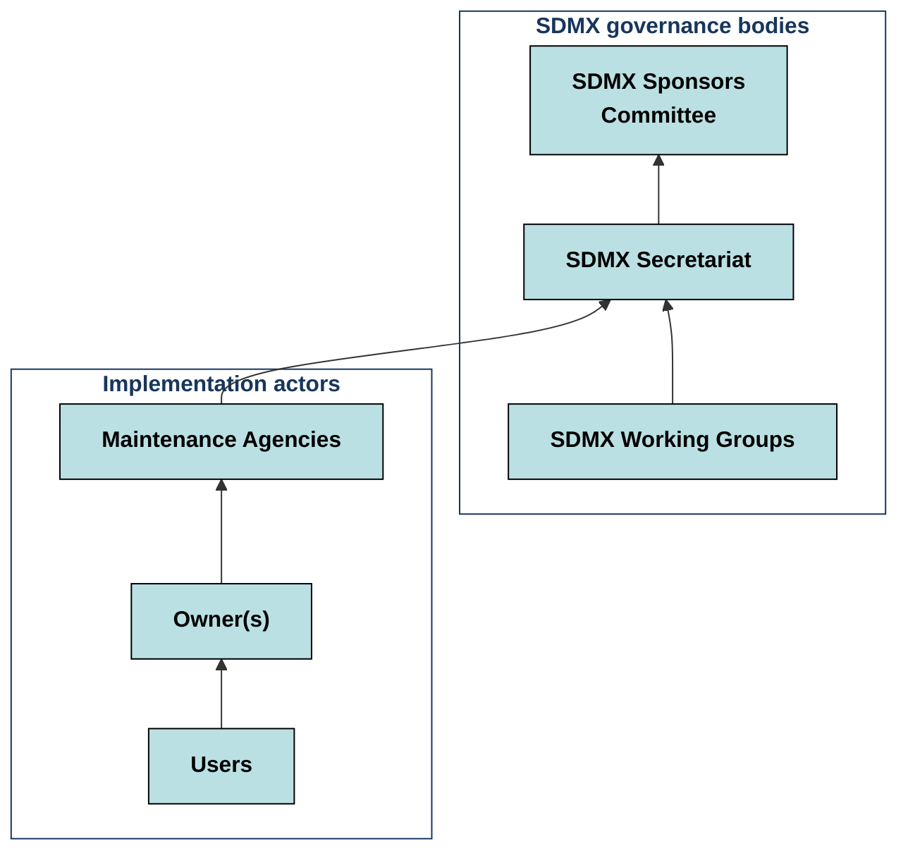
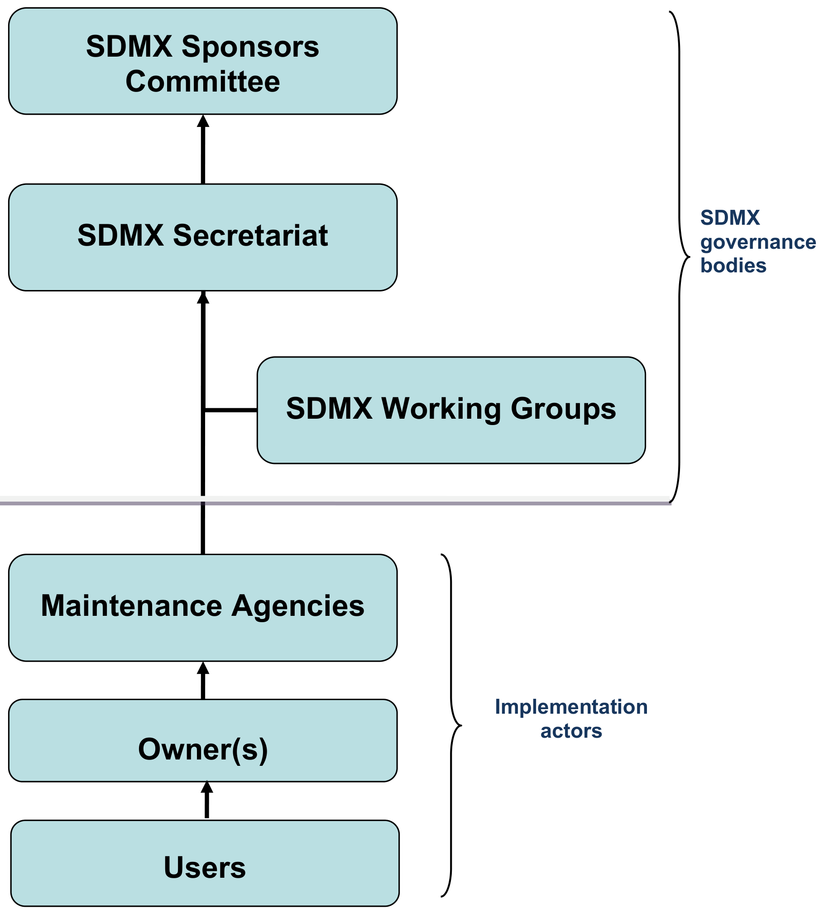
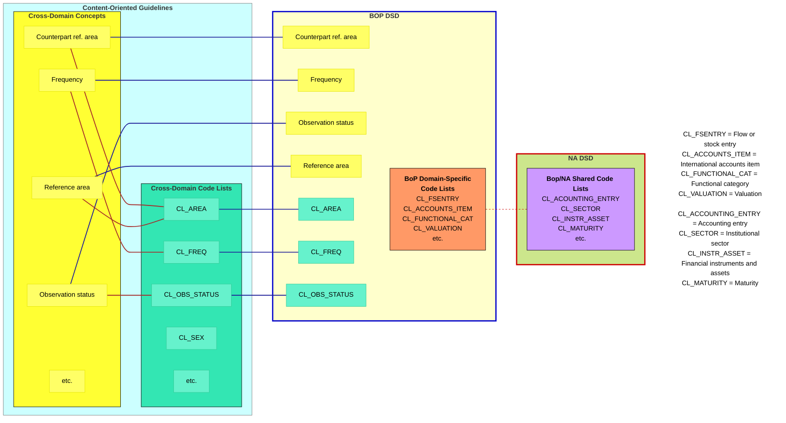
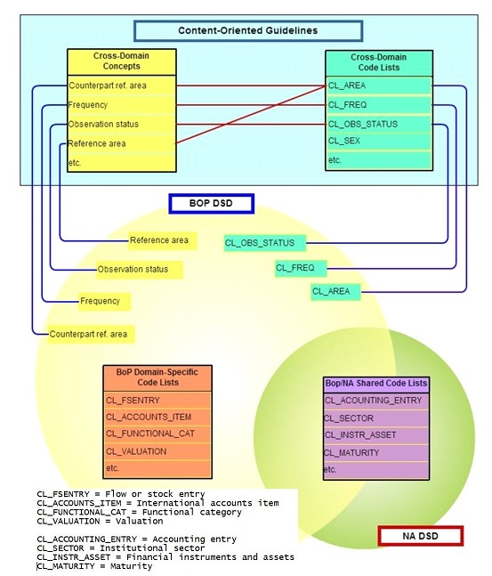
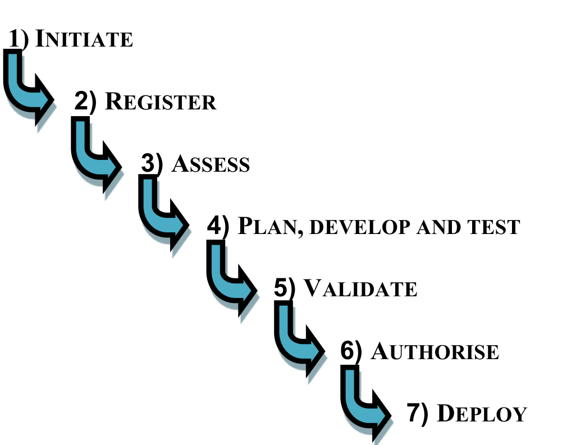

SDMX GUIDELINES

GOVERNANCE OF COMMONLY USED SDMX METADATA ARTEFACTS

VERSION 1.3

**1 September 2018**

© SDMX 2018

<http://sdmx.org/>

# CONTENTS

[1 INTRODUCTION](#1-introduction)

[1.1 General presentation](#11-general-presentation)

[1.2 Scope](#12-scope)

[1.3 Publication of updates](#13-publication-of-updates)

[2 POLICY STATEMENT](#2-policy-statement)

[3 GOVERNANCE MODEL](#3-governance-model)

[3.1 Governance Structure](#31-governance-structure)

[3.2 Roles and Responsibilities](#32-roles-and-responsibilities)

[3.2.1 SDMX governance organisation](#321-sdmx-governance-organisation)

[3.2.2 Maintenance agency](#322-maintenance-agency)

[3.2.3 Owner(s)](#323-owners)

[3.2.4 Users](#324-users)

[4 GOVERNANCE PRINCIPLES](#4-governance-principles)

[4.1 Commitment to actively collaborate](#41-commitment-to-actively-collaborate)

[4.2 Freedom of extension](#42-freedom-of-extension)

[4.3 Planning and coordination](#43-planning-and-coordination)

[4.4 Standardisation: no duplication of concept principle](#44-standardisation-no-duplication-of-concept-principle)

[4.5 Stability and pro-activity](#45-stability-and-pro-activity)

[4.6 Freedom of application and scope](#46-freedom-of-application-and-scope)

[4.7 Re-usability: Cross–domain concepts and code lists](#47-re-usability-crossdomain-concepts-and-code-lists)

[4.8 Accountability: Versioning and change management](#48-accountability-versioning-and-change-management)

[4.9 Transparency](#49-transparency)

[4.10 Close relationships with users](#410-close-relationships-with-users)

[4.11 Maintain links with related standardisation initiatives](#411-maintain-links-with-related-standardisation-initiatives)

[4.12 Consensus decision-making](#412-consensus-decision-making)

[5 MAINTENANCE OF SDMX STRUCTURAL METADATA ARTEFACTS](#5-maintenance-of-sdmx-structural-metadata-artefacts)

[5.1 Maintenance schedules](#51-maintenance-schedules)

[5.2 Change management](#52-change-management)

[6 REFERENCES](#6-references)

[ANNEX I MAINTENANCE AGREEMENT](#annex-i-maintenance-agreement)

# 1 INTRODUCTION 

## 1.1 General presentation 

In order to minimise uncertainty, inspire trust and foster standardisation, the maintenance of commonly used SDMX metadata artefacts requires **clear and openly communicated governance**. The purpose of this document is to present the governance framework which organises the maintenance of such artefacts. Commonly used metadata artefacts are essential and identifiable SDMX objects which are intended for global use or for use by more than one international organisation. The various artefacts referred to in this document are listed and defined under section 1.2.

Key element of such governance is a **maintenance policy**. The maintenance policy (releases/revisions) – which is needed to ensure smooth maintenance procedures – establishes *ground rules* by documenting the *agreed principles* applicable to the maintenance. It builds on the ground rules for the development of the technical standard and the Content-Oriented Guidelines established in 2008<a href="#fn-1" id="fnref-1">1</a>.

A **maintenance structure** based on a *maintenance agency* and supporting *processes and procedures* is established to implement the maintenance policy. Such maintenance structure provides certainty to the participating institutions about the role and duties of the maintenance agency. This responsibility will involve *close cooperation* with the SDMX Governance Structure (i.e. the SDMX Sponsor Organisations, Secretariat and Working Groups).

This means, for example, that those institutions that have already developed SDMX competence in their domains and regions might also take over the responsibility of maintaining the related SDMX concepts in those domains and regions they are responsible for.

A **maintenance agency** that is formally responsible for releasing and maintaining the commonly used metadata artefacts needs to be agreed upon. In this context, single maintaining organisation, distributed maintenance model or SDMX as maintenance agency are possible. A key consideration should be given to the respective use of Data Structure Definitions (DSDs) by several organisations, i.e. organisations using DSDs for data exchange (so mostly international organisations) could also be responsible for their maintenance; other organisations will then be informed of new versions of the DSDs. This could also be the case for "linked" DSDs, e.g. national derivates of international DSDs or DSDs for global use.

## 1.2 Scope 

This document is part of the [SDMX initiative](https://sdmx.org/) which is governed by a [Memorandum of Understanding](https://sdmx.org/wp-content/uploads/sdmx-memorandum-of-understanding-mou-2007.pdf) between the SDMX sponsoring institutions (dated 1 March 2007). It addresses the specific issue of governance rules for the maintenance of commonly used metadata artefacts (including but not limited to the Content-Oriented Guidelines) where mainly international organisations will be maintenance agencies.

The commonly used metadata artefacts which are the subject of this governance document encompass all types of structural metadata (like Data Structure Definitions (DSDs), Metadata Structure Definitions (MSDs), Code Lists and Concept Schemes)<a href="#fn-2" id="fnref-2">2</a>.

The governance rules apply to the individual artefacts as well as to the interlinked artefacts (for instance, revision of a code list and its related commonly shared DSDs).

The creation of metadata artefacts is governed by the ground rules for the development of the technical standard and the Content-Oriented Guidelines established in 2008<a href="#fn-3" id="fnref-3">3</a>. Supporting guidelines are provided in separate documents (e.g. "Guidelines for the design of SDMX Data Structure Definitions" and "Guidelines for the Creation and Management of SDMX Code Lists"<a href="#fn-4" id="fnref-4">4</a>.

The governance of national or regional metadata artefacts is not covered here. However, most rules and principles defined here will probably apply *mutatis mutandis* to these artefacts.

## 1.3 Publication of updates 

Based on the experience gained, this document will be reviewed and revised/amended as required. New releases of this document will be published on the [SDMX website](https://sdmx.org/). Any question or suggestion can also be submitted via this website.

# 2 POLICY STATEMENT 

The [Memorandum of Understanding](https://sdmx.org/wp-content/uploads/sdmx-memorandum-of-understanding-mou-2007.pdf) (MoU) signed in March 2007 by the SDMX Sponsors is the basis for the governance framework of the SDMX initiative. The goals pursued in setting up the governance structure are to ensure that

- there is a defined process that helps the SDMX community in general to contribute to the decision-making process;

- decisions are taken in a fair and transparent way.

With regard to commonly used metadata artefacts, the SDMX maintenance agencies which will take the responsibility for updating such artefacts commit themselves to

- abide by the governing rules defined in this document;

- agree on methodological rules and procedures for the management of these artefacts;

- define clear roles, structures and responsibilities for all involved parties;

- respect high quality standards for the benefit of the whole SDMX community.

Developing and maintaining DSDs and similar metadata artefacts is a task which often entails a high level of complexity. As a consequence, it is essential to define a clear framework so that all actors involved are aware of the principles and rules to abide by, the roles of the parties involved and the procedures to be followed.

# 3 GOVERNANCE MODEL 

## 3.1 Governance Structure 

The bodies involved in the governance of commonly used metadata artefacts are the SDMX governance bodies, i.e the SDMX Sponsors Committee, the SDMX Secretariat and the SDMX Working Groups (Technical Working Group and Statistical Working Group), the maintenance agencies, the owners and the users of these artefacts.

<!-- figure: f01-governance-structure -->

Original figure

## 3.2 Roles and Responsibilities 

### 3.2.1 SDMX governance organisation 

The SDMX governance organisation is documented in the Memorandum of Understanding signed by the SDMX Sponsors. This section recalls only the elements relevant for the scope of this document.

**Sponsors Committee**

The SDMX sponsor organisations are represented by the head of their statistical function in the SDMX Sponsors Committee. The SDMX Sponsors Committee can be assisted or represented by deputies from their institution as appropriate.

The SDMX Sponsors Committee is the owner of the SDMX governance framework, the SDMX technical and statistical standards, and the SDMX metadata artefacts maintained by the maintenance agency “SDMX”. It ensures their proper functioning and further improvement.

In concrete terms, this means that the SDMX sponsors are in charge of:

- maintaining and developing the technical specifications of the standards;

- fostering conceptual harmonisation;

- ensuring a consistent domain-specific implementation of the standards.

In performing these actions, the statistical neutrality of the standards and the necessary flexibility in implementation must be safeguarded.

***a) Maintaining and developing the technical specifications of the standards***

The SDMX Sponsors are responsible (after extensive consultation of stakeholders) for determining the evolution of the SDMX technical standards, which include among others the SDMX Information Model and the syntaxes specified to express its instances.

The SDMX Sponsors are therefore the owners of the SDMX technical standards. The SDMX Secretariat is to act as their maintenance agency.

***b) Fostering statistical harmonisation***

To encourage interoperability, it is necessary to standardise and harmonise the use of specific statistical concepts and terminology. The SDMX sponsors are responsible for the development and further evolution of the SDMX Content-Oriented Guidelines (including the SDMX cross-domain code lists).

The SDMX Sponsors are therefore the owners of the SDMX Content-Oriented Guidelines, while the SDMX Statistical Working Group (SWG) acts as their maintenance agency.

***c) Ensuring a consistent domain-specific implementation of the SDMX standards***

In general, the owners of the artefacts for a specific statistical domain should be the organisations involved in their development and using the artefacts for data/metadata exchange. This general principle has been applied e.g. for National Accounts and Balance of Payments (BOP) statistics.

In order to avoid confusion of institutional roles, the SDMX sponsor organisations should not appear as owners of SDMX artefacts used in a statistical domain in their capacity as SDMX Sponsors, but as organisations directly concerned by/responsible for the SDMX implementation in a particular domain.

In the example of National Accounts (NA), this means that the owners of the NA-specific artefacts (such as Data Structure Definitions) are not the SDMX Sponsors as such, but the seven international organisations concerned by the use of these artefacts. The organisations formed an ownership/steering group called "SDMX for Macro-Economic Statistics (SDMX-MES)" to govern the NA, BOP, Foreign Direct Investment (FDI), and future, related Global DSDs. In any SDMX implementation project, the organisations acting as owners are responsible for involving their respective constituencies and other interested bodies. In case of major SDMX implementations, it is thus strongly recommended to formalize the management arrangements by establishing an official "ownership group"<a href="#fn-5" id="fnref-5">5</a> and drafting a "maintenance agreement" (See Annex 1). The maintenance agreements are made publicly available on the SDMX official website.

In order to ensure a consistent domain-specific implementation of the standard, the SDMX Sponsors should however be entitled to check the SDMX artefacts (DSDs or other artefacts) in terms of conformity with the SDMX technical and statistical standards and guidelines. This conformity check is normally done by the SDMX Technical and Statistical working groups.

If and only if the SDMX artefacts are consistent with the SDMX standards and guidelines, they should be labelled accordingly and published in the appropriate SDMX registries/SDMX website. The publication of the certified SDMX artefacts should be accompanied by the publication of the corresponding maintenance agreements.

The table below summarises the SDMX governance roles as described above.

| **SDMX artefacts** | **Owner(s)** | **Maintenance agency** |
|----|----|----|
| **SDMX technical standards** | SDMX Sponsors | SDMX Secretariat |
| **SDMX statistical guidelines (including SDMX cross-domain code lists)** | SDMX Sponsors | SDMX Secretariat |
| **Domain-specific artefacts (e.g. NA DSDs, R&D statistics), shared code lists**<a href="#fn-6" id="fnref-6">6</a>**, etc.** | *Ad hoc* ownership groups made of all organisations involved in a given implementation, e.g. “SDMX for Macro-Economic Statistics (SDMX-MES)”. | Normally one of the organisations who is also owner |

**SDMX Secretariat**

The SDMX Secretariat, which is composed of senior experts from the sponsoring organisations, provides support to the SDMX Sponsors Committee. The SDMX Secretariat is responsible for the implementation, monitoring and functioning of the governance framework and submits proposals for improvement to the SDMX Sponsors Committee. It has regular contacts with the maintenance agencies to review progress and address any issues.

**SDMX Working Groups**

The SDMX Technical Working Group (TWG) and Statistical Working Group (SWG) report to the SDMX Secretariat. They maintain, improve or further develop the SDMX technical and statistical standards. They check the compliance of SDMX artefacts created in SDMX implementation actions.

The SWG deals with the creation and maintenance of the metadata artefacts maintained by the maintenance agency “SDMX”, e.g. SDMX cross-domain concepts as documented in the Content-Oriented Guidelines.

### 3.2.2 Maintenance agency 

A maintenance agency is the organisation responsible for the operational maintenance of a specific set of commonly used metadata artefacts. It is responsible for all governance issues relating to this artefact. It is the point of contact for all stakeholders for all issues related to the artefact(s) under its responsibility. It informs and coordinates activities with the SDMX working groups and other stakeholders as necessary. The maintenance agency is not a decision-making body. Decisions are made collegially among the owners of the artefact (through the domain-specific ownership group). One maintenance agency can be responsible for several SDMX artefacts.

For the SDMX Content-Oriented Guidelines (cross-domain concepts and code lists, SDMX Glossary, etc.), the maintenance agency is SDMX. For domain-specific concepts there are various different maintenance agencies, as labelled in the metadata artefacts.

A maintenance agency for any set of commonly used metadata artefacts is appointed by the SDMX Sponsors based on a proposal by the SDMX Secretariat, after consulting the respective owners. The SDMX Secretariat maintains a list of maintenance agencies and the SDMX artefacts under their responsibility.

The maintenance agency is responsible for providing adequate human, financial and technical resources required for fulfilling the responsibilities and tasks described above. It commits to an agreement with the SDMX sponsoring organisations based on the governance principles defined in this document. For each artefact, be it at national or international level, there is a need, for management purposes, to identify its owner and its maintenance agency. In the case where one organisation only is involved, both responsibilities will, under normal circumstances, be endorsed by that organisation. In the case where several organisations are involved, the ownership of the artefact will be endorsed by all the organisations involved jointly; for what concerns the maintenance agency, one organisation will be mandated by the others to act as maintenance agency. The organisation model makes no distinction between national and international levels. Indeed the governance rules for determining owners and maintenance agencies will apply *mutatis mutandis* to both contexts.

The sharing of responsibilities between several organisations as described below can apply to various artefacts: SDMX Data Structure Definitions (DSDs), domain-specific code lists<a href="#fn-7" id="fnref-7">7</a>, etc.

<table>
<colgroup>
<col style="width: 4%" />
<col style="width: 4%" />
<col style="width: 44%" />
<col style="width: 46%" />
</colgroup>
<thead>
<tr>
<th style="text-align: right;">→</th>
<th colspan="3" style="text-align: left;"><strong>ONE ORGANISATION
INVOLVED</strong></th>
</tr>
</thead>
<tbody>
<tr>
<td colspan="2" style="text-align: right;"></td>
<td style="text-align: center;"><strong>OWNER</strong></td>
<td style="text-align: center;"><strong>MAINTENANCE AGENCY</strong></td>
</tr>
<tr>
<td colspan="2" style="text-align: right;"></td>
<td style="text-align: center;">That organisation</td>
<td style="text-align: center;">That organisation</td>
</tr>
<tr>
<td colspan="2" style="text-align: right;"></td>
<td colspan="2"
style="text-align: center;">
<em><strong>Comments</strong></em> 
The sole owner is assumed to endorse the maintenance agency
responsibility
</td>
</tr>
<tr>
<td style="text-align: right;">→</td>
<td colspan="3" style="text-align: left;"><strong>MORE THAN ONE
ORGANISATION INVOLVED</strong></td>
</tr>
<tr>
<td colspan="2" style="text-align: right;"></td>
<td style="text-align: center;"><strong>OWNER</strong></td>
<td style="text-align: center;"><strong>MAINTENANCE AGENCY</strong></td>
</tr>
<tr>
<td colspan="2" style="text-align: right;"></td>
<td style="text-align: center;">All organisations involved (through an
ownership group)</td>
<td style="text-align: center;">One organisation proposed by the
owners</td>
</tr>
<tr>
<td colspan="2" style="text-align: right;"></td>
<td colspan="2"
style="text-align: center;">
<em><strong>Comments</strong></em> 
The owners mandate one organisation to play the role of maintenance
agency and endorse the corresponding responsibilities
</td>
</tr>
</tbody>
</table>

For SDMX cross-domain code lists (as part of the Content-Oriented Guidelines, COG), the owner is the SDMX Sponsors Committee and the maintenance agency (marked as “SDMX”) is the SDMX Statistical Working Group (SWG).

<table>
<colgroup>
<col style="width: 9%" />
<col style="width: 44%" />
<col style="width: 46%" />
</colgroup>
<thead>
<tr>
<th colspan="3" style="text-align: right;"><strong>SDMX CROSS-DOMAIN
CODE LISTS (part of the SDMX COG)</strong></th>
</tr>
</thead>
<tbody>
<tr>
<td style="text-align: right;"></td>
<td style="text-align: center;"><strong>OWNER</strong></td>
<td style="text-align: center;"><strong>MAINTENANCE AGENCY</strong></td>
</tr>
<tr>
<td style="text-align: right;"></td>
<td style="text-align: center;">SDMX Sponsors Committee</td>
<td style="text-align: center;">SDMX Statistical Working Group
(SWG)</td>
</tr>
</tbody>
</table>

For shared code lists, the sharing of responsibilities is not at the level of organisations but at the level of maintenance agencies. In this case, any request for change to a shared code list will require the agreement of all owner organisations (via the respective maintenance agencies) involved in the implementation.

In order to ensure efficient and effective communication, the maintenance agency shall establish a functional point of contact (e.g. functional mailbox, service desk) for all issues related to the maintenance of SDMX artefacts under its responsibility.

### 3.2.3 Owner(s) 

The owner of an artefact is the organisation/group which developed this artefact or mandated its development. There can be several owners for a given artefact (e.g. the Balance of Payments DSD is owned jointly by several organisations through the SDMX-MES ownership group). For daily management, owner organisations mandate one organisation as maintenance agency (see previous section). However, the ownership group is the ultimate decision-maker for authorising changes to the artefacts.

### 3.2.4 Users 

Users are community members who use the metadata artefacts for data and metadata exchange, i.e. statistical organisations or statistical users. Their relationships with the SDMX governance structure are ruled by the governing principles described in this document.

# 4 GOVERNANCE PRINCIPLES 

The governance principles listed and described below provide the basic framework for the maintenance policy of commonly used metadata artefacts as presented in section 1.2 above. These basic principles are:

- Commitment to actively collaborate

- Freedom of extension

- Planning and coordination

- Standardisation: No duplication of concept principle

- Stability and pro-activity

- Freedom of application and scope

- Re-usability: Use of cross-domain concepts and code lists

- Accountability: Versioning and change management

- Transparency

- Close relationships with users

- Maintain links with related standardisation initiatives

- Consensus decision-making

## 4.1 Commitment to actively collaborate 

Organisations deciding to take part in the maintenance of commonly used metadata artefacts commit themselves to actively collaborate on the task. Active collaboration means implementing the necessary arrangements for efficient work (for instance, effective time and human resource availability to take part in the process), sharing the burden resulting from the initiative (for instance, work out proposals if invited to do so or review proposals submitted by others) and contributing to discussions and decision-making process.

## 4.2 Freedom of extension 

Local extensions of global standards are allowed. Nevertheless, the global standards should remain untouched. As the name indicates, these artefacts are only extensions (i.e. using the global standards as basis and supplementing them to accommodate local needs, e.g. for local data exchange) and as such, should not conflict with the global standard.

The treatment of local standards shall follow *mutatis mutandis* the normal management rules defined in this document (for what concerns e.g. governance principles, maintenance agency(ies), change management process).

## 4.3 Planning and coordination 

Requests for changes need to be shared as early as possible to give some room for discussion and sufficient time for implementation. Coordination between international organisations as well as coordination within those organisations to collect the requirements is important.

Updates of commonly used metadata artefacts can trigger updates of the system of all data exchange partners involved; clear and timely communication between all actors is therefore very important. Well organised communication channels are also necessary to avoid overlaps (e.g. two organisations starting to revise the same code list).

Updates per metadata artefact should follow a schedule that is shared on the SDMX website. The schedule for updates of shared artefacts has to be agreed between the respective owners of the artefact.

## 4.4 Standardisation: no duplication of concept principle 

Concepts as well as code lists are clearly defined to be globally understood and applied. A global standard does not contain any duplication.

## 4.5 Stability and pro-activity 

Ideally, DSDs and similar SDMX metadata artefacts should be designed in a forward-looking way that is optimal in a mid-term horizon (three to five years). Frequent changes in metadata artefacts may have cost implications for adjusting systems, applications and users’ programmes. For this reason, frequent changes should be avoided to the largest extent possible, as these would have an impact on the benefits gained from using the standards. A typical example is the procedure for deciding the dimensions to be included in DSDs: redundant dimensions (not useful in identifying the observed phenomenon and distinguishing it from other phenomena) should be avoided, but also future needs (that might lead to a need for additional dimensions in future) should be taken into consideration.

These principles also apply to attributes.

## 4.6 Freedom of application and scope 

Any organisation has the freedom to apply an artefact outside the original scope of its application, e.g. the Balance of Payments or the National Accounts DSDs may be applied in part or in whole to data exchanges specifically geared to exchange basic data; e.g. insurance corporations and pension funds.

Similarly, a DSD can be used in various data exchange contexts (e.g. European Statistical System, European System of Central Banks, etc.) and between international organisations for reporting as well as for dissemination purposes.

## 4.7 Re-usability: Cross–domain concepts and code lists

Recommended cross-domain concepts and code lists, as agreed by the SDMX Statistical Working Group (SWG) and endorsed by the SDMX Secretariat, would not imply limitations on the applicability of any DSD and are implemented in commonly used DSDs. Changes in those concepts and code lists are also reflected following an agreed implementation timetable to allow all the actors to adapt their systems.

If new needs for data exchange at national or international level emerge, existing artefacts will be reused to the largest extent possible.

A code list can be considered for adoption as a cross-domain code list if it is deemed relevant for use across multiple domains. Requested changes to existing cross-domain concepts and code lists can be sent to the SDMX Statistical Working Group for consideration.

<!-- figure: f02-reusability -->

Original figure

Illustration of the re-usability concept

## 4.8 Accountability: Versioning and change management 

All SDMX metadata artefacts marked as final are subject to versioning. The process for managing changes to these artefacts and their versioning is followed by the maintenance agency.

New or modified artefacts do not automatically trigger a revision of the artefacts in which these concepts and code lists are referenced<a href="#fn-8" id="fnref-8">8</a>.

## 4.9 Transparency 

In line with international best practices, the SDMX governance and ownership groups will consult widely and openly on the maintenance of commonly used artefacts by placing draft documents related to major changes of commonly used SDMX metadata artefacts on the SDMX website for public comment.

Dissemination of revised artefacts will occur via the SDMX registries.

## 4.10 Close relationships with users 

Fostering and maintaining good relations with users is essential to the development of SDMX. Involvement of users will promote broad acceptance of the guidelines and standards enacted by the SDMX bodies. Considerable efforts are made, through a number of channels, to engage national and international experts interested in contributing to the improvement of SDMX technical standards and guidelines.

## 4.11 Maintain links with related standardisation initiatives

SDMX aims at maintaining close links with other standardisation activities in its field of interest with a view to cross-fertilisation of ideas, re-using of existing material, and eventually resource saving. For example, the [RDF Data Cube Vocabulary](https://www.w3.org/TR/vocab-data-cube/) is compatible with the cube model that underlies SDMX; the [Checklist for SDMX Design Projects](https://statswiki.unece.org/display/SDMXPM/Checklist+for+SDMX+Design+Projects+Home) is based on the UNECE [Generic Statistical Business Process Model](https://statswiki.unece.org/display/GSBPM/Generic+Statistical+Business+Process+Model) (GSBPM); the [Structures Group](https://statswiki.unece.org/display/GSIMclick/Structures+Group) of the UNECE Generic Statistical Information Model (GSIM) is largely based on SDMX. Efforts are also made to improve convergence with the [Data Documentation Initiative](https://www.ddialliance.org) (DDI), the other major standard for the management of statistical data and metadata.

## 4.12 Consensus decision-making

The SDMX bodies have a commitment to reaching consensus on all decisions. Consensus decision-making ensures that all opinions, ideas and concerns are heard, and that the consent of each member of the group is obtained. By listening closely to each other, the group aims to come up with proposals that work for everyone. Consensus requires commitment, patience, tolerance and a willingness to put the group first.

# 5 MAINTENANCE OF SDMX STRUCTURAL METADATA ARTEFACTS

Since all commonly used SDMX metadata artefacts are based on the same technical standards, agencies responsible for their maintenance will face similar challenges. The most frequently encountered issues are addressed in this section.

## 5.1 Maintenance schedules 

The maintenance agency is responsible for establishing, communicating and adhering to a maintenance schedule for the SDMX metadata artefacts under its responsibility. The maintenance schedule should be adequate to the frequency and timing of expected changes and should take into account user requirements, especially in the case of shared artefacts where schedules have to be agreed upon between all maintenance agencies involved.

## 5.2 Change management 

Any change to existing SDMX metadata artefacts is subject to a controlled change management process owned by the domain-specific ownership group and implemented by the maintenance agency. The change implementation will be aligned with the maintenance schedules to the largest extent possible.

Particular attention will be given to the coordination between maintenance agencies when shared artefacts (e.g. one code list used in several DSDs) are concerned. In these cases, the prior authorisation from all owners is required.

The change management process entails seven steps which can be schematised as follows:

**1) INITIATE**

**2) REGISTER**

**3) ASSESS**

**4) PLAN, DEVELOP AND TEST**

**5) VALIDATE**

**6) AUTHORISE**

**7) DEPLOY**

<!-- figure: f03-change-steps -->

Original figure

This process is explained in more detail in the table below. The abbreviations used are based on the RACI terminology:

- **R** = Responsible

- **A** = Accountable

- **C** = Contributing

- **I** = Informed<a href="#fn-9" id="fnref-9">9</a>.

<table>
<colgroup>
<col style="width: 5%" />
<col style="width: 21%" />
<col style="width: 72%" />
</colgroup>
<thead>
<tr>
<th colspan="2" style="text-align: center;"><strong>Step No. and
label</strong></th>
<th style="text-align: center;"><strong>Specification</strong></th>
</tr>
</thead>
<tbody>
<tr>
<td style="text-align: center;">
<strong>1</strong>
</td>
<td>
<strong>Initiate change</strong>
</td>
<td>
A change request for a specific SDMX metadata artefact is
triggered by sending it to the maintenance agency for this artefact.

<strong>R: Requester (can be anybody)</strong>

<strong>A: Maintenance agency</strong>

<strong>C:</strong>

<strong>I: Ownership group</strong>
</td>
</tr>
<tr>
<td style="text-align: center;">
<strong>2</strong>
</td>
<td>
<strong>Register change</strong>
</td>
<td><ul>
<li>
Acknowledge receipt of the change request.
</li>
<li>
Identify major stakeholders and invite them to take part in the
revision process.
</li>
</ul>

<strong>R: Maintenance agency</strong>

<strong>A: Ownership group</strong>

<strong>C:</strong>

<strong>I: Requester, stakeholders, SDMX
Secretariat</strong>
</td>
</tr>
<tr>
<td style="text-align: center;">
<strong>3</strong>
</td>
<td>
<strong>Assess change</strong>
</td>
<td>
Analyse and assess the change request with regard to its impact
and potential side effects. Resources and time needed for implementation
are estimated in order to properly assess the cost of the proposed
change.

Based on the evaluation of the change request and the estimated
costs, the change request is authorised to proceed to implementation or
rejected. The decision is communicated to the requester.

In case the change request is rejected, the process stops here.

<strong>R: Maintenance agency</strong>

<strong>A: Ownership group</strong>

<strong>C: Stakeholders, SWG, TWG</strong>

<strong>I: SDMX Secretariat, requester (if proposal is
rejected)</strong>
</td>
</tr>
<tr>
<td style="text-align: center;">
<strong>4</strong>
</td>
<td>
<strong>Plan, develop and test change</strong>
</td>
<td>
Establish a plan for developing, testing, validating and
deploying the change. The plan should include the resources required and
schedule for each step.

Develop and test change (including updates to documentation and
training material) and the communication package required for
validation, authorisation and deployment.

<strong>R: Maintenance agency</strong>

<strong>A: Ownership group</strong>

<strong>C: Stakeholders</strong>

<strong>I:</strong>
</td>
</tr>
<tr>
<td style="text-align: center;">
<strong>5</strong>
</td>
<td>
<strong>Validate change</strong>
</td>
<td>
Validate (after public consultation) the results of the previous
step and make a proposal to proceed, taking into account the deployment
schedule.

<strong>R: Maintenance agency</strong>

<strong>A: Ownership group</strong>

<strong>C: Anybody (via public consultation)</strong>

<strong>I: SDMX Secretariat</strong>
</td>
</tr>
<tr>
<td style="text-align: center;">
<strong>6</strong>
</td>
<td>
<strong>Authorise change</strong>
</td>
<td>
Authorise the implementation of the change based on the result of
the change validation.

<strong>R: Ownership group</strong>

<strong>A: SDMX Secretariat</strong>

<strong>C:</strong>

<strong>I: Maintenance agency</strong>
</td>
</tr>
<tr>
<td style="text-align: center;">
<strong>7</strong>
</td>
<td>
<strong>Deploy change</strong>
</td>
<td><ul>
<li>
Coordinate and communicate the change implementation.
</li>
<li>
Implement change (e.g. by changing the status in the registry to
"final").
</li>
</ul>

<strong>R: Maintenance agency</strong>

<strong>A: Ownership group</strong>

<strong>C:</strong>

<strong>I: Requester, SWG, TWG, SDMX user community (via publication
on the SDMX official website or uploading of the new artefacts to an
SDMX registry)</strong>
</td>
</tr>
</tbody>
</table>

# 6 REFERENCES 

- Bank for International Settlements (BIS), European Central Bank (ECB), Eurostat (the Statistical Office of the European Union), Organization for Economic Co-operation and Development (OECD), International Monetary Fund (IMF), United Nations (UN), The World Bank Group (WB), "[Memorandum of Understanding on the Establishment and Operation of the Statistical Data and Metadata Exchange (SDMX) Initiative](http://sdmx.org/wp-content/uploads/2007/05/sdmx-memorandum-of-understanding-mou-2007.pdf)", 1 March 2007

- ESSnet on SDMX (National Statistical Offices of Portugal (chair), Spain, Italy, Sweden and Norway, Infostat and Eurostat), Work Package 2 "[MCV Ontology](http://sdmxessnet.ine.pt/)", 2011

- Statistical Data and Metadata Exchange (SDMX), "[Checklist for SDMX Data Providers](https://statswiki.unece.org/display/SDMXPM/Checklist+for+SDMX+Data+Providers)", 2016

- Statistical Data and Metadata Exchange (SDMX) official website, [Example page of a global implementation project](https://sdmx.org/?page_id=1498) (National Accounts)

- Statistical Data and Metadata Exchange (SDMX) official website, "[Guidelines on the Versioning of SDMX Artefacts](https://sdmx.org/wp-content/uploads/Guidelines_on_versioning_v1_0.pdf)", 2015

- Statistical Data and Metadata Exchange (SDMX) official website, "[SDMX Content-Oriented Guidelines](http://sdmx.org/)", 2009

#  ANNEX I MAINTENANCE AGREEMENT 

Global or large-scale SDMX implementations require strong governance, so that all stakeholders know exactly their roles and responsibilities. It is recommended to formally describe these roles and responsibilities in a specific document referred to as a "Maintenance Agreement"

The "Maintenance Agreement" (or MA) is a crucial document that describes the processes that will be used to maintain the project's deliverables (not only the SDMX artefacts). The MA chiefly documents who is responsible for what (the maintenance information tables), and what can be done and when (the maintenance timelines).

Such document can contain some or all of these sections:

- An introduction, explaining the purpose and background of the project, and purpose of the maintenance agreement itself;

- A description of the ownership group mandate, including the domain and sub-domains involved;

- A table of maintenance information broken down by domain: maintenance agency, main stakeholder(s);

- Contact details for the maintenance agencies;

- Organisation principles that detail the governance of the ownership group;

- Maintenance Agreement points on the SDMX (and other) guidelines that have been used;

- Technical Arrangements that detail the governance and mandate of the technical group;

- Maintenance Timelines. There should be one table per possible timeline, for example, a table for "Regular maintenance"; and a table for "Fast-track maintenance". Each table should include:

  - The time frame, e.g. a month;

  - Who can initiate the change, e.g. anybody; maintenance agency; stakeholders;

  - A description of the timeline phase, e.g. deadline for change requests; implement changes; testing;

  - Deliverables, e.g. updated DSD matrix; test reports;

  - A document history;

- References section, especially with references to the SDMX Guidelines and other helpful information.

Examples of such Maintenance Agreements:

- Terms of Reference of the ownership group "SDMX for Macro-Economic Statistics"

- Agreement on the Governance of SDMX Artefacts for Statistics on: Balance of Payments, Foreign Direct Investment, National Accounts (incl. GFS)

These Maintenance Agreements can be consulted on the SDMX official website on the [National Accounts](https://sdmx.org/?page_id=1498) and [Balance of Payments](https://sdmx.org/?page_id=1747) pages respectively (under "Maintenance Cycle").

The attached template, called "[MaintenanceAgreement template.docx](https://statswiki.unece.org/download/attachments/117773102/MaintenanceAgreement%20template.docx?version=1&modificationDate=1452590749187&api=v2)", provides a possible structure with no content.

<!-- footnotes -->

------------------------------------------------------------------------

1 See "[Report of the Task Force to Establish Standards on Data and Metadata Exchange](http://unstats.un.org/unsd/statcom/doc09/2009-24-SDMX-E.pdf)" to the fortieth session of the UN Statistical Commission, Ref. E/CN.3/2009/24, dated 5 December 2008.

2 These concepts are defined and explained in the [SDMX Glossary](https://sdmx.org/wp-content/uploads/SDMX_Glossary_Version_2_0_October_2018.docx).

3 See "[Report of the Task Force to Establish Standards on Data and Metadata Exchange](http://unstats.un.org/unsd/statcom/doc09/2009-24-SDMX-E.pdf)" to the fortieth session of the UN Statistical Commission, Ref. E/CN.3/2009/24, dated 5 December 2008.

4 Available on the [SDMX official website](https://sdmx.org/?page_id=4345).

5 Set of organisations which collegially endorse the responsibility for the governance of SDMX artefacts in a specific statistical domain (e.g. macro-economic statistics). For more details on the definition of the "ownership group" concept, see the [SDMX Glossary](https://sdmx.org/wp-content/uploads/SDMX_Glossary_Version_2_0_October_2018.docx).

6 For detailed definitions of these concepts, see the [SDMX Glossary](https://sdmx.org/wp-content/uploads/SDMX_Glossary_Version_2_0_October_2018.docx).

7 A code list that serves only one very precise and targeted need and as such is not shared with any other statistical domain.

8 Issues relating to versioning are addressed in the "[Guidelines on the Versioning of SDMX Artefacts](https://sdmx.org/?page_id=4345#Versioning)".

9 **R : Responsible**: Main responsibility for the execution.

**A :** **Accountable**: Decision making instance under the perspective of cost responsibility and responsible that somebody is assigned to be (R)esponsible.

**C : Contributing**: Participation in execution or decision making.

**I : Informed**: Notification is given to.
