<!-- figure: f01-logo -->
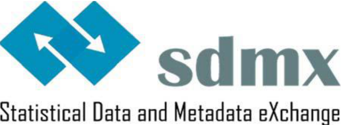

**Statistical Working Group  
Statistical Guidelines**

**A Reference Framework for**

**SDMX Structural Metadata Governance**

**Version 1.0**

**27 March 2023**

**Table of contents**

[1 EXECUTIVE SUMMARY](#1-executive-summary)

[2 INTRODUCTION](#2-introduction)

[2.1 SDMX Structural metadata Governance framework](#21-sdmx-structural-metadata-governance-framework)

[2.2 Why an SDMX structural metadata governance architecture is needed](#22-why-an-sdmx-structural-metadata-governance-architecture-is-needed)

[3 THE GOVERNANCE FRAMEWORK](#3-the-governance-framework)

[3.1 Terminology](#31-terminology)

[3.2 Governance architecture relevant to level of reusability, quality and time to deliver](#32-governance-architecture-relevant-to-level-of-reusability-quality-and-time-to-deliver)

[3.3 Governance based on shared artefacts](#33-governance-based-on-shared-artefacts)

[3.4 Non-shared structural metadata governance](#34-non-shared-structural-metadata-governance)

[3.5 The reference framework](#35-the-reference-framework)

[4 STEPS TO IMPLEMENTING AN SDMX STRUCTURAL METADATA GOVERNANCE ARCHITECTURE](#4-steps-to-implementing-an-sdmx-structural-metadata-governance-architecture)

[5 BUSINESS PROCESSES](#5-business-processes)

[5.1 Process for working groups that create or maintain shared structural metadata](#51-process-for-working-groups-that-create-or-maintain-shared-structural-metadata)

[5.2 Maintenance cycle of shared structural metadata](#52-maintenance-cycle-of-shared-structural-metadata)

[6 ANNEXES](#6-annexes)

[6.1 Annex 1: Governance architecture variations with comparative indicators](#61-annex-1-governance-architecture-variations-with-comparative-indicators)

[6.2 Annex 2: Example of institutional setting](#62-annex-2-example-of-institutional-setting)

[6.3 Annex 3: Using the reference framework with the Generic Activity Model for Statistical Organisations (GAMSO) 1.2 and Generic Statistical Business Process Model (GSBPM) 5.1](#63-annex-3-using-the-reference-framework-with-the-generic-activity-model-for-statistical-organisations-gamso-12-and-generic-statistical-business-process-model-gsbpm-51)

# 1 EXECUTIVE SUMMARY

This guideline describes a reference framework to enable agencies to implement the most appropriate governance architecture to maintain SDMX Structural Metadata. Thereby, agencies may improve the quality and maintenance of their structural metadata. Through use of this guideline, improvements may be achieved in reporting clarity, reviewing, resource management and structural metadata maintenance.

The framework’s design was motivated by the successful implementation of similar governance structural metadata architectures in several agencies with different institutional settings.

The guideline includes variations on the reference framework to adapt to agencies different needs and resources. Each variation includes comparative indicators to help analyse which one may be the most suitable to implement.

Also described are the various roles in the framework, a step-by-step guide to implementation, business processes related to the framework, an example of an institutional setting (OECD), and the relationship to the Generic Activity Model for Statistical Organisations (GAMSO) and Generic Statistical Business Process Model (GSBPM).

# 2 INTRODUCTION

## 2.1 SDMX STRUCTURAL METADATA GOVERNANCE FRAMEWORK

A key element of SDMX data and metadata modelling is to define how the structural models and the shared artefacts on which they are based will be maintained. The maintenance activities depend on fully defined processes and responsibilities which are described in a governance policy. This guideline proposes a reference framework for SDMX structural metadata governance architecture that may be adapted for implementation in any agency and domain.

The reference framework describes a (reference) governance architecture and business processes related to it. The groups within the governance architecture are abstract and require mapping to an institutional setting. There are also variations on the governance architecture (Annex 1), an example of an institutional setting (Annex 2), and how it integrates with the Generic Activity Model for Statistical Organisations (GAMSO) and Generic Statistical Business Process Model (GSBPM) (Annex 3).

The overall goal of this guideline is for an agency to improve its management and quality of SDMX Structural Metadata by implementing a governance policy and architecture based on best practices.

Note that the actual design of structural metadata is outside the scope of this paper. Please refer to the SDMX content-oriented guidelines for details on that such as the [Checklist for SDMX Design projects](https://statswiki.unece.org/display/SDMXPM/Checklist+for+SDMX+Design+Projects+Home), and the guideline on [Modelling Statistical Domains in SDMX](https://sdmx.org/?page_id=4345#Modelling).

## 2.2 WHY AN SDMX STRUCTURAL METADATA GOVERNANCE ARCHITECTURE IS NEEDED

Harmonising structural metadata models is a prerequisite to achieve efficient data integration in terms of data accessibility or efficient processing of data. To achieve a higher degree of coherence and harmonisation in the data models (for example, with the maintenance of unified, consistent code lists, that are maintained and used at an organisational level), governance principles must be agreed and put into practice. Basing these principles on best practices provides a solid foundation and reference point for governing bodies. Implementing or adapting this reference framework should help speed-up implementation of the policy and architecture and increase the quality of the structural metadata and processes.

Some of the needs for structural metadata governance are:

- Define clear workflows for structural metadata change processes

- Identify the relevant experts to work on the structural metadata proposals

- Enable effective ownership and clear accountability for business processes

- Separate responsibility between ownership (decision-making) and maintenance (execution of decisions)

- Identify tools for the processes such as reviews and communication

- Clearly identify ownership and maintenance of the governance policy itself

- Ensure there is effective adoption and communication of the policy itself

# 3 THE GOVERNANCE FRAMEWORK

## 3.1 TERMINOLOGY

**Maintenance entity**: a person or group responsible for the operational maintenance or referral to an SDMX artefact(s). They do not make the decisions on the content of the artefact – that is the owner. If the maintenance entity creates and updates the artefact, then in SDMX technical terminology they are the “Maintenance agency” of the artefact.

**Owner**: a person or group that makes decisions either on the content of an SDMX artefact(s) or decides which existing artefacts to use (which may be owned and maintained by others, for example in the case of internationally agreed artefacts – or derived from such artefacts – or be locally designed and maintained solely). Change proposals may come from the owner(s) themselves and/or they make take proposals from the wider community.

**Agency:** an organization/agency/company that implemented the governance architecture.

**Group:** a node/entity in the governance framework that has a role (see the table below) and some responsibility. For example, the Practices advisory team.

**CoP**: The Community of Practice

**Reference framework**: The “template” governance architecture in this document that can be adapted in implementation, see Annex 1 for examples.

**Artefact**: An item of structural metadata

**Governance policy**: An agency’s “rulebook” that defines its structural metadata governance architecture, processes, and principles.

**Governance architecture**: An architecture consists of the groups involved in governance, their relationships to each other and responsibilities. An architecture can be implemented by an agency.

**Governance principles:** The rules and recommendations to apply to structural metadata. Examples are naming conventions, coding (Ids) conventions, and which business processes to use when modelling. See the section on Business Processes for examples.

## 3.2 GOVERNANCE ARCHITECTURE RELEVANT TO LEVEL OF REUSABILITY, QUALITY AND TIME TO DELIVER

There is a trade-off between reusability, quality, and the time to deliver an artefact that is meant for reuse. If the emphasis is on the time to deliver, then an architecture which reduces or eliminates the community review process may be relevant, however there is a risk to quality. See Annex 1 for the governance architecture variations.

## 3.3 GOVERNANCE BASED ON SHARED ARTEFACTS

The reference framework proposes a different governance and processes for shared and non-shared artefacts.

A shared artefact is one that is designed for use and/or implemented (e.g., used in DSDs) outside of the team where it was created. Examples are codelists and concepts for “Status of observation”, “Reference area”, “Unit of measure”, “Industrial activity”. A non-shared artefact is one that is designed for use by only one domain, reference or in one structure.

The diagram below illustrates these differences. The red artefacts are not shared because they are codelists specific to their domains such as CL_MEASURE, or the concept does not apply to other domains such as Health facility and Nat. accts. table id. However, the green concepts are shared because the same concept and code items can be used in different domains such as Occupation used in Health and Labour, and Industrial activity used in Labour and National accounts.

The Observation status concept and the CL_UNIT_MEASURE codelist are used in all domains.

<!-- figure: f02-shared-non-shared-artefacts -->
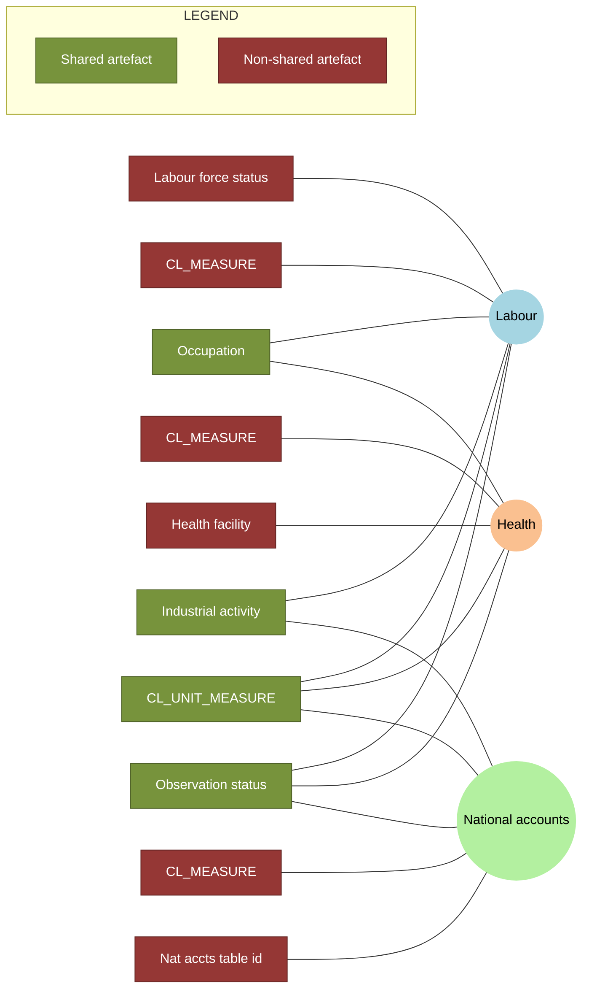

Original figure

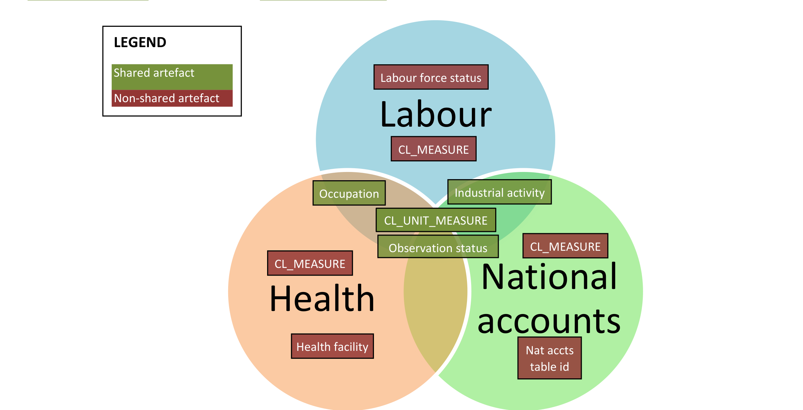

Figure 1 Examples of shared and non-shared artefacts

## 3.4 NON-SHARED STRUCTURAL METADATA GOVERNANCE 

When structural metadata is specific to a domain or framework, such as a codelist for a breakdown specific to one DSD, then the governance process is simple. The group that decides on the codelist content (owner) and the group that makes the changes to the codelist (maintenance entity) are the same. <u>As the reference framework is designed for the governance of shared structural metadata, the processes described in the document do not apply to non-shared structural metadata.</u>

### 3.4.1 Evolution of non-shared structural metadata to shared metadata

Though an artefact started as a non-shared artefact, it may start to be referenced by other artefacts. For example, a “Labour force status” codelist may be created as non-shared and maintained by the Labour statistics team, but eventually it is used by other data models that breakdown data by Labour force status. In such cases, to increase harmonization, quality and communication, the governance may switch to shared.

The following diagram shows the evolution of the Labour force status artefacts (concept and codelist) from non-shared to shared due to the increase of the domains using the artefact. In this case, the governance of the Labour force status artefacts would switch to shared governance and become subject to the shared structural metadata policy implemented by the agency.

<!-- figure: f03-shared-to-non-shared-transition -->
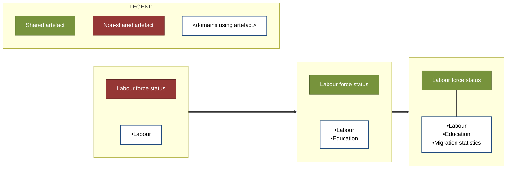

Original figure

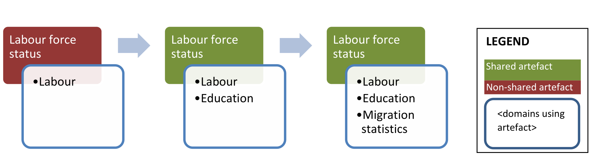

Figure 2 Transition of an artefact from shared to non-shared shared governance

## 3.5 THE REFERENCE FRAMEWORK 

<table>
<colgroup>
<col style="width: 9%" />
<col style="width: 40%" />
<col style="width: 24%" />
<col style="width: 25%" />
</colgroup>
<thead>
<tr>
<th colspan="4">
For shared structural metadata there are several
groups and process involved in the governance. The structural metadata
is approved for use through a process of consultation and review. The
groups in the process have well defined roles, responsibilities, and
dependencies.

<h3
id="351-roles-and-responsibilities-in-the-reference-framework-architecture">3.5.1
<strong>Roles and responsibilities in the reference framework
architecture</strong> </h3>

This table describes the separation of concerns for the roles in the
reference architecture diagram.
</th>
</tr>
</thead>
<tbody>
<tr>
<td>Role</td>
<td><strong>Description</strong></td>
<td><strong>Who/skills</strong></td>
<td><strong>Responsible for</strong></td>
</tr>
<tr>
<td>Practices advisory team</td>
<td>
Provides advice to all SDMX modelling practitioners in the
organisation, promote metadata harmonisation, and provide the necessary
methodology for SDMX modelling.

They may act as the maintenance entity (but not the owners, see the
CoP) for the organisation’s “top-level” shared metadata artefacts, or
they may delegate the maintenance to a relevant group.
</td>
<td>
Experts in SDMX structural modelling and the SDMX
concept-oriented guidelines.

Need a cross-domain perspective.

Have good knowledge of SDMX tools and their use cases.
</td>
<td>
SDMX methodology

Maintaining governance procedures

Organising SDMX Training

Maintaining (or delegating maintenance of) the organisation’s shared
codelists

Member of the CoP

(Optional) Chair and/or Secretariat of the CoP

Coordinating SDMX harmonisations
</td>
</tr>
<tr>
<td>Steering group</td>
<td>
A group that has the ability to guide and unblock issues in the
practices advisory team.

Mandates tasks and responsibilities to the Practices advisory
team.
</td>
<td>Staff with a strategical and business knowledge of structural
metadata and SDMX. Must be able to mandate tasks for the Practices
advisory team.</td>
<td>Mandating the Practices advisory team.</td>
</tr>
<tr>
<td>Community of practice (CoP)</td>
<td>
Joint owners of the organisation’s shared metadata artefacts.
Provides a clear consultation process for requesting changes to and
review the shared SDMX artefacts.

Meets regularly to discuss share metadata, proposals from the working
groups (see below), aspects on using SDMX in the organisations, etc.

The CoP requires a community site for information and discussion
between meetings, particularly for written procedures such as feedback
on the working groups’ proposals.

The CoP gives a mandate to shared structural metadata working groups
that report to it
</td>
<td>
A broad cross-section of subject-matter experts in the agency who
are potential users of the shared metadata artefacts.

Other members such as IT experts who have knowledge of the SDMX
data-warehouse and registry.

The Practices advisory team are a member of the CoP
</td>
<td>
Gives mandate to structural metadata working groups to work on
shared metadata

Reviewing and approving changes to the organisation’s shared metadata
artefacts.

Participating in regular meetings of the CoP

Contribute to written procedures on the virtual community.
</td>
</tr>
<tr>
<td>CoP member</td>
<td>An individual that participates in the CoP reviews and decisions on
structural metadata proposals.</td>
<td>
Statistical and metadata managers in the agency who will need to
acquire skills in SDMX structural metadata.

Stakeholders in data and metadata management such as IT, methodology,
publication, and classification specialists.

The Practices advisory team are a member.
</td>
<td>Participates in the reviews and decisions on structural metadata
proposals.</td>
</tr>
<tr>
<td>Training team</td>
<td>A group who are mandated to provide training to staff who need to
work with SDMX structural metadata.</td>
<td>
Experts in providing capacity building.

Experts in working with SDMX structural metadata.
</td>
<td>Design and provide training to structural metadata users.</td>
</tr>
<tr>
<td>Working groups</td>
<td>
Working groups may be formed to work on shared metadata. For
example, if the agency needs a shared codelist on “Labour force status”,
a working group may be formed to deliver a proposal to the CoP.

The artefact proposal does not have to be a new artefact – the
proposal may be to use ”SDMX cross-domain” concepts or codelists

The working groups follow the same business process (see section 5)
to deliver their work to the group that mandated them (usually the CoP
but it depends on the chosen governance architecture) and react on
feedback. See the diagram below.
</td>
<td>
The working group is formed of a chair (usually an expert on the
subject-matter) and other members.

At least one member of the Practices advisory team should be in the
group.

Other members are from the CoP and relevant other groups.
</td>
<td>
Formulates a shared metadata proposal according to the CoP
mandate

Reacts to feedback from the CoP on the proposals and revises the
proposals
</td>
</tr>
</tbody>
</table>

Table 1: Shared SDMX structural metadata modelling practice groups and responsibilities

### 3.5.2 The reference framework architecture

This diagram shows the reference architecture containing all the roles and relationships in this guideline. It can be implemented itself or customized – see Annex 1 for some examples of architecture variations. The  icon indicates who owns the structural metadata policy; in the reference architecture this is the Steering group.

<!-- figure: f05-reference-architecture -->
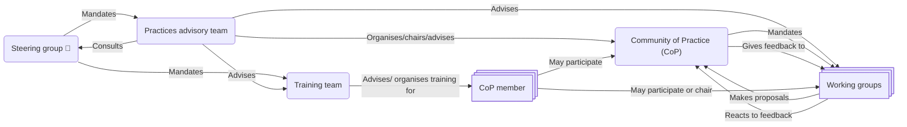

Original figure

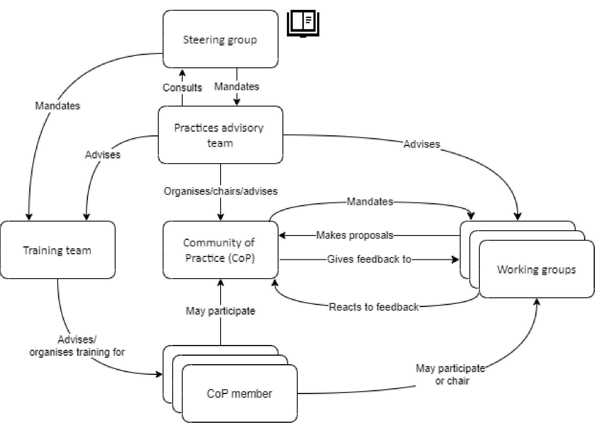

Figure 1: The reference architecture

# 4 STEPS TO IMPLEMENTING AN SDMX STRUCTURAL METADATA GOVERNANCE ARCHITECTURE 

These are recommended steps to implementing a structural metadata governance policy and architecture:

1.  Establish who will design the governance policy. This could be a senior manager who will be part of the steering group, or it could be delegated

2.  Identify the main goals of implementing a governance architecture

3.  Identify constraints. For example, staff lacking skills, low resources, low interest, heavy workload, siloed production, etc.

4.  Design the governance policy and choose the governance architecture based on the goals and constraints identified in the previous steps. Analyse the business needs, resources and other factors using this reference framework

5.  Establish who will own and who will maintain the governance policy (they may be different groups)

6.  Map the architecture in the policy to the institutional setting (which of the agency’s directorates/divisions/teams are associated with the abstract groups in this reference framework)

7.  Establish the **Steering committee** (if there is one in the chosen architecture)

8.  Establish the **Practices advisory team**

9.  Establish the **Community of Practice** (if there is one in the chosen architecture)

10. Determine the **tools** to use for collaboration and issue tracking

11. Establish the **Training team** (if there is one in the chosen architecture)

# 5 BUSINESS PROCESSES

This section describes business process that are related to the maintenance of shared structural metadata in the reference framework architecture.

## 5.1 PROCESS FOR WORKING GROUPS THAT CREATE OR MAINTAIN SHARED STRUCTURAL METADATA

When it is decided (e.g., by the CoP) that a new or new version of a structural metadata is required, a working group is formed to start a project to create a proposal.

The working group requires a starting draft proposal (this can be a rough scope outline), a moderator (ideally a subject-matter expert) and a group of members who collectively know the subject-matter and the SDMX standard and concept-oriented guidelines. It is also of great benefit to use a project or issue tracking tool such as Gitlab, Jira, GitHub, etc.

Figure 6.2.5 shows the roles and responsibilities within a working group. The horizontal swim lanes show the responsibilities of each role, e.g., the moderator organises the meetings and interacts with the CoP (or other group that mandated the change), but in working group discussions the moderator has the same “voice” as a participant.

<!-- figure: f06-business-process -->
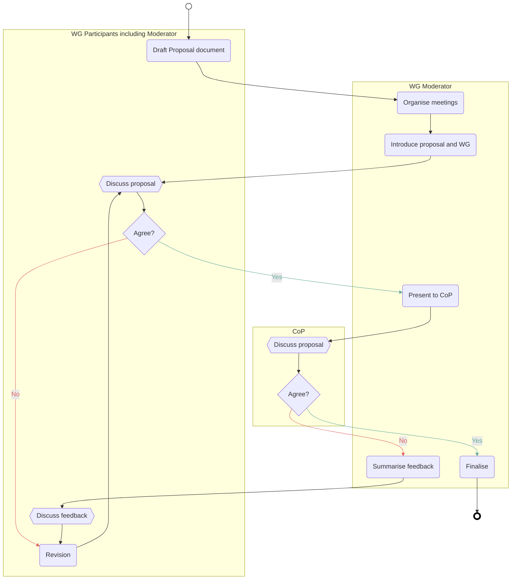

Original figure

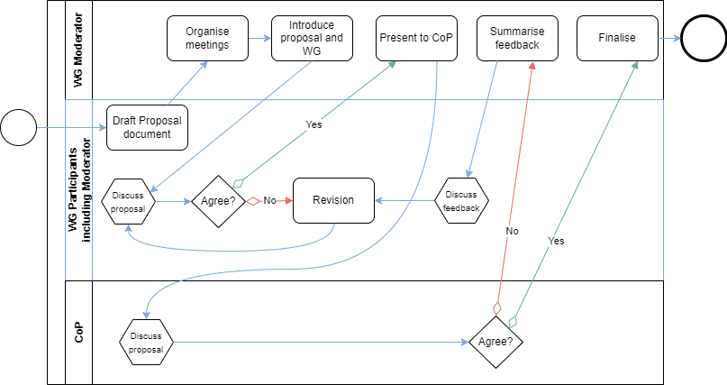

Figure 6.2.5: Business process for shared structural metadata governance

When the proposal is delivered from the working group there is a period of feedback via the CoP community site. If there is not agreement, the working moderator summarises it and the working group reacts to the feedback before responding to the CoP again. If there is agreement by the CoP (e.g., no feedback by the deadline) then the structural metadata is agreed and uploaded to the registry – the project ends, and the structural metadata enters the maintenance cycle.

## 5.2 MAINTENANCE CYCLE OF SHARED STRUCTURAL METADATA

Shared structural metadata require a maintenance lifecycle to stability, open communication, and a means for users to request changes.

<!-- figure: f07-maintenance-cycle -->
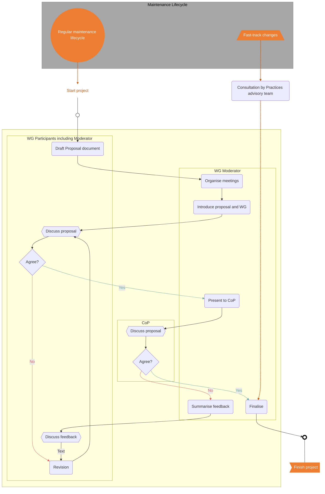

Original figure

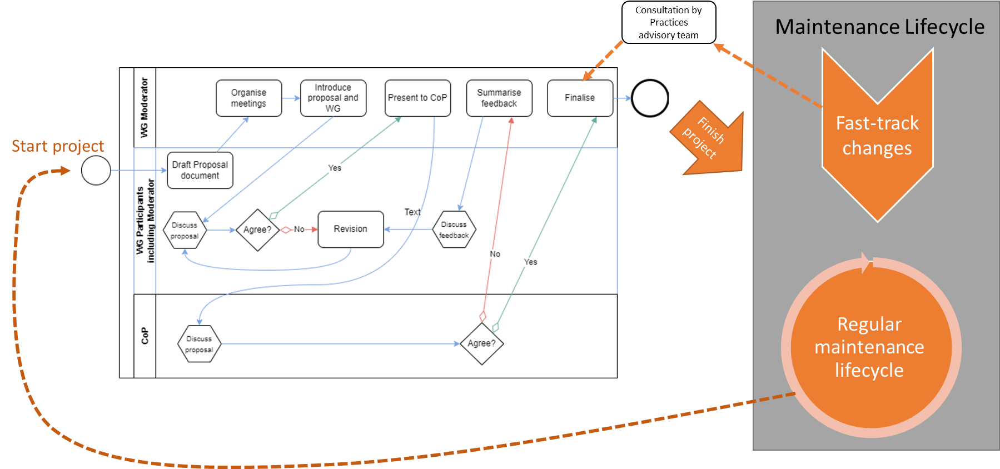

Figure 6.2.6: Maintenance cycle of shared structural metadata

At the end of each revision the new artefact version is finalised, and the maintenance lifecycle begins. The lifecycle period is decided by the owner, for example an annual lifecycle. During the lifecycle there are two types of change request:

- **Fast-track changes**: Minor changes to an artefact are allowed within the lifecycle, subject to a review coordinated by the Practices advisory team. They are rapidly implemented, typically in 1 month depending on the review outcome.

- **Regular maintenance lifecycle**: Any change may be requested including major changes. At the end of the lifecycle, all change requests are reviewed by a working group (which may need to be formed) and a proposal is sent to the ownership group (for example, the Community of Practice) for review.

# 6 ANNEXES

## 6.1 ANNEX 1: GOVERNANCE ARCHITECTURE VARIATIONS WITH COMPARATIVE INDICATORS

This annex describes some common variations on the reference architecture with indicators to help compare them. The indicators are for relative comparison between the architecture only, and there may be many other factors and constraints as to why an indicator would have a different value in certain use cases.

The architecture variations are not exhaustive and there may be better alternatives for certain use cases, especially if the horizontal responsibilities need to be scaled-out (for example, across a complex federal system), or scaled-up vertically in multiple layers of management.

### 6.1.1 Description of the comparative indicators

Each architecture variation is rated relatively to the others. The indicators are described below, each score is out of 1 (worst) to 5 (best).

| Indicator | Meaning |
|----|----|
| Metadata quality | The suitability of structural metadata for their original use case |
| Metadata reuse | The reuse potential of structural metadata across the agency |
| Agility | The rapidity that structural metadata can be finalized |
| Efficiency | The amount of resources needed to finalise structural metadata (not to be confused with the efficiency of using the structural metadata) |

This icon indicates who owns (makes decisions on) the governance architecture policy:

### 6.1.2 Fully distributed decisions and authority (reference architecture)

This is the governance reference architecture, including all the groups. The steering group are the owners and designers of the policy. This architecture offers the most quality, reuse, and communication, with a trade-off in more resources required and longer time to deliver artefacts and revisions.

<!-- figure: f09-fully-distributed -->
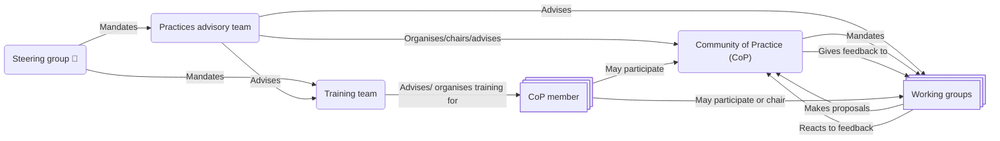

Original figure

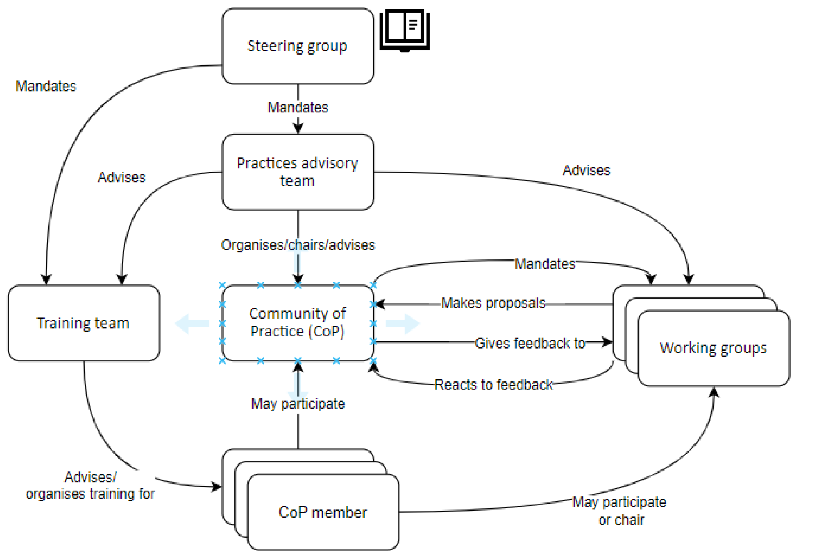

| Indicator        | Score |
|------------------|-------|
| Metadata quality | ●●●●● |
| Metadata reuse   | ●●●●● |
| Agility          | ●●    |
| Efficiency       | ●●    |

### 6.1.3 Balanced decisions and authority

This variation on the reference architecture removes the Steering group and Training team, they are merged into the Practices advisory team. As there are less groups and relations the resources required are slightly less and time to deliver is faster. However, there is slight a trade off in quality because there are less consultations and the advisory team must juggle several roles.

<!-- figure: f10-balanced -->
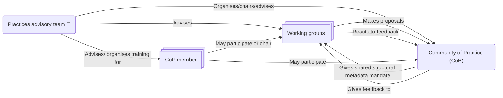

Original figure

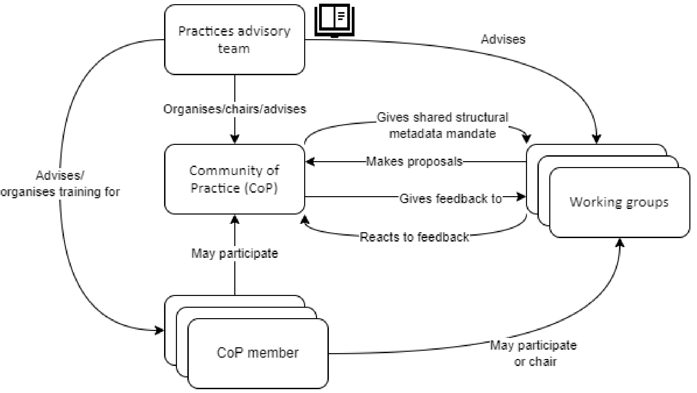

| Indicator        | Score |
|------------------|-------|
| Metadata quality | ●●●●  |
| Metadata reuse   | ●●●●● |
| Agility          | ●●●   |
| Efficiency       | ●●●   |

### 6.1.4 Centralised ownership and maintenance with community

This architecture moves the ownership of shared metadata from the CoP to the Practices advisory team. The working groups still make draft decisions and make proposals, but report to the Practices advisory team who make the final decisions instead of the CoP. The CoP is only used as a communication group and for consultations.

This architecture may be useful to save some resources and expediate decisions, if the Practices advisory team has the expertise, capacity and is mandated to make decisions on the shared metadata. However, there is risk on quality and reuse potential because there is less pro-active communication with the CoP on shared metadata proposals, and less consultation on their expertise.

| Indicator        | Score |
|------------------|-------|
| Metadata quality | ●●●   |
| Metadata reuse   | ●●●   |
| Agility          | ●●●●  |
| Efficiency       | ●●●   |

<!-- figure: f11-centralised-with-community -->
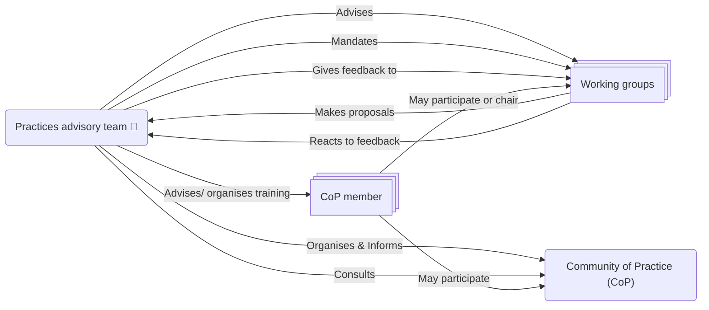

Original figure

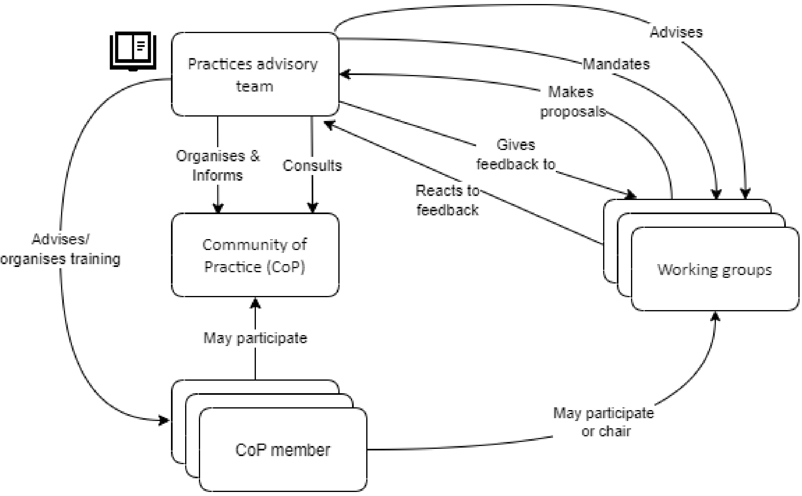

### 6.1.5 Centralised ownership and maintenance without community

This architecture removes the CoP altogether and the Practices advisory team is the owner of the shared metadata. The working groups still make draft decisions and make proposals, but report to the Practices advisory team who make the final decisions. Communication with the data managers on shared metadata could be through a notification-based collaboration portal, rather than “push-based” information and meetings to the CoP as with the architectures above.

This architecture may be useful to further reduce resources and time that were used for managing the CoP, however the Practices advisory team must have the expertise, capacity and be mandated to make decisions on the shared metadata. There is a larger risk of reduced quality and reuse potential because there is no consultation with a CoP, and it is harder to form working groups to have the required expertise for the proposals.

<!-- figure: f12-centralised-without-community -->
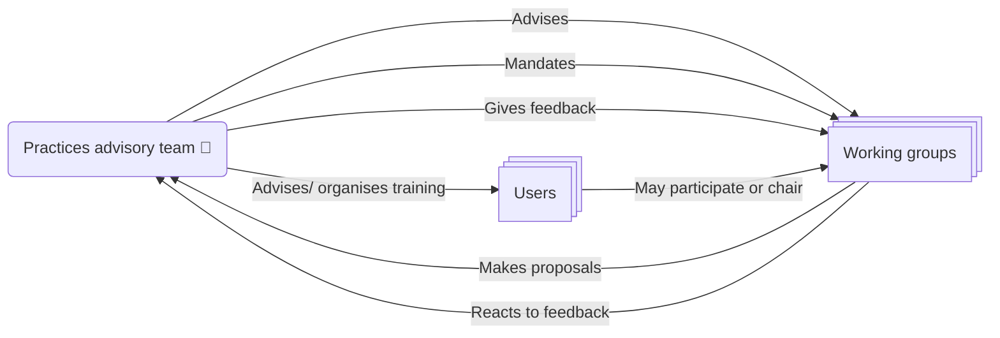

Original figure

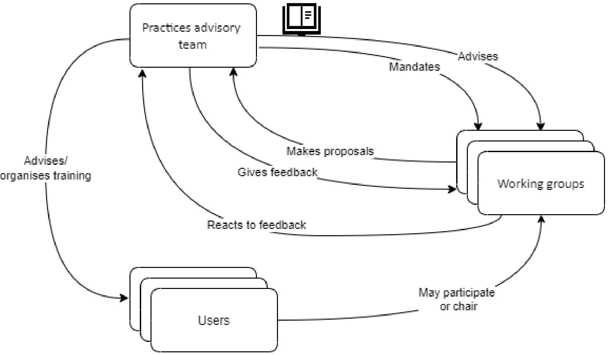

| Indicator        | Score |
|------------------|-------|
| Metadata quality | ●●    |
| Metadata reuse   | ●●    |
| Agility          | ●●●●  |
| Efficiency       | ●●●●  |

### 6.1.6 Sole authority and decision making

This architecture removes the CoP and working groups altogether and the Practices advisory team is the sole owner and author of the shared metadata. Communication with the data managers on shared metadata could be through a notification-based collaboration portal, rather than “push-based” information and meetings to the CoP as with the architectures above.

This architecture may be useful to further reduce resources and time that were used for managing the CoP, however the Practices advisory team must have the expertise, capacity and be mandated to make decisions on the shared metadata. There is a much larger risk of reduced quality because there is no consultation with a CoP, and there are no working groups to have the required expertise for the proposals. The reuse potential is reduced but still possible as the users can be informed of the shared metadata availability.

<!-- figure: f13-sole-authority -->
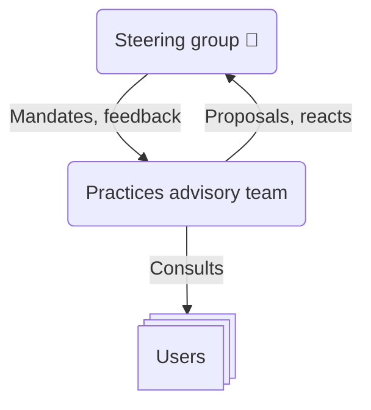

Original figure

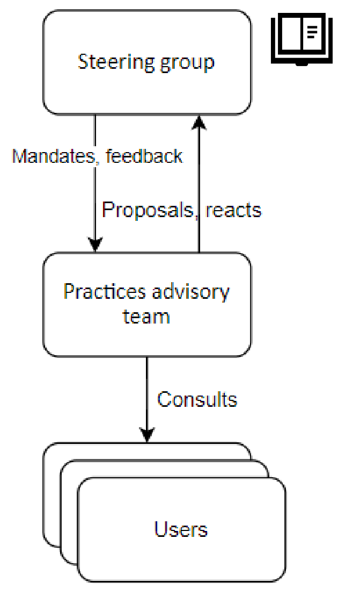

| Indicator        | Score |
|------------------|-------|
| Metadata quality | ●     |
| Metadata reuse   | ●●    |
| Agility          | ●●●●● |
| Efficiency       | ●●●●  |

### 6.1.7 Comparative scores of architecture variations

This table shows the relative scores of the architecture variations.

<table>
<colgroup>
<col style="width: 17%" />
<col style="width: 10%" />
<col style="width: 13%" />
<col style="width: 21%" />
<col style="width: 20%" />
<col style="width: 16%" />
</colgroup>
<thead>
<tr>
<th>INDICATOR</th>
<th colspan="5" style="text-align: center;">SCORE</th>
</tr>
</thead>
<tbody>
<tr>
<td>ARCHITECTURE -&gt;</td>
<td style="text-align: center;"><strong>Reference</strong></td>
<td style="text-align: center;"><strong>Balanced decisions and
authority</strong></td>
<td style="text-align: center;"><strong>Centralised ownership and
maintenance with community</strong></td>
<td style="text-align: center;"><strong>Centralised ownership and
maintenance without community</strong></td>
<td style="text-align: center;"><strong>Sole authority and decision
making</strong></td>
</tr>
<tr>
<td>Metadata quality</td>
<td style="text-align: center;">●●●●●</td>
<td style="text-align: center;">●●●●</td>
<td style="text-align: center;">●●●</td>
<td style="text-align: center;">●●</td>
<td style="text-align: center;">●</td>
</tr>
<tr>
<td>Metadata reuse</td>
<td style="text-align: center;">●●●●●</td>
<td style="text-align: center;">●●●●●</td>
<td style="text-align: center;">●●●</td>
<td style="text-align: center;">●●</td>
<td style="text-align: center;">●●</td>
</tr>
<tr>
<td>Agility</td>
<td style="text-align: center;">●●</td>
<td style="text-align: center;">●●●</td>
<td style="text-align: center;">●●●●</td>
<td style="text-align: center;">●●●●</td>
<td style="text-align: center;">●●●●●</td>
</tr>
<tr>
<td>Efficiency</td>
<td style="text-align: center;">●●</td>
<td style="text-align: center;">●●●</td>
<td style="text-align: center;">●●●</td>
<td style="text-align: center;">●●●●</td>
<td style="text-align: center;">●●●●</td>
</tr>
</tbody>
</table>

## 6.2 ANNEX 2: EXAMPLE OF INSTITUTIONAL SETTING

This is an example of a structural metadata governance architecture in the OECD’s institutional setting. The OECD have implemented the “Balanced decisions and authority” architecture based as it fits their needs on resourcing level, time to delivery, artefact quality and communication. The governance covers the needs of the whole organization.

<!-- figure: f14-oecd-implementation -->
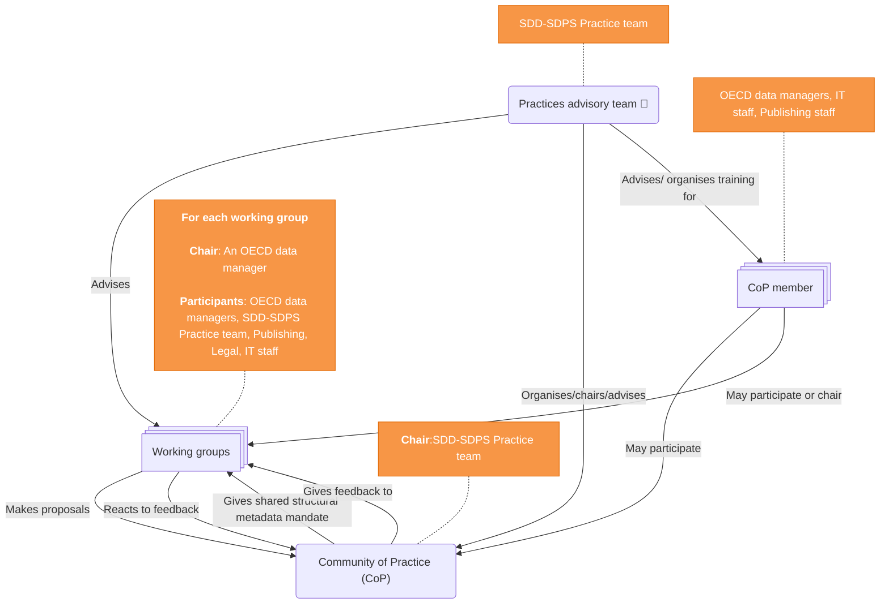

Original figure

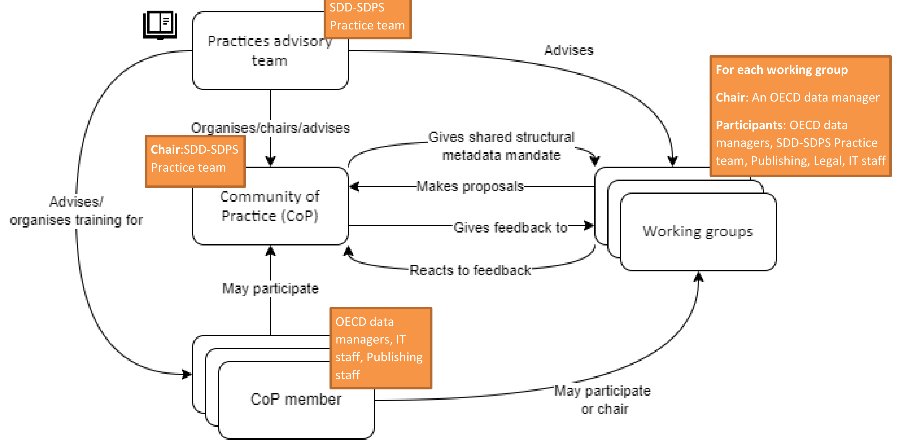

Figure 3 Example of OECD's governance architecture implementation

### 6.2.1 Explanation of OECD’s institutional setting using the “Balanced decisions and authority” architecture

- **Steering group:** There is no steering group in the OECD implementation because the Practices advisory team already contains several levels of management. It escalates issues internally and if issues need to be further escalated, they are to the direct manager of the Practices advisory team.

- **Practices advisory team**: The Practice team in the OECD’s Statistics Directorate’s (SDD) Smart Data Practices and Solutions division (SDPS). Team members have a cross-section of management, Economics, Statistics, Metadata and data management, and IT skills. They have a high level of SDMX skills and participate in the SDMX standard’s working groups. The team manager organizes and chairs the CoP. This team maintain the policy; however, it is decided in conjunction with SDD higher-level management.

- **CoP**: Any OECD staff responsible for statistical data management and activities related to it (e.g., Publishing, IT) may participate in the CoP. In-person meetings are held every 2-3 months to communicate new developments, ask for feedback, and draw attention to items requiring agreement. There is a collaboration platform where any member can post and comment on items open for feedback. Items are closed on a lapse-of-time basis if there are no comments against them. The CoP operates by consensus (rather than majority vote).

- **Working groups**: The working groups are formed of members of the CoP and at least one member of the Practices advisory team. The chair is usually a CoP member with subject-matter expertise; for example, the cross-domain codelist for Industrial activity is chaired by a statistician from the Trade and Productivity Statistics division. Other experts may be in the working group such as IT, Legal and Publishing directorate staff.

## 6.3 ANNEX 3: USING THE REFERENCE FRAMEWORK WITH THE GENERIC ACTIVITY MODEL FOR STATISTICAL ORGANISATIONS (GAMSO) 1.2 AND GENERIC STATISTICAL BUSINESS PROCESS MODEL (GSBPM) 5.1

The implementation of a structural metadata governance architecture can be integrated into an architecture that is compatible with GAMSO 1.2 and GSBPM 5.1.

### 6.3.1 GAMSO

The implementation of an architecture is in the context of these GAMSO activities under [Strategy and Leadership](https://statswiki.unece.org/display/GAMSO/Strategy+and+Leadership#StrategyandLeadership-GAMSOv1.2GovernandLead).

**Govern and Lead**

- Ensure general coordination and alignment

- Define general organisational policies

- Publish policies, guidelines, and normative documents

**Manage Strategic Collaboration and Cooperation**

- Coordinate the national statistical system

  The implementation of an architecture is in the context of these GAMSO activities under [Corporate Support](https://statswiki.unece.org/display/GAMSO/Corporate+Support#CorporateSupport-GAMSOv1.2ManageStatisticalMethodology).

**Manage Quality**

- Manage quality framework

- Manage quality assurance tools

- Manage quality documentation

**Manage Information and Knowledge**

- Manage knowledge

- Manage information standards and access rights

- Manage metadata and data

<!-- figure: f15-gamso -->
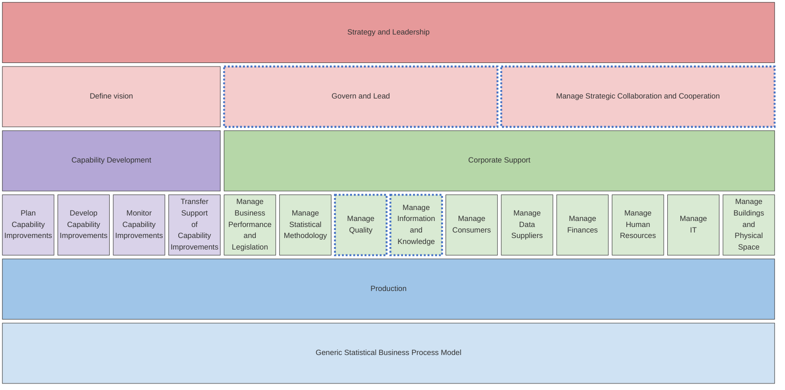

Original figure

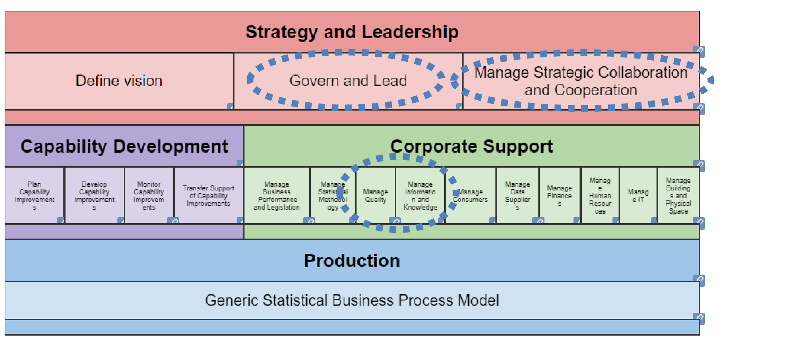

### 6.3.2 GENERIC STATISTICAL BUSINESS PROCESS MODEL (GSBPM) 5.1

The implementation of an architecture is in the context of these activities in the [GSBPM overarching processes](https://statswiki.unece.org/display/GSBPM/VI.+Overarching+Processes):

**Quality Management**

- Assessing risks and implementing risk treatments to ensure fit-for-purpose quality;

- Setting quality criteria to be used in the process;

- Seeking and analysing user feedback;

**Metadata Management**

- Metadata handling

- Metadata Authority

- Relationship to Statistical Cycle / Processes

- Users

**Data Management**

- Establishing a governance structure and assigning data stewardship responsibilities;

- Designing data structures and associated data sets, and the flow of data through the statistical business process

<!-- figure: f16-gsbpm -->
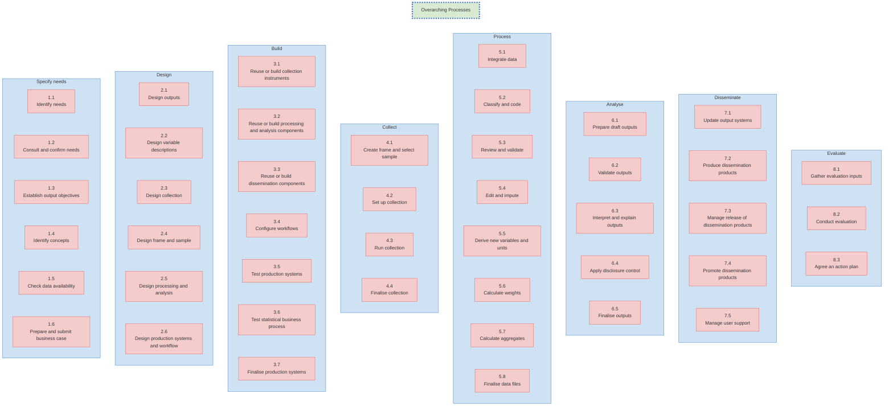

Original figure

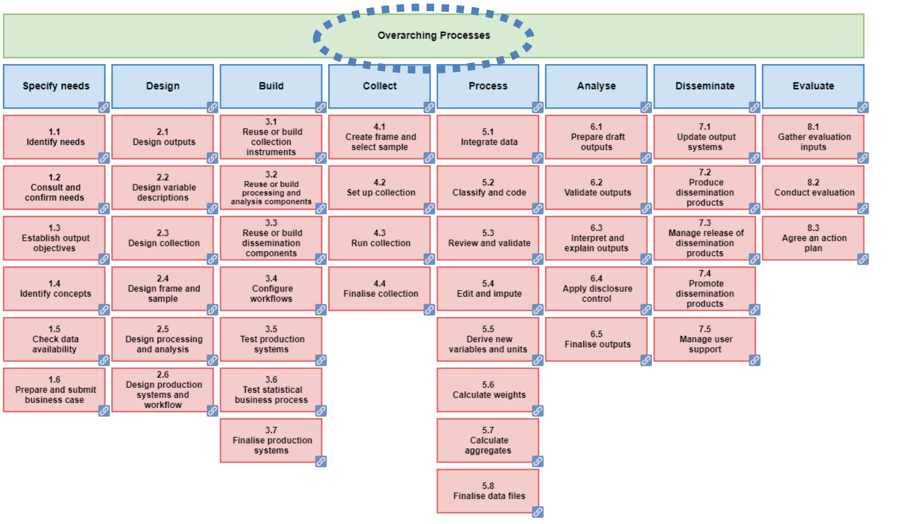

