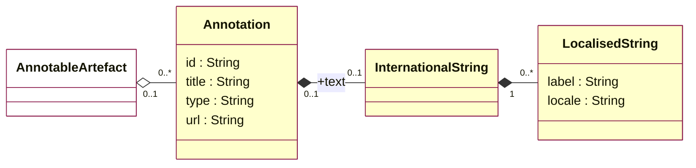
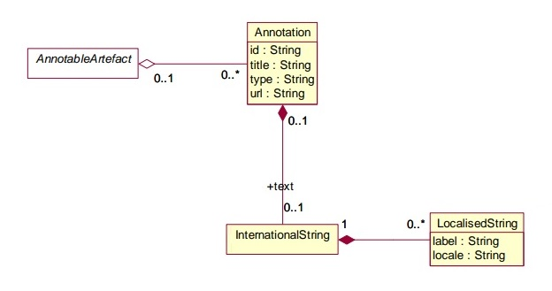
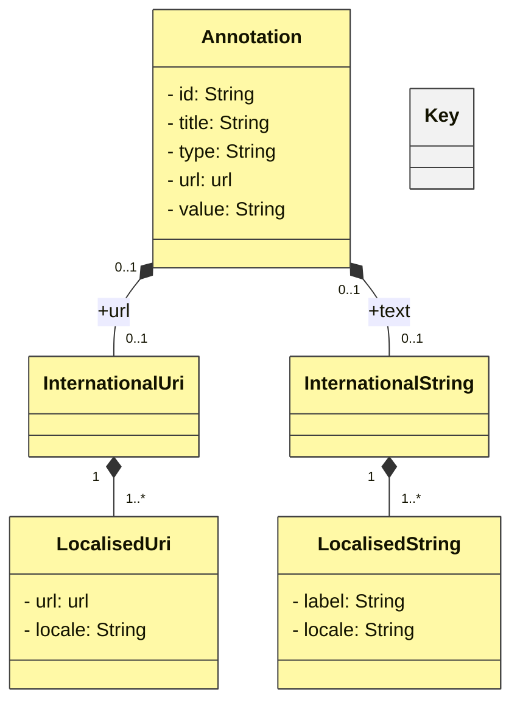
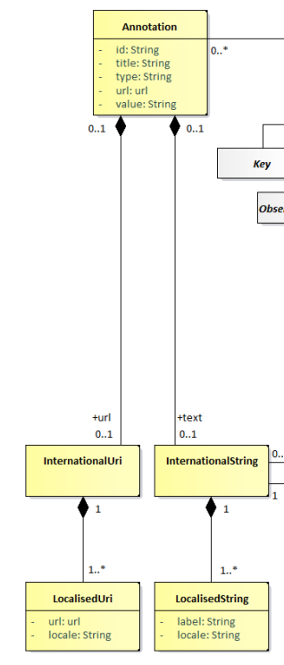
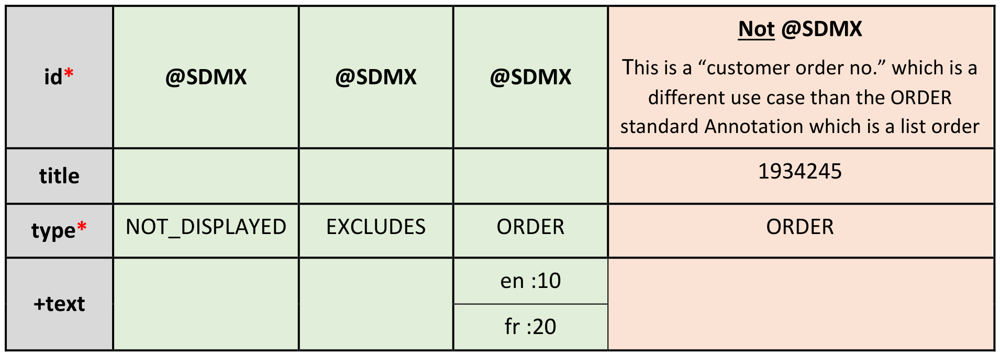
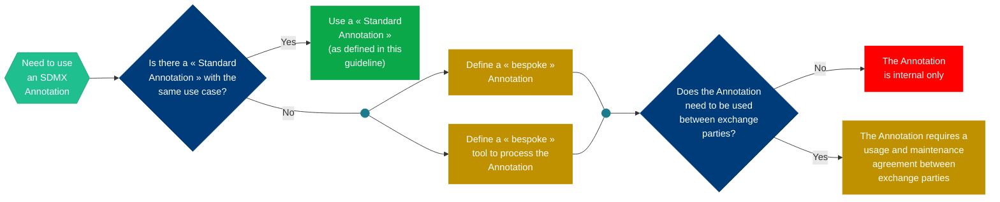
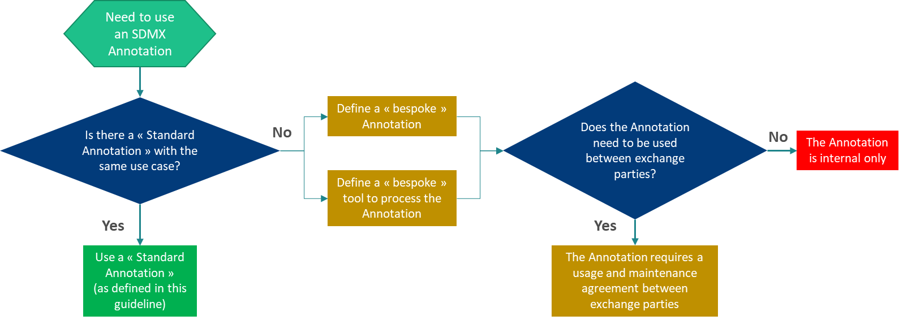

<!-- figure: f01-logo -->

**GUIDELINES ON USING SDMX ANNOTATIONS**

**Version 2.0 – April 2025**

# DOCUMENT HISTORY

| **Version** | **Date** | **Comment** |
|----|----|----|
| 1.0 | 01/03/2021 | Initial version. |
| 2.0 | 24/04/2025 | Adapted to SDMX 3.0. Extensions to controlled vocabulary. Clarified text. |

# Contents

[DOCUMENT HISTORY](#document-history)

[Contents](#_Toc196741567)

[Introduction](#introduction)

[SDMX Information Model for the Annotation construct](#sdmx-information-model-for-the-annotation-construct)

[SDMX 2.1](#sdmx-21)

[SDMX 3.0](#sdmx-30)

[Properties of the Annotation construct](#properties-of-the-annotation-construct)

[Introducing Standard Annotations](#introducing-standard-annotations)

[How to Identify Standard Annotations?](#how-to-identify-standard-annotations)

[Examples](#examples)

[The Business value of Standard Annotations](#the-business-value-of-standard-annotations)

[List of Standard Annotations](#list-of-standard-annotations)

[Relationships between Annotation properties](#relationships-between-annotation-properties)

[General and Display-related Annotation types](#general-and-display-related-annotation-types)

[Codelist and Statistical Classification-specific Annotations](#codelist-and-statistical-classification-specific-annotations)

[Concept Scheme SDMX:CS_ANNOT](#concept-scheme-sdmxcs_annot)

[Example of a Concept](#example-of-a-concept)

[SDMX-ML of the Example](#sdmx-ml-of-the-example)

[References](#references)

# Introduction

According to the SDMX documentation, the Annotation is a construct that contains user or organisation-specific metadata. The Annotation construct in SDMX is available to most of the SDMX structural metadata artefacts. This facility is essentially a flexible extension mechanism allowing metadata to be added to an SDMX structural artefact. Annotations are often used to store metadata in artefacts when there is no specific place for that information in the SDMX information model. Presentation metadata is a prime example, such as a default presentation for a dataflow.

Note that whilst the SDMX Annotation has a specific structure (Title, Type, URL, Text) individual organisations are free to use these in any way and any combination they wish. However, an Annotation can only be processed in a meaningful way (i.e. other than viewing it) by systems that understand its semantics.

The main advantage of the Annotation is its flexibility as all properties can be tailor-made and there is no limit to their number. This can prove very useful for specific applications, such as dissemination tools. The main drawback is poor interoperability as Annotations convey no semantics and are not standardised. This means that organisations that want to exchange Annotations and process them automatically must agree upon, at least, a common naming syntax.

The aim of this guideline is to improve machine interactions by proposing a controlled vocabulary for the Type property of the SDMX Annotation construct and a recommended usage for the other properties that will greatly improve the interoperability of Annotations between SDMX-compliant organisations.

The Controlled Vocabulary referred to above will be maintained as a SDMX Concept Scheme stored in the SDMX Global Repository.

# SDMX Information Model for the Annotation construct

### SDMX 2.1

<!-- figure: f02-uml-sdmx21 -->

Original figure

All classes derived from the abstract class AnnotableArtefact may have Annotations. The Annotation is used to convey extra information to describe SDMX constructs. This information may be in the form of a URL reference, a non-localised text, and/or multiple localised texts (represented by the one-to-many relationship to LocalisedString).

### SDMX 3.0

<!-- figure: f03-uml-sdmx30 -->

Original figure

The URL can be localised which gives the advantage of linking to different resources depending on the language. It also removes the complexity of having to use AnnotationText in SDMX 2.1 to do this.

# Properties of the Annotation construct

The properties of the Annotation construct are listed below. This information is taken from the [SDMX official technical documentation](https://sdmx.org/?page_id=5008).

<table>
<colgroup>
<col style="width: 28%" />
<col style="width: 37%" />
<col style="width: 33%" />
</colgroup>
<thead>
<tr>
<th style="text-align: center;">Property</th>
<th style="text-align: center;">Description</th>
<th style="text-align: center;">Controlled vocabulary context</th>
</tr>
</thead>
<tbody>
<tr>
<td style="text-align: center;">id</td>
<td style="text-align: left;">Identifier for the Annotation. It can be used to disambiguate one Annotation from another where there are several Annotations for the same annotated object.</td>
<td style="text-align: left;">Id is set to @SDMX to identify it as part of the controlled vocabulary</td>
</tr>
<tr>
<td style="text-align: center;">title</td>
<td style="text-align: left;">A title used to identify an Annotation.</td>
<td style="text-align: left;">A non-localised value for the annotation. Used when localisation is irrelevant.</td>
</tr>
<tr>
<td style="text-align: center;">type</td>
<td style="text-align: left;">
Specifies how the Annotation is to be processed.

The <strong>type</strong> is often used as the usage context of the Annotation. The types are not enumerated<a href="#fn-1" id="fnref-1">1</a>, as these can be specified by the Annotation creator. The definitions and use of Annotation types should be documented by their creator.
</td>
<td style="text-align: left;">Identifies the usage (e.g. images are type IMAGE) of the annotation. The type values are enumerated in the controlled vocabulary table.</td>
</tr>
<tr>
<td style="text-align: center;">url</td>
<td style="text-align: left;">
A link to external descriptive text.

The <strong>url</strong> is a URI - typically a URL - which points to a resource. If a specific behaviour is desired, an Annotation type should be defined which specifies the use of this field more exactly.
</td>
<td style="text-align: left;">A non-localised URL reference to an external resource. Used when localisation is irrelevant.</td>
</tr>
<tr>
<td style="text-align: center;">+url</td>
<td style="text-align: left;"><strong>SDMX 3.0 and later</strong>. An annotation may have several localised URLs</td>
<td style="text-align: left;">A localised URL reference to an external resource.</td>
</tr>
<tr>
<td style="text-align: center;">+text</td>
<td style="text-align: left;">
An International String that provides the multilingual text content of the Annotation.

<strong>Text</strong> holds a language-specific string containing the text of the Annotation.
</td>
<td style="text-align: left;">A localised value for the annotation.</td>
</tr>
</tbody>
</table>

# Introducing Standard Annotations

As stated earlier, a major drawback of the Annotation construct is the fact that they are not standardised for reuse when exchanging structural metadata. Annotations are containers for additional information relating to the object to which they are attached. This means that for an Annotation to be interpreted in the same way by exchange partners, a reference is needed that defines some standard behaviour and implementation.

This guideline proposes an Annotation controlled vocabulary and guidelines on their (re)use for SDMX implementers.

A standard Annotation can be defined as an Annotation that has an agreed definition in the SDMX community. Some of them, especially the general and display-related annotations also have a described behaviour. They allow diverse systems to parse the information and perform a specific action in response.

# How to Identify Standard Annotations?

In order to be able to configure their applications to implement actions based upon standard Annotations, systems must know how to identify such Annotations. This is done by setting the Annotation **id** property to “@SDMX” which indicates that the Annotation is part of the controlled vocabulary described in the section List of Standard Annotations, and avoids using “@SDMX” for other usage contexts. For example, ORDER could be the order of codes (as described in this controlled vocabulary) or some kind of order number (a different usage).

The additional mandatory information to be provided is the **type** property that specifies the type of action to be implemented. There may be other mandatory property values depending on the type of the standard Annotation.

## Examples

```mermaid
block-beta
    columns 76
    r0c0["id*"]:8 r0c1["@SDMX"]:14 r0c2["@SDMX"]:12 r0c3["@SDMX"]:12 r0c4["Not @SDMX<br>This is a “customer order no.” which is a different use case than the ORDER standard Annotation which is a list order"]:30
    r1c0["title"]:8 r1c1[" "]:14 r1c2[" "]:12 r1c3[" "]:12 r1c4["1934245"]:30
    r2c0["type*"]:8 r2c1["NOT_DISPLAYED"]:14 r2c2["EXCLUDES"]:12 r2c3["ORDER"]:12 r2c4["ORDER"]:30
    r3c0["+text"]:8 r3c1[" "]:14 r3c2[" "]:12 r3c3["en :10"]:12 r3c4[" "]:30
    r4c0[" "]:8 r4c1[" "]:14 r4c2[" "]:12 r4c3["fr :20"]:12 r4c4[" "]:30
    classDef default fill:#FFFFFF,stroke:#D9D9D9,color:#000000
    style r0c0 fill:#D9D9D9,stroke:#BFBFBF
    style r0c1 fill:#E2EFD9,stroke:#BFBFBF
    style r0c2 fill:#E2EFD9,stroke:#BFBFBF
    style r0c3 fill:#E2EFD9,stroke:#BFBFBF
    style r0c4 fill:#FBE4D5,stroke:#BFBFBF
    style r1c0 fill:#D9D9D9,stroke:#BFBFBF
    style r1c1 fill:#E2EFD9,stroke:#BFBFBF
    style r1c2 fill:#E2EFD9,stroke:#BFBFBF
    style r1c3 fill:#E2EFD9,stroke:#BFBFBF
    style r1c4 fill:#FBE4D5,stroke:#BFBFBF
    style r2c0 fill:#D9D9D9,stroke:#BFBFBF
    style r2c1 fill:#E2EFD9,stroke:#BFBFBF
    style r2c2 fill:#E2EFD9,stroke:#BFBFBF
    style r2c3 fill:#E2EFD9,stroke:#BFBFBF
    style r2c4 fill:#FBE4D5,stroke:#BFBFBF
    style r3c0 fill:#D9D9D9,stroke:#BFBFBF
    style r3c1 fill:#E2EFD9,stroke:#BFBFBF
    style r3c2 fill:#E2EFD9,stroke:#BFBFBF
    style r3c3 fill:#E2EFD9,stroke:#BFBFBF
    style r3c4 fill:#FBE4D5,stroke:#BFBFBF
    style r4c0 fill:#D9D9D9,stroke:#BFBFBF
    style r4c1 fill:#E2EFD9,stroke:#BFBFBF
    style r4c2 fill:#E2EFD9,stroke:#BFBFBF
    style r4c3 fill:#E2EFD9,stroke:#BFBFBF
    style r4c4 fill:#FBE4D5,stroke:#BFBFBF
```

The green columns in the table below show example usages of standard Annotations. The orange “ORDER” column is not a standard Annotation because the usage context is not the same as the standard Annotation “ORDER”, therefore the **id** should not be “@SDMX”.

<!-- figure: f05-standard-annotation-examples -->

Original figure

\* denotes a mandatory information for standard Annotations

# The Business value of Standard Annotations

The following diagram explains the business value and decision process when deciding whether to use a standard Annotation. As can be seen, if they are used then a maximum reuse is made of the Annotation itself, tools and processes. If they are not used then bespoke Annotations, agreements, tools and processing are required to understand and make use of the information in the Annotation, and it (plus supporting tools, processes, etc.) is harder to reuse.

<!-- figure: f04-business-value -->

Original figure

# List of Standard Annotations

This section lists the standard Annotations with their typical usage contexts. This list will be expanded over time as new implementations and needs arise. When references to external standards are made (e.g. skos or xkos specifications), the reader is invited to consult the “References” section for more information.

The list of standard Annotations will be available from the SDMX Registry as artefact: SDMX:CS_ANNOT(\*.\*.\*). Link: <https://registry.sdmx.org/ws/public/sdmxapi/rest/conceptscheme/SDMX/CS_ANNOT/latest/?format=sdmx-2.1&detail=full&references=none>

**Note:** There are several Annotations that are types of name or label, e.g. FULL_NAME, SHORT_LABEL, ORIGINAL_LABEL. These Annotations have specific use cases that are described in the tables below and should not be used to replace an artefact’s or item scheme item’s Name and Description property.

## Relationships between Annotation properties

#### Text value defaults and specific locale values

Some use cases may benefit from having a single, default value for all locales/languages but also to set the value for certain locales. An example is ORDER where there may be a default list order for all locales but two locales have a specific order which is different from the default. In order to avoid having to state an order for every locale, the Annotation Title property may be used to state the default value, whereas the text property is used for the localised values.

Consider this annotation *Example:* An ORDER annotation type that is attached to a code item ACME. If both the Annotation Text and Annotation Title have values, then the Annotation Text value (e.g. en:10,es:20) is used for the localized values instead of the Annotation Title (e.g. 30) which would only be taken if the locale in the context is not found among the specified ones.

#### URL value defaults and specific locale values

##### SDMX 2.1 and earlier

In SDMX 2.1, the Annotation’s URL property is a single, non-localised value. There may be cases where different URLs are required for certain locales. In this case, it is recommended to use the Annotation text property and state the language and URL in an HTML fragment, for example:

fr:\<a href=”https://someLink”\>

When both a URL and text property for the locale exists, the text property overrides (is used instead of) the URL property.

##### SDMX 3.0 and later

Multiple URL localised properties were introduced in SDMX 3.0. Therefore, the URL work-around in the above paragraph is not recommended. The URL property should be used as shown in the table.

## General and Display-related Annotation types

<table>
<colgroup>
<col style="width: 15%" />
<col style="width: 22%" />
<col style="width: 13%" />
<col style="width: 14%" />
<col style="width: 20%" />
<col style="width: 12%" />
</colgroup>
<thead>
<tr>
<th>Annotation Type</th>
<th>Use Case</th>
<th>Where to attach</th>
<th>
+Text

Blue is optional
</th>
<th>
Title

Blue is optional
</th>
<th>
SDMX 2.1:URL

SDMX &gt;=3.0:+URL

Blue is optional
</th>
</tr>
</thead>
<tbody>
<tr>
<td>FULL_NAME</td>
<td>Alternative name to be displayed for items in Item Schemes (e.g. Codelists, Concept Schemes, Category Schemes) whenever the item is displayed without its parent. For example, if a code list that has a hierarchy is displayed as a flat list, then this annotation may be used to provide sufficient context for the code. Concatenation of code + heading in NACE Rev.2.1  
en: A0123 Growing of citrus fruits</td>
<td>Item in an Item Scheme</td>
<td>
&lt;language&gt;:&lt;content&gt;,

&lt;language&gt;:&lt;content&gt;,…

<em>Example:</em>

en:Labour force (Employment)
</td>
<td>&lt;content&gt;</td>
<td></td>
</tr>
<tr>
<td>REPLACE_NAME</td>
<td>Replace each code name in a component by the value of another component in an observation or series</td>
<td>A Dataflow or DSD</td>
<td></td>
<td>
&lt;component Id to replace name&gt;:&lt;component Id to use name&gt;

<em>Example:</em>

CUST_BREAKDOWN:CUST_BREAKDOWN_LB
</td>
<td></td>
</tr>
<tr>
<td>REPLACE_CONTENT</td>
<td>Replace the content in a component by the value of another component in an observation or series</td>
<td>A Dataflow or DSD</td>
<td></td>
<td>
&lt;component Id to replace content&gt;:&lt;component Id to use content&gt;

<em>Example:</em>

REF_AREA:M49_CODE
</td>
<td></td>
</tr>
<tr>
<td>COMPLEMENT</td>
<td>
Additional fixed text to be displayed in parenthesis after the code name.

E.g. Representation of Non-hazardous (NHAZW), hazardous waste (HAZW) in the European List of Wastes 
en: 01 03 04* acid-generating tailings from processing of sulphide ore (HAZW) 
en: 01 03 99 wastes not otherwise specified (NHAZW)
</td>
<td>Item in an Item Scheme</td>
<td>
&lt;language&gt;:&lt;content&gt;,

&lt;language&gt;:&lt;content&gt;,…

<em>Example:</em>

en:See reference metadata 
</td>
<td>&lt;content&gt;</td>
<td></td>
</tr>
<tr>
<td>ORDER</td>
<td>Explicit indication of a localised order of items in Items Schemes or artefacts (e.g. Codelist, Concept Scheme, Category Scheme, Dataflow, etc.)</td>
<td>
Either:

<ul>
<li>
an artefact, or;
</li>
<li>
an item in an Item Scheme
</li>
</ul></td>
<td>
&lt;language&gt;:&lt;content&gt;,

&lt;language&gt;:&lt;content&gt;,…

<em>Example:</em>

en:10,es:20
</td>
<td>&lt;content&gt;</td>
<td></td>
</tr>
<tr>
<td>TOTAL</td>
<td>
Code Item that represents a total value. If the attachment is:

<ul>
<li>
to a Code, the Annotation Text is optional and may contain an explanatory text;
</li>
</ul>

to a Codelist, the Annotation Title is mandatory and includes the code(s) that represent a total
</td>
<td>
Either:

<ul>
<li>
a Code Item that represents a total value, or;
</li>
<li>
a Codelist to specify the code(s) with the total
</li>
</ul></td>
<td>
&lt;language&gt;:&lt;explanatory text&gt;,

&lt;language&gt;:&lt;explanatory text&gt;,…
</td>
<td>
Attached to Code Item: &lt;blank&gt;

Attached to Codelist: &lt;code&gt;,&lt;code&gt;,…
</td>
<td></td>
</tr>
<tr>
<td>DRILLDOWN</td>
<td>Denotes the concept that specifies whether observations are at the aggregate level or a drilldown.</td>
<td>
Either:

<ul>
<li>
A Dataflow or DSD
</li>
</ul></td>
<td></td>
<td>
&lt;concept Id&gt;

<em>Example:</em>

DD_DIM (this concept should be hidden using the NOT_DISPLAYED Annotation below)
</td>
<td></td>
</tr>
<tr>
<td>DEPRECATED</td>
<td>
Indication that an Item in an Item Scheme or an artefact is deprecated.

For an item scheme item, the annotation value provides a replacement name for the code name.

For an artefact, the URL points to the replacement artefact. May be used in conjunction with SUPERSEED where the replacement artefact references the replaced artefact.

Suggestion to use a controlled vocabulary

url: &lt;<a href="http://publications.europa.eu/resource/authority/concept-status/CURRENT">http://publications.europa.eu/resource/authority/concept-status/CURRENT</a>&gt; 
url: &lt;<a href="http://publications.europa.eu/resource/authority/concept-status/DEPRECATED">http://publications.europa.eu/resource/authority/concept-status/DEPRECATED</a>&gt;

or 

TITLE: true (false)
</td>
<td>
Either:

<ul>
<li>
an artefact, or;
</li>
<li>
an item in an Item Scheme
</li>
</ul></td>
<td>
For item scheme item:

&lt;language&gt;:&lt;content&gt;,

&lt;language&gt;:&lt;content&gt;,…

<em>Example:</em>

en:deprecated,fr:obsolète
</td>
<td>&lt;content&gt;</td>
<td>
For artefact:

&lt;see section URL value defaults and specific locale values&gt;
</td>
</tr>
<tr>
<td>DEFAULT</td>
<td>
Indication that an item in an Item Scheme or artefacts is to be selected by default.

The Annotation defines a selection so that a pre-defined default subset of data can be processed (e.g. visualised, extracted) instead of the entire dataset
</td>
<td><ul>
<li>
Item in ItemScheme, or;
</li>
<li>
DSD, or;
</li>
<li>
a Dataflow
</li>
</ul>

Note: A DEFAULT Annotation attached to a later level in this list supersedes that attached to an earlier level. E.g., a DEFAULT Annotation attached to individual Codes in Codelists is only to be used when there is no DEFAULT Annotation attached to the Dataflow nor to the DSD, and those of DSDs are only to be used when there is no DEFAULT Annotation attached to the Dataflow.
</td>
<td></td>
<td>
Attached to:

- DSD or Dataflow: 
 <strong>&lt;concept&gt;=&lt;code&gt;+&lt;code&gt;+…,&lt;concept&gt;=&lt;code&gt;+&lt;code&gt;+…</strong>

<em>Example:</em> FREQ=A+Q,TIME_PERIOD_START=2013-01,TIME_PERIOD_END=2018-12
</td>
<td></td>
</tr>
<tr>
<td>IMAGE</td>
<td>A visual identity to associate to Item Scheme Items or artefacts</td>
<td>
Either:

<ul>
<li>
an artefact, or;
</li>
<li>
an item in an item scheme
</li>
</ul></td>
<td style="text-align: left;">
For localised content in SDMX 2.1

&lt;language&gt;:&lt;HTML containing URL to the resource&gt;,

&lt;language&gt;:&lt;HTML containing URL to the resource&gt;,…

<em>Example:</em>

en:&lt;a href=”https://sdmx.org/wp-content/uploads/SDMX_map_small-220x220.jpg”&gt;
</td>
<td></td>
<td>
See section URL value defaults and specific locale values.

<em>Example:</em>

https://sdmx.org/wp-content/uploads/SDMX_map_small-220x220.jpg
</td>
</tr>
<tr>
<td>DRILLDOWN_CONCEPTS</td>
<td>Concepts to be displayed in a drilldown operation</td>
<td>Dataflow or DSD</td>
<td></td>
<td style="text-align: left;">
&lt;concept Id&gt;,&lt;concept Id&gt;,…

Example :

DONOR,RECIPIENT,YEAR,PROJECT_ID,OBS_VALUE,DESCRIPTION,OWNER
</td>
<td></td>
</tr>
<tr>
<td>NOT_DISPLAYED</td>
<td>Used to hide components or their values in the presentation</td>
<td style="text-align: left;">
Either:

<ul>
<li>
a Dataflow or DSD, or;
</li>
<li>
an Item in an Item Scheme
</li>
</ul></td>
<td></td>
<td style="text-align: left;">
Attached to Item in Item Scheme: &lt;blank&gt;

Attached to Dataflow or DSD:

&lt;concept Id&gt;,&lt;concept Id&gt;,…

Example :

DD_DIM (to hide drilldown control concept)
</td>
<td></td>
</tr>
<tr>
<td>LAYOUT_ROW</td>
<td>Dimensions to be presented in rows (concepts on y-axis)</td>
<td>
Either:

<ul>
<li>
an artefact, or;
</li>
<li>
a Dimension
</li>
</ul></td>
<td></td>
<td style="text-align: left;">
Attached to Dimension: &lt;blank&gt;

Attached to Dataflow or DSD: &lt;dimension Id&gt;,&lt;dimension Id &gt;,…

<em>Example:</em>

REF_AREA,MEASURE
</td>
<td></td>
</tr>
<tr>
<td>LAYOUT_COLUMN</td>
<td>Dimensions to be presented in columns (concepts on x-axis)</td>
<td>
Either:

<ul>
<li>
an artefact, or;
</li>
<li>
a Dimension
</li>
</ul></td>
<td></td>
<td style="text-align: left;">
Attached to Dimension: &lt;blank&gt;

Attached to Dataflow or DSD: &lt;dimension Id&gt;,&lt;dimension Id&gt;,…

<em>Example:</em>

TIME_PERIOD
</td>
<td></td>
</tr>
<tr>
<td>LAYOUT_FLAG</td>
<td>Indication that an attribute and its attribute value should be presented as a flag</td>
<td>Dataflow</td>
<td></td>
<td style="text-align: left;">
&lt;concept Id&gt;,&lt;concept Id&gt;,...

<em>Example:</em>

OBS_STATUS,CONF_STATUS
</td>
<td></td>
</tr>
<tr>
<td>LAYOUT_NOTE</td>
<td>Indication that an attribute and its attribute value should be presented as a note</td>
<td>Dataflow</td>
<td></td>
<td style="text-align: left;">
&lt;concept Id&gt;,&lt;concept Id&gt;,...

<em>Example:</em>

OBS_STATUS,CONF_STATUS
</td>
<td></td>
</tr>
<tr>
<td style="text-align: left;">METADATA</td>
<td>Links an MSD directly to a DSD. Can be used to overcome the complexities of reference metadata linkage</td>
<td>DSD</td>
<td></td>
<td>MSD URI, e.g. urn:sdmx:org.sdmx.infomodel.metadatastructure.MetadataStructure=OECD:MSD_REF_METADATA(1.0)</td>
<td></td>
</tr>
<tr>
<td style="text-align: left;">LAYOUT_ROW_SECTION</td>
<td>Dimension to be presented as a break-down concept at a third hierarchical level above columns and rows.</td>
<td>
Either:

<ul>
<li>
an artefact, or;

a Dimension
</li>
</ul></td>
<td></td>
<td>
Attached to Dimension: &lt;blank&gt;

Attached to Dataflow or DSD: &lt;dimension Id&gt;,&lt;dimension Id&gt;,…

<em>Example:</em>

SEX
</td>
<td></td>
</tr>
<tr>
<td style="text-align: left;">EXT_RESOURCE</td>
<td>
A localised link to an external resource associated to the annotated artefact. For example, an ontology item

<em>a methodology</em> en:&lt;a href:"<a href="https://ec.europa.eu/eurostat/web/waste/methodology">https://ec.europa.eu/eurostat/web/waste/methodology</a>"&gt;
</td>
<td>Any SDMX object</td>
<td style="text-align: left;">
For localised content in SDMX 2.1

 &lt;language&gt;:&lt;HTML containing URL to the resource&gt;,

&lt;language&gt;:&lt;HTML containing URL to the resource&gt;,…

<em>Example:</em>

en:&lt;a href=”<a href="http://rdf-vocabulary.ddialliance.org/xkos#depth">http://rdf-vocabulary.ddialliance.org/xkos#depth</a>”&gt;
</td>
<td style="text-align: left;"></td>
<td>
See section URL value defaults and specific locale values.

<em>Example:</em>

http://rdf-vocabulary.ddialliance.org/xkos#depth
</td>
</tr>
<tr>
<td style="text-align: left;">COMBINED_CONCEPTS</td>
<td>
Comma-separated list of concept IDs to show as a concatenated label.

The listed concepts’ item contents may be concatenated to generate the target concept.

Multiple target concept combinations can be defined by separating the target concepts by ;
</td>
<td>Dataflow or DSD</td>
<td>
&lt;language&gt;:&lt;display name&gt;,

&lt;language&gt;:&lt;display name&gt;

e.g. COMBINED_UNIT_MEASURE:PRICE_BASE,UNIT_MEASURE;COMBINED_MEASURE:MEASURE,REF_SECTOR{(en):Combined unit of measure;Combined measure}{(fr):Unité de mesure combinée;Mesure combinée}
</td>
<td></td>
<td></td>
</tr>
<tr>
<td style="text-align: left;">(deprecated) UNIT_MEASURE_CONCEPTS</td>
<td>
Comma-separated list of concept IDs that is used to define the full unit of measure. The concepts must be in the DSD.

The listed concepts’ item contents may be concatenated to generate the unit of measure label (unless the UNIT_MEASURE_LABEL annotation is present).
</td>
<td>Dataflow or DSD</td>
<td></td>
<td>
&lt;concept Id&gt;,&lt;concept Id&gt;,…

<em>Example:</em> UNIT_MEASURE,UNIT_MULT,TRANSFORMATION [could generate a value of Australian Dollar, Thousands, Non-transformed]
</td>
<td></td>
</tr>
<tr>
<td>(deprecated) UNIT_MEASURE_LABEL</td>
<td>
Indicates the concept that enumerates the full unit of measure labels.

The concept must be in the DSD. UNIT_MEASURE_LABEL overrides the UNIT_MEASURE_CONCEPTS if both are provided.

Also can be attached to items in item scheme, e.g.

Text     en:Gram 
           fr: Gramme 
url:<strong> <a href="http://data.europa.eu/gzn/su/G">http://data.europa.eu/gzn/su/G</a></strong>
</td>
<td>Dataflow or DSD, Item in an Item Scheme</td>
<td>
This is optional, used if a freetext label is required.

&lt;language&gt;:&lt;content&gt;,

&lt;language&gt;:&lt;content&gt;,…

<em>Example:</em>

en:USD, thousands

fr:USD, milliers
</td>
<td>
This is optional, used if an enumerated list is required.

&lt;concept Id&gt;

<em>Example:</em>

UOM_ATTRIBUTE [This concept may contain the following items as units of measure:

<ul>
<li>
National Currency, thousands
</li>
<li>
USD, thousands
</li>
</ul>

Index, based on National Currency]
</td>
<td></td>
</tr>
<tr>
<td>LAYOUT_TIME_PERIOD_DESC</td>
<td>Indication that the display of the TIME_PERIOD dimension for a dataflow, or all dataflows of the same DSD, is to be done in descending sort order.</td>
<td>Dataflow, DSD</td>
<td></td>
<td>
<em>Example:</em>

LAYOUT_TIME_PERIOD_DESC
</td>
<td></td>
</tr>
<tr>
<td>LAYOUT_CELL_ALIGN</td>
<td>Indication to force the data cell alignment to the left or to the right. This can be defined generically for all locales or per locale.</td>
<td>Dataflow, DSD, Dimension</td>
<td>
&lt;language&gt;:&lt;content&gt;,

&lt;language&gt;:&lt;content&gt;,…

&lt;content&gt; values:RIGHT or LEFT
</td>
<td>Content values:RIGHT or LEFT</td>
<td></td>
</tr>
<tr>
<td>MAX_TABLE_DATA</td>
<td>Increase the maximum preview table size above default maximum limits for the number of observations retrieved from the SDMX web service and for the number of table cells</td>
<td>Dataflow</td>
<td></td>
<td>
&lt;integer&gt;

<em>Example:</em>

15000
</td>
<td></td>
</tr>
<tr>
<td>MAXTEXTATTRIBUTELENGTH</td>
<td>Increase the maximum length for textual attribute values</td>
<td>DSD</td>
<td></td>
<td>
&lt;integer&gt;

<em>Example:</em>

500
</td>
<td></td>
</tr>
<tr>
<td>SEARCH_WEIGHT</td>
<td>Indication of localised boosted dataflows in the search results when ordered by relevance</td>
<td>Dataflow</td>
<td>
&lt;language&gt;:&lt;integer&gt;,...

<em>Example:</em>

"en":"3","es":"4","fr":"5"
</td>
<td>
&lt;integer&gt;

<em>Example:</em>

10
</td>
<td></td>
</tr>
</tbody>
</table>

## Codelist and Statistical Classification-specific Annotations 

The categories below are used widely, for example by the European Statistical System (ESS), and the United Nations Statistics Division for its central framework classifications ISIC4<a href="#fn-2" id="fnref-2">2</a> and CPC<a href="#fn-3" id="fnref-3">3</a>.

<table>
<colgroup>
<col style="width: 15%" />
<col style="width: 22%" />
<col style="width: 13%" />
<col style="width: 14%" />
<col style="width: 20%" />
<col style="width: 12%" />
</colgroup>
<thead>
<tr>
<th>Annotation Type</th>
<th>Use Case</th>
<th>Where to attach</th>
<th>
+Text

Blue is optional
</th>
<th>
Title

Blue is optional
</th>
<th>
SDMX 2.1:URL

SDMX &gt;=3.0:+URL

Blue is optional
</th>
</tr>
</thead>
<tbody>
<tr>
<td>ORIGINAL_CODE</td>
<td>Code as displayed in other representations, such as official or original documentation (i.e. possibly containing dots, spaces, etc.). Reference to external standard: skos:notation</td>
<td>Item in an Item Scheme</td>
<td></td>
<td>
&lt;original code&gt;

<em>Examples:</em>

<ul>
<li>
0105.13 [Harmonized System]
</li>
<li>
11.2.0.9 [COICOP classification]
</li>
</ul></td>
<td></td>
</tr>
<tr>
<td>HIER_CONTEXT</td>
<td>
In SDMX 2.1, a reference between a usage context and a hierarchy (that may be contained in a Hierarchical Codelist (HCL)).

In SDMX 3.0, use the HierarchyAssociation artefact
</td>
<td>DSD or Dataflow</td>
<td></td>
<td>
&lt;component Id&gt;:&lt;HCL Id&gt;.&lt;hierarchy Id&gt; 

<em>Example:</em>

REF_AREA:OECD.EDU:HCL_REF_AREA(1.0).REF_AREA provides the link to the reference area hierarchy for OECD education data
</td>
<td></td>
</tr>
<tr>
<td>HIER_LEVEL</td>
<td>
Explicit specification of the hierarchical level of a code item

Reference to external standard: xkos:ClassificationLevel - property: xkos:xdepth url: <a href="http://data.europa.eu/ux2/nace2.1/sections">http://data.europa.eu/ux2/nace2.1/sections</a>

text en:sections
</td>
<td>Code item</td>
<td></td>
<td>
&lt;hierarchical level&gt;

<em>Example:</em>

1
</td>
<td></td>
</tr>
<tr>
<td>SHORT_LABEL</td>
<td>A short label, typically for dissemination purposes where long labels are sometimes not appropriate for presentation in tables where space is an important parameter (generally less than 40 or 50 characters)</td>
<td>Artefact, or Concept, or Item in an Item Scheme</td>
<td>
&lt;language&gt;:&lt;content&gt;,

&lt;language&gt;:&lt;content&gt;,…
</td>
<td>
<em>Example:</em>

[Official French label “Transformation et conservation de la viande de boucherie” is shortened to] fr:Transf. &amp; conserv. viande de boucherie

In Codelist=IMF:CL_AREA(1.13)  
Code 4J837 European Union Intellectual Property Office has a Short_Label

EN:EUIPO
</td>
<td></td>
</tr>
<tr>
<td>EXPLAN_LABEL</td>
<td>An explanatory text that specifies “other” and similar categories. An example is the Combined Nomenclature classification where the many codes labelled “other” are complemented by a verbose text describing in detail the content of the code item</td>
<td>Item in an Item Scheme, mapping to Representation Maps</td>
<td>
&lt;language&gt;:&lt;content&gt;,

&lt;language&gt;:&lt;content&gt;,…
</td>
<td>
<em>Example:</em>

[EU Combined Nomenclature official label for code 3824 99 57 reads “Other”, which is not very informative for the user; instead the EXPLAN_LABEL reads] en:Cartridges and refills, filled, for electronic cigarettes, and preparations for use in the cartridges and refills, not containing nicotine or its salts, ethers, esters or other derivatives thereof
</td>
<td></td>
</tr>
<tr>
<td>EXPLAN_CONSOL</td>
<td>Explanatory notes. An explanatory text to be used when objects included in and excluded from a classification position are consolidated, i.e. are presented together. Reference to external standard: skos:scopeNote</td>
<td>Item in an Item Scheme, mapping to Representation Maps</td>
<td>
&lt;language&gt;:&lt;content&gt;,

&lt;language&gt;:&lt;content&gt;,…
</td>
<td>
Example (from the US NAICS classification):

en:Industries in the Food Manufacturing subsector transform livestock and agricultural products into products for intermediate or final consumption. […] The food products manufactured in these establishments are typically sold to wholesalers or retailers for distribution to consumers, but establishments primarily engaged in retailing bakery and candy products made on the premises not for immediate consumption are included. Establishments primarily engaged in manufacturing beverages are classified in Subsector 312, Beverage and Tobacco Product Manufacturing.
</td>
<td></td>
</tr>
<tr>
<td>EXPLAN_INCLUDES</td>
<td>Explanatory notes. Description of those things known specifically to be included in the concept. Synonyms Typical labels for such explanatory notes: "This class includes", "This category includes", "This position includes", "Includes", etc. Reference to external standard: xkos:inclusionNote or xkos:coreContentNote (if  EXPLAN_INCLUDES_ALSO available)</td>
<td>Item in an Item Scheme, mapping to Representation Maps</td>
<td>
&lt;language&gt;:&lt;content&gt;,

&lt;language&gt;:&lt;content&gt;,…
</td>
<td>
Example (from ISIC Rev. 4 explanatory notes to code 2520 - Manufacture of weapons and ammunition):

en: This class includes:

<ul>
<li>
manufacture of heavy weapons (artillery, mobile guns, rocket launchers, torpedo tubes, heavy machine guns)
</li>
<li>
manufacture of small arms (revolvers, shotguns, light machine guns)
</li>
<li>
manufacture of air or gas guns and pistols
</li>
<li>
manufacture of war ammunition
</li>
</ul></td>
<td></td>
</tr>
<tr>
<td>EXPLAN_CASELAW</td>
<td>Explanatory notes. Indication that a decision on the classification has been made by the ad hoc Committee (concept generally described as “ruling”, “classification opinion”, classification decision; caselaw). : Reference to external standardxkos:caseLaw. The difference between caselaws and traditional explanatory notes is that caselaws are adopted during the time period between two official versions of a specific classification and have thus a slightly different status (e.g. from a legal viewpoint)</td>
<td>Item in an Item Scheme</td>
<td>
&lt;language&gt;:&lt;content&gt;,

&lt;language&gt;:&lt;content&gt;,…

Example (from NACE Rev. 2 caselaw to code 01.62):

en:Automated egg hatching for poultry - Operation of livestock management systems]
</td>
<td></td>
<td></td>
</tr>
<tr>
<td>EXPLAN_INCLUDES_ALSO</td>
<td>Explanatory notes. Description of those things which can be considered as borderline cases and are generally based on consensus rather than strict methodological principles (e.g. classifying wooden shoes as handicraft rather than shoes). Typical labels for such explanatory notes: "This class includes also", "This category includes also", "This position includes also ", "Includes also", etc. Reference to external standard: xkos:additionalContentNote</td>
<td>Item in an Item Scheme</td>
<td>
&lt;language&gt;:&lt;content&gt;,

&lt;language&gt;:&lt;content&gt;,…
</td>
<td>
Example (from ISIC Rev. 4 explanatory notes to code 2520 - Manufacture of weapons and ammunition):

en:This class also includes:

<ul>
<li>
manufacture of hunting, sporting or protective firearms and ammunition
</li>
<li>
manufacture of explosive devices such as bombs, mines and torpedoes
</li>
</ul></td>
<td></td>
</tr>
<tr>
<td>EXPLAN_EXCLUDES</td>
<td>Explanatory notes. Description of those things which are explicitly excluded from a category. Typical labels for such explanatory notes: "This class excludes", "This category excludes", "This position excludes", "Excludes", etc. Reference to external standards: xkos:exclusionNote</td>
<td>Item in an Item Scheme</td>
<td>
&lt;language&gt;:&lt;content&gt;,

&lt;language&gt;:&lt;content&gt;,…
</td>
<td>
Example (from ISIC Rev. 4 explanatory notes to code 2520 - Manufacture of weapons and ammunition):

en:This class excludes:

<ul>
<li>
manufacture of percussion caps, detonators or signalling flares, see 2029
</li>
<li>
manufacture of cutlasses, swords, bayonets etc., see 2593
</li>
</ul></td>
<td></td>
</tr>
<tr>
<td>MAP_REFER</td>
<td>A reference to a classification mapping or transformation, e.g. an SDMX Structure Map. Reference to external standard: skos:mappingRelation (skos:broadMatch, skos:narrowMatch, skos:closeMatch, skos:exactMatch or skos:relatedMatch)</td>
<td>Codelist, Concept Scheme, or another Item Scheme</td>
<td></td>
<td>Id of an ItemSchemeMap returned by the Annotation URL</td>
<td>See section URL value defaults and specific locale values.</td>
</tr>
<tr>
<td>COMP_RULE</td>
<td>Code item composition rule. For example, for code A the composition rule may be “A1+A2” where A1 and A2 are other codes in the same Codelist</td>
<td>An Item in an Item Scheme</td>
<td></td>
<td>
&lt;content&gt;

<em>Example:</em>

A1+A2
</td>
<td></td>
</tr>
<tr>
<td>FOLLOWS</td>
<td>
A reference used to express the succession in time of Item Schemes.

For example, NACE Rev. 2 is the successor of NACE Rev. 1.1

Reference to external standard: skos:ConceptScheme - property: xkos:follows 
</td>
<td>Codelist or Item Scheme</td>
<td></td>
<td></td>
<td>
See section URL value defaults and specific locale values.

<em>Example:</em>

(CL_REGIONAL 3.1.1 follows CL_REGIONAL 3.1):

<a href="https://registry.sdmx.org/ws/public/sdmxapi/rest/codelist/ESTAT/CL_REGIONAL/3.1">https://registry.sdmx.org/ws/public/sdmxapi/rest/codelist/ESTAT/CL_REGIONAL/3.1</a>
</td>
</tr>
<tr>
<td>HAS_VARIANT</td>
<td>
A reference used to express the relation between an Item Scheme and its variant(s).

Reference to external standard: skos:ConceptScheme - property: xkos:variant

For <em>Example:</em> CL_AREA has a variant CL_GEO
</td>
<td>Codelist or Item Scheme</td>
<td></td>
<td></td>
<td>See section URL value defaults and specific locale values.</td>
</tr>
<tr>
<td>SUPERSEED</td>
<td>
A reference to a previous version, if the current version obsoleted the previous one.

May be used in conjunction with DEPRECATED.

Reference to external standard: skos:ConceptScheme - property: xkos:supersedes
</td>
<td>Codelist or Item Scheme, or an artefact</td>
<td></td>
<td></td>
<td>See section URL value defaults and specific locale values.</td>
</tr>
<tr>
<td>FAMILY_LABEL</td>
<td>
Label of the Classification Family (e.g. NACE, ISIC)

Reference to external standard: skos:ConceptScheme - property: xkos:belongsTo

label of the classification
</td>
<td>Codelist or Item Scheme</td>
<td>
&lt;language&gt;:&lt;content&gt;,

&lt;language&gt;:&lt;content&gt;,…

<em>Example:</em>

en:NACE
</td>
<td></td>
<td>See section URL value defaults and specific locale values.</td>
</tr>
<tr>
<td>COVERAGE_LABEL</td>
<td>
Label(s) of the item scheme’s coverage (e.g. National Accounts, Products, Activities, Occupations)

Reference to external standard: skos:ConceptScheme - property: xkos:covers

<em>Examples:</em>

URL &lt;http://eurovoc.europa.eu/56&gt; (National accounts)

URL &lt;http://publications.europa.eu/resource/authority/data-theme/REGI&gt; (Regions and Cities)
</td>
<td>Codelist or Item Scheme</td>
<td>
&lt;language&gt;:&lt;content&gt;,

&lt;language&gt;:&lt;content&gt;,…

<em>Example:</em>

En:national accounts
</td>
<td></td>
<td>See section URL value defaults and specific locale values.</td>
</tr>
<tr>
<td>GEO_FEATURE_SET</td>
<td>
In Codelists, transmits GeoFeature values.

Example for  NUTS ID BE23 
url:<a href="http://data.europa.eu/nuts/geometry/2xr1qiv9">http://data.europa.eu/nuts/geometry/2xr1qiv9</a>
</td>
<td>Code in a Codelist. The Codelist must have an annotation attached with AnnotationType=GEO_TYPE_GEOGRAPHIC</td>
<td></td>
<td>A set of points defining a feature following the 1363 ISO/IEC 13249-3:2016 standard to conform Well-known Text (WKT) for the 1364 representation of geometries. See SDMX STANDARDS: SECTION 6 for further information on the format.</td>
<td></td>
</tr>
<tr>
<td>GEO_TYPE_GEOGRAPHIC</td>
<td>Indicates that a codelist contains GeoFeature values via the GEO_FEATURE_SET annotation.</td>
<td>Codelist</td>
<td></td>
<td></td>
<td></td>
</tr>
<tr>
<td>LEGAL_BASIS</td>
<td>
Indicates that the Legislation on which the codelist/nomenclature is based.

Example for NACE Rev.2.1

url: <a href="http://data.europa.eu/eli/reg_del/2023/137/oj">http://data.europa.eu/eli/reg_del/2023/137/oj</a>
</td>
<td>Codelist</td>
<td></td>
<td></td>
<td>http://data.europa.eu/eli/reg_del/2023/137/oj</td>
</tr>
</tbody>
</table>

# Concept Scheme SDMX:CS_ANNOT

The Concept Scheme for standard Annotations will have the Maintenance Agency SDMX and will describe the following properties for each Annotation. For the information represented by Annotations, the value is in AnnotationTitle apart from the URL property where it is in AnnotationURL.

| Property | Representation in Concept | Description |
|----|:---|----|
| Code | Concept Id | The Annotation Type column, e.g. NOT_DISPLAYED, EXCLUDES |
| Name | Concept Name | Short description of the standard Annotation derived from the “Use case” column |
| Representation | Concept Core Representation | Allowable type or format for the Annotation |
| Description | Concept Description | The information in the “Use case” column. Possible to add more contextual information. Specific details can be described here, such as if the value should be in AnnotationText or AnnotationTitle |
| Artefact(s) | Annotation Type: Artefact(s) | The information in the “Where to attach” column |
| URL | Annotation Type: URL | The Annotation URL column. The value is in URL |

## Example of a Concept

| **Concept Id** | NOT_DISPLAYED |
|:--:|----|
| **Concept Name** | Used to hide components or their values in the presentation |
| **Concept Core Representation** | /TextFormat@textType="String" |
| **Concept Description** | To hide dimensions and attributes in a display (e.g. a table). For example, if they have only one allowed, available or selected value |
| **Concept: Annotation: Type: Artefact(s)** | Either a Dataflow or DSD, or an item in an item scheme |

### SDMX-ML of the Example

\<str:Concept id="NOT_DISPLAYED"\>  
\<com:Annotations\>  
\<com:Annotation\>  
\<com:AnnotationTitle\>Either a Dataflow or DSD, or an item in an item scheme\</com:AnnotationTitle\>  
\<com:AnnotationType\>Artefact(s)\</com:AnnotationType\>  
\</com:Annotation\>  
\</com:Annotations\>  
\<com:Name xml:lang="en"\>Used to hide components or their values in the presentation\</com:Name\>  
\<com:Description xml:lang="en"\>To hide dimensions and attributes in a display (e.g. a table). For example, if they have only one allowed, available or selected value\</com:Description\>  
\<str:CoreRepresentation\>  
\<str:TextFormat textType="String"/\>  
\</str:CoreRepresentation\>  
\</str:Concept\>

# References

- [Formalization of the Structure and Content of Statistical Classifications](https://urldefense.com/v3/__https:/eur02.safelinks.protection.outlook.com/?url=https*3A*2F*2Furldefense.com*2Fv3*2F__https*3A*2Feur02.safelinks.protection.outlook.com*2F*3Furl*3Dhttps*3A*2F*2Fec.europa.eu*2Feurostat*2Framon*2Fmiscellaneous*2Fgen_intro_classif_files*2FStructure_and_content_of_classifications_version_1_0_October_2019.docx*26data*3D02*7C01*7CDavid.BARRACLOUGH*40oecd.org*7Cf9cb429291334e5170cb08d80c883aeb*7Cac41c7d41f61460db0f4fc925a2b471c*7C0*7C1*7C637273126543303645*26sdata*3Dl01*2BEX3SNWREH*2FElV3r9Ld*2BG49l7ouvFi7pqAGYg2Ss*3D*26reserved*3D0__*3BJSUlJSUlJSUlJSUlJSUlJSUlJSU!!DOxrgLBm!Q_cL04DGMBYhHfuPQVRMMCKao1C3QuaoJxBTxO4_mSKNMGfLjmV2UTCtAhTDvbMAZtNzrTZ3*24&data=02*7C01*7CDavid.BARRACLOUGH*40oecd.org*7Ca70a73c696814b06406408d80d1d9336*7Cac41c7d41f61460db0f4fc925a2b471c*7C0*7C1*7C637273768055440921&sdata=r4CVvCdYBIU39XMN0qNmt*2FC9FIS7AnXrzYcjuzDe0Dc*3D&reserved=0__;JSUlJSUlJSUlJSoqKioqKioqJSUqKioqKioqKiUlKioqKiUlJSUlJSUlJSUlJSUl!!DOxrgLBm!RCGOp-FMBfmiP7CvEwdSAhL4XCil-vey-z32n6uxoCDXVTN7rXWXG442IZgqwpmM4wKQq908$)

- [SDMX Global Registry](https://registry.sdmx.org/overview.html)

- 

- [SDMX Glossary 2.1](https://sdmx.org/wp-content/uploads/SDMX_Glossary_version_2_1-Final-2.docx)SDMX Standards, “[Information Model: UML Conceptual Design](https://sdmx.org/wp-content/uploads/SDMX_2_0_SECTION_02_InformationModel.pdf)”, version 2.1

- [SKOS Specification](https://www.w3.org/TR/2009/REC-skos-reference-20090818/)

- [XKOS Specification](https://ddialliance.org/Specification/XKOS/1.2/OWL/xkos.html)

<!-- footnotes -->

------------------------------------------------------------------------

1 The technical standard does not enumerate the annotation types, however this guideline provides a recommended enumeration or controlled vocabulary

2 International Standard Industrial Classification of All Economic Activities

3 Central Product Classification
