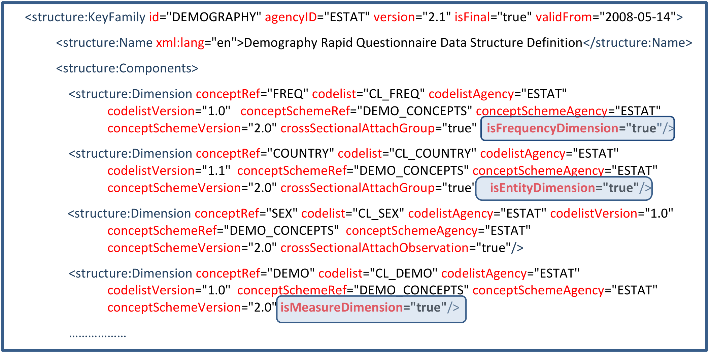
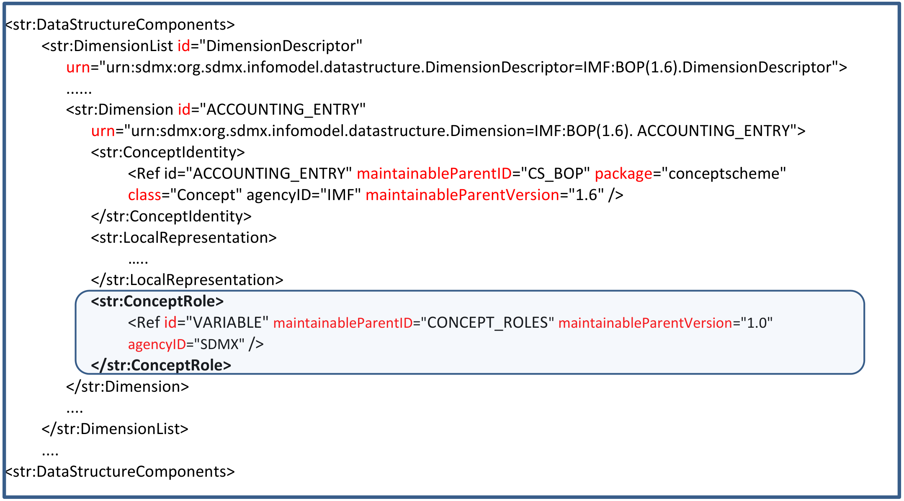
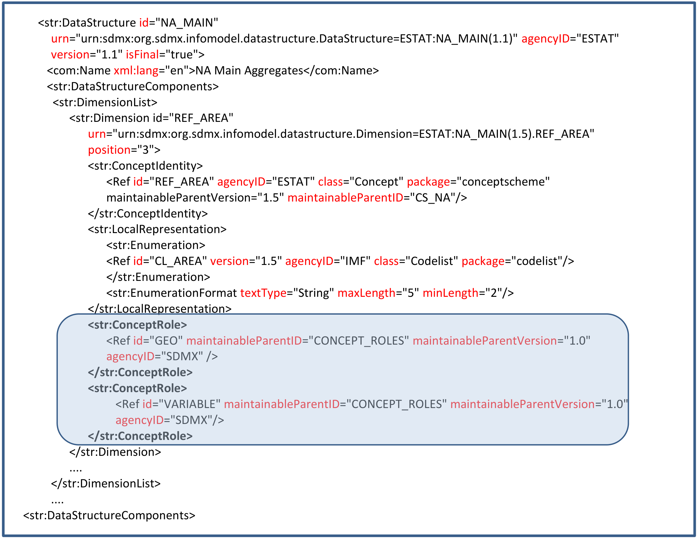

SDMX GUIDELINES

GUIDELINES FOR  
SDMX CONCEPT ROLES

VERSION 1.1

# Contents

[Document History](#_Toc2084466)

[Introduction](#introduction)

[Cross-domain Concept Scheme for Concept Roles in SDMX 2.1](#cross-domain-concept-scheme-for-concept-roles-in-sdmx-21)

[Concept roles in SDMX 2.0](#concept-roles-in-sdmx-20)

[Appendix on implementation examples](#appendix-on-implementation-examples)

[SDMX 2.0: Implementation example](#sdmx-20-implementation-example)

[SDMX 2.1: Implementation example](#sdmx-21-implementation-example)

# Document History

| **Version** | **Date** | **Comment** |
|:---|:---|:---|
| 1.0 | 26/2/2019 | Initial version |
| 1.1 | 2/2/2021 | Added COUNT concept role; SDMX 2.1 concept roles apply to SDMX 3.0 |

# Introduction

This document describes SDMX Concept Roles and their use, proposes a cross-domain Concept scheme that defines the set of concept roles (for SDMX 2.1), and gives examples on concept role implementation in both SDMX 2.0 and SDMX 2.1.

A concept role gives a particular context to a concept for easy and systematic interpretation by machine processing and visualization tools. For example, the concepts REPORTING_AREA and COUNTERPART_AREA are different concepts but they are both geographical characteristics, therefore they can be associated with the same concept role ID: “GEO”. This allows visualization systems to interpret these concepts as geographical data in order to generate maps.

A concept can have more than one role; for example, a concept may have both a geographical and entity role (see the table 1 for a description of these roles). Also, concept roles can be defined and referenced outside of the cross-domain concept role set.

The implementation of concept roles is different in versions 2.0 and 2.1 of the SDMX technical standard. The SDMX 2.1 concept roles also apply to SDMX 3.0.

Examples for both versions are included in the Appendix.

# Cross-domain Concept Scheme for Concept Roles in SDMX 2.1

The concept roles are themselves concepts, and a cross-domain concept scheme for concept roles is described in Table 1 below. A concept (in a DSD) can acquire one or more concept roles.

Note: The roles marked with “\*” have been included for compatibility with SDMX 2.0. Some of the SDMX 2.0 concept roles have been excluded from this 2.1 list for these reasons:

- Other mechanisms exist in SDMX 2.1 to distinguish the concepts, for example for time period and measure;

- No use cases could be found for the concept roles. For example for identity and nonObsTime.

<table>
<colgroup>
<col style="width: 12%" />
<col style="width: 16%" />
<col style="width: 22%" />
<col style="width: 47%" />
</colgroup>
<thead>
<tr>
<th style="text-align: center;"><strong>Id</strong></th>
<th style="text-align: center;"><strong>Name</strong></th>
<th style="text-align: center;"><strong>Definition</strong></th>
<th style="text-align: center;"><strong>Context</strong></th>
</tr>
</thead>
<tbody>
<tr>
<td style="text-align: center;"><strong>COMMENT</strong></td>
<td>Comment</td>
<td>Descriptive text which can be attached to data or metadata.</td>
<td style="text-align: left;">
Used for concepts that contain descriptive information about the data.

Examples include footnotes, notes, reference metadata within the data message.
</td>
</tr>
<tr>
<td style="text-align: center;"><strong>ENTITY*</strong></td>
<td>Entity</td>
<td>Describes the subject of the data set (e.g. a country).</td>
<td style="text-align: left;">Identifies the subject to whom the data refers (e.g. the reporting agent for primary reporting, the country for secondary reporting)</td>
</tr>
<tr>
<td style="text-align: center;"><strong>FLAG</strong></td>
<td>Flag</td>
<td>Coded attribute in a data set that represents qualitative information for the cell or partial key (e.g. series) value.</td>
<td style="text-align: left;">
Allows to display flags close to the observation value or partial key in statistical tables.

Examples of qualitative information that can be exchanged via a flag are "estimated value", "break in series", “confidential”.
</td>
</tr>
<tr>
<td style="text-align: center;"><strong>FREQ*</strong></td>
<td>Frequency</td>
<td>Time interval at which the source data are collected.</td>
<td style="text-align: left;">
Identifies the observation’s time interval for processing and/or presenting on a graph’s time axis.

For example, if a data series has a constant time interval between its observations, this interval determines the frequency of the series (e.g. monthly, quarterly, yearly). “Frequency” - also called “periodicity” - may refer to several stages in the production process, e.g. in data collection or in data dissemination. (e.g., a time series could be available at annual frequency but the underlying data are compiled monthly). Therefore, “Frequency” can be broken down into “Frequency - data collection” and “Frequency - data dissemination”.
</td>
</tr>
<tr>
<td style="text-align: center;"><strong>GEO</strong></td>
<td>Geographical</td>
<td>Geographic area to which the measured statistical phenomenon relates.</td>
<td style="text-align: left;">Used for concepts which refer to geographical or political groups of countries or regions within a country. It can allow for the representation of geographical information on maps or graphs.</td>
</tr>
<tr>
<td style="text-align: center;"><strong>OPERATION</strong></td>
<td>Statistical operation</td>
<td>Signifies statistical operations have been done on the observations.</td>
<td style="text-align: left;">
Allows systems to distinguish operation concepts from other concepts (entities, variables) which may be prioritised differently in navigation, presentation and processing.

An example is to indicate that this concept codes information such as seasonal adjustment or time transformations.
</td>
</tr>
<tr>
<td style="text-align: center;"><strong>VARIABLE</strong></td>
<td>Variable<a href="#fn-1" id="fnref-1">1</a></td>
<td>Characteristic of a unit being observed that may assume more than one of a set of values to which a numerical measure or a category from a classification can be assigned.</td>
<td style="text-align: left;">
Used to distinguish concepts that represent statistical variables (e.g. sex, age) from concepts that are strictly related to the operation performed over data (e.g. Adjustment).

This identification of this concept(s) is crucial for statisticians as it is very important in survey data to identify variables. For example, in a DSD representing the GDP of a country we will have the reference area, the unit of measure of the GDP and the value of the GDP. The unit of measure is a concept used to understand or interpret data but it is not a statistical variable, which are reference area and the GDP observed value. The concept of variable is emphasized strongly in GSIM but not in SDMX, and the inclusion of this information as a Concept role, incorporates this information into SDMX.
</td>
</tr>
<tr>
<td style="text-align: center;"><strong>COUNT</strong></td>
<td>Count</td>
<td>Indicates a counter for unique items in a dataset</td>
<td style="text-align: left;">
Used when a unique (or unique in conjunction with other other series key fields) artificial key is required in datasets. An example usage is for generating and processing a reporting template and there is no guarantee that the key field values for each observation will be unique. Each observation would have a different COUNT concept value to guarantee that the observation key values are unique.

A concept with this role would usually be typed as Integer and the observation values would increment (1,2,3,…). However, other data types could be used as long as the concept serves the purpose of making the dataset’s observation key values unique.
</td>
</tr>
</tbody>
</table>

*Table 1. Cross-domain concept scheme for concept roles*

If other cross-domain roles are required, the SDMX SWG should be contacted to update the concept scheme with new role proposals. Alternatively, domain or implementation-specific concept roles may be created. However, these would be difficult to use for inter-agency exchange and are therefore not recommended.

For technical implementation details please see the appendix below.

# Concept roles in SDMX 2.0

In SDMX 2.0, the list of concept roles is specified in the technical standard itself. In SDMX messages, a role is allocated to a concept by setting its role-specific xml attribute to **true.** Table 2 lists all of the xml attributes that can be specified as roles in SDMX 2.0.

| **Role type** | **Description** |
|:---|:---|
| **Frequency** | Identifies the Concept that plays the role of frequency: *time interval at which observations occur over a given time period*<a href="#fn-2" id="fnref-2">2</a> |
| **Count** | Identifies the Concept that plays the role of an identifier where the identifier is taken from a known system of counts |
| **measureType** | Identifies the Concept that plays the role of identifying a type of measure |
| **Entity** | Identifies the Concept that plays the role of the subject to whom the data refers (e.g. the reporting agent for primary reporting, the country for secondary reporting) |
| **Time** | Identifies the Concept that specifies the time of the observation of the primaryMeasure |
| **nonObsTime** | Identifies the Concept that plays the role of a date/time identifier in the KeyFamily which is not related to the time of the observation |
| **primaryMeasure** | Identifies the Concept that plays the role of the observation in a time series |
| **Identity** | Identifies the Concept that plays the role of an identifier which is taken from a known scheme of identifiers |

*Table 2. List of roles in SDMX 2.0*

For example, if a dimension represents the frequency, the attribute *IsFrequencyDimension* should be set to ’true’ in the data structure definition.

<table>
<colgroup>
<col style="width: 18%" />
<col style="width: 40%" />
<col style="width: 1%" />
<col style="width: 40%" />
</colgroup>
<thead>
<tr>
<th style="text-align: center;"><strong>Role type</strong></th>
<th colspan="2" style="text-align: center;"><strong>xml attribute 
associated to a Dimension</strong></th>
<th style="text-align: center;"><strong>xml attribute 
associated to an Attribute</strong></th>
</tr>
</thead>
<tbody>
<tr>
<td><strong>Frequency</strong></td>
<td colspan="2" style="text-align: center;">isFrequencyDimension</td>
<td style="text-align: center;">isFrequencyAttribute</td>
</tr>
<tr>
<td><strong>Count</strong></td>
<td colspan="2" style="text-align: center;">isCountDimension</td>
<td style="text-align: center;">isCountAttribute</td>
</tr>
<tr>
<td><strong>measureType</strong></td>
<td colspan="2" style="text-align: center;">isMeasureDimension</td>
<td style="text-align: center;">isMeasureAttribute</td>
</tr>
<tr>
<td><strong>Entity</strong></td>
<td colspan="2" style="text-align: center;">isEntityDimension</td>
<td style="text-align: center;">isEntityAttribute</td>
</tr>
<tr>
<td><strong>Time</strong></td>
<td colspan="3"
style="text-align: center;"><strong>Specified
by the standard with the xml element “TimeDimension”</strong></td>
</tr>
<tr>
<td><strong>nonObsTime</strong></td>
<td style="text-align: center;">isNonObsTimeDimension</td>
<td colspan="2" style="text-align: center;">isNonObsTimeAttribute</td>
</tr>
<tr>
<td><strong>primaryMeasure</strong></td>
<td colspan="3"
style="text-align: center;"><strong>Specified
by the standard with the xml element “PrimaryMeasure”</strong></td>
</tr>
<tr>
<td><strong>Identity</strong></td>
<td style="text-align: center;">isIdentityDimension</td>
<td colspan="2" style="text-align: center;">isIdentityAttribute</td>
</tr>
</tbody>
</table>

*Table 3. SDMX 2.0 xml attributes to be specified for a role*

In SDMX 2.0 there are some restrictions in the use of roles:

- only one concept among all dimensions and attributes can have the frequency role;

- only one concept among all dimensions and attributes can have the entity role;

- Frequency, Count, Entity, nonObsTime and Identity roles, are mutually exclusive when applied to dimensions;

- Frequency and Entity roles are mutually exclusive when applied to attributes.

# Appendix on implementation examples

This appendix shows how concept roles can be represented in SDMX messages in SDMX 2.0 and SDMX 2.1.

## SDMX 2.0: Implementation example

Note that SDMX 2.0 Concept roles are fixed according to the technical standards; they are also described in this guideline.

In the Demography DSD example shown below, dimensions: “FREQ”, “COUNTRY” and “DEMO” have been assigned the “frequency dimension”, “entity dimension”, and “measure dimension” roles. This is expressed by setting the “isFrequencyDimension”, “isEntityDimension” and “isMeasureDimension” XML attributes equal to “true” to the corresponding dimensions.

\<structure:KeyFamily id="DEMOGRAPHY" agencyID="ESTAT" version="2.1" isFinal="true" validFrom="2008-05-14"\>

\<structure:Name xml:lang="en"\>Demography Rapid Questionnaire Data Structure Definition\</structure:Name\>

\<structure:Components\>

 \<structure:Dimension conceptRef="FREQ" codelist="CL_FREQ" codelistAgency="ESTAT" codelistVersion="1.0" conceptSchemeRef="DEMO_CONCEPTS" conceptSchemeAgency="ESTAT" conceptSchemeVersion="2.0" crossSectionalAttachGroup="true" **isFrequencyDimension="true"**/\>

 \<structure:Dimension conceptRef="COUNTRY" codelist="CL_COUNTRY" codelistAgency="ESTAT" codelistVersion="1.1" conceptSchemeRef="DEMO_CONCEPTS" conceptSchemeAgency="ESTAT" conceptSchemeVersion="2.0" crossSectionalAttachGroup="true" **isEntityDimension="true"**/\>

\<structure:Dimension conceptRef="SEX" codelist="CL_SEX" codelistAgency="ESTAT" codelistVersion="1.0" conceptSchemeRef="DEMO_CONCEPTS" conceptSchemeAgency="ESTAT" conceptSchemeVersion="2.0" crossSectionalAttachObservation="true"/\>

\<structure:Dimension conceptRef="DEMO" codelist="CL_DEMO" codelistAgency="ESTAT" codelistVersion="1.0" conceptSchemeRef="DEMO_CONCEPTS" conceptSchemeAgency="ESTAT" conceptSchemeVersion="2.0" **isMeasureDimension="true"**/\>

………………

<!-- figure: f01-roles-sdmx20 -->

Original figure

*Figure 1. XML excerpt of roles definition in SDMX 2.0*

## SDMX 2.1: Implementation example

Note that SDMX 2.0 Concept roles are flexible according to the technical standards; they are also described in this guideline.

The example below shows a role of “Variable” assigned to the dimension “ACCOUNTING_ENTRY” in the Balance of Payments DSD. The concept role is defined using the xml element: *ConceptRole* and the “VARIABLE” role is referenced in the cross-domain concept scheme “CONCEPT_ROLES”.

\<str:DataStructureComponents\>

\<str:DimensionList id="DimensionDescriptor" urn="urn:sdmx:org.sdmx.infomodel.datastructure.DimensionDescriptor=IMF:BOP(1.6).DimensionDescriptor"\>

......

\<str:Dimension id="ACCOUNTING_ENTRY" urn="urn:sdmx:org.sdmx.infomodel.datastructure.Dimension=IMF:BOP(1.6). ACCOUNTING_ENTRY"\>

\<str:ConceptIdentity\>

\<Ref id="ACCOUNTING_ENTRY" maintainableParentID="CS_BOP" package="conceptscheme" class="Concept" agencyID="IMF" maintainableParentVersion="1.6" /\>

\</str:ConceptIdentity\>

\<str:LocalRepresentation\>

…..

\</str:LocalRepresentation\>

**\<str:ConceptRole\>**

\<Ref id="VARIABLE" maintainableParentID="CONCEPT_ROLES" maintainableParentVersion="1.0" agencyID="SDMX" /\>

**\</str:ConceptRole\>**

\</str:Dimension\>

....

\</str:DimensionList\>

....

\<str:DataStructureComponents\>

<!-- figure: f02-variable-role-sdmx21 -->

Original figure

*Figure 2. XML example of “variable” concept role in SDMX 2.1*

\<str:DataStructure id="NA_MAIN" urn="urn:sdmx:org.sdmx.infomodel.datastructure.DataStructure=ESTAT:NA_MAIN(1.1)" agencyID="ESTAT" version="1.1" isFinal="true"\>

\<com:Name xml:lang="en"\>NA Main Aggregates\</com:Name\>

\<str:DataStructureComponents\>

\<str:DimensionList\>

\<str:Dimension id="REF_AREA" urn="urn:sdmx:org.sdmx.infomodel.datastructure.Dimension=ESTAT:NA_MAIN(1.5).REF_AREA" position="3"\>

\<str:ConceptIdentity\>

\<Ref id="REF_AREA" agencyID="ESTAT" class="Concept" package="conceptscheme" maintainableParentVersion="1.5" maintainableParentID="CS_NA"/\>

\</str:ConceptIdentity\>

\<str:LocalRepresentation\>

\<str:Enumeration\>

\<Ref id="CL_AREA" version="1.5" agencyID="IMF" class="Codelist" package="codelist"/\>

\</str:Enumeration\>

\<str:EnumerationFormat textType="String" maxLength="5" minLength="2"/\>

\</str:LocalRepresentation\>

**\<str:ConceptRole\>**

\<Ref id="GEO" maintainableParentID="CONCEPT_ROLES" maintainableParentVersion="1.0" agencyID="SDMX" /\>

**\</str:ConceptRole\>**

**\<str:ConceptRole\>**

\<Ref id="VARIABLE" maintainableParentID="CONCEPT_ROLES" maintainableParentVersion="1.0" agencyID="SDMX"/\>

**\</str:ConceptRole\>**

\</str:Dimension\>

....

\</str:DimensionList\>

....

\<str:DataStructureComponents\>

<!-- figure: f03-geo-role-sdmx21 -->

Original figure

*Figure 3. XML example of “geo” concept role in SDMX 2.1*

<!-- footnotes -->

------------------------------------------------------------------------

1 <http://www1.unece.org/stat/platform/display/GSIMclick/Variable>

2 Source: "[SDMX Glossary](https://sdmx.org/wp-content/uploads/SDMX_Glossary_Version_2_0_October_2018.docx)", Version 2.0
