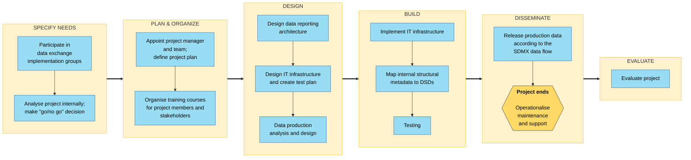
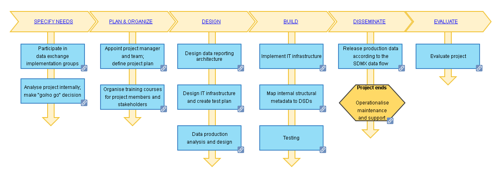
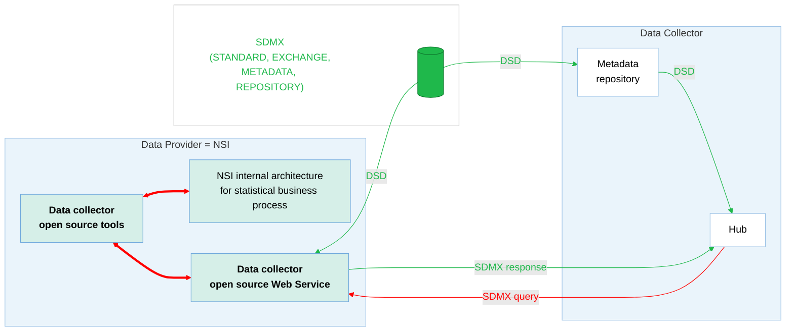
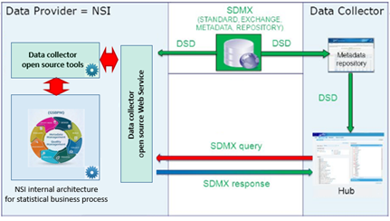

<!-- figure: f01-checklist-phases -->

Original figure

# Story for the Checklist for SDMX Data Provider Implementation

## Introduction

This document relates a user story showing how the checklist may be implemented.

A data-providing agency (in this case a national statistical organization (NSO), though the agency could be any provider such as a central bank, or government agency) is involved in a new SDMX data exchange with a Data Collector. The document will describe the steps done to achieve the goal. This implementation story is an example based on a real implementation: the CENSUS-HUB SDMX project.

The story chapters follow the stages of the checklist

## Participation to data implementation groups

The data collector holds a kick-off meeting to describe a new data exchange with the data providers. High-level representatives of data providers are invited to participate. During the meeting, the data collector explains the objective of the project. The idea is to collect statistical data through a unique hub to compare data coming from different data providers. Participants are invited to express their opinion after a presentation. The data collector presents different alternatives for the NSO’s architecture:

- Full implementation: data are made available by the data provider via a web service allowing the data “pull” mode to data collectors

- Partial implementation : static data files can be sent directly (the “push” mode) to data collectors that will store internally for the Hub

The data collector also proposes using open source tools, and for the data provider to participate in a pilot project to test the validity of the structural metadata and of the technical infrastructure(s) (tools and processes).

The data collector proposes project deadlines and milestones: the pilot phase should start in six months from the beginning of the project.

The first data release should be between one and one year and a half from the beginning of the project.

After the kick-off meeting with the data collector, the following meetings are organized:

- A meeting that is for statisticians and IT staff focused on the data exchange content, in particular:

<!-- -->

- Variables to be provided

- Structural metadata in the exchange: Data Structure Definitions, Dataflow, Constraints etc.

- Project milestones. In particular, the release will be in a specific range of time.

<!-- -->

- IT architects: The data collector will present available tools for the data provider to accelerate the implementation and highlights some crucial aspects of the data exchange as performance and security issues.

The data provider (NSO) organizes the following internal meetings:

- Meetings with high-level representatives of staff from statistical production and IT staff: to explain the project, manage project resources, and monitor the status of the project

- subject-matter/statistical-domain meetings with the agency’s subject-matter experts on structural metadata and new variables. During the meetings, concepts, codelist and dataflow are presented, explained and discussed in order to reach a common agreement on the data exchange,

- technical meetings with the NSO’s IT project manager on technical aspects of data exchange (security, performance and so on) and the architecture to implement for the data reporting.

## Analyse project internally; make “go/no go” decision

The “go/no go” decision includes analysis of confirming to legal regulations, budget, priorities and other aspects of the NSO; after an evaluation of these factors, it is seen that there is a positive value in the project therefore the NSO decides to participate to the project.

The NSO’s management team appoints staff to an internal working group for the implementation project involving the different professional and management skills. The head of the statistical domain chairs the working group. This working group consists of:

- IT experts to provide a feasibility study of technical aspects taking into account:

  - The software already in place for the business process of the statistical domain

  - External SDMX software that may be used for the project

  - Any new developments that are required

  - Performance requirements (e.g. throughput) and constraints (e.g. bandwidth)

  - Security requirements

- SDMX experts who provide guidance and validate the correct implementation of the standard and participate in the feasibility studies

- Statistical domain experts who validate the reported data, and provide a mapping between internal structures and the SDMX structures (e.g. DSDs and Code Lists)

## Appoint project manager and team; define project plan

The data provider (NSO) organizes these aspects of the implementation working group:

- regular meetings of the working group to follow the project progress, analyse and resolve issues;

- consultancy with external experts where required;

- reporting lines (e.g. to senior management).

## Organize training courses for project members and stakeholders

The data provider (NSO) decides to propose some training courses both for management and for staff affected by the SDMX implementation.

Courses may be physical and/or virtual. The training plan is:

- half-day course for NSO managers where SDMX data exchange is presented as a strategic perspective for the organization itself;

- two-day course for NSO statisticians covering the transition to SDMX, information model, guidelines, data modelling;

- two-days course for NSO IT staff covering the transition to SDMX, the technical standard, web service, tech. implementation;

- a pre-recorded video covering the use of SDMX tools for all staff involved in the SDMX exchange. The course includes a simple test to help staff integrate the training, and a virtual-machine or container with the tools installed so that the trainee can safely experiment with them.

## Design data reporting architecture, Design IT infrastructure and create test plan

The data provider (NSO) IT Project Manager leads the team to design the IT architecture. The architecture is composed of NSO-specific tools for the data production and of [SDMX tools available on SDMX.org](https://sdmx.org/?page_id=4500) for the data reporting which includes the web service for the hub architecture of the data collector.

<!-- figure: f02-project-architecture -->

Original figure

Project architecture

## Data production, analysis and design

Data for reporting are produced specifically for the project. They will be not re-used for internal purposes or for other dissemination purposes. Data are therefore stored in a separate data warehouse and described using the structural metadata used in the data reporting DSDs. No internal structural mappings are necessary.

## Test

The pilot project data are available via a web service from data provider (NSO). Dummy data is used until the real data can be officially disseminated.

## Evaluate projects

A post-mortem evaluation of the project is presented to the data provider (NSO)’s staff and management in an internal meeting. The project’s documentation and a final evaluation document containing issues and solutions are made available in an internal dissemination platform.
