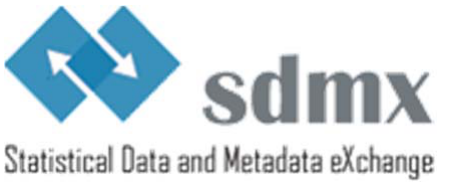

<!-- figure: f01-logo -->

\_\_\_\_\_\_\_\_\_\_\_\_\_\_\_\_\_\_\_\_\_\_\_\_\_\_\_\_\_\_\_\_\_\_\_\_\_\_\_\_\_\_\_\_\_\_\_\_\_\_\_\_\_\_\_\_\_\_\_\_\_\_\_\_\_\_\_\_\_\_\_\_\_\_\_\_\_\_\_\_\_\_\_\_\_\_\_\_\_\_\_\_\_\_\_\_\_\_\_\_

# SDMX GLOBAL REGISTRY CONTENT POLICY

## INTRODUCTION

This paper proposes a policy for artefacts stored, maintained and disseminated from the SDMX global registry (GR)<a href="#fn-1" id="fnref-1">1</a>.

In the process of developing the content policy several options were evaluated by the SDMX working groups and the secretariat. The options ranged from a narrow scope, corresponding to the early state of the GR, in which only artefacts belonging to a unique domain with clear global governance would fit, to a wide scope – a “yellow pages” approach in which any artefact could be hosted with minimum quality and governance requirement. This document presents a balanced approach – aiming for a GR that is a central repository of most globally used artefacts, nonetheless ensuring a quality minimum, ‘readability’, and maintainability with the current GR management structure. The policy outlined is believed to best fit the needs of the SDMX community while retaining a practical level of manageability and high quality of the SDMX contents, and also delivering a good return on investment from the global registry development and maintenance project.

Defining precisely which artefacts should go into the GR and which ones should not is crucial as the GR will play a central role in providing SDMX implementers with final, reliable, up-to-date, harmonised and validated SDMX artefacts.

## WHAT MAY BE STORED IN THE SDMX GLOBAL REGISTRY?

The following types of artefacts are used in exchange between statistical agencies and have an appropriate level of governance to support the exchange in a maintainable fashion, and therefore qualify to being hosted in the GR:

- Global DSDs<a href="#fn-2" id="fnref-2">2</a> and their supporting artefacts, e.g. National Accounts, Balance of Payments;
- shared DSDs<a href="#fn-3" id="fnref-3">3</a> and their supporting artefacts, e.g. IMF’s SDDS+, OECD’s Short-Term Economic Statistics (STES);
- cross-domain SDMX artefacts, e.g. code lists<a href="#fn-4" id="fnref-4">4</a> for geographical area, sex, age

In conjunction with the above artefact types, certain quality and governance criteria need to be respected.  These criteria are outlined in the sections below.

## QUALITY CRITERIA FOR STORED SDMX ARTEFACTS

This section describes mandatory aspects to ensure that the content in the GR is the most useful for the SDMX community.

### GOVERNANCE

A well-defined governance model is essential to build reliable data-exchange contracts with SDMX artefacts.  The SDMX artefacts in the GR must abide by the governance principles described in the “Governance of commonly used SDMX metadata artefacts” document<a href="#fn-5" id="fnref-5">5</a>, particularly the sections that describe the governance criteria and how to apply those criteria, such as ownership, stability and reusability, maintenance schedule and change management.

### VALIDITY OF CONTENT

The SDMX artefacts must have been designed in the spirit of the SDMX content-oriented guidelines, for example the Guidelines for SDMX Data Structure Definitions.

Structural validation is at the core of the SDMX initiative; therefore the SDMX artefacts in the GR must be valid; both with accordance to the SDMX technical standards, and contain valid cross-references links, e.g. between a DSD and its referenced code lists.

### VERSIONING

The GR is for production-ready content; therefore the version of the artefacts must be at least v1.0 and in “Final” status.  When artefacts change their version must be incremented accordingly in order to build dependable data-exchange contracts.  The SDMX working groups have published SDMX versioning guidelines in this respect<a href="#fn-6" id="fnref-6">6</a>.

## BEST-PRACTICE RECOMMENDATIONS

Beyond the mandatory criteria described above this section contains best-practice recommendations to help improve content quality in the GR.

### CONSULT ON DOMAIN CONTENT WITH SDMX COMMUNITY

New SDMX artefacts may, by design or accidentally, contain content that overlap with existing GR content in the GR.  For example, a multi-domain DSD may refer to indicators that are already covered in other domain-specific or multi-domain DSDs.  Therefore, content maintainers are strongly encouraged to:

- Check the existing GR content before adding new content The GR search facility may be used to scan for existing content.
- Consult with the Global Registry Managers (GRMs)<a href="#fn-7" id="fnref-7">7</a>, the ownership group of the existing artefacts, and/or the SDMX Statistical Working Group<a href="#fn-8" id="fnref-8">8</a>

### DOCUMENT THE CONTENT OVERLAPS

If there are content overlaps in GR content then SDMX Structure Set artefacts can be created to document the content mapping.  SDMX Structure Set artefacts have the added advantage in that they allow SDMX systems to map between the overlapping content in an automated way.

## GLOBAL REGISTRY CONTENT SUBMISSION PROCEDURE

This section describes the steps to follow to add content to the GR.

1. Ensure that the submitted content abides by this content policy, paying special attention to the quality criteria; and strongly consider implementing the recommendations in the best practice section to maximise the benefit to the SDMX community.
2. If the agency submitting the request is not already registered in the GR as a “maintenance agency”\[1\], the Global Registry Managers (GRMs)\[2\] should be contacted requesting the creation of a maintenance agency in the GR.
3. The GRMs will analyse the request and may contact the submitter to discuss the requirements of the request.
4. For new domains, the SDMX Secretariat will be consulted on whether or not to accept the artefacts before they are included in the GR.  The SDMX Secretariat has the right to veto content submitted to the GR.
5. Once the request is accepted, the GRMs will create the maintenance agency and corresponding account in the GR, and inform the submitter.
6. Content may be uploaded to the GR, after having logged-in to the account corresponding to the maintenance agency.  The GR documentation wiki\[3\] can be consulted on how to upload content.

\[1\] About SDMX Maintenance Agencies

\[2\] agilis@registry.sdmx.org

\[3\] Tutorial on Using the Global Registry Technical GUI

<!-- footnotes -->

---

1 https://registry.sdmx.org/

2 A global DSD is designed as a standard data structure for global use with more than one SDMX sponsor organisation represented in its ownership group. One of the members of the ownership group acts as a maintenance agency. A DSD may be also labelled as "global" by the SDMX sponsors considering the recognised expertise in the domain concerned of one of the organisations represented in its ownership group and the potential usefulness of the artefact for the whole SDMX community. In all cases a global DSD will have to meet strict criteria of versioning, governance, maintenance, adoption and endorsement.

3 Any DSD used by two or more statistical organisations and which does not meet the criteria for being a global DSD is a shared DSD.  For inclusion in the GR, the shared DSD is also subject to the mandatory aspects in the “Quality criteria for stored artefacts”.

4 PART III – Cross-Domain Code Lists

5 Governance of commonly used SDMX metadata artefacts

6 \<versioning guidelines link when ready\>

7 agilis@registry.sdmx.org

8 swg@sdmx.org
