<!-- figure: f01-logo -->
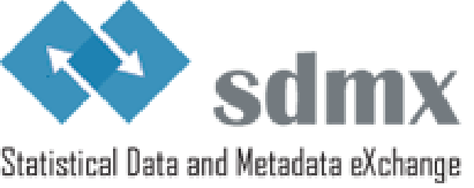

SDMX GUIDELINES

GUIDELINES FOR SDMX HIERARCHIES

VERSION 1.0

# Contents

[Document History](#document-history)

[Introduction](#introduction)

[Problem Definition](#problem-definition)

[Principles for the creation of SDMX hierarchies](#principles-for-the-creation-of-sdmx-hierarchies)

[Use cases for SDMX hierarchies](#use-cases-for-sdmx-hierarchies)

[Data presentation](#use-case-for-data-presentation)

[Data dissemination](#use-case-for-data-dissemination)

[Structured Metadata Representation](#use-case-for-structured-metadata-representation)

[How to create SDMX hierarchies](#how-to-create-sdmx-hierarchies)

[Implementing a hierarchy](#implementing-a-hierarchy)

# Document History

| **Version** | **Date**   | **Comment**     |
|-------------|------------|-----------------|
| 1.0         | 26/06/2025 | Initial version |

# Introduction

The purpose of this document is to illustrate the use case for hierarchies in SDMX, provide examples and recommend best practices for its implementation. Hierarchies are commonly used to represent various relationships among elements in the code list and classifications. They play a crucial role in data management systems for tasks such as data modelling and data dissemination.

# Problem Definition

Concepts in SDMX are usually coded if they are dimensions and could be coded if they are attributes<a href="#fn-1" id="fnref-1">1</a>. Coded concepts in SDMX have a corresponding code list. Relationships defined by different levels of granularity may exist among codes in these code lists. A typical example of these relationships is an area code list, where codes could represent, in descending order, different levels: country, region, province, etc.

The relationship between codes in the code list may be represented by in-line hierarchies defined using the parent field inside a code list. In this scenario, the arrangement of elements in the code list typically resembles a tree, with parent-child relationships between the elements. However, the relationship between codes may be more complex, and in those cases the definition of a hierarchy is more suitable to represent the elements relationships.

Besides in-line hierarchies, parent-child codes relationships (and ordering) may be implemented in SDMX 3.0 and later versions by using two maintainable artefacts:

- **Hierarchy:** describes code hierarchies principally for data discovery purposes. The codes are referenced from the code lists in which they are maintained.

- **Hierarchy Association:** this links a hierarchy to a component such as a dimension. Furthermore, the linking can be specified in the context of a certain dataflow. Thus, a dimension in a data structure definition could have different hierarchies depending on the dataflow.

In SDMX 2.1, the creation of hierarchies can be achieved using Hierarchical Code Lists (HCL). However, the implementation of HCLs is not intuitive; SDMX 3.0 rectifies this.

# Principles for the creation of SDMX hierarchies

The SDMX 2.1 HierarchicalCodelist artefact was deprecated in SDMX 3.0. The Hierarchy artefact contained in a HCL was retained, made maintainable without the HCL, and had features added to it.

The basic characteristics of the hierarchy artefact are:

- A child code can have more than one parent.

- There can be more than one code that has no parent (i.e. more than one “root node”).

- The hierarchy is a specification of the structure and order of the codes.

- Codes participating in a hierarchy are not themselves contained in the list – they are referenced from the list and are maintained in one or more code lists.

- The hierarchy of codes is specified in HierarchicalCode. This references the code and its immediate child HierarchicalCodes.

- The levels in a hierarchy can be explicitly defined or they can be implicit: i.e. they exist only as parent/child relationships in the coding structure.

- A hierarchy can have formal levels, but it is not necessarily a balanced tree. A balanced tree is where levels are pre-defined and fixed:

  - If the hierarchy has level, then the hierarchy is “level based” and this indicates that the hierarchy structure is arranged in levels of detail from the broadest to the most detailed level. In a “level based” hierarchy each HierarchicalCode is linked to the level in which it resides.

  - If the hierarchy has no levels, then the hierarchy is “value based” comprising a hierarchy of codes with no formal levels.

- The hierarchy also specifies the order of codes in the sequential order they are specified in the hierarchy. This order overrides the order (implicit or explicit) specified in a codelist.

- The hierarchy in the hierarchy artefact overrides a codelist’s in-line hierarchy.

Hierarchy artefacts and in-line hierarchies can be used together to provide an (in-line) default hierarchy that is then overridden by specific hierarchies (artefacts) depending on use case. There are cases where an in-line hierarchy is sufficient to provide a hierarchy. SDMX hierarchy artefacts are more flexible and have advantages over in-line hierarchies.

SDMX 3.0 also introduces hierarchy association, which links an identifiable artefact (such as a dimension in a dataflow) with the hierarchy artefact. Hierarchies can be reused by several artefacts via the HierarchyAssociation. In SDMX 2.1, the hierarchy association can be made with a Dataflow annotation HIER_CONTEXT. The annotation is part of the [SDMX annotation controlled vocabulary](https://sdmx.org/wp-content/uploads/Guidelines-on-the-use-of-SDMX-Annotations.pdf).

# Use cases for SDMX hierarchies

This section presents some specific, non-exhaustive use cases for hierarchy usage.

## Use case for data presentation

The first use case is focused on how information derived from data can be effectively communicated to the user. This is typically achieved through features that capture user interest and are easily comprehensible. In this context, hierarchies can be beneficial for several reasons:

1.  The ability to have more than one parent enables the display of different groupings that partially share the same codes.

2.  The ability to use codes from the same code list at different levels allows for multiple perspectives on the data.

3.  The hierarchy describes the code order.

To better illustrate the points, we will provide some practical examples. In Figure 6 below, the "Gross Domestic Product and main components" dataset from ISTAT’s data warehouse illustrates that the code "gross domestic product at market prices" is repeated under both the "Output approach" and "Expenditure approach." This enables the possibility to display different aggregations sharing common codes (point 1). Simultaneously, two different phenomena are presented in the same dataset: the output approach and the expenditure approach. These can be indeed considered as two different code lists in the same hierarchy (point 2).

***Figure 6. Example of multiple parent codes and different code lists in a hierarchy***

<!-- figure: f02-istat-multiple-parents -->
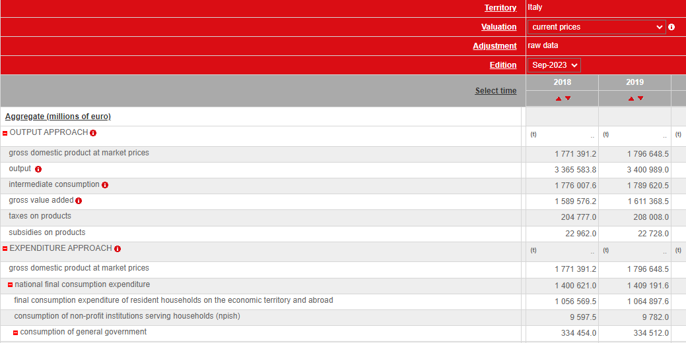

*Source: ISTAT’s Data Warehouse*

In Figure 7 below, it is possible to observe the feature outlined in point 3. Specifically, in the "Household energy consumption" section, the territory variable is organized, at the second level, using both the granularity of territory restricted to regions {Abruzzo, Molise, Campania...} and the one for repartitions {Nord-ovest, Nord – est, Centro, Mezzogiorno} giving a different perspective of data for the Italian territory.

***Figure 7. Example of codes from same code list at different levels in a hierarchy***

<!-- figure: f03-istat-levels -->
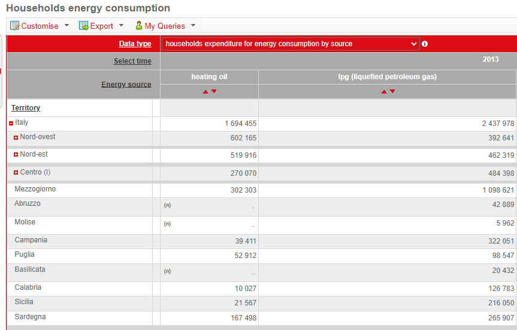

*Source: ISTAT’s Data Warehouse*

## Use case for data dissemination

In the second use case, a hierarchy artefact is implemented by building upon existing code lists. One of the key distinctions from in-line hierarchies (a code list where the parent code is not null) is that each code can have more than one parent. Another key distinction is that hierarchy artefacts can merge lists of codes representing different subjects while an in-line hierarchy is usually a partition of only one subject. These possibilities offered by the hierarchy artefact are particularly crucial for dissemination purposes. In Figure 8 below is an example use case in the OECD.Stat Suite Data Explorer.

***Figure 8. Example from the OECD-FAO Agricultural Outlook 2021-2030 dataset.***

<!-- figure: f04-oecd-fao-outlook -->
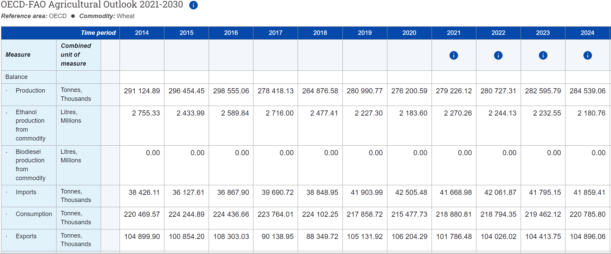

*Source: OECD’s Data*

In this dataset, the concept “Country” can only be represented by a hierarchy. If the list of codes is related to a single subject, the hierarchy is needed because some items have more than one parent, as it is shown below:

- OECD countries

<!-- -->

- Australia

- Canada

- Chile

- Colombia

- European Union

- Israel

- Japan

- Korea

- Mexico

- Norway

- New Zealand

- Türkiye

- Switzerland

- United Kingdom

- United States

<!-- -->

- NORTH AMERICA

<!-- -->

- Canada

- United States

<!-- -->

- OCEANIA

<!-- -->

- Australia

- New Zealand

## Use case for structured metadata representation

Another use case for the adoption of hierarchical levels is the configuration of metadata models for a Data Catalogue, which is a repository of information enabling data assets discoverability. The structure of the metamodel affects the capability to organise data assets information and facilitate the search functionality within the catalogue.

To illustrate the example, let us consider the following metamodel shown in Figure 9 below:

***Figure 9. Example from the ECB Data Catalogue metamodel***

<!-- figure: f05-ecb-metamodel -->
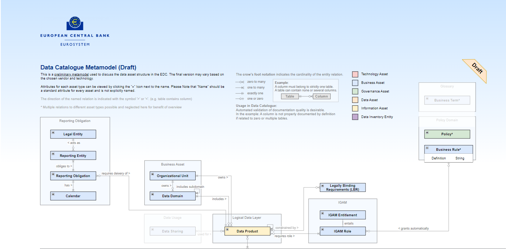

*Source: ECB’s Data Catalogue Metamodel*

In this example, the entity “Data Product”, defined in the logical layer, is child of the entity “Business Asset”, which describes the organizational unit and the data domain (see Hierarchy 1 below). However, an organizational unit may own zero to many domains (see Hierarchy 2 and Hierarchy 3 below). Three hierarchies can be described, where the entity “Data Product” appears at different levels in the hierarchy:

Hierarchy 1:

1.  Organizational Unit (owns)

    a\. Data Domain (includes)

    i\. Data Product

Hierarchy 2:

1.  Organizational unit (owns)

    a\. Data Product

Hierarchy 3:

1.  Organizational unit (owns)

    a\. Data domain (includes)

    i\. Sub-domain (includes)

    1.  Data Product

# How to create SDMX hierarchies

## Implementing a hierarchy

The hierarchy artefact is a concept that has existed in previous versions of SDMX to reinforce the “flat” code list. It was mainly used for visualizations, as it was not possible to be referenced in any other SDMX artefacts. In SDMX 3.0, this artefact has been enhanced to cover more needs. The next paragraph will describe the Hierarchy features and how to implement them throughout two simple use cases. For this reason, it is necessary to specify the main characteristics of a Hierarchy.

A Hierarchy can be implemented using only existing code lists. It is indeed not possible to create items in a Hierarchy that are not part of a code list. A Hierarchy includes:

- The ability to have an Item of a code list as a child of more than one parent, enabling more groupings for the same Item.

- A greater flexibility for Hierarchy levels, for example, the possibility to place Items of an included code lists at different level of the Hierarchy or specify the names and descriptions of the Hierarchy levels.

- The feature to use different code lists in the same hierarchy gives the opportunity to study different phenomena within the same dataset.

- The possibility to be referenced and reused by other artefacts (e.g. as in the following use cases, by a dimension in a dataflow)

Furthermore, it is possible to specify:

- The starting and ending points of a code sequence or construct using the validFrom and validTo features.

- The minimum or maximum length of items.

- The pattern for codes, defined using a regular expression. This pattern acts as a constraint on the code's value.

To understand how to apply some of these enhancements and how to, concretely, create a hierarchy; we can consider two distinct code lists.

- Code list of *World Countries (Figure 1)*, comprising the Items: {*Australia*, *Belgium*, Algeria, *Republic of China*, …}

- Code list of *International Organizations (Figure 2)*, comprising the Items: {*OECD*, *ILO*, *UNESCO*, …}

Using these code lists, we aim to create two Hierarchies: one having all the countries grouped by International Organizations and one with all the countries also including those that are not in International Organizations. In the first use case, the arrangement of code lists’ Items implicitly indicates their respective levels: the Items of code list *International Organizations* are placed at level one, while Items of code list *World Countries* are placed at level two.

In the created hierarchy, shown in Figure 3 below, it is evident that *Australia* is a child of both *OECD* and *ILO*. The two code lists have been used while adhering to the rule that Items belonging to the same code list are placed at the same level. For instance, all Items in the *World Countries code list* are at the second level, and the items in International Organisations are at the first level.

***Figure 1. Code list of World Countries***

<!-- figure: f06-world-countries -->
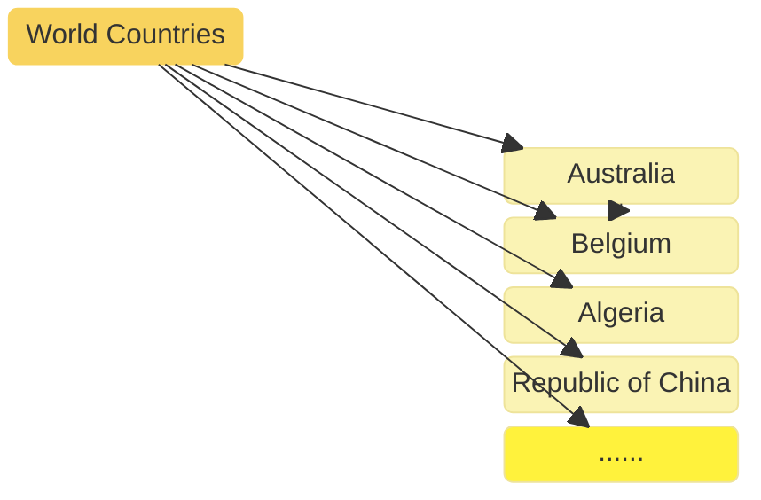

Original figure

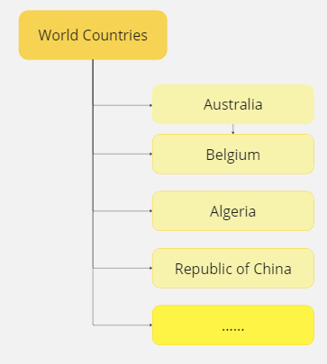

***Figure 2. Code list of International Organizations***

<!-- figure: f07-international-organizations -->
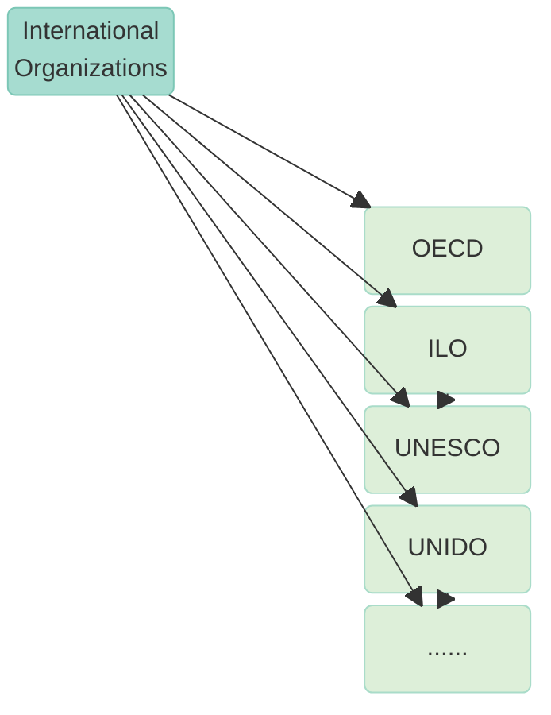

Original figure

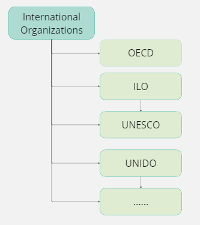

***Figure 3. World Countries in International Organizations***

<!-- figure: f08-world-countries-in-organizations -->
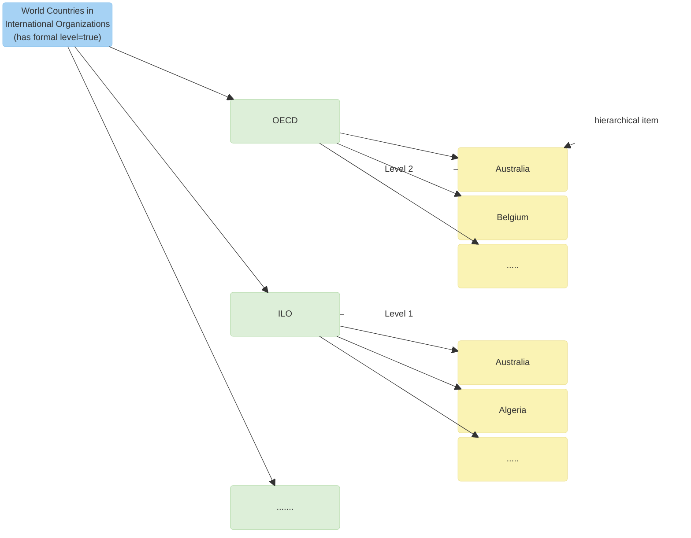

Original figure

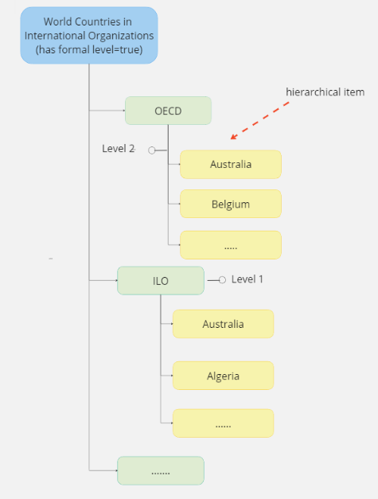

In the second Hierarchy (Figure 4), the items of World Countries *code list* are both at level one (*Republic of China*) and level two (*Australia*, *Algeria*, *Belgium*….). This flexibility is achieved through the attribute “*has formal level”*, that in the first hierarchy is set to *true*, as it is clear by the order of code lists items. In the second hierarchy, formal level is set to *false* because items in the code list are mixed in different levels. In this last case, it is therefore needed to specify to which level the item is assigned.

Another attributes that can add more clarity to this type of hierarchies is the *“valid from”* and *“valid to” features* since the construct of countries belonging to international organizations or regional groups can change over time.

***Figure 4. World Countries in and out International Organizations***

<!-- figure: f09-world-countries-in-and-out -->
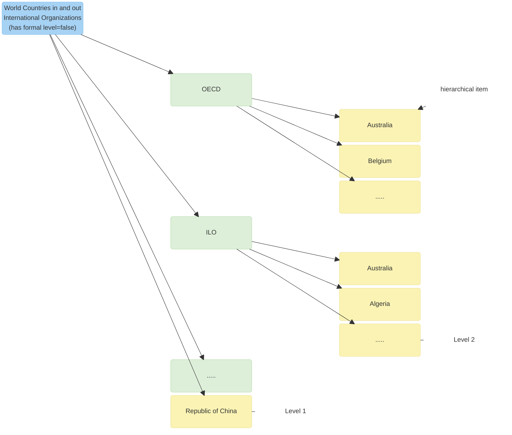

Original figure

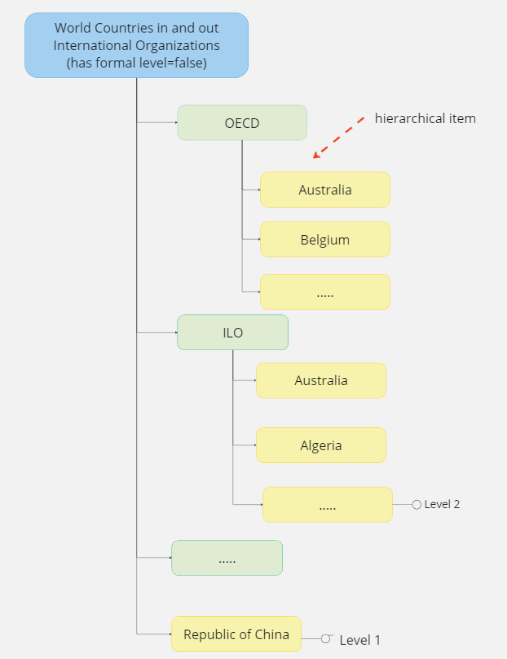

A significant advancement in version 3.0 is the capability to associate the hierarchy with an identifiable artefact (e.g. dimension in a dataflow). This allows the utilization of Hierarchies in the structures of data and metadata. As showed in Figure 8 below, the hierarchy *World Countries in International Organization* has been associated with a dimension, *Representative countries in the international organizations,* used in the dataflow *Number of employees grouped by representative countries in the international organizations*. In this way, the Hierarchy does not remain as an artefact independent from the data, but as part of its representation, increasing the representativeness of the data.

***Figure 8. Hierarchy Association***

<!-- figure: f10-hierarchy-association -->
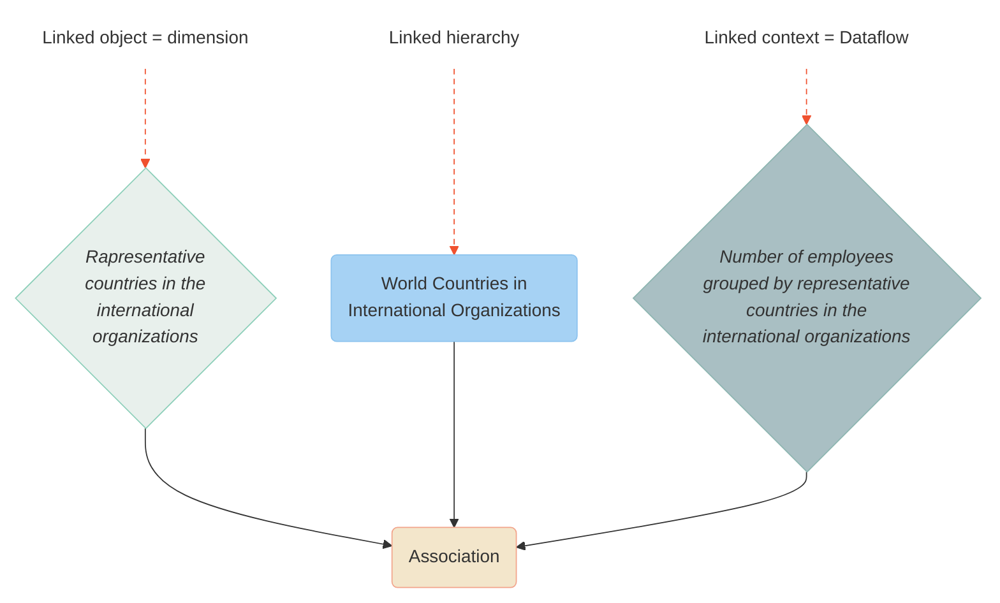

Original figure

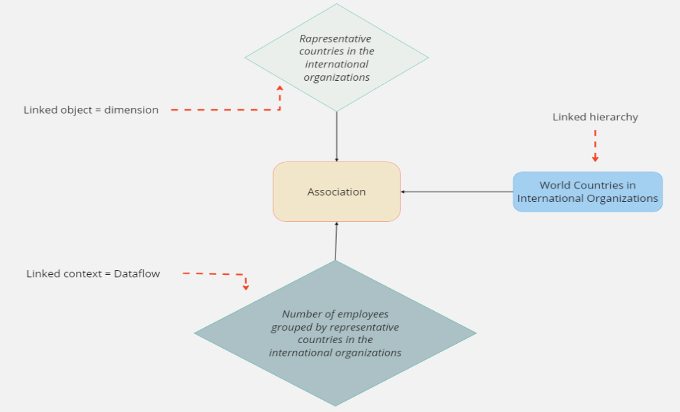

<!-- footnotes -->

------------------------------------------------------------------------

1 <https://sdmx.org/wp-content/uploads/Modelling-statistical-domains-in-SDMX-v2-201806.docx>
