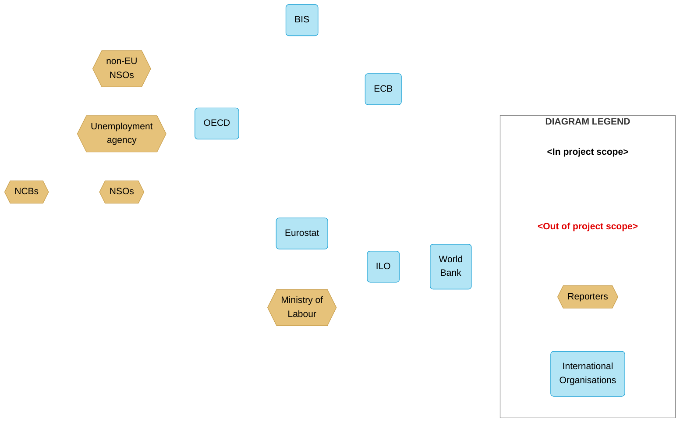
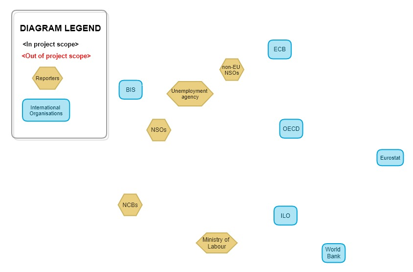
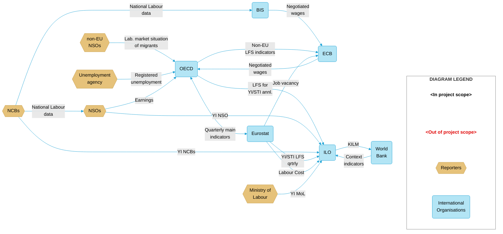
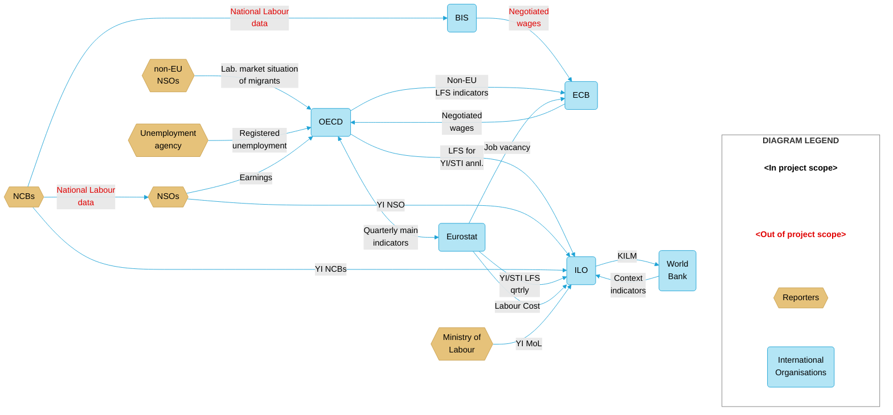
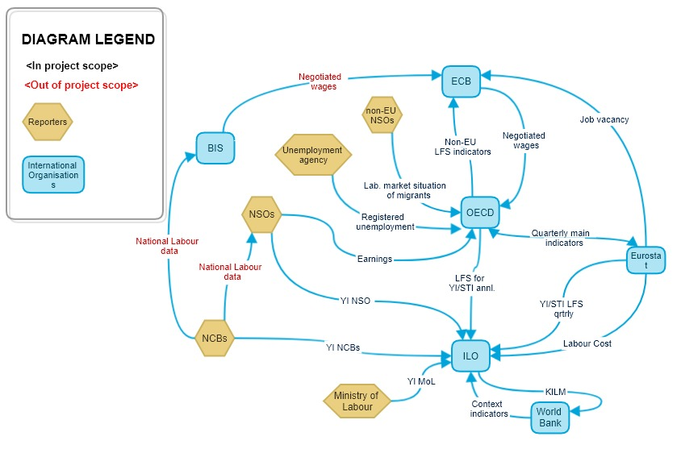
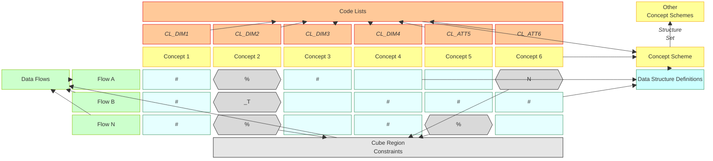
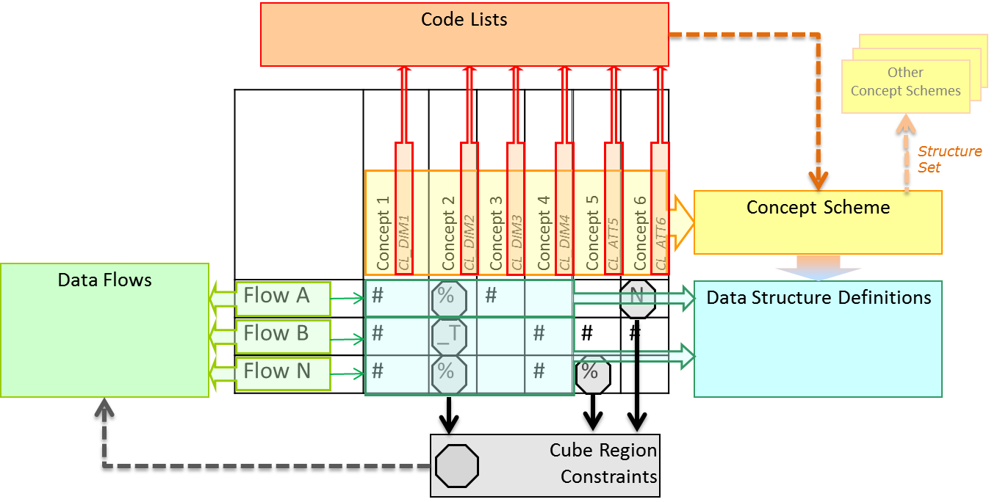
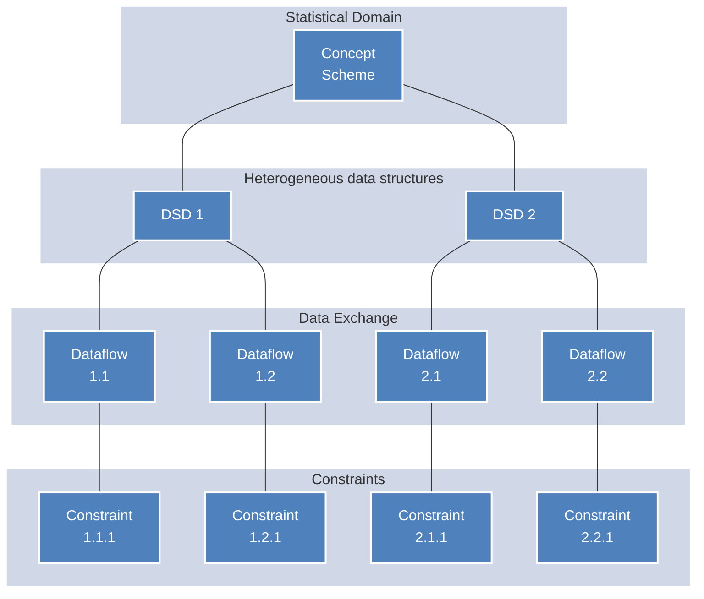
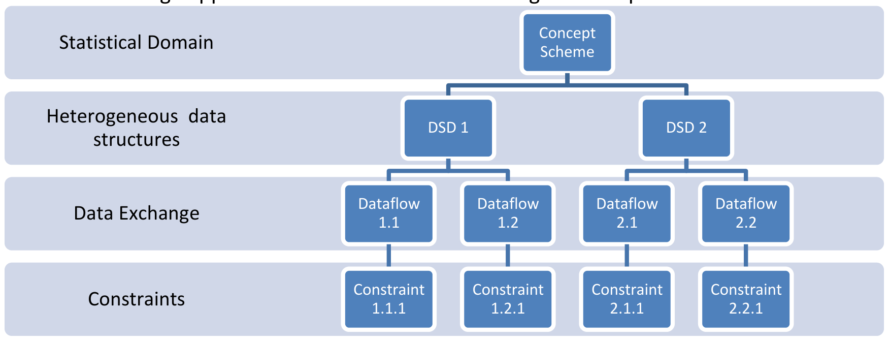

<!-- figure: f01-logo -->

**MODELLING STATISTICAL DOMAINS IN SDMX**

SDMX Guidelines

Version 2.0

27/6/2018

# TABLE OF CONTENTS

[1 Purpose of this Document](#1-purpose-of-this-document)

[2 Step-By-Step Guide](#2-step-by-step-guide)

[2.1 Agree on exchange needs](#21-agree-on-exchange-needs)

[2.2 Identify statistical concepts](#22--identify-statistical-concepts)

[2.2.1 Derive logical concepts](#221-derive-logical-concepts)

[2.2.2 Commonly used concepts](#222-commonly-used-concepts)

[2.3 Decide the roles of the concepts](#23-decide-the-roles-of-the-concepts)

[2.3.1 Decide aspects of the Attributes](#231-decide-aspects-of-the-attributes)

[2.3.2 Add additional attributes](#232-add-additional-attributes)

[2.4 Define a DSD Matrix](#24-define-a-dsd-matrix)

[2.5 Optimisation of the model](#25-optimisation-of-the-model)

[2.5.1 Optimise the statistical concept list based on their usage](#251-optimise-the-statistical-concept-list-based-on-their-usage)

[2.5.2 Optimise the DSD Dimensionality based on Dataflows](#252-optimise-the-dsd-dimensionality-based-on-dataflows)

[2.6 Fully define Code Lists](#26-fully-define-code-lists)

[2.7 Create SDMX Artefacts](#27-create-sdmx-artefacts)

[3 Generic implementation model](#3-generic-implementation-model)

[4 References](#4-references)

[5 Annexes](#5-annexes)

[5.1 Annex 1: Architectural Scenarios](#51-annex-1-architectural-scenarios)

# DOCUMENT HISTORY

| **Version** | **Date** | **Comment** |
|----|----|----|
| 1.0 | 1/4/2014 | Initial version |
| 2.0 | 27/6/2018 | Main additions: Multi-domain modelling; decomposition of indicators; optimisation steps; Dataflow modelling; Choosing dimensions/attributes/ reference metadata; References to DSD guidelines |

# 1 PURPOSE OF THIS DOCUMENT

These guidelines outline general principles on how to design and create SDMX artefacts within an SDMX implementation project. It is recommended that the project follows the checklist for SDMX Design Projects<a href="#fn-1" id="fnref-1">1</a>. The project could encompass a single or multiple statistical domains. The guidelines follow a step-by-step approach based on the SDMX information model, and the design phase could be an iterative process.

The main purpose of these guidelines is to improve certain quality aspects of data quality and exchange frameworks by leveraging SDMX artefacts, especially:

- **coherence**: By enabling logical interconnections and consistency with other models, capacity to aggregate, link and repurpose data at an individual organisation’s level, or in a multi-organisations ecosystem, will be greatly facilitated and potentially automated

- **user-friendliness**: By means of standard information structures, enable development of data experiences (search, navigation) that will contribute to make data more accessible to users

- and **cost-efficiency**: By enabling reuse of systems and artefacts, the guidelines should contribute to simplify the seemingly complex task of creating SDMX structural metadata for a domain or framework by providing a series of simple, easy to follow steps that have been compiled through experience by SDMX experts.

These guidelines are for both SDMX implementers and subject-matter experts. As such, the document is targeted towards domain experts and data modelling experts involved in the design of SDMX artefacts for representing a domain or multiple domains that are related by a data exchange program or dissemination needs. Readers are expected to understand the basic objects of the SDMX information model (Concept Scheme, Data Structure Definition, Code List) and related terminology used in SDMX.

The SDMX information model is very flexible as regards representation of statistical domains with SDMX artefacts. The "core" artefacts in each data exchange program are the Data Structure Definitions (DSD) and Dataflows.

This document follows the approach that the SDMX artefacts needed for describing a data exchange program is based on a generic implementation model with an optimisation phase by matching Dataflows to statistical concepts.

It is important that the resulting number of DSDs needed for describing the exchange framework should be an outcome of the analysis and design steps that are in this guideline, rather than an arbitrary decision before the design phase.

Some more details on pros and cons of alternative design scenarios are outlined in the annex.

# 2 STEP-BY-STEP GUIDE

## 2.1 Agree on exchange needs

The scope of the implementation exercise needs to be defined as the first step. To achieve this, all of the data exchanges to be covered must be listed in a Dataflow diagram. This diagram is very useful for the project team to have a common understanding and overview of the Dataflows that need to be covered by the project.

The Dataflows are typically derived from transmission programs, international guidelines on the statistical reporting requirements, statistical handbooks or predefined statistical tables. The diagram should also include dissemination flows (a Dataflow where the receiver of the data is not known, such as wide publication of statistical data on the web at the end of the statistical production process); these data flows could be marked going to a "Dissemination" node.

Follow these steps to create the Dataflow diagram. The completed example is a simplified version of the dataflow diagram from the Labour Global DSD project:

1.  Add nodes to the diagram that depict the agencies/bodies in the exchange program, example:

<!-- figure: f02-dataflow-step1 -->

Original figure

2.  Add the data exchanges/flows as labelled lines between the agency nodes

3.  Indicate the direction of the exchange (who sends the data to who) as arrows on the data exchange lines. Example for steps 2 and 3:

<!-- figure: f03-dataflow-steps2-3 -->

Original figure

4.  Discuss and decide which Dataflows are out of scope of the project, and color them differently. They are colored red in the example below:

<!-- figure: f04-dataflow-step4 -->

Original figure

Ensure that a legend is included that depicts the diagram notation.

The above diagram is now complete and is used throughout the project to define the scope of discussions, and show which data and indicators need encoding in SDMX. Obviously, the indicators that are in the out of scope Dataflows (colored red above) do not need to be part of the ConceptScheme and Codelists. The Dataflows shown are added directly to the DSD Matrix that is discussed later in this guideline. The Dataflow diagram should be reviewed regularly and revised if needed.

SDMX has the potential to replace bilateral, proprietary flows by multilateral, standardised ones. Therefore, a further step could be to optimise (consolidate, simplify) the existing flows if it is within the mandate of the project; to do this a separate diagram could be created to show the optimised data flows. Keeping the diagrams separate avoids complicating the diagram and shows a clear before/after state.

## 2.2  Identify statistical concepts

### 2.2.1 Derive logical concepts

The first step is to derive the logical concepts by decomposing the underlying definition of each statistical indicator. There may already be a starting point where the concepts are partly identified (e.g. the system of National Accounts (SNA) describes concepts and not only resulting indicators). In this case the decomposition step is simplified. For each indicator, extract its concepts where the logical concepts are not evident in the description of the indicator.

Here is an example of decomposition of some of the original Labour indicators. The INDICATOR and other concepts is a result of the decomposition exercise:

| Concepts | UNIT_MEASURE | INDICATOR | AGE | LABOUR_FORCE_STATUS |
|----|----|----|----|----|
| Original Indicator |   |   | <strong> </strong> | <strong> </strong> |
| Working-age population | Persons | Population | Working age |   |
| Population | Persons | Population | \_T (Total) |   |
| Labour force | Persons | Population | Working age | Labour Force |
| Labour force participation rate | Percent of pop | Population | Working age | Labour Force |

After the indicator decomposition, further possible breakdown concepts should be added, including general concepts such as for Seasonal Adjustment, and Time Transformation. Also, consider including possible future breakdowns of the indicators. Here is an example of adding possible breakdowns:

| Concepts | UNIT_MEASURE | INDICATOR | AGE | LABOUR_FORCE_STATUS | WORK_TIME_ARRANGEMENT | WORKER_STATUS | SEASONAL_ADJUST | TRANSFORMATION |
|----|----|----|----|----|----|----|----|----|
| Original Indicator |   |   | <strong> </strong> | <strong> </strong> |  |  |  |  |
| Working-age population | Persons | Population | Working age |   |  |  |  |  |
| Population | Persons | Population | \_T (Total) |   |  |  |  |  |
| Labour force | Persons | Population | Working age | Labour Force |  |  |  |  |
| Labour force participation rate | Percent of pop | Population | Working age | Labour Force |  |  |  |  |
| Part-time underemployment | Persons | Population | Working age | Employed | Part time |  |  |  |
| Employees | Persons | Population | Working age | Employed |  | ICSE93_1 |  |  |

Also, consider including other cross-domain concepts that could be useful to avoid unnecessary version changes. For example, consider the inclusion of commonly used concepts in section 2.2.2.

While identifying the statistical concepts, try to delay in-depth discussions on the Code List items (Codes) as there are later steps to optimise the concepts which may change them (such as merging the Codes). However, it could be useful to document the Code List items that are already known (such as for an existing classification) in order to help understand the concepts.

### 2.2.2 Commonly used concepts

Certain concepts have been widely used in SDMX exchanges to make exchange simpler, promote reuse of automated processes, and add features to the exchange framework. This is a list of the more widely used concepts including links to their specific guidelines.

<table>
<colgroup>
<col style="width: 33%" />
<col style="width: 33%" />
<col style="width: 33%" />
</colgroup>
<thead>
<tr>
<th>Concept name</th>
<th>Description</th>
<th>Further information</th>
</tr>
</thead>
<tbody>
<tr>
<td>Unit of Measure</td>
<td>Unit in which the data values are expressed.</td>
<td>Forthcoming guideline</td>
</tr>
<tr>
<td>Confidentiality and Embargo</td>
<td>Property of data indicating whether they are subject to
dissemination restrictions.</td>
<td rowspan="2"><a
href="https://sdmx.org/wp-content/uploads/SWG_TimeTransformation_V1.0.docx">SDMX
Guideline</a></td>
</tr>
<tr>
<td>Embargo time</td>
<td>Exact time at which the data can be made available to the
public</td>
</tr>
<tr>
<td>Observation Status</td>
<td>Information on the quality of a value or an unusual or missing
value.</td>
<td><a
href="http://sdmx.org/wp-content/uploads/CL_OBS_STATUS_implementation_20-10-2014.pdf">SDMX
Guideline</a></td>
</tr>
<tr>
<td>Non-calendar Year Reporting</td>
<td>Data that are exchanged in SDMX data messages do not relate to the
calendar year.</td>
<td><a
href="https://sdmx.org/wp-content/uploads/Guidelines_Non-Calendar_Year_Reporting_V1-0.docx">SDMX
Guideline</a></td>
</tr>
<tr>
<td>Time transformation</td>
<td>Time-related operation performed on a time series, solely involving
observations of that time series.</td>
<td><a
href="https://sdmx.org/wp-content/uploads/SWG_TimeTransformation_V1.0.docx">SDMX
Guideline</a></td>
</tr>
</tbody>
</table>

## 2.3 Decide the roles of the concepts 

Once the list of concepts is complete, specify which concepts will become dimensions (identify the series), and which concepts will become attributes (add information to the data, can be used to process the data, do not identify the series).

Some concepts may also refer to reference metadata. Reference metadata is often not coded, is purely descriptive, may be transmitted separately from the data, and is not used to process the data. Keep in mind that the choice of dimension/attribute/reference metadata may change later but it is a useful input to the optimisation process.

The main difference between dimensions and attributes or reference metadata is that dimensions are used to identify the observation and make it unique, whereas attributes and reference metadata are used to add information to the data but are not used in the identification of the observation. For example:

- “reference area” is a characteristic often used in the identification of a data point and is considered a **dimension**;

- “unit multiplier” is needed to correctly interpret data but not for its uniqueness, therefore is commonly an **attribute**;

- “contact name” is used to describe the contact point for the data which may change on a different frequency to the data, therefore it is considered **reference metadata**.

**Axioms for deciding roles of the concepts**

- **Dimensions** are used to uniquely identify series; each dimension must be defined for each observation

- **Attributes** are used to:

- Specify additional information needed to correctly process and/or interpret the data and

- are sent with the data message

- **Reference metadata** is used to:

- Provide information for human understanding of data, e.g. quality aspects

- It cannot be used for automatic validation of the data

- May be sent separately to the data message

- It can be attached to artefacts outside of the DSD such as Dataflows and Provision agreements.

Each Concept can be coded (with a Code List) or uncoded. An uncoded Concept must have a valid SDMX data type declared (such as string or integer).

Concepts not identified as dimensions may be reference metadata concepts defined in MSDs, or attributes defined in DSDs. The advantages of defining them in MSDs is that reference metadata can be transmitted separately and on a different frequency to the data transmission. On the other hand, the advantages of using DSD concepts is that the metadata can be closely related to the data, and it can be processed at the same time as the data.

**Dimensions** are usually coded. However, there are some rare cases where they could have a data type, for example if a Base Period is used to identify the data. In this case, the concept should use the data type: ObservationalTimePeriod. However, free-text (string) should not be used for dimensions.

### 2.3.1 Decide aspects of the Attributes

Each Concept that has been identified as an attribute also needs to have certain aspects decided for it:

- **Attachment level/relationship**: The attribute could be attached to an observation, the dataset, or a group of dimensions. A common group of dimensions is the series level which is all dimensions apart from time.

- **Mandatory or Conditional**. Mandatory means that the attribute and value must be specified in the data message. Conditional means that it does not have to be specified in the data message.

- **Attribute data type**: For non-coded attributes, refer to the SDMX data types.

  Section 5.2 of the [Guidelines for SDMX Data Structure Definitions](https://sdmx.org/wp-content/uploads/SDMX_Guidelines_for_DSDs_1.0.pdf) includes further details on attributes including how to decide the attribute’s attachment level and defining groups.

### 2.3.2 Add additional attributes

In addition to the Concepts identified as Attributes in step 2.3, also consider including attributes that are required for processing the data, especially those that are regularly used in statistical systems and other exchanges, and information that may be used in the future.

This list is not exhaustive, but some examples include:

- Confidentiality Status

- Observation Status

- Embargo time

Some commonly used attributes are listed in the [Generic DSD Matrix template](http://www1.unece.org/stat/platform/download/attachments/117772664/Generic%20DSD%20Matrix.xlsx?version=1&modificationDate=1450879221918&api=v2). The [SDMX Glossary](https://sdmx.org/wp-content/uploads/SDMX_Glossary_Version_2_0_October_2018.docx) contains all Cross-domain Concepts which can be used for attributes.

## 2.4 Define a DSD Matrix

The [Generic DSD Matrix template](http://www1.unece.org/stat/platform/download/attachments/117772664/Generic%20DSD%20Matrix.xlsx?version=1&modificationDate=1450879221918&api=v2) can be used for identifying the intersection between the dimensions (identified in step 2.2.2) and the Dataflows. Each dimension needed in a specific Dataflow is marked. A simplified example of a DSD matrix for a statistical domain is given below.

Complete the table by adding the list of Dataflows on the y-axis from the data flow diagram in step 2.1. Add the list of dimensions on the x-axis that have been decided between steps 2.2 to 2.2.2.

To identify which dimensions are used for each Dataflow, do this for each Dataflow in turn:

1.  Identify which of the original indicators are used for the Dataflow

2.  Use section 2.2 to see how the indicators are decomposed into the dimensions on the z-axis

3.  Use the legend symbols to mark which dimensions are used in the Dataflow for all of the indicators that are used

For example, Flow A uses the original indicators “Labour force participation rate” and “Working-age population”. These indicators decompose into the following dimensions:

| Original Indicator | UNIT_MEASURE | INDICATOR | AGE | LABOUR_FORCE_STATUS |
|----|----|----|----|----|
| Working-age population | Persons | Population | Working age |   |
| Labour force participation rate | Percent of pop | Population | Working age | Labour Force |

So for Flow A, the dimensions used are **Unit of Measure, Indicator, Age and Labour Force Status.**

Flow B and C are separate Dataflows where the above process should be repeated.

<table>
<colgroup>
<col style="width: 32%" />
<col style="width: 10%" />
<col style="width: 10%" />
<col style="width: 12%" />
<col style="width: 10%" />
<col style="width: 10%" />
<col style="width: 10%" />
</colgroup>
<thead>
<tr>
<th style="text-align: right;">
Dimensions →

↓ Dataflows
</th>
<th>
Sex
</th>
<th>
Age
</th>
<th>
Indicator
</th>
<th>
Adjustment
</th>
<th>
Unit of Measure
</th>
<th>
Labour force status
</th>
</tr>
</thead>
<tbody>
<tr>
<td>Flow A</td>
<td></td>
<td>Working age</td>
<td>Population</td>
<td></td>
<td>%</td>
<td>%</td>
</tr>
<tr>
<td>Flow B</td>
<td>#</td>
<td></td>
<td>#</td>
<td>#</td>
<td>#</td>
<td>#</td>
</tr>
<tr>
<td>Flow C</td>
<td>#</td>
<td></td>
<td>#</td>
<td>%</td>
<td>%</td>
<td></td>
</tr>
<tr>
<td style="text-align: right;"><em>Legend</em></td>
<td colspan="6">
<em># concept used in dataflow</em>

<em>% concept partially used in dataflow</em>

<em>(code) concept limited to a single code for dataflow 
(blank) concept not used in dataflow</em>
</td>
</tr>
</tbody>
</table>

## 2.5 Optimisation of the model

### 2.5.1 Optimise the statistical concept list based on their usage

This step is required to make the Concept Scheme and resulting DSDs efficient, maintainable and to ease their implementation. It is recommended to also apply the best practices described in the [Guidelines for SDMX Data Structure Definitions](https://sdmx.org/wp-content/uploads/SDMX_Guidelines_for_DSDs_1.0.pdf), especially section 2.3 Structural Principles.

The following steps are recommended to optimise the list of concepts:

1.  **Remove concepts that are used in only one original indicator**; the concept information will be retained in the Indicator itself. In the above example, **Worker Status** will be removed from the list of concepts.

2.  **Retain concepts that are used in all original indicators**; the concept information will be removed from the Indicator itself. In the above example, **Unit of Measure** and **Indicator** will be retained in the list of concepts

3.  More analysis is required for concepts that are used in more than one but not all indicators. This is not a deterministic rule, but consider the following:

    a\. **Remove concepts that are used in few indicators**; the concept information will be retained in the Indicator

    b\. **Retain concepts that appear in most indicators**; the concept information will be removed from the Indicator

    c\. **Retain concepts that reuse existing code lists**<a href="#fn-2" id="fnref-2">2</a>; e.g. cross-domain or shared code lists, and established classifications. E.g. ISIC, NACE, National Accounts institutional sector

    d\. **Consider the size of the Code Lists and Dataflow usage:**

    i\. **Remove concepts that will have short Code Lists (e.g. 2 items) and are rarely used in the Dataflows**; put the information into the Indicator itself

    ii\. **Retain concepts that will have long Code Lists or are often used in Dataflows**; this avoids duplicating the information in the indicators many times

The optimisation criteria from statistical concepts to a Concept Scheme are not an exact science and there may be several iterations of the above steps.

### 2.5.2 Optimise the DSD Dimensionality based on Dataflows

The dimensionality optimisation step helps to find the lowest number of DSDs whilst at the same time not losing information. In this step all *blanks* in the matrix are filled with a single code as far as useful. The code used to fill the blanks will in most cases be "Total", except in cases where a more appropriate code exists (e.g. "N – Not adjusted" for code list on seasonal adjustment). It should be avoided to misuse codes such as "Not applicable" for disabling Dimensions in Dataflows.

For the example used above, there are two different possibilities to define the model:

- Option 1: A DSD covering both Dataflows, where the code reported for Dimensions not needed are fixed to a single code for use with that specific Dataflow

- Option 2: One DSD for each Dataflow with only the Dimensions needed for the respective Dataflow

The two options are outlined below:

<table style="width:100%;">
<colgroup>
<col style="width: 32%" />
<col style="width: 0%" />
<col style="width: 10%" />
<col style="width: 11%" />
<col style="width: 13%" />
<col style="width: 10%" />
<col style="width: 10%" />
<col style="width: 10%" />
</colgroup>
<thead>
<tr>
<th>
<em>Option 1 (DSD for both data flows)</em>

Dimensions →

↓ Dataflows
</th>
<th colspan="2">
Sex
</th>
<th>
Age
</th>
<th>
Indicator
</th>
<th>
Adjustment
</th>
<th>
Unit of Measure
</th>
<th>
Labour force status
</th>
</tr>
</thead>
<tbody>
<tr>
<td>Flow A</td>
<td colspan="2">_T</td>
<td>Working age</td>
<td>Population</td>
<td>N</td>
<td>%</td>
<td>%</td>
</tr>
<tr>
<td>Flow B</td>
<td colspan="2">#</td>
<td>_T</td>
<td>#</td>
<td>#</td>
<td>#</td>
<td>#</td>
</tr>
<tr>
<td colspan="2" style="text-align: right;"><em>Legend</em></td>
<td colspan="6"><em># concept used in Dataflow 
(code) concept limited to a single code for dataflow 
(blank) concept not used in dataflow</em></td>
</tr>
</tbody>
</table>

<table style="width:100%;">
<colgroup>
<col style="width: 32%" />
<col style="width: 0%" />
<col style="width: 10%" />
<col style="width: 11%" />
<col style="width: 13%" />
<col style="width: 10%" />
<col style="width: 10%" />
<col style="width: 10%" />
</colgroup>
<thead>
<tr>
<th>
<em>Option 2 (Separate DSDs for data flows)</em>

Dimensions →

↓ Dataflows
</th>
<th colspan="2">
Sex
</th>
<th>
Age
</th>
<th>
Indicator
</th>
<th>
Adjustment
</th>
<th>
Unit of Measure
</th>
<th>
Labour force status
</th>
</tr>
</thead>
<tbody>
<tr>
<td>Flow A</td>
<td colspan="2"></td>
<td>Working age</td>
<td>Population</td>
<td></td>
<td>%</td>
<td>%</td>
</tr>
<tr>
<td>Flow B</td>
<td colspan="2">#</td>
<td></td>
<td>#</td>
<td>#</td>
<td>#</td>
<td>#</td>
</tr>
<tr>
<td colspan="2" style="text-align: right;"><em>Legend</em></td>
<td colspan="6"><em># concept used in Dataflow 
(code) concept limited to a single code for dataflow 
(blank) concept not used in dataflow</em></td>
</tr>
</tbody>
</table>

For option 1, the matrix was optimised by filling the blanks for *Sex, Age* and *Indicator* with a code, for example \_T for "Total". The blank for Adjustment was filled with “N” for Not adjusted, since it is more appropriate than "Total" for that Dimension in our example.

More generally, coded Concepts defined in the Concept Scheme may be used in four different ways in a Dataflow:

- Fully (#): all Codes defined in the Code List for the Concept are used;

- Partially (%): a limited set of Codes from the Code List is used;

- Fixed (\<code\>): a single Code from the Code List is used;

- Unused (blank): the Concept plays no role for that specific Dataflow.

If a concept is not coded, it is either fully used or unused in a Dataflow.

A more generic sample matrix may look as follows:

<table style="width:100%;">
<colgroup>
<col style="width: 26%" />
<col style="width: 12%" />
<col style="width: 12%" />
<col style="width: 12%" />
<col style="width: 12%" />
<col style="width: 12%" />
<col style="width: 12%" />
</colgroup>
<thead>
<tr>
<th style="text-align: right;">
Concepts →

↓ Dataflows
</th>
<th>
Concept 1 
<em>CL_DIM1</em> 

</th>
<th>
Concept 2 
<em>CL_DIM2</em> 

</th>
<th>
Concept 3 
<em>CL_DIM3</em> 

</th>
<th>
Concept 4 
<em>CL_DIM4</em> 

</th>
<th>
Concept 5 
<em>CL_DIM5</em> 

</th>
<th>
Concept 6 
<em>CL_DIM6</em> 

</th>
</tr>
</thead>
<tbody>
<tr>
<td>Flow A</td>
<td>#</td>
<td>%</td>
<td>#</td>
<td></td>
<td></td>
<td>N</td>
</tr>
<tr>
<td>Flow B</td>
<td>#</td>
<td>_T</td>
<td></td>
<td>#</td>
<td>#</td>
<td>#</td>
</tr>
<tr>
<td>…</td>
<td></td>
<td></td>
<td></td>
<td></td>
<td></td>
<td></td>
</tr>
<tr>
<td>Flow N</td>
<td>#</td>
<td>%</td>
<td></td>
<td>#</td>
<td>%</td>
<td></td>
</tr>
<tr>
<td style="text-align: right;"><em>Legend</em></td>
<td colspan="6"><em># concept fully used in dataflow 
% concept partially used in dataflow 
(code) concept fixed to single code in dataflow 
(blank) concept not allowed in dataflow</em></td>
</tr>
</tbody>
</table>

What looks simple for two Dataflows and six Dimensions in the example, may get complex in reality since statistical domains covers a higher number of Dataflows and Concepts. Nevertheless, the optimisation of the matrix can be very efficient.

SDMX does not offer a way to disable dimensions therefore do not automatically fill the blanks with the "Not applicable" code (\_Z) unless it is the most relevant code.

## 2.6 Fully define Code Lists

For coded Concepts, it is suggested that the Code List is defined in the Concept Scheme (this is a “default representation”). The default representation defines the default Code List for the respective Concept in a Data Structure Definition (DSD).

It is important to consider existing Concepts and their Code Lists, therefore check the Global Registry, other registries, and the [SDMX Guidelines Cross-domain Code Lists](https://sdmx.org/?page_id=3215) page.

For recommendations on coding refer to the [Guidelines for the creation and management of SDMX Code Lists](http://sdmx.org/wp-content/uploads/SDMX_Guidelines_for_CDCL.doc)<a href="#fn-3" id="fnref-3">3</a>.

## 2.7 Create SDMX Artefacts

Once the DSD matrix is optimised as described above, the SDMX artefacts can be created.

One DSD is created for each difference in dimensionality after the optimisation phase.

The following artefacts are created on the basis of the information available in the matrix:

- One Concept Scheme covering all Concepts listed and their default representation;

- One DSD per dimensionality;

- One Dataflow per exchange need / flow linked to the respective DSD;

- One Content Constraint for each Dataflow, defining a Cube Region restricting permitted codes for each Concept with % or (code) in the matrix;

- Optionally one Provision Agreement per data provider for each Dataflow;

- Optionally a Structure Set is created to maintain the link between Concepts re-used from other Concept Schemes (e.g. cross-domain Concept Scheme)

The matrix representation of the SDMX artefact relationship is shown below:

<!-- figure: f05-dsd-matrix -->

Original figure

Please note that the DSDs should also contain all relevant attributes for the Dataflow.

It is recommended to create mappings from multi domain to existing single-domain SDMX structures. This can help validate the structures, for example to check for ambiguous coding. It may also allow the sourcing of data from existing Dataflows, for example part of the required data could be sourced from a Global DSD or other well-established Dataflow.

The recommended method to create such mappings is by using SDMX Structure Sets artefacts. The advantage of using SDMX Structure Sets is that they are part of the SDMX Information Model; therefore standard tools exist, and they can be stored and shared through an SDMX Registry.

# 3 GENERIC IMPLEMENTATION MODEL

The data exchange approach could be translated into a generic implementation model:

<!-- figure: f06-generic-model -->

Original figure

Using the process above, the resulting SDMX artefacts should represent the reporting framework in the most efficient way based on the optimised matrix.

Dataflows can be created at organisational level independently by the organisations involved in a data exchange for the respective statistical domain. Constraint artefacts are linked to the Dataflow to subset the Code Lists attached to the respective Concepts of the DSD.

# 4 REFERENCES

- [Guidelines for SDMX Data Structure Definitions](http://sdmx.org/wp-content/uploads/2014/02/SDMX_Guidelines_for_DSDs_1.0.doc), version 1.0, June 2013

- [Guidelines for the creation and Management of SDMX Code Lists](https://sdmx.org/wp-content/uploads/SDMX_Guidelines_for_CDCL.docx), version 3.0, January 2018

  All other guideline documents are available on the [SDMX.org Guidelines page](https://sdmx.org/?page_id=4345)

# 5 ANNEXES

## 5.1 Annex 1: Architectural Scenarios 

The number of pros and cons for each scenario do not necessarily dictate which is the best approach. Some of the criteria may have a greater weight than others depending on the business case for the data exchange. Therefore, this list of pros and cons is a guide only and should be evaluated with the specific needs of the data exchange scenario in mind.

Section 4 of the [Guidelines for SDMX Data Structure Definitions](https://sdmx.org/wp-content/uploads/SDMX_Guidelines_for_DSDs_1.0.pdf) includes a more exhaustive description of various scenarios and their pros and cons.

<table>
<colgroup>
<col style="width: 40%" />
<col style="width: 19%" />
<col style="width: 17%" />
<col style="width: 22%" />
</colgroup>
<thead>
<tr>
<th style="text-align: right;">
Scenario →

↓ Criteria
</th>
<th><strong>Non-optimised single DSD</strong></th>
<th><strong>Optimised matrix</strong></th>
<th><strong>One DSD per Dataflow</strong></th>
</tr>
</thead>
<tbody>
<tr>
<td>Number of artefacts to be maintained</td>
<td> Low</td>
<td> Medium</td>
<td> High</td>
</tr>
<tr>
<td>Complexity of the overall data model for end users</td>
<td> Low</td>
<td> Medium</td>
<td> High</td>
</tr>
<tr>
<td>Complexity of data structures</td>
<td> High</td>
<td> Medium</td>
<td> Low</td>
</tr>
<tr>
<td>Full statement of domain as single data message</td>
<td> Yes</td>
<td> Possible<a href="#fn-4" id="fnref-4">4</a></td>
<td> Possible4</td>
</tr>
<tr>
<td>Comparability of data messages from different Dataflows</td>
<td> Easy</td>
<td> Medium</td>
<td> Difficult</td>
</tr>
<tr>
<td>Risk of arbitrary codes to fill Dimensions</td>
<td> High</td>
<td> Low</td>
<td> None</td>
</tr>
<tr>
<td>Complexity in managing Dataflows and Constraints</td>
<td> High</td>
<td> Medium</td>
<td> Low</td>
</tr>
</tbody>
</table>

Number of artefacts to be maintained

The basic assumption is that in all cases Dataflow artefacts are created.

In the non-optimised single DSD scenario, only one single artefact is needed to define the structure.

In the optimised matrix scenario, the number of DSDs will depend on the level of matrix optimisation possible.

In the "one DSD per Dataflow" scenario, the maximum number of DSDs is defined.

Complexity of the overall data model for end users

In the single DSD scenario the end user does not need to look at the Concept Scheme to get an overview of the coding framework for the whole statistical domain. The DSD will contain all the information needed.

In the optimised matrix scenario, the Concept Scheme will contain the coding framework of the whole statistical domain. The end user needs to consult the matrix to know the link between the DSDs created and the Dataflow requirements.

In the "one DSD per Dataflow" scenario, the case is similar to the optimised matrix scenario, apart from that the matrix is not optimised for minimising the number of DSDs and thus includes potentially a high number of different structures.

Complexity of data structures

In the single DSD scenario, the DSD needs to accommodate the requirements of all Dataflows. Each Concept needs to be added, even if only needed in a single Dataflow. Thus the DSD will tend to have a high number of Dimensions and Attributes, which potentially will only play a role in a limited number of data messages.

In the optimised matrix scenario, the Dimensions which are not needed in a data message are coded with a single fixed code value. The code used should be statistically valid for the Dimension in the respective Dataflow. In this way a domain expert will understand the coding of data without ambiguity.

In the one DSD per dimensionality scenario the structure is optimised for the viewpoint of the Dataflow. Each data message carries only the minimum information needed for the data exchange. Thus the DSDs are potentially less complex, comprising fewer Dimensions.

Full statement of domain as single data message

The non-optimised single DSD scenario makes it possible to represent the whole statistical domain in a single data message. In the optimised matrix scenario and the 1 DSD per dimensionality, this is also possible if a Dataflow is defined which needs to carry such a message. However, unless there is a specific need to do this, it should be avoided.

Comparability of data messages from different Dataflows

This user need is linked to the possibility of expressing the whole statistical domain as a single data message.

In the non-optimised single DSD scenario, comparison of data messages from different Dataflows tends to be easier, since no structural mapping is needed.

In the optimised matrix scenario, comparison of data messages is easy if they are from Dataflows grouped under the same DSD.

For Dataflows using different DSDs and thus potentially more often as well in the "one DSD per Dataflow" scenario, structural mapping (e.g. by using Structure Sets) is required to compare messages. For this case, also the processing time is higher, since transformations need to be applied on the data messages.

Risk of arbitrary codes to fill Dimensions

In the single DSD scenario, with the limitation of a single structure, designers are tempted to artificially disable Dimensions by arbitrary codes such as "\_Z" (Not applicable). This leads to ambiguity between a "disabled" Dimension and the actual meaning of the generic code, to be statistically not applicable.

In the optimised matrix scenario, the risk of arbitrary codes is low. Designers are advised to fill blanks in the matrix only with statistically valid codes.

In the "one DSD per dimensionality" scenario, only applicable Dimensions are part of the structure and thus no Dimensions need to be filled.

Complexity in managing Dataflows and Constraints

In the non-optimised single DSD scenario the complexity in modelling is shifted from the DSD definition to the Dataflow definition. A higher number or more complex Constraints will be needed, since more Dimensions are fixed. Usage of arbitrary codes to "disable" Dimensions leads to less obvious Dataflow definitions.

In the "one DSD per dimensionality" scenario, Constraints will be optimised, since no single code fixing is needed.

In the optimised matrix scenario, each Constraints will be slightly “wider”, since some single code fixing will need to be included. However, arbitrary codes are avoided and thus the management of Dataflows and Constraints is still easily understandable by an end user working in the statistical domain.

<!-- footnotes -->

------------------------------------------------------------------------

1 <http://www1.unece.org/stat/platform/display/SDMXPM/Checklist+for+SDMX+Design+Projects+Home>

2 See section 2.1 of [Guidelines for SDMX Data Structure Definitions](https://sdmx.org/wp-content/uploads/SDMX_Guidelines_for_DSDs_1.0.pdf)

3 <http://sdmx.org/wp-content/uploads/SDMX_Guidelines_for_CDCL.doc>

4 Yes, if a " non-optimised single" DSD is defined as part of the package
