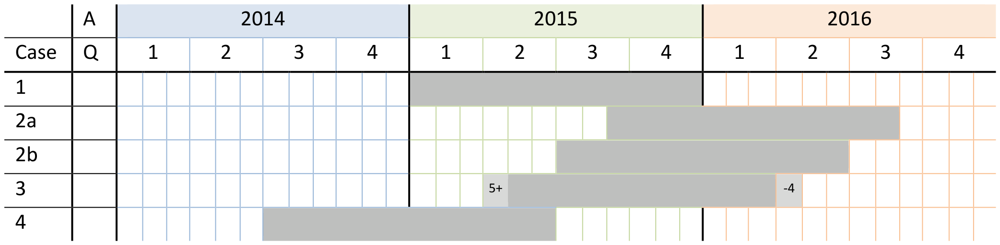
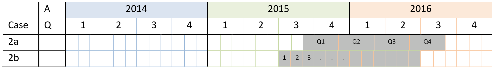

<!-- figure: f01-logo -->

**Statistical Working Group  
Statistical Guidelines**

  
**Guidelines on Non-Calendar Year Reporting of Data**

**Version 1.0 – 29/11/2016**

# 1. Problem statement

In many cases, data that are exchanged in SDMX data messages do not relate to the calendar year. However, many statistical system implementations require that data are mapped to and stored as the real calendar.

This guideline provides recommendations for the following four use cases of such non-calendar year data:

1\) Reporting year is equal to the calendar year

2\) Reporting year starts on the first day of a month different to January  
Example: school year starting on the 1st of September, fiscal year starting on the 1st of July

3\) Reporting year starts on a given day in the year  
Example: tax year starting on the 5th of April

4\) Reporting year **ends** on a given day in the year  
Example: fiscal year ending on the 30th of June, equivalent to fiscal year starting on the 1st of July Y-1

It is also required to take into account reporting frequencies other than annual (e.g. quarterly, monthly). The use cases lined out above can be visualised graphically. Note that, in this example, all time spans would use the year 2015 (“2015” or “2015-A1”) as the reference year in reporting:

```mermaid
block-beta
    columns 163
    r0c0[" "]:11 r0c1["A"]:7 r0c2["2014"]:48 r0c3["2015"]:48 r0c4["2016"]:49
    r1c0["Case"]:11 r1c1["Q"]:7 r1c2["1"]:12 r1c3["2"]:12 r1c4["3"]:12 r1c5["4"]:12 r1c6["1"]:12 r1c7["2"]:12 r1c8["3"]:12 r1c9["4"]:12 r1c10["1"]:13 r1c11["2"]:12 r1c12["3"]:12 r1c13["4"]:12
    r2c0["1"]:11 r2c1[" "]:7 r2c2[" "]:4 r2c3[" "]:4 r2c4[" "]:4 r2c5[" "]:4 r2c6[" "]:4 r2c7[" "]:4 r2c8[" "]:4 r2c9[" "]:4 r2c10[" "]:4 r2c11[" "]:4 r2c12[" "]:4 r2c13[" "]:4 r2c14[" "]:48 r2c15[" "]:4 r2c16[" "]:4 r2c17[" "]:5 r2c18[" "]:4 r2c19[" "]:4 r2c20[" "]:4 r2c21[" "]:4 r2c22[" "]:4 r2c23[" "]:4 r2c24[" "]:4 r2c25[" "]:4 r2c26[" "]:4
    r3c0["2a"]:11 r3c1[" "]:7 r3c2[" "]:4 r3c3[" "]:4 r3c4[" "]:4 r3c5[" "]:4 r3c6[" "]:4 r3c7[" "]:4 r3c8[" "]:4 r3c9[" "]:4 r3c10[" "]:4 r3c11[" "]:4 r3c12[" "]:4 r3c13[" "]:4 r3c14[" "]:4 r3c15[" "]:4 r3c16[" "]:4 r3c17[" "]:4 r3c18[" "]:4 r3c19[" "]:4 r3c20[" "]:4 r3c21[" "]:4 r3c22[" "]:49 r3c23[" "]:4 r3c24[" "]:4 r3c25[" "]:4 r3c26[" "]:4
    r4c0["2b"]:11 r4c1[" "]:7 r4c2[" "]:4 r4c3[" "]:4 r4c4[" "]:4 r4c5[" "]:4 r4c6[" "]:4 r4c7[" "]:4 r4c8[" "]:4 r4c9[" "]:4 r4c10[" "]:4 r4c11[" "]:4 r4c12[" "]:4 r4c13[" "]:4 r4c14[" "]:4 r4c15[" "]:4 r4c16[" "]:4 r4c17[" "]:4 r4c18[" "]:4 r4c19[" "]:4 r4c20[" "]:49 r4c21[" "]:4 r4c22[" "]:4 r4c23[" "]:4 r4c24[" "]:4 r4c25[" "]:4 r4c26[" "]:4
    r5c0["3"]:11 r5c1[" "]:7 r5c2[" "]:4 r5c3[" "]:4 r5c4[" "]:4 r5c5[" "]:4 r5c6[" "]:4 r5c7[" "]:4 r5c8[" "]:4 r5c9[" "]:4 r5c10[" "]:4 r5c11[" "]:4 r5c12[" "]:4 r5c13[" "]:4 r5c14[" "]:4 r5c15[" "]:4 r5c16[" "]:4 r5c17["5+"]:4 r5c18[" "]:45 r5c19["-4"]:4 r5c20[" "]:4 r5c21[" "]:4 r5c22[" "]:4 r5c23[" "]:4 r5c24[" "]:4 r5c25[" "]:4 r5c26[" "]:4 r5c27[" "]:4
    r6c0["4"]:11 r6c1[" "]:7 r6c2[" "]:4 r6c3[" "]:4 r6c4[" "]:4 r6c5[" "]:4 r6c6[" "]:4 r6c7[" "]:4 r6c8[" "]:48 r6c9[" "]:4 r6c10[" "]:4 r6c11[" "]:4 r6c12[" "]:4 r6c13[" "]:4 r6c14[" "]:4 r6c15[" "]:4 r6c16[" "]:4 r6c17[" "]:5 r6c18[" "]:4 r6c19[" "]:4 r6c20[" "]:4 r6c21[" "]:4 r6c22[" "]:4 r6c23[" "]:4 r6c24[" "]:4 r6c25[" "]:4 r6c26[" "]:4
    classDef default fill:#FFFFFF,stroke:#D9D9D9,color:#000000
    style r0c2 fill:#DBE5F1,stroke:#BFBFBF
    style r0c3 fill:#EAF1DD,stroke:#BFBFBF
    style r0c4 fill:#FDE9D9,stroke:#BFBFBF
    style r2c14 fill:#BFBFBF,stroke:#BFBFBF
    style r3c22 fill:#BFBFBF,stroke:#BFBFBF
    style r4c20 fill:#BFBFBF,stroke:#BFBFBF
    style r5c17 fill:#D9D9D9,stroke:#BFBFBF
    style r5c18 fill:#BFBFBF,stroke:#BFBFBF
    style r5c19 fill:#D9D9D9,stroke:#BFBFBF
    style r6c8 fill:#BFBFBF,stroke:#BFBFBF
```

<!-- figure: f02-reporting-year-cases -->

Original figure

Assuming that the time dimension has the ID TIME_PERIOD, case 1 could use TIME_PERIOD=”2015”. All other cases would need to use the notation TIME_PERIOD=”2015-A1”. For the rest of the document we use the more general notation “2015-A1”. <a href="#fn-1" id="fnref-1">1</a>

For quarterly or monthly data, the first period of the reporting year would also need to be read as relative to the start of the reporting year. Here are examples for case 2 if the data is quarterly (2a) or monthly (2b):

```mermaid
block-beta
    columns 170
    r0c0[" "]:12 r0c1["A"]:9 r0c2["2014"]:48 r0c3["2015"]:51 r0c4["2016"]:50
    r1c0["Case"]:12 r1c1["Q"]:9 r1c2["1"]:12 r1c3["2"]:12 r1c4["3"]:12 r1c5["4"]:12 r1c6["1"]:12 r1c7["2"]:12 r1c8["3"]:14 r1c9["4"]:13 r1c10["1"]:13 r1c11["2"]:13 r1c12["3"]:12 r1c13["4"]:12
    r2c0["2a"]:12 r2c1[" "]:9 r2c2[" "]:4 r2c3[" "]:4 r2c4[" "]:4 r2c5[" "]:4 r2c6[" "]:4 r2c7[" "]:4 r2c8[" "]:4 r2c9[" "]:4 r2c10[" "]:4 r2c11[" "]:4 r2c12[" "]:4 r2c13[" "]:4 r2c14[" "]:4 r2c15[" "]:4 r2c16[" "]:4 r2c17[" "]:4 r2c18[" "]:4 r2c19[" "]:4 r2c20[" "]:5 r2c21[" "]:5 r2c22["Q1"]:13 r2c23["Q2"]:13 r2c24["Q3"]:13 r2c25["Q4"]:12 r2c26[" "]:4 r2c27[" "]:4 r2c28[" "]:4 r2c29[" "]:4
    r3c0["2b"]:12 r3c1[" "]:9 r3c2[" "]:4 r3c3[" "]:4 r3c4[" "]:4 r3c5[" "]:4 r3c6[" "]:4 r3c7[" "]:4 r3c8[" "]:4 r3c9[" "]:4 r3c10[" "]:4 r3c11[" "]:4 r3c12[" "]:4 r3c13[" "]:4 r3c14[" "]:4 r3c15[" "]:4 r3c16[" "]:4 r3c17[" "]:4 r3c18[" "]:4 r3c19[" "]:4 r3c20["1"]:4 r3c21["2"]:5 r3c22["3"]:5 r3c23["."]:4 r3c24["."]:4 r3c25["."]:5 r3c26[" "]:4 r3c27[" "]:4 r3c28[" "]:5 r3c29[" "]:4 r3c30[" "]:4 r3c31[" "]:5 r3c32[" "]:4 r3c33[" "]:4 r3c34[" "]:4 r3c35[" "]:4 r3c36[" "]:4 r3c37[" "]:4
    classDef default fill:#FFFFFF,stroke:#D9D9D9,color:#000000
    style r0c2 fill:#DBE5F1,stroke:#BFBFBF
    style r0c3 fill:#EAF1DD,stroke:#BFBFBF
    style r0c4 fill:#FDE9D9,stroke:#BFBFBF
    style r2c22 fill:#BFBFBF,stroke:#BFBFBF
    style r2c23 fill:#BFBFBF,stroke:#BFBFBF
    style r2c24 fill:#BFBFBF,stroke:#BFBFBF
    style r2c25 fill:#BFBFBF,stroke:#BFBFBF
    style r3c20 fill:#BFBFBF,stroke:#BFBFBF
    style r3c21 fill:#BFBFBF,stroke:#BFBFBF
    style r3c22 fill:#BFBFBF,stroke:#BFBFBF
    style r3c23 fill:#BFBFBF,stroke:#BFBFBF
    style r3c24 fill:#BFBFBF,stroke:#BFBFBF
    style r3c25 fill:#BFBFBF,stroke:#BFBFBF
    style r3c26 fill:#BFBFBF,stroke:#BFBFBF
    style r3c27 fill:#BFBFBF,stroke:#BFBFBF
    style r3c28 fill:#BFBFBF,stroke:#BFBFBF
    style r3c29 fill:#BFBFBF,stroke:#BFBFBF
    style r3c30 fill:#BFBFBF,stroke:#BFBFBF
    style r3c31 fill:#BFBFBF,stroke:#BFBFBF
```

<!-- figure: f03-case-2-periods -->

Original figure

Note that in case 2a, the third quarter of reporting year 2015 (TIME_PERIOD=2015-Q3) is covering data from March until June 2016. In case 2b, the seventh month of reporting year 2015 (TIME_PERIOD=2015-M07) is covering data for January 2016.

It is clear in the graphical view that time series under case 2b should not be directly compared with time series under case 4. If it is required to compare figures of the same time period, the 2015 observation of the type 2b series is compared with the 2016 figure of the type 4 series. Comparing a 2a series with others from the example may be more complicated, because exact alignment of the timelines might not be possible without additional data. It is possible to estimate aligned timelines by doing a time transformation using formulas; for instance, shifting the time series to comply with the calendar year. The methodological aspects of time transformation are not part of these guidelines. For coding the results of such transformations, please refer to the guidelines on coding time transformations in SDMX<a href="#fn-2" id="fnref-2">2</a>.

# 2. SDMX Concepts for Non-Calendar Year Series

## *Start and end day coding*

In SDMX messages, the time period concept (concept ID TIME_PERIOD) specifies the **reporting period**. This reporting period, as outlined above, is in many cases not aligned with the calendar year.

To specify the calendar period that a reporting period is covering, the SDMX technical standard already defines an attribute “reporting year start” on series level with format xs:gMonthDay<a href="#fn-3" id="fnref-3">3</a>. It gives a day and month when the reporting year starts. It is optional and if not provided the default is 1st January. Using this attribute can cover cases 1, 2 and 3 from above. When added to a series, the attribute will specify on which day of the calendar year the reporting year starts.

This is not sufficient to cover case 4, because in this case the reporting year 2015 starts in 2014. In order to specify this case, a different attribute “reporting year end” should be used. It is also on series level with format xs:gMonthDay and gives a day and month when the reporting year ends. It is optional and if not provided the default is 31st December.

The technical note (revision 1.0) suggests that the attribute ID for reporting year start day to be REPORTING_YEAR_START_DAY. However, to maintain EDI compliance, it is suggested to use the IDs REPYEARSTART and REPYEAREND when defining DSDs.

For any given series either start or end day should be used, <u>but not both</u>. This also implies that a reporting year will always have a duration of one year. In case reporting years do not last exactly a year, refer to the ISO time interval specification described in the next chapter. It is also strongly recommended not to use 29th February as either start or end date of the reporting year, since that might lead to undefined situations.

## *ISO 8601 time interval*

As outlined above, in some cases reporting periods might not have the same duration as calendar periods. A crop year in agriculture may only last for a couple of months. To specify these periods on a more granular level, the SDMX technical standard suggests using the time intervals as defined by ISO 8601. ISO specifies four ways to express a time interval<a href="#fn-4" id="fnref-4">4</a>:

1.  Start and end, such as "2007-03-01T13:00:00Z/2008-05-11T15:30:00Z"

2.  Start and duration, such as "2007-03-01T13:00:00Z/P1Y2M10DT2H30M"

3.  Duration and end, such as "P1Y2M10DT2H30M/2008-05-11T15:30:00Z"

4.  Duration only, such as "P1Y2M10DT2H30M", with additional context information

An attribute time range (ID:TIME_RANGE) is suggested at the observation level to specify further in which particular time range a specific observation was collected. The series will still specify when the reporting period starts or ends for the whole series and each observation can have a specific time range within that reporting period. It is suggested for that case to use only option 1, the start and end date, and not the other options in SDMX context.

# 3. Example 1: Based on National Accounts data exchange

Note that the SDMX fragments shown in the examples below are not syntactically correct. They serve the purpose of explaining the issue and show the coding in a readable way (pseudo code).

## *Current NA definition*

In the National Accounts Data Structure Definitions, fiscal year reporting was initially covered with the “reference period detail” attribute. This attribute is coded and only covers cases where a fiscal year starts on the first day of a given month. For other cases, a code for “other definition” was introduced.

The code list for “reference period detail” previously used in the National Accounts DSDs is as follows:

| **Code** | **Description**                   |
|:---------|:----------------------------------|
| C        | Calendar year                     |
| F_O      | Fiscal year (other definition)    |
| F02      | Fiscal year starting in February  |
| F03      | Fiscal year starting in March     |
| F04      | Fiscal year starting in April     |
| F05      | Fiscal year starting in May       |
| F06      | Fiscal year starting in June      |
| F07      | Fiscal year starting in July      |
| F08      | Fiscal year starting in August    |
| F09      | Fiscal year starting in September |
| F10      | Fiscal year starting in October   |
| F11      | Fiscal year starting in November  |
| F12      | Fiscal year starting in December  |

Following this code list, the cases lined out in the problem statement could be coded as such:

1\) Reporting year is equal to the calendar year

\<na\_:Series <strong>REF_PERIOD_DETAIL="C" </strong>STO="B1G" REF_AREA="LU" FREQ="Q"\>  
\<na\_:Obs OBS_VALUE="44" TIME_PERIOD="**1995**-Q1"/\>  
\</na\_:Series\>

REF_PERIOD_DETAIL="C" → reporting year 1995 starts 1st January 1995

2\) Reporting year starts on the first day of a month different to January  
Example: fiscal year starting on the 1st of July

\<na\_:Series <strong>REF_PERIOD_DETAIL="F07" </strong>STO="B1G" REF_AREA="LU" FREQ="Q"\>  
\<na\_:Obs OBS_VALUE="44" TIME_PERIOD="**1995**-Q1"/\>  
\</na\_:Series\>

REF_PERIOD_DETAIL="F07" → reporting year 1995 starts 1st July 1995 and Q1 projected on the calendar year goes from: 07-09/1995

3\) Reporting year starts on a given day in the year  
Example: tax year starting on the 5th of April

\<na\_:Series <strong>REF_PERIOD_DETAIL="F04" </strong>STO="B1G" REF_AREA="LU" FREQ="Q"\>  
\<na\_:Obs OBS_VALUE="44" TIME_PERIOD="**1995**-Q1"/\>  
\</na\_:Series\>

REF_PERIOD_DETAIL="F04" → reporting year 1995 would start 1st April 1995. The case is not solved because we do not know anymore that it should be on the 5th. Another option would be to use the “F_O” code:

\<na\_:Series <strong>REF_PERIOD_DETAIL="F\_O" </strong>STO="B1G" REF_AREA="LU" FREQ="Q"\>  
\<na\_:Obs OBS_VALUE="44" TIME_PERIOD="**1995**-Q1"/\>  
\</na\_:Series\>

REF_PERIOD_DETAIL="F_O" → reporting year 1995 has another definition. The case is only partly solved because we do not know the exact date. Additional metadata are needed and the reporting period cannot directly be parsed by a system.

4\) Reporting year **ends** on a given day in the year  
Example: fiscal year ending on the 30th of June, equivalent to fiscal year starting on the 1st of July Y-1

\<na\_:Series <strong>REF_PERIOD_DETAIL="??" </strong>STO="B1G" REF_AREA="LU" FREQ="Q"\>  
\<na\_:Obs OBS_VALUE="44" TIME_PERIOD="**1995**-Q1"/\>  
\</na\_:Series\>

REF_PERIOD_DETAIL="??" → the case is not covered. The code “F_O” could be used with the same problems as lined above for case 3.

## *Recommendations based on the use cases from National Accounts*

Using the attributes as suggested above, all cases outlined in the National Account examples can be fully covered:

1\) Reporting year is equal to the calendar year

\<na\_:Series **~~REF_PERIOD_DETAIL="C"~~ REPYEARSTART="--01-01"** STO="B1G" REF_AREA="LU" FREQ="Q"\>  
\<na\_:Obs OBS_VALUE="44" TIME_PERIOD="**1995**-Q1"/\>  
\</na\_:Series\>

1995-Q1 is the same as the calendar definition: from 1st January 1995 until 31st March 1995. In this case, the attribute REPYEARSTART may be omitted, since it expressed the default value of 1st January.

2\) Reporting year starts on the first day of a month different to January  
Example: fiscal year starting on the 1st of July

\<na\_:Series **~~REF_PERIOD_DETAIL="F07"~~ REPYEARSTART="--07-01"** STO="B1G" REF_AREA="LU" FREQ="Q"\>  
\<na\_:Obs OBS_VALUE="44" TIME_PERIOD="**1995**-Q1"/\>  
\</na\_:Series\>

Reporting period 1995-Q1 lasts in that case from 1st July 1995 until 30th September 1995.

3\) Reporting year starts on a given day in the year  
Example: tax year starting on the 5th of April

\<na\_:Series **~~REF_PERIOD_DETAIL="F04"~~ REPYEARSTART="--04-05"** STO="B1G" REF_AREA="LU" FREQ="Q"\>  
\<na\_:Obs OBS_VALUE="44" TIME_PERIOD="**1995**-Q1"/\>  
\</na\_:Series\>

Reporting period 1995-Q1 lasts in that case from 5th April 1995 until 4th July 1995.

4\) Reporting year **ends** on a given day in the year  
Example: fiscal year ending on the 30th of June, equivalent to fiscal year starting on the 1st of July Y-1

\<na\_:Series **~~REF_PERIOD_DETAIL="??"~~ REPYEAREND="--06-30"** STO="B1G" REF_AREA="LU" FREQ="Q"\>  
\<na\_:Obs OBS_VALUE="44" TIME_PERIOD="**1995**-Q1"/\>  
\</na\_:Series\>

Reporting period 1995-Q1 lasts in that case from 1st July 1994 until 30th September 1994

# 4. Example 2: Based on Agriculture data exchange 

## *Problem statement*

The problem statement explains some issues faced in agriculture statistics when reporting on non-calendar year observations. The examples are somewhat simplified to focus on the issue at hand.

In agriculture there are usually three numbers associated with crop production: the planted area, the harvested area and the production in quantity or value. From this, yield may be derived in order to perform economic calculations and use it for other purposes.

Let us take the example of wheat. In most cases an area is planted in year n and it is harvested in year n+1. As can be seen in the examples below about wheat growing periods in several regions in the world, the reference period usually refers to the year of the harvest (year n+1). From these observations, different indicators may be derived and the relation be made that the planted area of year n is to the production of year n+1.

To be able to do this without mistakes when looking at the three datasets mentioned (harvested area, planted area, production), the start date, the end date and the year reported by the country are required for each dataset for comparability reasons. The Start date and end date of the observation will allow the data to be linked to perform calculations and analysis. The reported year is important to determine how the country reports and publishes its data and to compare and explain differences between the published data of each country and, for instance, data published by an international organisation.

Also, the growing periods for wheat may change according to the weather. Sometimes the planting and harvesting may happen during the same calendar year and sometimes not. The growing period might be a little shorter or longer. It would be good to know for each year according to the length of the growing period how the country codes the data: when the season goes beyond 31 Dec, they might use year n or year n+1.

In many countries, data are published with the year written as periods (e.g. 2009-10 for annual data about the 2009-2010 period). This notation is also commonly used in education statistics, but is not part of the standard observational time-period format defined in SDMX.

## *Proof of concept DSD*

Note that the DSD proposal below does not constitute a real usable DSD for agriculture statistics. It is heavily simplified to only include concepts that are relevant for the purpose of these guidelines. Also the SDMX fragments shown in the example are not syntactically correct. They just serve the purpose of explaining the issue and show the coding in a readable way (pseudo code).

<table>
<colgroup>
<col style="width: 18%" />
<col style="width: 23%" />
<col style="width: 19%" />
<col style="width: 38%" />
</colgroup>
<thead>
<tr>
<th>Concept ID</th>
<th>Description</th>
<th>Role</th>
<th>Code List / Format</th>
</tr>
</thead>
<tbody>
<tr>
<td>FREQ</td>
<td>Frequency</td>
<td>Dimension</td>
<td>A (annual), S (Half-yearly)</td>
</tr>
<tr>
<td>REF_AREA</td>
<td>Reference area</td>
<td>Dimension</td>
<td>IN (India), CN (China)</td>
</tr>
<tr>
<td>CROP</td>
<td>Crop</td>
<td>Dimension</td>
<td>W (Wheat)</td>
</tr>
<tr>
<td></td>
<td>Crop 
(alternative coding)</td>
<td>Dimension</td>
<td>W (Total Wheat), WW (winter wheat), SW (summer wheat)</td>
</tr>
<tr>
<td>ACTIVITY</td>
<td>Activity</td>
<td>Dimension</td>
<td>P (planting), H (harvesting)</td>
</tr>
<tr>
<td>REPYEARSTART</td>
<td>Reference year start</td>
<td>Attribute 
(optional, series)</td>
<td>xs:gMonthDay</td>
</tr>
<tr>
<td>REPYEAREND</td>
<td>Reference year end</td>
<td>Attribute 
(optional, series)</td>
<td>xs:gMonthDay</td>
</tr>
</tbody>
</table>

## *Usage of guidelines*

### India

Planting: wheat takes place in October to December (e.g. 2010)

Harvest: during the months of February and May (e.g. 2011).

Assumption: India attributes both activities to “crop year” 2011, which goes from Oct 2010-May 2011

**Example data:**

Oct-Dec 2010: 100 units planted

Feb-May 2011: 100 units harvested

Oct-Dec 2011: 200 units planted

Feb-May 2012: 200 units harvested

**Coding:**

\<Series FREQ=A REF_AREA=IN CROP=W ACTIVITY=P **REPYEAREND=--05-31**\>  
Obs TIME_PERIOD=2011-A1 VALUE=100  
Obs TIME_PERIOD=2012-A1 VALUE=200

\<Series FREQ=A REF_AREA=IN CROP=W ACTIVITY=H **REPYEAREND=--05-31**\>  
Obs TIME_PERIOD=2011-A1 VALUE=100  
Obs TIME_PERIOD=2012-A1 VALUE=200

The end of the reporting year is the end of May (attribute REPYEAREND). By definition, the year 2011 would thus go from 1st June 2010 – 31st May 2011. The real crop year is shorter, but since it is the same for every year and always within that time range, this information is sufficient to be available as reference metadata.

### China

Winter wheat is planted from mid-September through October and harvested from mid-May through June. Summer wheat is planted from mid-March through April and harvested from mid-July to mid-August.

Assumption: China attributes both activities to a “crop year”, which goes from September of the previous until May of the current year.

**Sample Data for China**

| Crop year | Season | Calendar period | Units         |
|-----------|--------|-----------------|---------------|
| 2011      | Winter | Sep-Oct 2010    | 100 planted   |
|           |        | May-Jun 2011    | 100 harvested |
|           | Summer | Mar-Apr 2011    | 200 planted   |
|           |        | Jul-Aug 2011    | 200 harvested |
| 2012      | Winter | Sep-Oct 2011    | 120 planted   |
|           |        | May-Jun 2011    | 120 harvested |
|           | Summer | Mar-Apr 2012    | 220 planted   |
|           |        | Jul-Aug 2012    | 220 harvested |

## *Recommendations based on the Use Cases from Agriculture*

For coding the SDMX message, the frequency of the data is half-yearly, since we have two seasons per year. The reporting year end (31st August) corresponds to the whole reporting year, ranging from 1st September Y-1 until 31st August Y. The exact duration of the season would, in this example, only be available in metadata.

\<Series FREQ=S REF_AREA=CN CROP=W ACTIVITY=P REPYEAREND=--08-31\>  
Obs TIME_PERIOD=2011-S1 VALUE=100  
Obs TIME_PERIOD=2011-S2 VALUE=200  
Obs TIME_PERIOD=2012-S1 VALUE=120  
Obs TIME_PERIOD=2012-S2 VALUE=220

\<Series FREQ=S REF_AREA=CN CROP=W ACTIVITY=H REPYEAREND=--08-31\>  
Obs TIME_PERIOD=2011-S1 VALUE=100  
Obs TIME_PERIOD=2011-S2 VALUE=200  
Obs TIME_PERIOD=2012-S1 VALUE=120  
Obs TIME_PERIOD=2012-S2 VALUE=220

To calculate the total annual planting of crop, the half-yearly series are added up to annual series (2011=2011-S1+2011-S2 → P: 100+200=300; H: 100+200=300).

\<Series FREQ=A REF_AREA=CN CROP=W ACTIVITY=P REPYEAREND=--08-31\>  
Obs TIME_PERIOD=2011-A1 VALUE=300  
Obs TIME_PERIOD=2012-A1 VALUE=340  
\<Series FREQ=A REF_AREA=CN CROP=W ACTIVITY=H REPYEAREND=--08-31\>  
Obs TIME_PERIOD=2011-A1 VALUE=300  
Obs TIME_PERIOD=2012-A1 VALUE=340

If the alternative coding of Winter Wheat (WW) and Summer Wheat (SW) is used, the frequency becomes annual and values can also be added up separately:

\<Series FREQ=A REF_AREA=CN CROP=WW ACTIVITY=P REPYEAREND=--08-31\>  
Obs TIME_PERIOD=2011-A1 VALUE=100  
Obs TIME_PERIOD=2012-A1 VALUE=120

\<Series FREQ=A REF_AREA=CN CROP=WW ACTIVITY=H REPYEAREND=--08-31\>  
Obs TIME_PERIOD=2011-A1 VALUE=100  
Obs TIME_PERIOD=2012-A1 VALUE=120

\<Series FREQ=A REF_AREA=CN CROP=SW ACTIVITY=P REPYEAREND=--08-31\>  
Obs TIME_PERIOD=2011-A1 VALUE=200  
Obs TIME_PERIOD=2012-A1 VALUE=220

\<Series FREQ=A REF_AREA=CN CROP=SW ACTIVITY=H REPYEAREND=--08-31\>  
Obs TIME_PERIOD=2011-A1 VALUE=200  
Obs TIME_PERIOD=2012-A1 VALUE=220

For the total annual planting of crop, the winter and summer wheat can be added (W=WW+SW) and lead to the same result as above:

\<Series FREQ=A REF_AREA=CN CROP=W ACTIVITY=P REPYEAREND=--08-31\>  
Obs TIME_PERIOD=2011-A1 VALUE=300  
Obs TIME_PERIOD=2012-A1 VALUE=340  
\<Series FREQ=A REF_AREA=CN CROP=W ACTIVITY=H REPYEAREND=--08-31\>  
Obs TIME_PERIOD=2011-A1 VALUE=300  
Obs TIME_PERIOD=2012-A1 VALUE=340

### Date range coding example

As it can be seen in the examples above, the exact period when the actual planting / harvesting took place can usually be expressed as reference metadata. However, when adding up figures from different reporting year definitions (e.g. adding India and China for 2011), one needs to pay attention to the different definitions. There is no implicit SDMX solution, because SDMX only expresses the data but does not contain the methodology of how data are added for different reporting periods. If more detailed information is needed; for instance, an algorithm to attribute crop production to exact comparable periods, the exact time ranges need to be known as input to the estimation formulas.

To take the examples of India from above, slightly modified:

1st Oct- 27th Dec 2010: 100 units planted

5th Feb- 17th May 2011: 100 units harvested

15th Oct- 2nd Jan 2012: 200 units planted

7th Feb-5th May 2012: 200 units harvested

It can be coded as follows, to give the data user the maximum information for further processing:

\<Series FREQ=A REF_AREA=IN CROP=W ACTIVITY=P REPYEAREND=--05-31\>  
Obs TIME_PERIOD=2011-A1 VALUE=100 TIME_RANGE=2010-10-01/2010-12-27  
Obs TIME_PERIOD=2012-A1 VALUE=200 TIME_RANGE=2011-10-15/2012-01-02

\<Series FREQ=A REF_AREA=IN CROP=W ACTIVITY=H REPYEAREND=--05-31\>  
Obs TIME_PERIOD=2011-A1 VALUE=100 TIME_RANGE=2011-02-05/2011-05-17  
Obs TIME_PERIOD=2012-A1 VALUE=200 TIME_RANGE=2012-02-07/2012-05-05

Care needs to be taken that the time range for each observation is within the period covered by the reporting period projected on the calendar. For instance, a harvesting range lasting from the beginning of March until the end of June would be invalid, because the reporting period ends at the end of May. In case harvesting would last until June, the reporting year end would need to be changed accordingly.

<!-- footnotes -->

------------------------------------------------------------------------

1 The *YYYY* format is reserved for Gregorian years, i.e. from January 1 to December 31. For reporting years that are not Gregorian years, the format YYYY-A1 (e.g. 2016-A1) must be used for the time dimension

2 <https://sdmx.org/wp-content/uploads/SWG_TimeTransformation_V1.0.docx>

3 <https://sdmx.org/wp-content/uploads/SDMX_2-1-1-SECTION_6_TechnicalNotes-march-2013.pdf>, row 658

4 <http://www.iso.org/iso/home/standards/iso8601.htm> and  
<https://sdmx.org/wp-content/uploads/SDMX_2-1-1-SECTION_6_TechnicalNotes-march-2013.pdf>, row 749.
