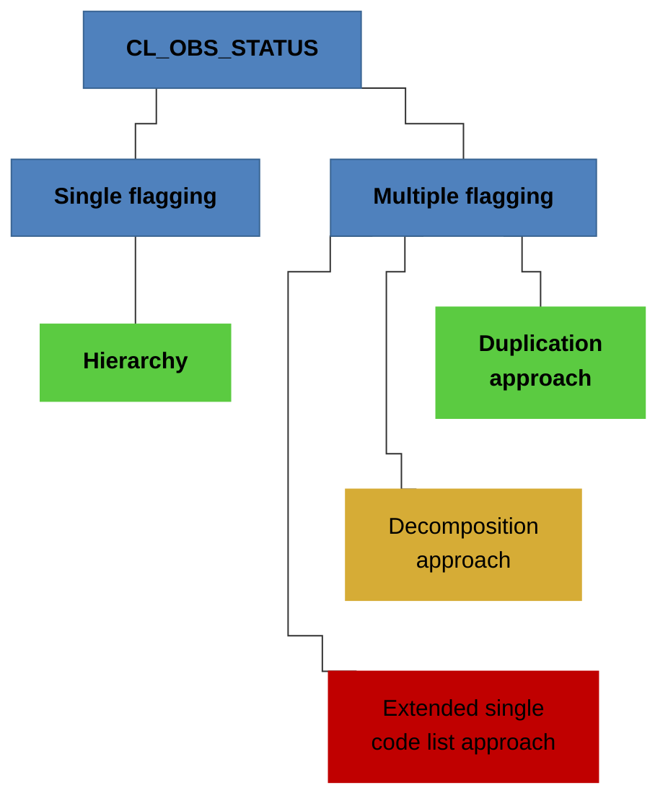
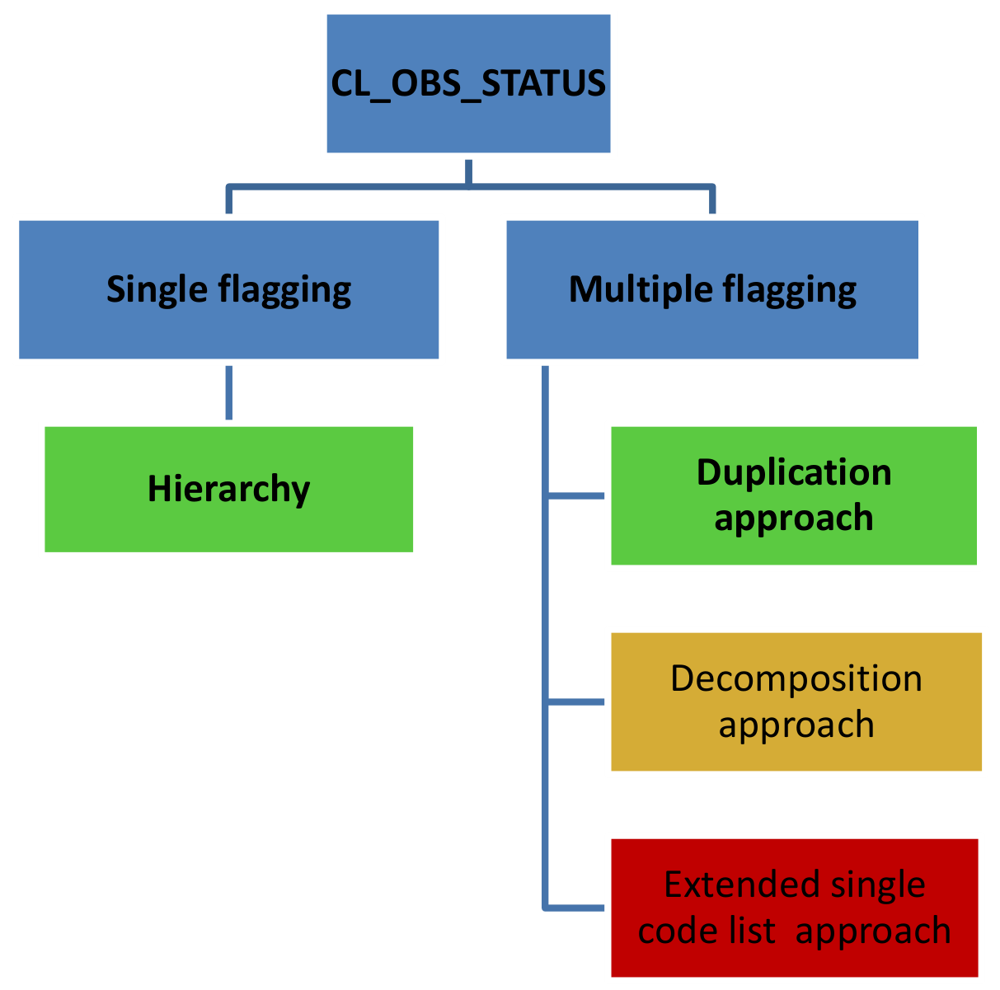

<!-- figure: f01-logo -->

  
**Statistical Working Group / Technical Working Group**

**POSSIBLE WAYS OF IMPLEMENTING THE OBSERVATION STATUS CONCEPT**

**MAY 2019**

**VERSION 2.0**

**Document History**

| **Version** | **Date** | **Comment** |
|:---|:---|:---|
| 1.0 | 1/10/2014 | Initial version |
| 2.0 | 1/5/2019 | Guideline title change (more accurate); add new OBS_STATUS codes to hierarchy; changed 3.1 approach to include OBS_STATUS code (this compatibility break is the major version change); text clarification; include a document history |

**1) Introduction**

First of all, it is important to note that the "Observation status" code list (CL_OBS_STATUS<a href="#fn-1" id="fnref-1">1</a>) has an heterogeneous character as it mixes concepts which are not always mutually exclusive (e.g. a missing value can generate a break in time series, an estimated value can be of low reliability). Thus, to cope with the issue of allocating more than one flag to one statistical value, this code list should ideally be broken down into various sub-code lists corresponding to the various concepts covered. It was not done so because it was felt that it would unnecessarily increase the number of (very short) code lists for low benefits in terms of technical and conceptual orthodoxy.

However, in view of the central importance of this code list, it is essential to provide implementers with all possible ways of implementing this code list so that they can decide, based on their specific implementation needs, which option best suits their requirements. These various options are presented in the sections below, and their pros and contras explicated.

In case implementers are satisfied with one flag per observation value, they are invited to apply the recommended hierarchy proposed under "2) One flag only per value". In the case of multiple flagging, although the three options described below are in theory applicable, they should certainly not be considered equally; indeed, option 3.1 "Duplication approach" is to be considered as the recommended general solution to preserve backwards compatibility with SDMX-EDI; in cases where implementers do not think the recommended general solution can be applied, or is appropriate to apply in their particular context, or SDMX-EDI is not supported in the exchange, an alternative solution 3.2 "Decomposition approach" is also recommended. The third option 3.3 "Extended single code list approach", is documented here for the sake of completeness but strongly discouraged.

The SDMX standard allows for the use of zero or more observation level attributes, using any identifiers. However, SDMX-EDI imposes the mandatory use of the observation level attribute called OBS_STATUS. In the past, SDMX-EDI has limited itself, for practical reasons, to the use of the observation level attributes OBS_STATUS, CONF_STATUS, PRE_BREAK_VALUE and COMMENT_OBS, but SDMX-EDI can handle any number of observation level attributes, as long as OBS_STATUS is included.

**2) One flag only per value**

In case implementers want to use only one single flag per value, they should use the hierarchy below to determine the code to be used. This approach (choice of only one event, namely the most important one) offers a good compromise between simplicity for the user, completeness of provided information and presentational easiness of management on the user interface side. The main drawback of this approach is the loss of information resulting from the use of only one flag when several flags may apply to a given value.

<u>Example</u>: From now on, value x is compiled on the basis of a methodology diverging from the previous one (e.g. following an alignment with international standards), which generates a break in time series. However, the value in this period is suppressed, e.g. for confidentiality reasons. In this case, two flags, namely B (*Time series break*) and Q (missing value; suppressed), should be used. If only one flag is to be indicated, then use should be made of the hierarchy below to determine which flag to use. In this case, this would be B since B has precedence over Q in the hierarchy.

<table style="width:100%;">
<colgroup>
<col style="width: 50%" />
<col style="width: 22%" />
<col style="width: 26%" />
</colgroup>
<thead>
<tr>
<th rowspan="2" style="text-align: center;"><strong>Observation status
hierarchy</strong></th>
<th colspan="2" style="text-align: center;"><strong>Relevant in
conjunction with...</strong></th>
</tr>
<tr>
<th style="text-align: center;"><strong>numeric values</strong></th>
<th style="text-align: center;"><strong>missing values</strong></th>
</tr>
</thead>
<tbody>
<tr>
<td><strong>B</strong> / time series break (highest importance)</td>
<td style="text-align: center;">Yes</td>
<td style="text-align: center;">Yes</td>
</tr>
<tr>
<td>
<strong>O</strong> / missing value
</td>
<td style="text-align: center;"></td>
<td style="text-align: center;">Yes</td>
</tr>
<tr>
<td>
<strong>M</strong> / missing value; data cannot exist
</td>
<td style="text-align: center;"></td>
<td style="text-align: center;">Yes</td>
</tr>
<tr>
<td>
<strong>L</strong> / missing value; data exist but were not
collected
</td>
<td style="text-align: center;"></td>
<td style="text-align: center;">Yes</td>
</tr>
<tr>
<td>
<strong>H</strong> / missing value; holiday or weekend
</td>
<td style="text-align: center;"></td>
<td style="text-align: center;">Yes</td>
</tr>
<tr>
<td>
<strong>Q</strong> / missing value; suppressed
</td>
<td style="text-align: center;"></td>
<td style="text-align: center;">Yes</td>
</tr>
<tr>
<td>
<strong>J</strong> / derogation
</td>
<td style="text-align: center;">Yes</td>
<td style="text-align: center;">Yes</td>
</tr>
<tr>
<td>
<strong>S</strong> / strike and other special events
</td>
<td style="text-align: center;">Yes</td>
<td style="text-align: center;">Yes</td>
</tr>
<tr>
<td>
<strong>D</strong> / definition differs
</td>
<td style="text-align: center;">Yes</td>
<td style="text-align: center;"></td>
</tr>
<tr>
<td>
<strong>K</strong> / data included in another category
</td>
<td style="text-align: center;"></td>
<td style="text-align: center;">Yes</td>
</tr>
<tr>
<td>
<strong>W</strong> / Includes data from another category
</td>
<td style="text-align: center;">Yes</td>
<td style="text-align: center;"></td>
</tr>
<tr>
<td>
<strong>I</strong> / imputed value
</td>
<td style="text-align: center;">Yes</td>
<td style="text-align: center;"></td>
</tr>
<tr>
<td>
<strong>F</strong> / forecast value
</td>
<td style="text-align: center;">Yes</td>
<td style="text-align: center;"></td>
</tr>
<tr>
<td>
<strong>E</strong> / estimated value
</td>
<td style="text-align: center;">Yes</td>
<td style="text-align: center;"></td>
</tr>
<tr>
<td>
<strong>P</strong> / provisional value
</td>
<td style="text-align: center;">Yes</td>
<td style="text-align: center;"></td>
</tr>
<tr>
<td>
<strong>N</strong> / not significant
</td>
<td style="text-align: center;">Yes</td>
<td style="text-align: center;"></td>
</tr>
<tr>
<td>
<strong>U</strong> / low reliability
</td>
<td style="text-align: center;">Yes</td>
<td style="text-align: center;"></td>
</tr>
<tr>
<td>
<strong>V</strong> / unvalidated value
</td>
<td style="text-align: center;">Yes</td>
<td style="text-align: center;"></td>
</tr>
<tr>
<td>
<strong>G</strong> / experimental value
</td>
<td style="text-align: center;">Yes</td>
<td style="text-align: center;"></td>
</tr>
<tr>
<td>
<strong>A</strong> / normal value
</td>
<td style="text-align: center;">Yes</td>
<td style="text-align: center;"></td>
</tr>
</tbody>
</table>

**3) Multiple flagging**

There might be cases however where implementers will want to attach multiple flags to one statistical value. To cope with this situation, three solutions have been analysed, based on:

\(1\) a duplication approach;

\(2\) a decomposition approach;

\(3\) an extended single code list approach.

Technically the three approaches are possible. However, considering the severe limitations that the third approach would implicate, only one of the first two approaches will be recommended for use (as said earlier also with a view to improving harmonisation across implementations and backwards compatibility).

***3.1) Duplication approach (recommended solution)***

In this case, the OBS_STATUS concept is duplicated as many times as needed. These duplicated concepts should be named "OBS_STATUS", "OBS_STATUS_1", "OBS_STATUS_2", "OBS_STATUS_3", etc. All these concepts have to be inserted in the DSD and linked to the CL_OBS_STATUS code list. Only one value is allowed per code list. In order to have backwards compatibility with systems only processing a single observation status flag and also to keep DSDs with multiple flags compatible with DSDs using a single flag, it is strongly recommended to sort the flags according to the observation status hierarchy table above in a data message. For example, if the multiple flags should be G (experimental), V (unvalidated) and D (definition differs), then the order according to the hierarchy would be: OBS_STATUS = D, OBS_STATUS_1 = V, OBS_STATUS_2 = G. A system only parsing a single flag could still rely on the OBS_STATUS concept identifier to catch the flag with the highest priority.

The main advantages of this solution are its simplicity and the fact that it does not require listing the possible combinations.

Drawbacks are the multiplication of the same concept and the absence of implicit checks which makes it possible to enter aberrant combinations of codes (e.g. missing value **<u>and</u>** imputed value). It is thus recommended to perform validation checks before data processing to ensure that combinations contained in a data message make semantic sense.

This approach is the recommended general solution for implementations where multiple flagging is required.

***3.2) Decomposition approach (recommended solution if exchange does not support SDMX-EDI)***

Here, CL_OBS_STATUS code list is broken down into its basic components, distinguished on the basis of the different concepts used and their mutually exclusive character. The list of "building blocks" composing the CL_OBS_STATUS code list as it stands at present could be represented as separate concepts as follows:

- Concept OBS_STATUS (Observation status) → code list CL_OBS_MAIN (A,E,G,H,I,J,K,W,M,O, L,Q,S)<a href="#fn-2" id="fnref-2">2</a>: these codes can be grouped in one single code list because they are mutually exclusive: a normal value cannot be estimated nor imputed nor missing; an estimated value cannot be normal nor imputed nor missing, an imputed value cannot be normal nor estimated nor missing, etc.

For the other status codes, a single Boolean code list<a href="#fn-3" id="fnref-3">3</a> can be created to enable / disable a specific flag:

- Concept OBS_BREAK → code list CL_BOOLEAN, with code Y corresponding to flag B (Time series break);

- Concept OBS_DEF_DIFFERS → code list CL_BOOLEAN, with code Y corresponding to flag D (Definition differs);

- Concept OBS_FORECAST → code list CL_BOOLEAN, with code Y corresponding to flag°F (Forecast value);

- Concept OBS_PROV → code list CL_BOOLEAN, with code Y corresponding to flag P (Provisional value);

- Concept OBS_NOTSIGNIFICANT → code list CL_BOOLEAN, with code Y corresponding to flag N (Not significant);

- Concept OBS_UNVALIDATED → code list CL_BOOLEAN, with code Y corresponding to flag V (Unvalidated value);

- Concept OBS_LOWRELIABILITY → code list CL_BOOLEAN, with code Y corresponding to flag U (Low reliability).

If additional flags are needed, more concepts can be defined accordingly. All these concepts have to be inserted in the DSD and linked to CL_BOOLEAN.

The main advantage of this proposal is its full compliance with the technical standards and the content-oriented guidelines which insist on separating concepts which are different in content. Drawbacks are the multiplication of (very) small code lists and the absence of implicit checks which makes it possible to enter aberrant combinations of codes (e.g. normal value **<u>and</u>** low reliability). Furthermore, any new code will require reconsidering the content of the various sub-code lists.

Although not recommended as the preferred solution, this approach can be implemented in cases where the general solution cannot be applied, or is not the appropriate solution, in a particular context.

<table>
<colgroup>
<col style="width: 100%" />
</colgroup>
<thead>
<tr>
<th style="text-align: left;">
<strong>Comments on the choice of the recommended solution</strong>

Both "Decomposition" and "Duplication" options provide acceptable workarounds to the problem of multiple flagging, and appear to be quite similar in practice. The trade-off in this context was between orthodoxy and ease of implementation.

Conceptually the "Decomposition" approach is the strongest of the two as it not only allows separating concepts, but also helps arranging codes into more homogeneous code lists. It also requires that implementers define pure concepts and name them accordingly.

This document recommends the "Duplication" approach mainly on the practical grounds of ease of implementation because its use of “OBS_STATUS” is compatible with the cross-domain concept scheme, whereas the Decomposition approach is not. The recommended approach could be reconsidered in the future, would the technical standard better accommodate the decomposition approach.
</th>
</tr>
</thead>
<tbody>
</tbody>
</table>

***3.3) Extended single code list approach (strongly discouraged)***

The extended version of CL_OBS_STATUS (see below) provides the full list of logically possible combinations of codes in a specific SDMX implementation.

An advantage of this solution would be that only meaningful combinations of flags are included in the list. Users would not be able to choose combinations which would not make sense (such as "missing" and "estimated").

However, there are several drawbacks related to the technical implementation of this solution:

- relative complexity for users to find the right combination of flags

- maintenance burden in case of revision of the code list

- presentational complexity of management on user interface side

- very complex SDMX query message would be needed to query for data according to flags

Thus, this approach is not recommended to be used. For completeness the table shows a possible implementation of this approach:

| **Code** | **Description**                                        |
|----------|--------------------------------------------------------|
| **A**    | **Normal**                                             |
| **B**    | **Time series break**                                  |
| BD       | Time series break, Definition differs                  |
| BDE      | Time series break, Estimated value, Definition differs |
| etc.     |                                                        |
| **D**    | **Definition differs**                                 |
| DE       | Definition differs, Estimated value                    |
| DEP      | Definition differs, Estimated value, Provisional value |
| etc.     |                                                        |
| **E**    | **Estimated value**                                    |
| EP       | Estimated value, Provisional value                     |
| etc.     |                                                        |

If further combinations are needed, these can be created on an *ad hoc* basis by selecting the necessary codes from the basic code list and sorting them alphabetically. Inversely, implementers might wish to reduce the list of possible options, would all options above not be necessary for their specific needs.

Considering the severe limitations implied by the third approach, only the first two approaches are recommended for use.

**4) Conclusion**

From the analysis of the various approaches presented above, it appears clearly that the extended single code list approach cannot be recommended for use.

Although the two remaining approaches, i.e. the duplication approach and the decomposition approach , may qualify for being recommended, it is preferable to give precedence to one approach in order to improve harmonisation across implementations. Considering its relative simplicity in terms of maintenance, the recommended option is option based on the "duplication approach".

**5) Synthetic overview of solutions proposed and suggested recommendations**

<!-- figure: f02-solutions-overview -->

Original figure

**Colour key**

- **Recommended solution**

- **Recommended solution if exchange does not support SDMX-EDI**

- **Strongly discouraged**

<!-- footnotes -->

------------------------------------------------------------------------

1 <https://sdmx.org/?page_id=3215>

2 Other grouping are thinkable, for example, all codes related to missing values could be moved to a different concept and code list OBS_MISSING and CL_OBS_MISSING.

3 CL_BOOLEAN with 2 codes: Y (Yes), N (No)
