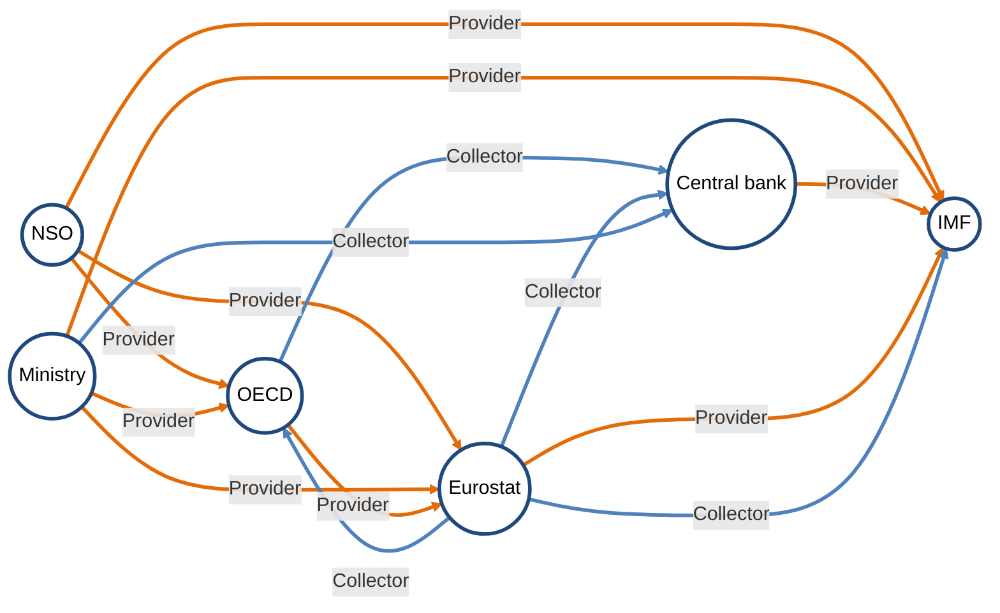
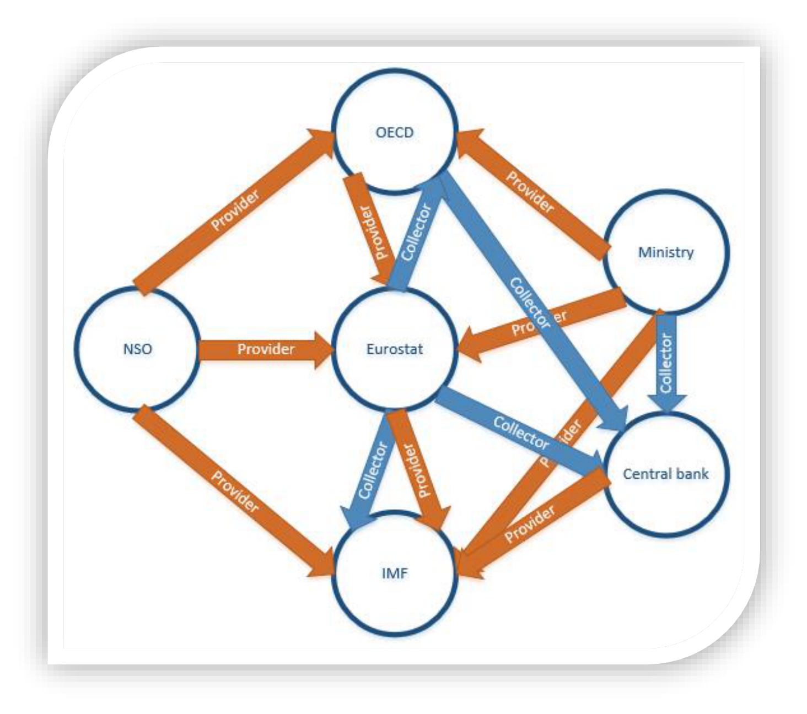
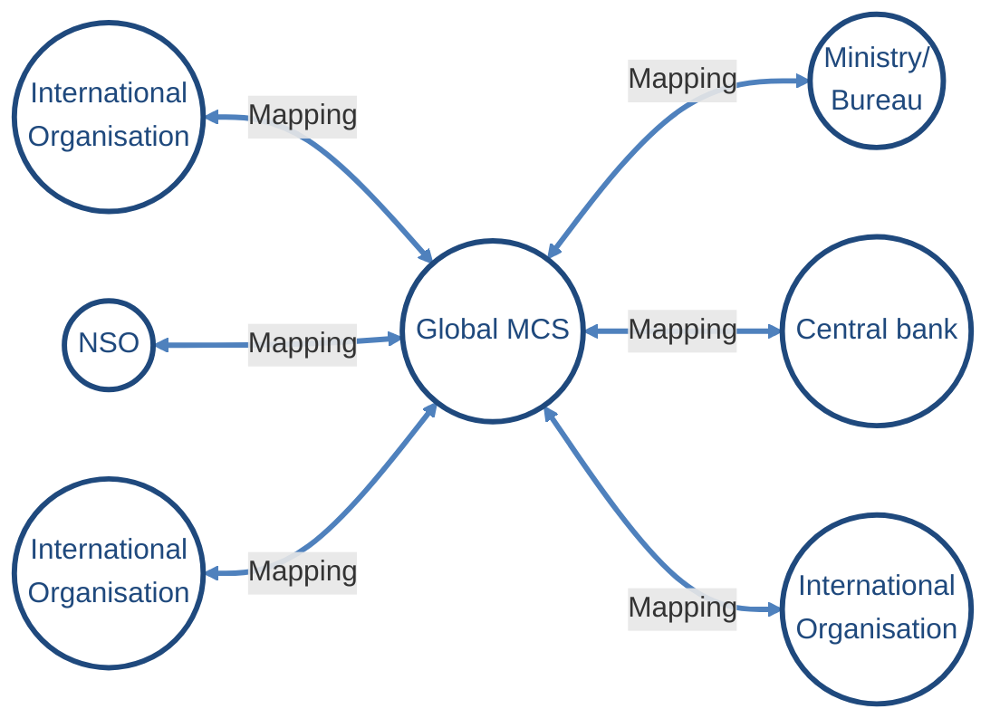
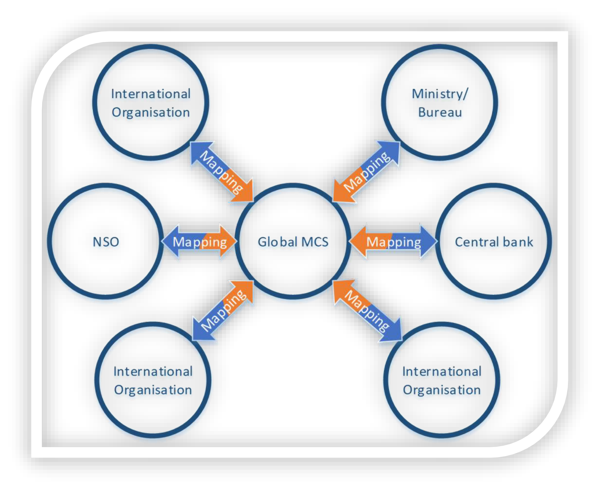
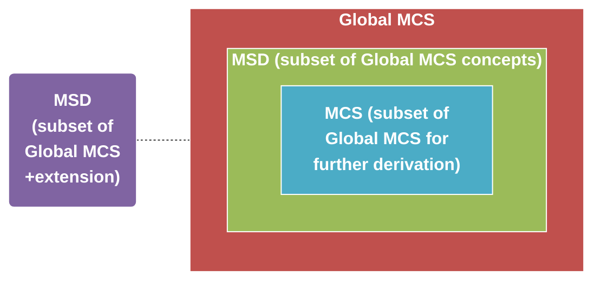
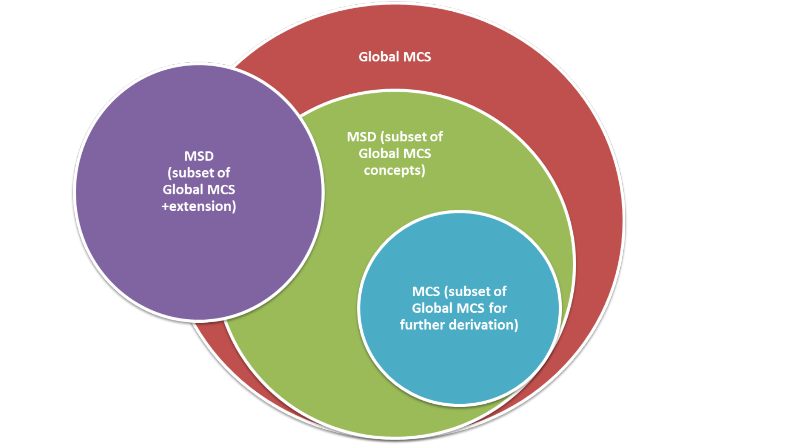
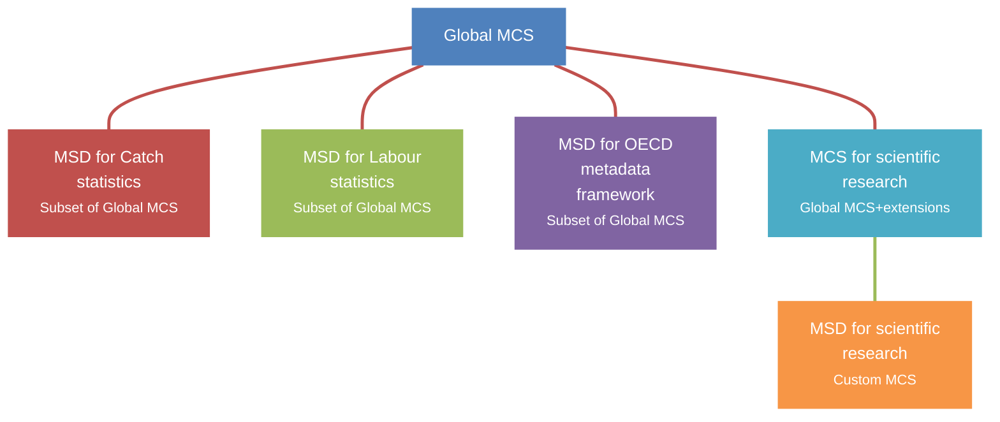
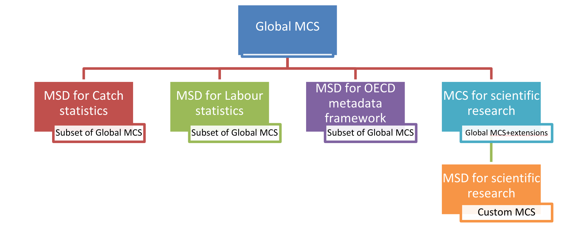
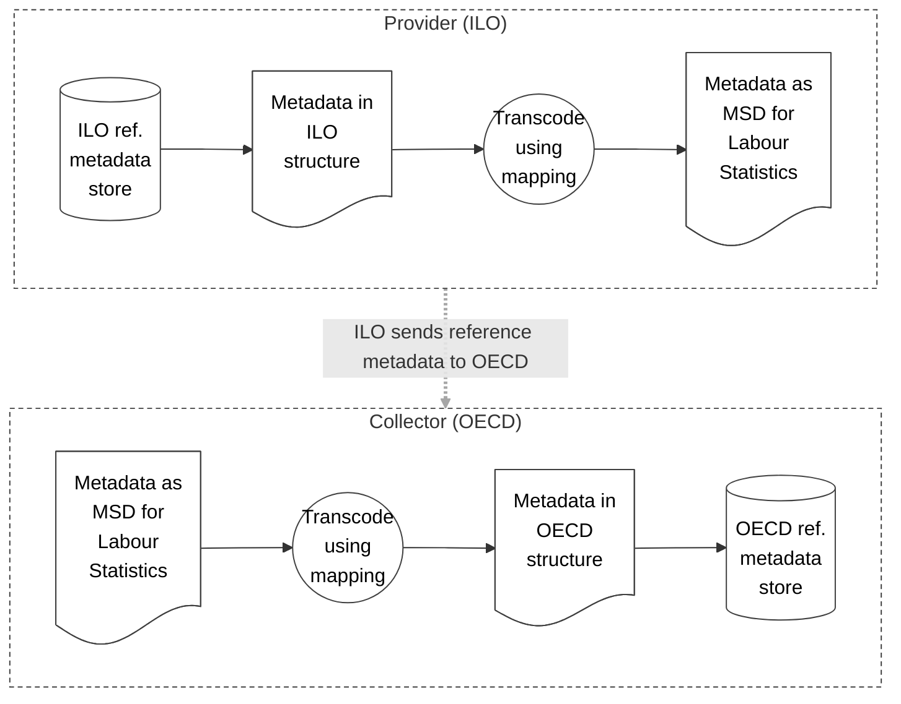
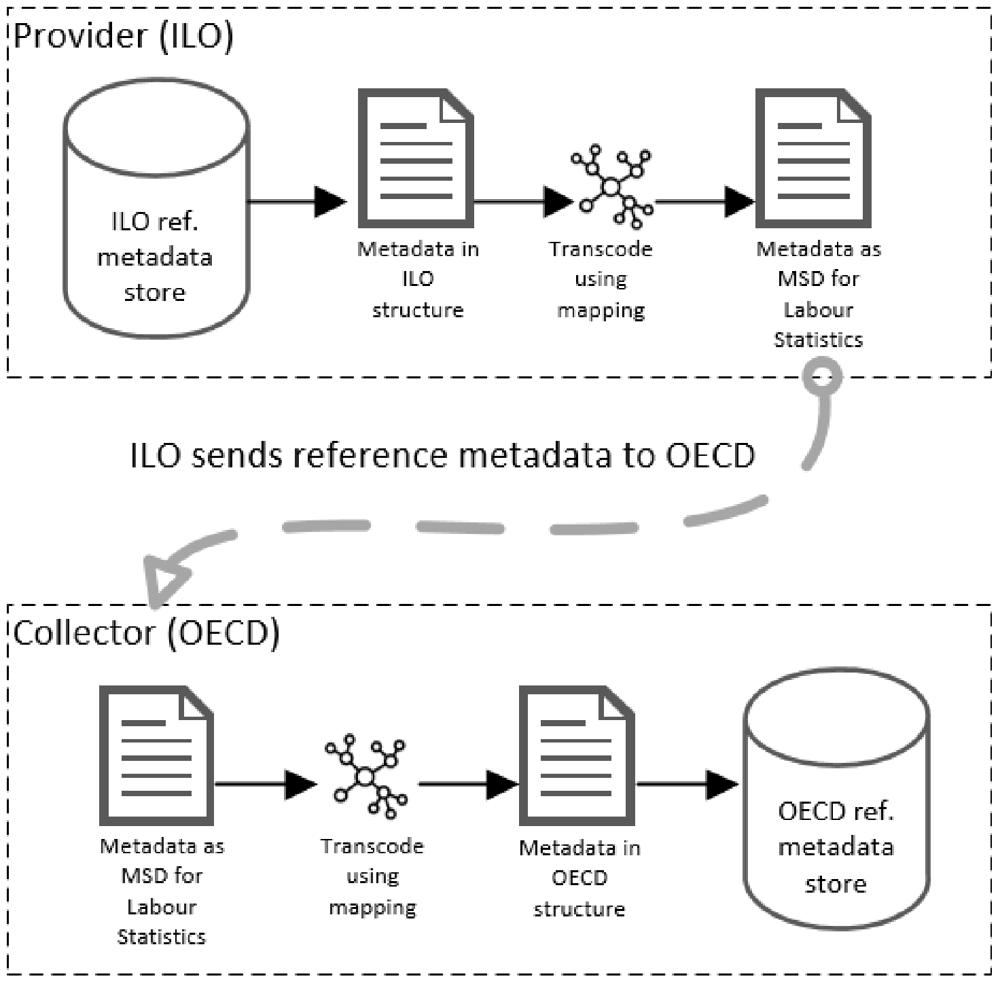

**SDMX STATISTICAL GUIDELINES**

\_\_\_\_\_\_\_\_\_\_\_\_\_\_\_\_\_\_\_\_\_\_\_\_\_\_\_\_\_\_\_\_\_\_\_\_\_\_\_\_\_\_\_\_\_\_\_\_\_\_\_\_\_\_\_\_\_\_\_\_\_\_\_\_\_\_\_\_\_\_\_\_\_\_\_\_\_\_\_\_\_\_\_

**Standardising Reference Metadata Reporting in SDMX**

Details and Implementation Examples

**Version 1.0 – 28/6/2019** \_\_\_\_\_\_\_\_\_\_\_\_\_\_\_\_\_\_\_\_\_\_\_\_\_\_\_\_\_\_\_\_\_\_\_\_\_\_\_\_\_\_\_\_\_\_\_\_\_\_\_\_\_\_\_\_\_\_\_\_\_\_\_\_\_\_\_\_\_\_\_\_\_\_\_\_\_\_\_\_\_\_\_

# TABLE OF CONTENTS

[Table of Contents](#table-of-contents)

[Document History](#document-history)

[Introduction](#introduction)

[Methodology used to build the Global Metadata Concept Scheme](#methodology-used-to-build-the-global-metadata-concept-scheme)

[Description](#description)

[Recommended usage](#recommended-usage)

[Implementation Example](#implementation-example)

[Implementation User Stories](#implementation-user-stories)

[Maintenance of the Global Metadata Concept Scheme](#maintenance-of-the-global-metadata-concept-scheme)

[Concepts in the Global Metadata Concept Scheme](#concepts-in-the-global-metadata-concept-scheme)

[Associating Reference Metadata Concepts to SDMX Artefacts](#associating-reference-metadata-concepts-to-sdmx-artefacts)

[List of Reference Metadata Concepts](#list-of-reference-metadata-concepts)

[Mutually exclusive character of some concepts](#mutually-exclusive-character-of-some-concepts)

# DOCUMENT HISTORY

<table>
<tr><th><strong>Version</strong></th><th><strong>Date</strong></th><th><strong>Comment</strong></th></tr>
<tr><td>1.0</td><td>28/6/2019</td><td>Initial version</td></tr>
</table>

# INTRODUCTION

The goal of this guideline is to increase the efficiency of reference metadata exchange between statistical agencies, and for dissemination (where the consumer may not be known). The quality and timeliness of reference metadata exchange may be improved and harmonised, thereby enabling statistical data to be described more thoroughly in a comparable way using automated, shared systems.

This guideline includes a Global Reference Metadata Concept Scheme (hereafter referred to as “Global MCS”) that enumerates a standard list of reference metadata concepts. The Global MCS is not sufficient to implement an exchange; therefore, the document also describes how to derive implementation structures from the Global MCS.

By following the guideline, the same tools and mappings may be used across separate metadata flows, agencies and domains using community-driven systems, thus saving on reinvention of the same functionality. Furthermore, the use of the Global MCS is intended to boost the automation of metadata exchange.

# METHODOLOGY USED TO BUILD THE GLOBAL METADATA CONCEPT SCHEME

The Global MCS is constructed from a subset of SDMX cross-domain concepts that are related to reference metadata in the SDMX Glossary Version 2.0<a href="#fn-1" id="fnref-1">1</a>. When the SDMX Glossary was compiled, all relevant reference metadata concepts were included that can be mapped to metadata frameworks used by several international organisations.

The procedure of building the Global MCS was to group the concepts relating to reference metadata into homogeneous categories, for example: Administrative Information; Scope; Statistical Processing. The categories are simply guides in this document and are not functional categories.

For each metadata concept, this document includes the definition and concept ID from the SDMX Glossary for ease of reference. To avoid unnecessary duplication, the usage context, related terms and other fields have not been included here and are available in the SDMX Glossary.

The Global MCS is available in the Global Registry to enable direct referencing.

# DESCRIPTION

The current situation of reference metadata exchange usually requires that, for an agency to exchange with another agency, a specific mapping between the two agencies is required. Reference metadata are provided in the following ways:

- either the providing agency maps to the consumer agency's framework and sends the metadata (provider mapping),
- or the providing agency publishes metadata using their own framework structure, and the consumer has to map the metadata to their own framework (collector mapping). This situation results in many mappings to compile and maintain which increases quickly with each new agency in the exchange, as shown here:

<!-- figure: f01-without-global-mcs -->

Original figure

Figure 1: Without the global MCS, agencies maintain many similar mappings to other agencies metadata reference frameworks

The mapping maintenance cost grows significantly if agencies exchange metadata with each other directly.

The recommendations in this guideline are designed to alleviate this issue by replacing the direct mappings between the different local frameworks by mappings from and to the Global MCS, as in the following diagram:

<!-- figure: f02-with-global-mcs -->

Original figure

Figure 2: Agencies will map to and from the Global MCS rather than implement the concepts directly. The two-colour mapping arrows indicate that each agency needs to map to the Global MCS for dissemination (orange), and from the Global MCS for collection (blue)

It is important to note that this Global MCS guideline recommends that statistical agencies should not have to change their own internal metadata framework in order to implement and benefit from the Global MCS.

### Implementation Artefacts

The Global MCS may be considered as an “abstract” artefact – it cannot be used directly to define the structure of reference metadata messages, validate and exchange them. Instead, “implementation artefacts” must be created that derive from the Global MCS. These artefacts may be Metadata Structure Definitions (MSDs), or Data Structure Definitions (DSDs) (usually in attributes).

There are certain advantages to implementing reference metadata exchange using either artefact:

<table>
<tr><th><strong>FEATURES</strong></th><th><strong>Use MSD</strong></th><th><strong>Use DSD</strong></th></tr>
<tr><td><strong>Reuse an instance of metadata, attaching it to multiple artefacts</strong></td><td>Yes</td><td>No</td></tr>
<tr><td><strong>Exchange metadata separately from data</strong></td><td>Yes</td><td>Possible<a href="#fn-2" id="fnref-2">2</a></td></tr>
<tr><td><strong>Define metadata for artefact types which are not a dataset</strong></td><td>Yes</td><td>No</td></tr>
<tr><td><strong>Relate/exchange metadata tightly with data</strong></td><td>No</td><td>Yes</td></tr>
<tr><td><strong>Use same SDMX tools as for data exchange</strong></td><td>No</td><td>Yes</td></tr>
<tr><td><strong>Reduce amount of artefacts to implement</strong></td><td>Maybe<a href="#fn-3" id="fnref-3">3</a></td><td>Yes</td></tr>
</table>

Table 1: Advantages of implementing reference metadata exchange using DSDs or MSDs

To simplify this guideline, the implementation artefact referred to from this point will be an MSD; however the points would apply if a DSD was chosen for the implementation.

The Global MCS encompasses all SDMX reference metadata concepts; however, some of them may not be relevant for a metadata exchange program; therefore, implementation structures will likely be created that use a subset of the MCS concepts. If required in special cases, reference metadata concepts that are not in the Global MCS may be added to the MSDs – however, such additions will result in non-standard exchanges so this should be used with caution. If the added concepts are considered to be cross-domain in character, please refer to the section on Maintenance of the Global Metadata Concept Scheme.

The figure 3 below shows the relationship between the Global MCS , the derived MSDs for implementation, and a possible custom MCS:

- The green Custom MSD is a typical subset of metadata concepts that will be implemented;
- The light blue Custom MCS is a subset of metadata concepts that may have further MSDs derived from it;
- The purple Custom MSD contains some concepts from the Global MCS but has also been extended with other metadata concepts.

<!-- figure: f03-deriving-msds -->

Original figure

Figure 3: Examples of deriving MSDs/MCSs and extending the Global MCS concepts The figure 4 below shows how the above MCSs and MSDs can be used for various implementations:

<!-- figure: f04-custom-msds -->

Original figure

Figure 4: Examples of creating custom MSDs for example use cases.

# RECOMMENDED USAGE

The Global MCS is domain independent, and is designed to cover the typical cross-domain metadata frameworks that most official statistical agencies have implemented. In order to create and exchange metadata messages that can be validated, an MSD must exist. It is likely that metadata repositories and exchange frameworks only require a subset of all concepts, therefore custom MSDs will usually be created to limit the full set of concepts; for example, if a branch of social statistics only uses a subset of the Global MCS concepts, a custom MSD should be created for the social statistics branch reference metadata. As mentioned above, the concepts in the Global MCS may be implemented as data message attributes. To make the choice, there are certain factors to consider as mentioned in *Table 1: Advantages of implementing reference metadata exchange using DSDs or MSDs*

There may also be some cases where an exchange program may have some reference metadata described by MSDs and some in DSDs; whichever architecture is chosen requires a thorough analysis beforehand.

Some example use cases that would require the creation of a MSD with concepts outside of the Global MCS (an extension) are:

- where the reference metadata concepts to exchange are very domain-specific, and/or;
- this version of the Global MCS does not cover the type of reference metadata (e.g. detailed quality metadata).

# IMPLEMENTATION EXAMPLE

In order to avoid a large impact on existing systems, this section describes how an agency can avoid changes to its metadata framework when implementing the recommendations in the guideline.

Figure 5 below shows the process involved in a theoretical implementation when sending metadata from a metadata provider (ILO) to a collector (OECD) using an MSD for Labour statistics that was derived from the Global MCS:

<!-- figure: f05-mapping-process -->

Original figure

Figure 5: Mapping and transform processes in an SDMX metadata exchange using the Global MCS

Before starting the exchange, the provider (ILO) and collector (OECD) each identify a mapping to reuse, or create a mapping between their metadata frameworks and the MSD (which is derived from the Global MCS).

For each transmission, the metadata provider (ILO):

1. extracts the metadata from their metadata store;
2. transcodes it to the Labour MSD structure using a mapping between their local structure and the Labour MSD, and;
3. sends the resulting SDMX metadata message to the collector.

The metadata collector (OECD) then:

1. transcodes the received message (in the Labour MSD structure) to their local structure using their mapping;
2. uploads the resulting metadata to their metadata system.

It is recommended to use SDMX Structure Set artefacts for the metadata mappings and make them available in the SDMX global registry. The advantage of using SDMX Structure Sets is that they are part of the SDMX Information Model and may be used in system implementation to convert the Global MCS structure to and from the local metadata frameworks.

The user stories below describe how the implementation can be made in more detail.

## Implementation User Stories

### Statistical agency/dissemination/reporting perspective

A statistical agency wishes to disseminate its reference metadata using a standard that can be easily used by metadata collectors, and using a system and metadata framework that can be reused across statistical domains while avoiding manual processing, and the agency recognises that the Global MCS provides this. Achieving these goals with a unified standard and automated system will save the agency time and money.

The agency currently stores its reference metadata in a database and has an extraction method to create XML files from it. The agency carries out the following work in order to disseminate its metadata:

1. Create a mapping between the agency's existing metadata concepts and the Global MCS, or MSD derived from it. This mapping is an SDMX Structure Set (which is used to map concepts and codes in different structures) and is stored and shared in the agency's SDMX registry;
2. create or adopt a system component that acts as a proxy to the existing agency's metadata component. The component does the following:

   a. takes input from the agency's metadata component (the agency's metadata XML);

   b. **transforms** the input XML to SDMX (the agency's metadata framework);

   c. **transcodes** the SDMX by applying the mapping created in step 1. The result is an SDMX metadata message that matches the Global MCS, or MSD;

   d. outputs the resulting SDMX with an SDMX web service

Later work could be considered for further efficiency gains:

- Change the agency's native metadata XML format to SDMX. This would avoid step 2b (transform);
- align the agency's metadata framework to the Global MCS. This would avoid steps 1 (create mapping) and 2c (transcoding).

### International organisation/collector perspective

An international organisation maintains many different systems and manual processes to collect and process metadata from its constituent agencies. A lot of time is spent extracting the metadata, some of it is missed, and mistakes are naturally made during the different manual processes. The organisation wishes to avoid these mistakes while saving time and money, maintain all of the different processes, while increasing the amount of metadata it can reuse, therefore allowing better interpretation of the statistical data.

The organisation stores its metadata in a production system. Many agencies provide their metadata by email, Word or Excel documents, and these are processed by several bespoke ETL processes that import the metadata into the production system. Other agencies publish metadata on their web sites, and the organisation's statisticians search the web sites and copy/paste the metadata into their production system.

The organisation carries out the following work in order to implement collection using the Global MCS:

1\. Create a mapping between the Global MCS or MSD derived from it, and the organisation's metadata framework. This mapping is an SDMX Structure Set (which is used to map concepts and codes in different structures) and is stored and shared in the agency's SDMX registry;

2\. create or adopt a new system component that does the following:

   a. takes as input an SDMX metadata message that matches the Global MSC (or MSD);

   b. **transcodes** the SDMX by applying the mapping created in step 1. The result is an SDMX metadata message that matches the organisation's metadata framework;

   c. **transforms** the SDMX metadata message into the format understood by the organisation's metadata production system;

   d. **imports** the message into the organisation's metadata production system.

Later work could be considered for further efficiency gains:

- Add an SDMX import function to the organisation's metadata production system. This would avoid step 2c (transform);
- align the organisation's metadata framework to a relevant subset of the Global Metadata Concept Scheme. This would avoid steps 1 (create mapping) and 2b (transcoding).

# MAINTENANCE OF THE GLOBAL METADATA CONCEPT SCHEME

The concepts in the Global MCS are a subset of the concepts in the SDMX Glossary<a href="#fn-4" id="fnref-4">4</a> (which defines the entire cross-domain concept scheme). Therefore, changes or additions to reference metadata concepts in the SDMX Glossary will result in a revision to the Global MCS. Conversely, requests to change the Global MCS will be considered in future revisions of the SDMX Glossary.

Requests to extend the Global MCS or change this guideline should be sent to the SDMX Statistical Working Group (swg@sdmx.org).

# CONCEPTS IN THE GLOBAL METADATA CONCEPT SCHEME

## Associating Reference Metadata Concepts to SDMX Artefacts

The metadata content has to be associated or “attached” to SDMX artefacts in two ways by stating:

1\. (in an MSD) the associated SDMX artefact type, e.g. Dataset; Dataflow; Provision agreement;

2\. the associated “level” within the artefact, e.g. for a Dataset: Dataset; Series; Observation.

These are some example attachments, others are possible:

- the “Contact” concept may be attached to a Dataset artefact at the Dataset level;
- the “Adjustment” concept may be attached to a Dataset artefact at the Series level;
- the “Statistical population” concept may be attached to a Codelist artefact.

This version of the proposal does not include an attachment recommendation for each concept. Recommended attachments may be provided in a future version of this guideline based on the feedback and forthcoming implementations. If you have any questions on how to attach reference metadata, please contact the SDMX Statistical Working Group (swg@sdmx.org).

## List of Reference Metadata Concepts

As said earlier, the reference metadata concepts are a subset of the concepts in the SDMX Glossary (which defines the entire cross-domain concept scheme). The usage context, some examples, related terms and other fields for each concept are available in the SDMX Glossary.

Some metadata concepts may not be listed in this version of the Global MCS (for example, detailed quality metadata). However, they may be proposed as candidate concepts to include in a future revision of the Global MCS and SDMX Glossary.

## Mutually exclusive character of some concepts

The Global MCS containing the full list of metadata concepts used by international organisations, some of these concepts have overlaps. In such cases, this will be indicated under the “Recommended usage” section. As an example, organisations summarising all contact information (e.g. name, address, mail, etc.) into one property will use the generic property “Contact” while others wanting a more structured way of presenting the contact information will use atomic properties such as “Contact name”, “Contact organisation”, “Contact email address”, etc. This means that “Contact” on the one hand and “Contact name”, “Contact organisation”, “Contact email address”, etc. on the other hand are mutually exclusive

### ADMINISTRATIVE INFORMATION

<table>
<tr><th><strong>Name</strong></th><th><strong>Definition</strong></th><th><strong>Concept ID</strong></th></tr>
<tr><td><strong>Data source</strong></td><td>Location or service from where data or metadata can be obtained.</td><td>DATA_SOURCE</td></tr>
<tr><td><strong>Compiling agency</strong></td><td>Organisation collecting and/or elaborating the data being reported.  <em>Example usage: if an organisation receives data from a member agency and publishes it, the “Compiling agency” concept would be the member agency.</em></td><td>COMPILING_ORG</td></tr>
<tr><td><strong>Dissemination agency</strong></td><td>Organisation disseminating the data being reported.</td><td>DISS_ORG</td></tr>
<tr><td><strong>Contact</strong></td><td>Individual or organisational contact points for the data or metadata.  <em>Recommended usage. Use:</em> &nbsp;&nbsp;• <em>either the summary “Contact” concept but not the granular “Contact xxx” concepts,</em> &nbsp;&nbsp;• <em>or the granular “Contact xxx” concepts but not the “Contact” concept.</em></td><td>CONTACT</td></tr>
<tr><td><strong>Contact email address</strong></td><td>E-mail address of the contact points for the data or metadata.</td><td>CONTACT_EMAIL</td></tr>
<tr><td><strong>Contact fax number</strong></td><td>Fax number of the contact points for the data or metadata.</td><td>CONTACT_FAX</td></tr>
<tr><td><strong>Contact mail address</strong></td><td>Postal address of the contact points for the data or metadata.</td><td>CONTACT_MAIL</td></tr>
<tr><td><strong>Contact name</strong></td><td>Name of the contact points for the data or metadata.</td><td>CONTACT_NAME</td></tr>
<tr><td><strong>Contact organisation</strong></td><td>Organisation of the contact point(s) for the data or metadata.  <em>Example usage: if an organisation receives data from a member agency and publishes it, the “Contact organisation” concept would usually be the publishing organisation.</em></td><td>CONTACT_ORGANISATION</td></tr>
<tr><td><strong>Contact organisation unit</strong></td><td>Addressable subdivision of an organisation.</td><td>ORGANISATION_UNIT</td></tr>
<tr><td><strong>Contact person function</strong></td><td>Area of technical responsibility of the contact, such as “methodology”, “database management” or “dissemination”.</td><td>CONTACT_FUNCT</td></tr>
<tr><td><strong>Contact phone number</strong></td><td>Telephone number of the contact points for the data or metadata.</td><td>CONTACT_PHONE</td></tr>
</table>

### LEGAL AND INSTITUTIONAL ENVIRONMENT

<table>
<tr><th><strong>Name</strong></th><th><strong>Definition</strong></th><th><strong>Concept ID</strong></th></tr>
<tr><td><strong>Institutional mandate</strong></td><td>Set of rules or other formal set of instructions assigning responsibility as well as the authority to an organisation for the collection, processing, and dissemination of statistics.  <em>Recommended usage. Use:</em> &nbsp;&nbsp;• <em>either the summary “Institutional mandate” concept but not the granular “Institutional mandate xxx” concepts,</em> &nbsp;&nbsp;• <em>or the granular “Institutional mandate xxx” concepts but not the “Institutional mandate” concept.</em></td><td>INST_MANDATE</td></tr>
<tr><td><strong>Institutional mandate – data sharing</strong></td><td>Arrangements or procedures for data sharing and coordination between data producing agencies.</td><td>INST_MAN_SHAR</td></tr>
<tr><td><strong>Institutional mandate - legal acts and other agreements</strong></td><td>Legal acts or other formal or informal agreements that assign responsibility as well as the authority to an Agency for the collection, processing, and dissemination of statistics.</td><td>INST_MAN_LA_OA</td></tr>
<tr><td><strong>Confidentiality</strong></td><td>Property of data indicating whether they are subject to dissemination restrictions.  <em>Recommended usage. Use:</em> &nbsp;&nbsp;• <em>either the summary “Confidentiality” concept but not the granular “Confidentiality xxx” concepts,</em> &nbsp;&nbsp;• <em>or the granular “Confidentiality xxx” concepts but not the “Confidentiality” concept.</em></td><td>CONF</td></tr>
<tr><td><strong>Confidentiality - data treatment</strong></td><td>Rules applied for treating the Data Set to ensure that private information from individual units cannot be accessed and to prevent unauthorised disclosure.</td><td>CONF_DATA_TR</td></tr>
<tr><td><strong>Confidentiality - policy</strong></td><td>Legislative measures or other formal procedures which prevent unauthorised disclosure of data that identify a person or economic entity either directly or indirectly.</td><td>CONF_POLICY</td></tr>
<tr><td><strong>Professionalism</strong></td><td>Standard, skill and ability suitable for producing statistics of good quality.  <em>Recommended usage. Use:</em> &nbsp;&nbsp;• <em>either the summary “Professionalism” concept but not the granular “Professionalism xxx” concepts,</em> &nbsp;&nbsp;• <em>or the granular “Professionalism xxx” concepts but not the “Professionalism” concept.</em></td><td>PROF</td></tr>
<tr><td><strong>Professionalism - code of conduct</strong></td><td>Provisions for assuring the qualifications of staff and allowing staff to perform their functions without intervention motivated by non-statistical objectives.</td><td>PROF_COND</td></tr>
<tr><td><strong>Professionalism - impartiality</strong></td><td>Elements providing assurances that statistics are developed, produced and disseminated in a neutral (impartial) manner, and that all users are given equal treatment.</td><td>PROF_IMP</td></tr>
<tr><td><strong>Professionalism - methodology</strong></td><td>Elements providing assurances that the choices of sources and statistical techniques as well as decisions about dissemination are informed solely by statistical considerations.</td><td>PROF_METH</td></tr>
<tr><td><strong>Professionalism - statistical commentary</strong></td><td>Elements providing assurances that the statistical entity is entitled to comment on erroneous interpretation and misuse of statistics.</td><td>PROF_STAT_COM</td></tr>
<tr><td><strong>Cost and burden</strong></td><td>Cost associated with the collection and production of a statistical product, as well as the burden imposed on respondents.  <em>Recommended usage. Use:</em> &nbsp;&nbsp;• <em>either the summary “Cost and burden” concept but not the granular “Cost and burden xxx” concepts,</em> &nbsp;&nbsp;• <em>or the granular “Cost and burden xxx” concepts but not the “Cost and burden” concept.</em></td><td>COST_BURDEN</td></tr>
<tr><td><strong>Cost and burden - efficiency management</strong></td><td>Cost-benefit analysis, effectiveness of execution of medium term statistical programmes, and ensuring efficient use of resources.</td><td>COST_BURDEN_EFF</td></tr>
<tr><td><strong>Cost and burden – resources</strong></td><td>Metadata element providing assurances that staff, facilities, computing resources, and financing to undertake statistical production are commensurate with statistical programs.</td><td>COST_BURDEN_RES</td></tr>
</table>

### SCOPE

<table>
<tr><th><strong>Name</strong></th><th><strong>Definition</strong></th><th><strong>Concept ID</strong></th></tr>
<tr><td><strong>Statistical population</strong></td><td>Total membership or population or “universe” of a defined class of people, objects or events.</td><td>STAT_POP</td></tr>
<tr><td><strong>Reference area</strong></td><td>Country or geographic area to which the measured statistical phenomenon relates.</td><td>REF_AREA</td></tr>
<tr><td><strong>Coverage</strong></td><td>Definition of the scope of the data compiled.  <em>Recommended usage. Use:</em> &nbsp;&nbsp;• <em>either the summary “Coverage” concept but not the granular “xxx coverage” concepts and/or “Economic sector” concept,</em> &nbsp;&nbsp;• <em>or the granular “xxx coverage” concepts and/or “Economic sector” but not the “Coverage” concept.</em></td><td>COVERAGE</td></tr>
<tr><td><strong>Geographical coverage</strong></td><td>Characterisation of the statistical units according to geographical criteria.  <em>Example usage: May exclude small parts of the national territory amounting to no more than 2% of the national population and the national territories.</em></td><td>COVERAGE_GEO</td></tr>
<tr><td><strong>Population coverage</strong></td><td>Definition of the main types of population covered by the statistics.</td><td>COVERAGE_POP</td></tr>
<tr><td><strong>Sector coverage</strong></td><td>Sector(s) covered by the statistics.</td><td>COVERAGE_SECTOR</td></tr>
<tr><td><strong>Economic sector</strong></td><td>High-level grouping of economic activities based on the types of goods and services produced.</td><td>ECO_SECTOR</td></tr>
<tr><td><strong>Time coverage</strong></td><td>Period of time for which data are provided.</td><td>COVERAGE_TIME</td></tr>
</table>

### METHODOLOGICAL INFORMATION

#### Data presentation

<table>
<tr><th><strong>Name</strong></th><th><strong>Definition</strong></th><th><strong>Concept ID</strong></th></tr>
<tr><td><strong>Data description</strong></td><td>Metadata element describing the main characteristics of the Data Set in an easily understandable manner, referring to the main data and indicators disseminated.</td><td>DATA_DESCR</td></tr>
</table>

#### Other Methodological Information

<table>
<tr><th><strong>Name</strong></th><th><strong>Definition</strong></th><th><strong>Concept ID</strong></th></tr>
<tr><td><strong>Source data type</strong></td><td>Characteristics and components of the raw statistical data used for compiling statistical aggregates.</td><td>SOURCE_TYPE</td></tr>
<tr><td><strong>Data collection method</strong></td><td>Method applied for gathering data for official statistics.</td><td>COLL_METHOD</td></tr>
<tr><td><strong>Reference period</strong></td><td>Timespan or point in time to which the measured observation is intended to refer.</td><td>REF_PERIOD</td></tr>
<tr><td><strong>Base period</strong></td><td>Period of time used as the base of an index number, or to which a constant series refers.</td><td>BASE_PER</td></tr>
<tr><td><strong>Base weight</strong></td><td>Weights of a weighting system for an index number computed according to the information relating to the base period instead, for example, of the current period.</td><td>BASE_WEIGHT</td></tr>
<tr><td><strong>Frequency of observation</strong></td><td>Time interval at which observations occur over a given time period.</td><td>FREQ</td></tr>
<tr><td><strong>Frequency of data collection</strong></td><td>Time interval at which the source data are collected.</td><td>FREQ_COLL</td></tr>
<tr><td><strong>Classification system</strong></td><td>Metadata element used to a) list the classification(s) being used for a given Data Set or set of Data Sets, and b) describe how these conform to internationally agreed standards, guidelines, or good practices.</td><td>CLASS_SYSTEM</td></tr>
<tr><td><strong>Statistical concepts and definitions</strong></td><td>Definitions and descriptions of the main variables provided.</td><td>STAT_CONC_DEF</td></tr>
<tr><td><strong>Statistical unit</strong></td><td>Entity for which information is sought and for which statistics are ultimately compiled.</td><td>STAT_UNIT</td></tr>
<tr><td><strong>Unit of measure</strong></td><td>Unit in which the data values are expressed.</td><td>UNIT_MEASURE</td></tr>
<tr><td><strong>Accounting conventions</strong></td><td>Practical procedures, standards and other aspects used when compiling data from diverse sources under a common methodological framework.</td><td>ACC_CONV</td></tr>
<tr><td><strong>Valuation</strong></td><td>Definition of the price per unit, for goods and services flows and asset stocks.</td><td>VALUATION</td></tr>
</table>

### STATISTICAL PROCESSING

<table>
<tr><th><strong>Name</strong></th><th><strong>Definition</strong></th><th><strong>Concept ID</strong></th></tr>
<tr><td><strong>Data compilation</strong></td><td>Operations performed on data to derive new information according to a given set of rules.</td><td>DATA_COMP</td></tr>
<tr><td><strong>Adjustment</strong></td><td>Set of procedures employed to modify statistical data to enable it to conform to national or international standards or to address data quality differences when compiling specific Data Sets.  <em>Recommended usage. Use:</em> &nbsp;&nbsp;• <em>either the summary “Adjustment” concept but not the granular “xxx adjustment” concepts,</em> &nbsp;&nbsp;• <em>or the granular “xxx adjustment” concepts but not the “Adjustment” concept.</em></td><td>ADJUSTMENT</td></tr>
<tr><td><strong>Price adjustment</strong></td><td>Statistical technique used to remove the effects of price influences operating on a data series.</td><td>PRICE_ADJUST</td></tr>
<tr><td><strong>Seasonal adjustment</strong></td><td>Statistical technique used to remove the effects of seasonal and calendar influences operating on a data series.</td><td>SEASONAL_ADJUST</td></tr>
<tr><td><strong>Data validation</strong></td><td>Process of monitoring the results of data compilation and ensuring the quality of the statistical results.</td><td>DATA_VALIDATION</td></tr>
<tr><td><strong>Data revision</strong></td><td>Change in a value of a statistic released to the public.  <em>Recommended usage. Use:</em> &nbsp;&nbsp;• <em>either the summary “Data revision” concept but not the granular “Data revision xxx” concepts,</em> &nbsp;&nbsp;• <em>or the granular “Data revision xxx” concepts but not the “Data revision” concept.</em></td><td>DATA_REV</td></tr>
<tr><td><strong>Data revision - policy</strong></td><td>Policy aimed at ensuring the transparency of disseminated data, whereby preliminary data are compiled that are later revised.</td><td>REV_POLICY</td></tr>
<tr><td><strong>Data revision - practice</strong></td><td>Information on the data revision practice.</td><td>REV_PRACTICE</td></tr>
<tr><td><strong>Data revision - studies</strong></td><td>Information about data revision studies and analyses.</td><td>REV_STUDY</td></tr>
<tr><td><strong>Imputation</strong></td><td>Procedure for entering a value for a specific data item where the response is missing or unusable.</td><td>IMPUTATION</td></tr>
<tr><td><strong>Imputation rate</strong></td><td>Ratio of the number of replaced values to the total number of values for a given variable.</td><td>IMPUTATION_RATE</td></tr>
</table>

### QUALITY

<table>
<tr><th><strong>Name</strong></th><th><strong>Definition</strong></th><th><strong>Concept ID</strong></th></tr>
<tr><td><strong>Quality management</strong></td><td>Systems and frameworks in place within an organisation to manage the quality of statistical products and processes.  <em>Recommended usage. Use:</em> &nbsp;&nbsp;• <em>either the summary “Quality management” concept but not the granular “Quality management xxx” concepts,</em> &nbsp;&nbsp;• <em>or the granular “Quality management xxx” concepts but not the “Quality management” concept.</em></td><td>QUALITY_MGMNT</td></tr>
<tr><td><strong>Quality management - quality assessment</strong></td><td>Overall evaluation of data quality, based on standard quality criteria.</td><td>QUALITY_ASSMNT</td></tr>
<tr><td><strong>Quality management - quality assurance</strong></td><td>Guidelines focusing on quality in general and dealing with quality of statistical programmes, including measures for ensuring the efficient use of resources.</td><td>QUALITY_ASSURE</td></tr>
<tr><td><strong>Quality management - quality documentation</strong></td><td>Documentation on procedures applied for quality management and quality assessment.</td><td>QUALITY_DOC</td></tr>
<tr><td><strong>Accuracy</strong></td><td>Closeness of computations or estimates to the unknown exact or true values that the statistics were intended to measure.  <em>Recommended usage. Use:</em> &nbsp;&nbsp;• <em>either the summary “Accuracy” concept but not the granular “Accuracy - overall”, “Non-sampling error” or “Sampling error” concepts,</em> &nbsp;&nbsp;• <em>or the granular “Accuracy - overall”, “Non-sampling error” or “Sampling error” concepts but not the “Accuracy” concept.</em></td><td>ACCURACY</td></tr>
<tr><td><strong>Accuracy - overall</strong></td><td>Assessment of accuracy, linked to a certain Data Set or domain, which is summarising the various components into one single measure.</td><td>ACCURACY_OVERALL</td></tr>
<tr><td><strong>Sampling error</strong></td><td>Part of the difference between a population value and an estimate thereof, derived from a random sample, which is due to the fact that only a subset of the population is enumerated.</td><td>SAMPLING_ERR</td></tr>
<tr><td><strong>Non-sampling error</strong></td><td>Error in sample estimates which cannot be attributed to sampling fluctuations.</td><td>NONSAMPLING_ERR</td></tr>
<tr><td><strong>Coverage error</strong></td><td>Error caused by a failure to cover adequately all components of the population being studied, which results in differences between the target population and the sampling frame.</td><td>COVERAGE_ERR</td></tr>
<tr><td><strong>Measurement error</strong></td><td>Error in reading, calculating or recording a numerical value.</td><td>MEASUREMENT_ERR</td></tr>
<tr><td><strong>Non-response error</strong></td><td>Error that occurs when the survey fails to get a response to one, or possibly all, of the questions.</td><td>NONRESPONSE_ERR</td></tr>
<tr><td><strong>Processing error</strong></td><td>Error in final survey results arising from the faulty implementation of correctly planned implementation methods.</td><td>PROCESSING_ERR</td></tr>
<tr><td><strong>Model assumption error</strong></td><td>Error that occurs due the use of methods, such as calibration, generalised regression estimator, calculation based on full scope or constant scope, benchmarking, seasonal adjustment and other models not included in other accuracy components, in order to calculate statistics or indexes.</td><td>MODEL_ASSUMP_ERR</td></tr>
<tr><td><strong>Coherence</strong></td><td>Adequacy of statistics to be reliably combined in different ways and for various uses.  <em>Recommended usage. Use:</em> &nbsp;&nbsp;• <em>either the summary “Coherence” concept but not the granular “Coherence xxx” concepts,</em> &nbsp;&nbsp;• <em>or the granular “Coherence xxx” concepts but not the “Coherence” concept.</em></td><td>COHERENCE</td></tr>
<tr><td><strong>Coherence - cross domain</strong></td><td>Extent to which statistics are reconcilable with those obtained through other Data Sources or statistical domains.</td><td>COHER_X_DOM</td></tr>
<tr><td><strong>Coherence - internal</strong></td><td>Extent to which statistics are consistent within a given Data Set.</td><td>COHER_INTERNAL</td></tr>
<tr><td><strong>Comparability</strong></td><td>Extent to which differences between statistics can be attributed to differences between the true values of the statistical characteristics.  <em>Recommended usage. Use:</em> &nbsp;&nbsp;• <em>either the summary “Comparability” concept but not the granular “Comparability xxx” concepts,</em> &nbsp;&nbsp;• <em>or the granular “Comparability xxx” concepts but not the “Comparability” concept.</em></td><td>COMPARABILITY</td></tr>
<tr><td><strong>Comparability - geographical</strong></td><td>Extent to which statistics are comparable between geographical areas.</td><td>COMPAR_GEO</td></tr>
<tr><td><strong>Comparability - over time</strong></td><td>Extent to which statistics are comparable or reconcilable over time.</td><td>COMPAR_TIME</td></tr>
<tr><td><strong>Punctuality</strong></td><td>Time lag between the actual delivery of the data and the target date when it should have been delivered.</td><td>PUNCTUALITY</td></tr>
<tr><td><strong>Relevance</strong></td><td>Degree to which statistical information meets the real or perceived needs of clients.  <em>Recommended usage. Use:</em> &nbsp;&nbsp;• <em>either the summary “Relevance” concept but not the granular “Relevance xxx” concepts,</em> &nbsp;&nbsp;• <em>or the granular “Relevance xxx” concepts but not the “Relevance” concept.</em></td><td>RELEVANCE</td></tr>
<tr><td><strong>Relevance - completeness</strong></td><td>Extent to which all statistics that are needed are available.</td><td>COMPLETENESS</td></tr>
<tr><td><strong>Relevance - user needs</strong></td><td>Description of requirements with respect to the statistical output.</td><td>USER_NEEDS</td></tr>
<tr><td><strong>Relevance - user satisfaction</strong></td><td>Description of how well the disseminated statistics meet the expressed user needs.</td><td>USER_SAT</td></tr>
<tr><td><strong>Timeliness</strong></td><td>Length of time between data availability and the event or phenomenon they describe  <em>Recommended usage. Use:</em> &nbsp;&nbsp;• <em>either the summary “Timeliness” concept but not the granular “Timeliness xxx” concepts,</em> &nbsp;&nbsp;• <em>or the granular “Timeliness xxx” concepts but not the “Timeliness” concept.</em></td><td>TIMELINESS</td></tr>
<tr><td><strong>Timeliness - source data</strong></td><td>Time between the end of a reference period and actual receipt of the data by the compiling agency.</td><td>TIME_SOURCE</td></tr>
</table>

### DISSEMINATION

<table>
<tr><th><strong>Name</strong></th><th><strong>Definition</strong></th><th><strong>Concept ID</strong></th></tr>
<tr><td><strong>Release policy</strong></td><td>Rules for disseminating statistical data to interested parties.  <em>Recommended usage. Use:</em> &nbsp;&nbsp;• <em>either the summary “Release policy” concept but not the granular “Release policy xxx” concepts,</em> &nbsp;&nbsp;• <em>or the granular “Release policy xxx” concepts but not the “Release policy” concept.</em></td><td>REL_POLICY</td></tr>
<tr><td><strong>Release policy - release calendar</strong></td><td>Schedule of statistical release dates.</td><td>REL_CAL_POLICY</td></tr>
<tr><td><strong>Release policy - release calendar access</strong></td><td>Description of how the release calendar can be accessed.</td><td>REL_CAL_ACCESS</td></tr>
<tr><td><strong>Release policy - transparency</strong></td><td>Statement describing whether and how the release policy is disseminated to the public.</td><td>REL_POL_TRA</td></tr>
<tr><td><strong>Release policy - user access</strong></td><td>Policy for release of the data to users, scope of dissemination (e.g. to the public, to selected users), how users are informed that the data are being released, and whether the policy determines the dissemination of statistical data to all users.</td><td>REL_POL_US_AC</td></tr>
<tr><td><strong>Frequency of dissemination</strong></td><td>Time interval at which the statistics are disseminated over a given time period.</td><td>FREQ_DISS</td></tr>
<tr><td><strong>Dissemination format</strong></td><td>Media by which statistical data and metadata are disseminated.  <em>Recommended usage. Use:</em> &nbsp;&nbsp;• <em>either the summary “Dissemination format” concept but not the granular “Dissemination format xxx” concepts,</em> &nbsp;&nbsp;• <em>or the granular “Dissemination format xxx” concepts but not the “Dissemination format” concept.</em></td><td>DISS_FORMAT</td></tr>
<tr><td><strong>Dissemination format - microdata access</strong></td><td>Information on whether microdata are also disseminated.</td><td>MICRO_DAT_ACC</td></tr>
<tr><td><strong>Dissemination format - news release</strong></td><td>Regular or ad-hoc press releases linked to the data.</td><td>NEWS_REL</td></tr>
<tr><td><strong>Dissemination format - online database</strong></td><td>Information about on-line databases in which the disseminated data can be accessed.</td><td>ONLINE_DB</td></tr>
<tr><td><strong>Dissemination format - publications</strong></td><td>Regular or ad-hoc publications in which the data are made available to the public.</td><td>PUBLICATIONS</td></tr>
<tr><td><strong>Dissemination format - other formats</strong></td><td>References to the most important other data dissemination done.</td><td>DISS_OTHER</td></tr>
<tr><td><strong>Documentation on methodology</strong></td><td>Descriptive text and references to methodological documents available.</td><td>DOC_METHOD</td></tr>
<tr><td><strong>Documentation on methodology - advance notice</strong></td><td>Policy on notifying the public of changes in methodology, indicating whether the public is notified before a methodological change affects disseminated data and, if so, how long before.</td><td>ADV_NOTICE</td></tr>
<tr><td><strong>Recommended uses and limitations</strong></td><td>Metadata element guiding users with limited knowledge of the statistics presented and helping them determine whether the product meets their requirements.</td><td>REC_USE_LIM</td></tr>
</table>

### MISCELLANEOUS

<table>
<tr><th><strong>Name</strong></th><th><strong>Definition</strong></th><th><strong>Concept ID</strong></th></tr>
<tr><td><strong>Metadata update</strong></td><td>Date on which the metadata element was created or modified.  <em>Recommended usage. Use:</em> &nbsp;&nbsp;• <em>either the summary “Metadata update” concept but not the granular “Metadata update xxx” concepts,</em> &nbsp;&nbsp;• <em>or the granular “Metadata update xxx” concepts but not the “Metadata update” concept.</em></td><td>META_UPDATE</td></tr>
<tr><td><strong>Metadata update - last certified</strong></td><td>Date of the latest certification provided by the domain manager to confirm that the metadata posted are still up-to-date, even if the content has not been amended.</td><td>META_CERTIFIED</td></tr>
<tr><td><strong>Metadata update - last posted</strong></td><td>Date of the latest dissemination of the metadata.</td><td>META_POSTED</td></tr>
<tr><td><strong>Metadata update - last update</strong></td><td>Date of last update of the content of the metadata.</td><td>META_LAST_UPDATE</td></tr>
<tr><td><strong>Comment</strong></td><td>Descriptive text which can be attached to data or metadata.</td><td>COMMENT</td></tr>
<tr><td><strong>Technical information</strong></td><td>Technical details related to the data, for example the storage system used, or technical systems related to the exchange.</td><td>TECH_INFO</td></tr>
</table>

<!-- footnotes -->

---

1 https://sdmx.org/wp-content/uploads/SDMX\_Glossary\_Version\_2\_0\_October\_2018.docx

2 It is possible to exchange metadata separately from data using a DSD by querying using the detail=nodata parameter

3 This may be possible, depending on the current implementation such as if an MSD is already implemented

4 https://sdmx.org/wp-content/uploads/SDMX\_Glossary\_Version\_2\_0\_October\_2018.docx
