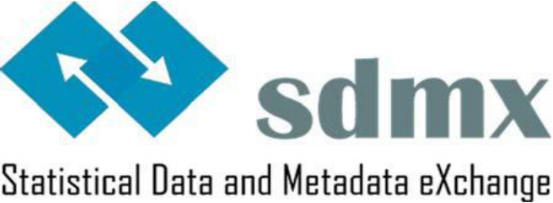
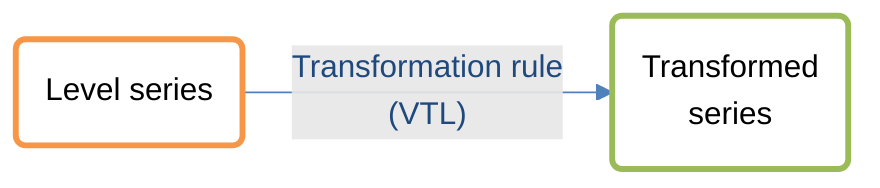
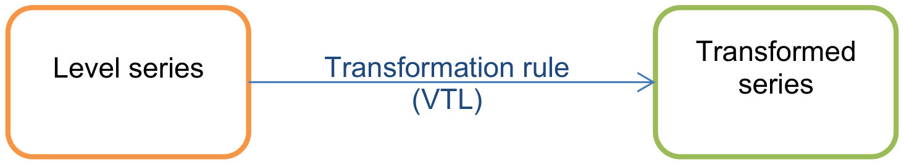

<!-- figure: f01-logo -->

**Statistical Working Group  
Statistical Guidelines**

**Guidelines on coding time transformations in SDMX**

**Version 1.0 - 15/9/2016**

# 1. PROBLEM STATEMENT

Time transformation is defined as a time-related operation performed on a time series, solely involving observations of that time series. Examples of such time transformations are growth rates, cumulative sums over several periods and moving averages.

To express a time transformation, three elements are required: the type of transformation, the number of periods involved and the length of each period. Even though in theory you could express the base value and the transformation applied, it is much more practical, and in many cases sufficient in statistical data exchange, to transmit the time-transformed values themselves.

The operation to be coded can be expressed generically as such: For value *V* the transformation *T* was applied over *P* periods with frequency *F*.

Examples:

| Statement | T | P | F |
|----|----|----|----|
| Quarter on quarter growth rate | Growth rate | 2 | Q |
| Contribution to growth over 1 year (quarterly data) | Contribution to growth | 4 | Q |
| Contribution to growth over 1 year (annual data) | Contribution to growth | 1 | A |
| 3 months moving average | Moving average | 3 | M |
| Annual index (reference year=100)<a href="#fn-1" id="fnref-1">1</a> | Index | 1 | A |

This guideline describes two methods that may be used to code a time transformation:

1.  A normalised, multi-concept approach that is described in section SDMX CONCEPTS FOR TIME TRANSFORMATIONS. The overall time span involved in the time transformation depends on the number of periods stated and the frequency of a series.

2.  A denormalised, compound concept approach that is described in section COMPOUND CODING FOR TIME TRANSFORMATIONS. The overall time span involved in the time transformation does not necessarily depend on the number of periods stated and the frequency of a series.

Both of these methods are included as separate use cases as served by each method. The aim of this document is to demonstrate that guidance and a standard approach is available and promoted for each use case. The use cases are described in the related sections.

Further recommended code values for expressing general statistical concepts such as "not applicable", etc., can be found in section “Generic codes” of the "Guidelines for the creation and management of SDMX Cross-Domain Code Lists" (to be found under “Guidelines” on the official SDMX website<a href="#fn-2" id="fnref-2">2</a>).

# 2. SDMX CONCEPTS FOR TIME TRANSFORMATIONS

SDMX defines two cross domain concepts for the purpose of coding time transformations: Time transformation type (ID TIMETRANS_TYPE) and time transformation periods (ID TIMETRANS_PER). The concept TIMETRANS_TYPE is coded with a cross domain code list. The concept TIMETRANS_PER is coded with a coded list of integers.

## 2.1 Time Transformation Type

Definition: This concept provides coded information about time-related transformation types of time series.

**Concept ID:** The concept ID is TIMETRANS_TYPE.

**Code List Name**: Code list for Time Transformation Type.

**Code List ID:** CL_TIMETRANS_TYPE.

**Established international standard(s) used as input for the code list**: None.

**Version**: 1.0, 15 September 2016

| Recommended code value | Recommended code description | Annotation |
|----|----|:---|
| N | Non transformed | TIMETRANS_PER is always 1, since a non-transformed number covers by definition a single period |
| A | Average | Moving average, i.e. an operation that preserves the frequency of the series |
| C | Cumulated sum |  |
| D | Difference |  |
| DD | Difference, second order | A second order difference is the delta of deltas |
| F | Growth rate, flow over stock |  |
| FC | Contribution to growth, flow over stock |  |
| G | Growth rate |  |
| GC | Contribution to growth |  |
| I | Index | In the usual case, the index is fixed to 100 for a specific reference period, in most cases a year. It is recommended that the DSD contains an additional attribute BASE_PER (type ObservationalTimePeriod), which specifies the reference period of the index. In special cases (e.g. National Accounts chain linking), the index is fixed to a value different to 100 in the reference year. In these cases the BASE_PER attribute is even more important. |
| LA | Annualised levels | This relates to stock versus flow series. For example, many countries publish their Quarterly National Accounts (QNA) at quarterly level, which means that annual Gross Domestic Product (GDP) is the sum of the four quarters, whereas some countries publish their QNA at annual level (e.g. US), which means that annual GDP is the average of the four quarters. In order to present quarterly data in comparable levels across countries and to derive zone aggregates, quarterly data expressed at quarterly levels are “transformed” to annual levels (i.e. multiplied by four) and have this code. |
| S | Shifted | The time series was moved back or forth in time. This may for instance be used when non-calendar year series are aligned to the calendar year using certain estimation formulas. |
| \_O | Other transformation | This code is taken from the guidelines on generic codes, specifying "Other". In that context it should be used if more complex transformations are applied. An explanation of the transformation or a transformation script should be given in a comment field. |

## 2.2 Time Transformation Periods

Definition: This concept provides information about the number of periods used for a time-related transformation of the time series.

**Concept ID:** The concept ID is TIMETRANS_PER.

**Code List Name**: Code list for Time Transformation Periods.

**Code List ID:** CL_TIMETRANS_PER.

**Established international standard(s) used as input for the code list**: None.

**Version**: 1.0, 15 September 2016

<table>
<colgroup>
<col style="width: 19%" />
<col style="width: 40%" />
<col style="width: 39%" />
</colgroup>
<thead>
<tr>
<th style="text-align: center;">Recommended code value</th>
<th style="text-align: center;"><strong>Recommended 
code description</strong></th>
<th style="text-align: center;"><strong>Annotation</strong></th>
</tr>
</thead>
<tbody>
<tr>
<td>1</td>
<td>One</td>
<td></td>
</tr>
<tr>
<td>2</td>
<td>Two</td>
<td></td>
</tr>
<tr>
<td>etc.</td>
<td>etc.</td>
<td></td>
</tr>
</tbody>
</table>

## 2.3 Relation of transformation coding to transformation rules

Transformation can also be expressed with transformation rules using a syntax such as the Validation and Transformation Language (VTL). Following the transformation graph model behind VTL, the transformation coding suggested in this guideline can be seen complementary with using transformation rules in VTL. The idea is that a coded non-transformed time series is transformed using a VTL rule and the result is then coded again with transformation codes for further data exchange. This principle is shown in the graph below:

<!-- figure: f02-transformation-graph -->

Original figure

Using the two concepts as suggested above for coding the type of transformation applied and the number of periods covered will additionally ensure that the parameters used for the formula are directly used in the coding of the resulting series. Thus no complex mapping is needed. The transformation applied is linked to the transformation type concept and the number of periods used for the calculation is linked to the transformation periods concept.

**Example:**

The formula for a simple annual growth rate can be expressed as follows:<a href="#fn-3" id="fnref-3">3</a>

$$G_{T} = \ \frac{V_{T} - V_{T - P}}{V_{T - P}}$$

→ A growth rate over P years in year T is the difference between the current year value and the value P years ago related to the value P years ago; with G being the growth rate, V being the absolute value, T being the time (year) and P the number of periods.

The growth rate formula can be expressed in VTL and linked to transformation type G. The year T is linked to the respective year in the time series and the parameter P is linked to the transformation period concept.

**Example:**

<table>
<colgroup>
<col style="width: 24%" />
<col style="width: 11%" />
<col style="width: 21%" />
<col style="width: 21%" />
<col style="width: 21%" />
</colgroup>
<thead>
<tr>
<th style="text-align: center;"><strong>Year →</strong></th>
<th style="text-align: center;"><strong>2010</strong></th>
<th style="text-align: center;"><strong>2011</strong></th>
<th style="text-align: center;"><strong>2012</strong></th>
<th style="text-align: center;"><strong>2013</strong></th>
</tr>
</thead>
<tbody>
<tr>
<td><strong>GDP Level</strong></td>
<td style="text-align: center;">500</td>
<td style="text-align: center;">505</td>
<td style="text-align: center;">510</td>
<td style="text-align: center;">505</td>
</tr>
<tr>
<td style="text-align: left;"><strong>Growth rate, 
period on period</strong></td>
<td style="text-align: center;"></td>
<td style="text-align: center;">0.0100</td>
<td style="text-align: center;">0.0099</td>
<td style="text-align: center;">-0.0098</td>
</tr>
<tr>
<td style="text-align: right;"><strong>Formula</strong></td>
<td style="text-align: center;"></td>
<td style="text-align: center;">$$G_{T} = \ \frac{V_{2011} - V_{2011 - 1}}{V_{2011 - 1}}$$</td>
<td style="text-align: center;">$$G_{T} = \ \frac{V_{2012} - V_{2012 - 1}}{V_{2012 - 1}}$$</td>
<td style="text-align: center;">$$G_{T} = \ \frac{V_{2013} - V_{2013 - 1}}{V_{2013 - 1}}$$</td>
</tr>
<tr>
<td style="text-align: left;"><strong>Growth rate, 
over 2 periods</strong></td>
<td style="text-align: center;"></td>
<td style="text-align: center;"></td>
<td style="text-align: center;">0.0200</td>
<td style="text-align: center;">0.0000</td>
</tr>
<tr>
<td style="text-align: right;"><strong>Formula</strong></td>
<td style="text-align: center;"></td>
<td style="text-align: center;"></td>
<td style="text-align: center;">$$G_{T} = \ \frac{V_{2012} - V_{2012 - 2}}{V_{2012 - 2}}$$</td>
<td style="text-align: center;">$$G_{T} = \ \frac{V_{2013} - V_{2013 - 2}}{V_{2013 - 2}}$$</td>
</tr>
</tbody>
</table>

When looking at the formulas, you can see that the same parameters that are used to call a transformation service can be used to code the resulting series, which makes it very easy for data processing systems to ensure consistency between calculations and coding of results:

<table>
<colgroup>
<col style="width: 22%" />
<col style="width: 21%" />
<col style="width: 56%" />
</colgroup>
<thead>
<tr>
<th style="text-align: left;"><strong>Year →</strong></th>
<th style="text-align: left;">2011</th>
<th rowspan="4" style="text-align: left;">
<strong>Transformed
series:</strong>

REF_YEAR → 2011

OBS_VALUE → 0.0100

TRANS_TYPE → G (Formula / VTL function)

TRANS_PER → 1
</th>
</tr>
<tr>
<th style="text-align: left;"><strong>GDP Level</strong></th>
<th style="text-align: left;">505</th>
</tr>
<tr>
<th style="text-align: left;"><strong>Growth rate, 
period on period</strong></th>
<th style="text-align: left;">0.0100</th>
</tr>
<tr>
<th
style="text-align: left;"><strong>Formula</strong></th>
<th style="text-align: left;">$$G_{T} = \
\frac{V_{2011} - V_{2011 - 1}}{V_{2011 - 1}}$$</th>
</tr>
</thead>
<tbody>
</tbody>
</table>

This is especially useful when only transformed series should be exchanged and level series or transformations are not subject to exchange. An example could be GDP growth rates, where for early estimates often level series are still under embargo, whereas growth rates are publishable.

## 2.4 Recommendation

Where possible, it is recommended to use the above solution with the two concepts TIMETRANS_TYPE and TIMETRANS_PER to express time transformations because:

- this method separates the type of transformation and the number of periods involved, therefore the coding of time transformation is simpler with no redundancy;

- it is possible to add extra concepts if required without introducing ambiguity;

- the coded transformations can be linked directly with transformation formulas.

# 3. COMPOUND CODING FOR TIME TRANSFORMATIONS

## 3.1 Known Limitations

The normalised approach as presented above does not support the definition of mixed-frequency time transformations – like monthly series of annual growth rates – since there is only a single frequency dimension available. This also means that when annual growth rates are expressed in a quarterly dataset, the time transformation period would need to be modified (i.e. when frequency changes from A to Q, the number of periods need to be quadrupled).

A "transformation frequency" might be added to keep the normalised approach also for those cases.

It also does not allow to directly code complex transformations, like transforming already transformed series (like the period-on-period growth rate of a four-period cumulative sum). For that case it is recommended to use the generic code "\_O - Other" to specific that another transformation has been applied and provide the explanation or the transformation script in a comment field.

However, both of these use cases may lead to a quite complex data structures or issues if various different complex transformations should be coded. Thus an alternative solution is presented in chapter 3 for cases where these use cases need to be covered and additional concepts should not be added to the data structure.

In case the mixed frequencies or complex transformations as outlined above are needed in a simpler way and normalisation does not need to be strictly enforced, a composite code list CL_TIMETRANS may be created.

The number of periods in the code follows the frequency of the series unless stated otherwise. Example: code G3Y refers to a three-year growth rate, irrespective of the series frequency. For complex transformations, the codes that would be used for the respective transformations can be concatenated and separated by an underscore<a href="#fn-4" id="fnref-4">4</a>.

Example for composite CL_TIMETRANS:

<table>
<colgroup>
<col style="width: 19%" />
<col style="width: 39%" />
<col style="width: 41%" />
</colgroup>
<thead>
<tr>
<th style="text-align: center;">Recommended code value</th>
<th style="text-align: center;"><strong>Recommended 
code description</strong></th>
<th style="text-align: center;"><strong>Annotation</strong></th>
</tr>
</thead>
<tbody>
<tr>
<td>N</td>
<td>Non transformed data</td>
<td style="text-align: left;"></td>
</tr>
<tr>
<td>A2</td>
<td>2-period moving average</td>
<td style="text-align: left;">Period on period</td>
</tr>
<tr>
<td>A3</td>
<td>3-period moving average</td>
<td style="text-align: left;"></td>
</tr>
<tr>
<td>A4</td>
<td>4-period moving average</td>
<td style="text-align: left;"></td>
</tr>
<tr>
<td>A6</td>
<td>6-period moving average</td>
<td style="text-align: left;"></td>
</tr>
<tr>
<td>A12</td>
<td>12-period moving average</td>
<td style="text-align: left;"></td>
</tr>
<tr>
<td>C3</td>
<td>3-period cumulated sum</td>
<td style="text-align: left;"></td>
</tr>
<tr>
<td>C4</td>
<td>4-period cumulated sum</td>
<td style="text-align: left;"></td>
</tr>
<tr>
<td>C6</td>
<td>6-period cumulated sum</td>
<td style="text-align: left;"></td>
</tr>
<tr>
<td>C12</td>
<td>12-period cumulated sum</td>
<td style="text-align: left;"></td>
</tr>
<tr>
<td>C16</td>
<td>16-period cumulated sum</td>
<td style="text-align: left;"></td>
</tr>
<tr>
<td>D2</td>
<td>Differences, period on period, first order</td>
<td style="text-align: left;"></td>
</tr>
<tr>
<td>DD</td>
<td>Differences, period on period, second order</td>
<td style="text-align: left;"></td>
</tr>
<tr>
<td>D4</td>
<td>Difference, period on 4 periods, first order</td>
<td style="text-align: left;"></td>
</tr>
<tr>
<td>F2</td>
<td>Growth rate, flow over stock, over two periods</td>
<td style="text-align: left;">Period on period</td>
</tr>
<tr>
<td>F3</td>
<td>Growth rate, flow over stock ,over 3 periods</td>
<td style="text-align: left;"></td>
</tr>
<tr>
<td>F4</td>
<td>Growth rate, flow over stock over 4 periods</td>
<td style="text-align: left;"></td>
</tr>
<tr>
<td>F6</td>
<td>Growth rate, flow over stock over 6 periods</td>
<td style="text-align: left;"></td>
</tr>
<tr>
<td>F12</td>
<td>Growth rate, flow over stock over 12 periods</td>
<td style="text-align: left;"></td>
</tr>
<tr>
<td>FO2</td>
<td>Contribution to growth rate, flow over stock, over two periods</td>
<td style="text-align: left;">Period on period</td>
</tr>
<tr>
<td>FO3</td>
<td>Contribution to growth rate, flow over stock, over 3 periods</td>
<td style="text-align: left;"></td>
</tr>
<tr>
<td>FO4</td>
<td>Contribution to growth rate, flow over stock, over 4 periods</td>
<td style="text-align: left;"></td>
</tr>
<tr>
<td>FO6</td>
<td>Contribution to growth rate, flow over stock, over 6 periods</td>
<td style="text-align: left;"></td>
</tr>
<tr>
<td>FO12</td>
<td>Contribution to growth rate, flow over stock, over 12 periods</td>
<td style="text-align: left;"></td>
</tr>
<tr>
<td>FO16</td>
<td>Contribution to growth rate, flow over stock, over 16 periods</td>
<td style="text-align: left;"></td>
</tr>
<tr>
<td>G2</td>
<td>Growth rate, over two periods</td>
<td style="text-align: left;">Period on period</td>
</tr>
<tr>
<td>G3</td>
<td>Growth rate over 3 periods</td>
<td style="text-align: left;"></td>
</tr>
<tr>
<td>G4</td>
<td><strong>Growth rate over 4 periods</strong></td>
<td style="text-align: left;"></td>
</tr>
<tr>
<td>G6</td>
<td>Growth rate over 6 periods</td>
<td style="text-align: left;"></td>
</tr>
<tr>
<td>G10</td>
<td>Growth rate, over 10 periods</td>
<td style="text-align: left;"></td>
</tr>
<tr>
<td>G12</td>
<td>Growth rate over 12 periods</td>
<td style="text-align: left;"></td>
</tr>
<tr>
<td>GR</td>
<td>Growth rate, over reference year</td>
<td style="text-align: left;"></td>
</tr>
<tr>
<td>GO2</td>
<td>Contribution to growth rate, over 2 periods</td>
<td style="text-align: left;">Period on period</td>
</tr>
<tr>
<td>GO3</td>
<td>Contribution to growth rate, over 3 periods</td>
<td style="text-align: left;"></td>
</tr>
<tr>
<td>GO4</td>
<td>Contribution to growth rate, over 4 periods</td>
<td style="text-align: left;"></td>
</tr>
<tr>
<td>GO6</td>
<td>Contribution to growth rate, over 6 periods</td>
<td style="text-align: left;"></td>
</tr>
<tr>
<td>GO12</td>
<td>Contribution to growth rate, over 12 periods</td>
<td style="text-align: left;"></td>
</tr>
<tr>
<td>LA</td>
<td>Annualised levels</td>
<td style="text-align: left;">This relates to stock versus flow series. For example, many countries publish their QNA at quarterly level, which means that annual GDP is the sum of the four quarters, whereas some countries publish their QNA at annual level (e.g. US), which means that annual GDP is the average of the four quarters. In order to present quarterly data in comparable levels across countries and to derive zone aggregates, quarterly data expressed at quarterly levels are “transformed” to annual levels (i.e. multiplied by four) and have this code.</td>
</tr>
<tr>
<td>G1Y</td>
<td>Growth rate, over 1 year</td>
<td style="text-align: left;"></td>
</tr>
<tr>
<td>F1Y</td>
<td>Growth rate, flow over stock, over 1 year</td>
<td style="text-align: left;"></td>
</tr>
<tr>
<td>D1Y</td>
<td>Difference, over 1 year</td>
<td style="text-align: left;"></td>
</tr>
<tr>
<td>G3Y</td>
<td>Growth rate, over 3 years</td>
<td style="text-align: left;"></td>
</tr>
<tr>
<td>G4Y</td>
<td>Growth rate, over 4 years</td>
<td style="text-align: left;"></td>
</tr>
<tr>
<td>GC5Y</td>
<td>Compound growth rate, over 5 years</td>
<td style="text-align: left;"></td>
</tr>
<tr>
<td>GC10Y</td>
<td>Compound growth rate, over 10 years</td>
<td style="text-align: left;"></td>
</tr>
<tr>
<td>GO1Y</td>
<td>Contribution to growth rate, over 1 year</td>
<td style="text-align: left;"></td>
</tr>
<tr>
<td>C1Y</td>
<td>Cumulated sum, over 1 year</td>
<td style="text-align: left;"></td>
</tr>
</tbody>
</table>

The use of codes like G3Y introduces redundancy in the code list. G3Y equals G36 for monthly data, G12 for quarterly data and G3 for annual data. Thus introducing such extensions should be well justified by solid use cases and DSD guidelines should explain which of the two possibilities (GxY or Gx) are preferred and why. Machine-to-machine queries, formulas, validation rules or coding templates may require mappings between those possibilities, taking into account both the frequency of a series and the transformation code.

# 4. ANNEX: CODED EXAMPLES

The table below shows coding example using all 3 options lined out above.

<table>
<colgroup>
<col style="width: 27%" />
<col style="width: 17%" />
<col style="width: 27%" />
<col style="width: 27%" />
</colgroup>
<thead>
<tr>
<th style="text-align: center;">Statement</th>
<th style="text-align: center;">Normalised<a href="#fn-5" id="fnref-5">5</a></th>
<th style="text-align: center;">Type+Period</th>
<th style="text-align: center;">Type+Period+Freq</th>
</tr>
</thead>
<tbody>
<tr>
<td>Level series (non transformed data)</td>
<td style="text-align: left;">
FREQ=A or Q or M …

TYPE=N

PER=1
</td>
<td>
FREQ=A or Q or M …

TIMETRANS=N
</td>
<td>
FREQ=A or Q or M …

TIMETRANS=N
</td>
</tr>
<tr>
<td>Quarter on quarter growth rate</td>
<td style="text-align: left;">
FREQ=Q

TYPE=G

PER=1
</td>
<td>
FREQ=Q

TIMETRANS=G1
</td>
<td>
FREQ=Q or M …

TIMETRANS=G1Q
</td>
</tr>
<tr>
<td>Contribution to growth over 1 year (quarterly data)</td>
<td style="text-align: left;">
FREQ=Q

TYPE=GC

PER=4
</td>
<td>
FREQ=Q

TIMETRANS=GC4
</td>
<td>
FREQ=Q

TIMETRANS=GC1Y
</td>
</tr>
<tr>
<td>Contribution to growth over 1 year (annual data)</td>
<td style="text-align: left;">
FREQ=A

TYPE=GC

PER=1
</td>
<td>
FREQ=A

TIMETRANS=GC1
</td>
<td>
FREQ=A

TIMETRANS=GC1Y
</td>
</tr>
<tr>
<td>3 months moving average</td>
<td style="text-align: left;">
FREQ=M

TYPE=A

PER=3
</td>
<td>
FREQ=M

TIMETRANS=A3
</td>
<td>
FREQ=Q or M …

TIMETRANS=A3M
</td>
</tr>
<tr>
<td>Annual index</td>
<td style="text-align: left;">
FREQ=A

TYPE=I

PER=1
</td>
<td>
FREQ=A

TIMETRANS=I1
</td>
<td>
FREQ=A or Q or M …

TIMETRANS=I1Y
</td>
</tr>
</tbody>
</table>

<!-- footnotes -->

------------------------------------------------------------------------

1 Note that for the case of an index, it is useful to specify the reference base period in an additional attribute (see concept BASE_PER specified in the SDMX Glossary).

2 <http://sdmx.org/>

3 Note: often growth rates are expressed as percentage growth, in which case the value is multiplied with 100%. This is however not relevant for this guideline and is left out for simplicity.

4 Example:

| **G1_C4** | Growth rate, period on period, over 4-period cumulated sum |
|-----------|------------------------------------------------------------|

5 For sake of readability the prefix **TIMETRANS\_** was not put in the table. The concepts are in fact called **TIMETRANS_TYPE** and **TIMETRANS_PER**.
