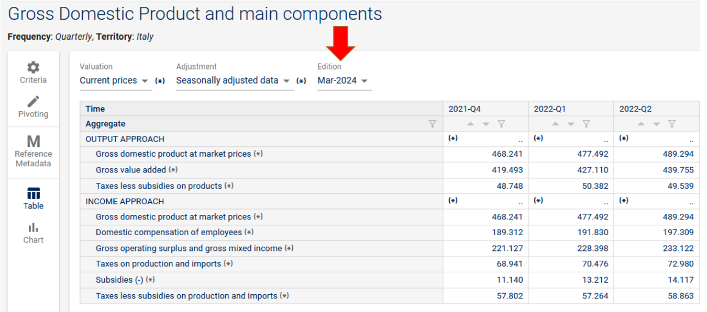
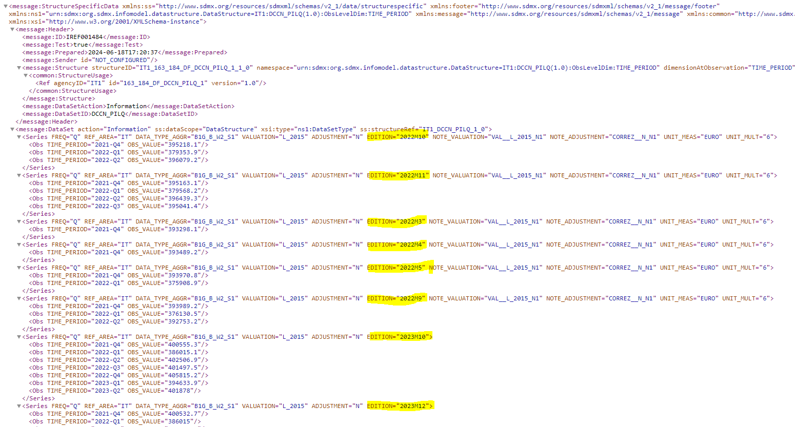
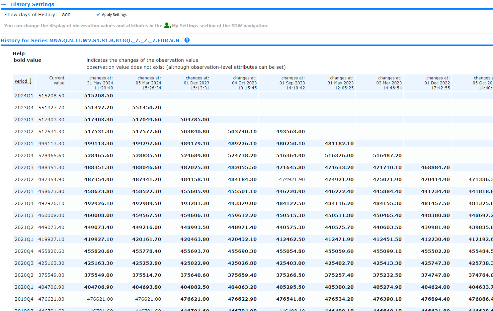
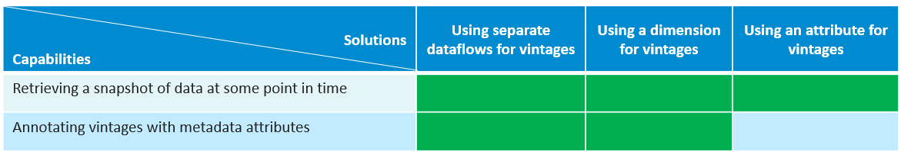

<!-- figure: f01-logo -->


SDMX GUIDELINES

GUIDELINES FOR MODELLING VINTAGES IN SDMX

VERSION 1.0

# Contents

[Document History](#document-history)

[Introduction](#introduction)

[Problem definition](#problem-definition)

[Use cases](#use-cases)

[Recommended implementation options](#recommended-implementation-options)

# Document History

| **Version** | **Date**   | **Comment**     |
|-------------|------------|-----------------|
| 1.0         | 27/06/2025 | Initial version |

# Introduction

In these guidelines, vintage is defined as a published set of data at a particular moment. Vintage data allows academics to reproduce others' research, build more accurate forecasting models, and analyse economic policy decisions using the data available at the time.

Modelling data vintages in SDMX involves managing and organizing different versions of datasets that are released over time. Each "vintage" refers to a specific release of data, capturing the state of the data at a particular point in time. In general, economic data for past observation periods are revised as more accurate estimates become available due to changing conditions. The changes referred to in these guidelines are exogenous to the estimated concepts, which are different than the changes covered by the [guidelines for representing methodological changes](https://sdmx.org/wp-content/uploads/GUIDELINES_FOR_REPRESENTING_METHODOLOGICAL_CHANGES_IN_DSDs_version_1_0.docx), e.g., changes in currency, base year, statistical framework, etc.

These guidelines focus on data modelling. There are time-based parameters in the SDMX REST API that enable users to retrieve data at a specific point in time, such as *includeHistory* and *asOf;* however, these are outside the scope of this document. Details regarding vintages support in the SDMX REST API are available in the [REST API technical documentation](https://github.com/sdmx-twg/sdmx-rest/blob/master/doc/data.md#vintages), which is developed and maintained by the SDMX Technical Working Group.

# Problem definition

International and national agencies use different approaches for modelling vintages of datasets. Agencies using SDMX, or wanting to use SDMX for modelling vintages, can benefit from a standard approach, depending on the use case, and clear guidance on the different alternatives for modelling vintages in SDMX. These guidelines provide recommendations on how to work with vintages for several use cases and present practical examples for its implementation.

Data modelers and users could benefit from having a standard approach for modelling vintages in SDMX. For data modelers, harmonization of the ways to treat vintage datasets would mean less time spent designing the conceptual and logical models for datasets for which it is important to identify this information. For the users, this would improve the accessibility of different vintages of a dataset.

# Use cases

***<span style="color:#1F497D">IMF World Economic Outlook (WEO)</span>***

Two releases per year (April and October) with projections for the next five years, which are revised on each release. Previous vintages are published for comparison.

WEO April 2023

| Country   | Indicator      | 2022   | 2023   | 2024   | 2025   |
|-----------|----------------|--------|--------|--------|--------|
| Country A | GDP Per Capita | 10,000 | 10,500 | 11,000 | 11,000 |

WEO October 2023

| Country | Indicator | 2022 | 2023 | 2024 | 2025 |
|----|----|----|----|----|----|
| Country A | GDP Per Capita | 10,000 | <span style="color:#FF0000">10,800</span> | <span style="color:#FF0000">11,200</span> | <span style="color:#FF0000">11,200</span> |

In this example, the projection for Country A’s GDP per capita improved in the WEO October 2023 release, however, these latest projections do not overwrite the previous projections released in April 2023. Both projections are disseminated in their respective vintages so that users can access and compare the projections. The same applies for archive vintages.

***<span style="color:#1F497D">Italian National Institute of Statistics (ISTAT) GDP and main components</span>***

ISTAT disseminates on the [i.stat platform](http://dati.istat.it/?lang=en&SubSessionId=55bfe5f4-cebe-4318-98f9-20738582071f) updates of the quarterly national accounts data and the revisions for the previous periods. Each dissemination is identified by a variable ‘EDITION’ modelled as a dimension in the DSD used for the dissemination. In the platform, the latest edition is shown by default (as in the case of the table below) but for the users it is also possible to access and visualize different vintages of data by selecting the parameter appropriately.

<!-- figure: f02-istat-gdp-screenshot -->


<!-- figure: f03-istat-sdmx-message -->


***<span style="color:#1F497D">ECB Statistical Data Warehouse (SDW)</span>***

The ECB disseminates in the SDW the history of revisions at the series level—**only for European System of Central Banks users**. It is possible to change ‘History settings’ and visualize the changes (see table below).

<!-- figure: f04-ecb-sdw-history -->


In this case, the vintage is managed at the dataset level with a technical field ‘validFromDate=’ and ‘validToDate=’ which are not part of the DSD. They are implemented in the backend, i.e. on the databases storing the data. The vintage information can be queried via API by using the includeHistory parameter in the query to retrieve data. In the query, it is possible to specify from which date should the revisions start. The validFromDate and/or validToDate fields should be used to indicate the periods of validity for the data contained in the data set.

The [data is available for researchers with vintages](https://data.ecb.europa.eu/data/datasets/RTD/data-information) which can be queried via API following the API instructions. An example query is:

<!-- figure: t01-ecb-query-url (text box, text follows) -->

<https://data-api.ecb.europa.eu/service/data/RTD/A.S0.N.F_CEC_CGG_D0.F?includeHistory=true&format=csvdata>

# Recommended implementation options

A solution for vintages must provide the following capabilities:

- Retrieving a snapshot of data at some point in time

- Retrieving data from different vintages to compare it over time (if the indicator underlying methodology remains the same)

- Retrieving a snapshot of structural artefacts at some point in time

- Storing a link between vintages and the corresponding parent dataflow

- Filtering out vintage dataflows when retrieving a list of regular dataflows

Some approaches are not mutually exclusive and can complement each other:

**Table 1. Modelling solutions vis-à-vis capabilities**

<!-- figure: f05-modelling-solutions-table -->


***<span style="color:#1F497D">Using separate dataflows for vintages</span>***

With separate dataflows for each vintage, users can query the specific vintage they need by referencing the appropriate dataflow ID. This approach ensures clarity and precision in data access. Using separate dataflows for each vintage in SDMX involves creating distinct dataflows that reference a common DSD but are uniquely identified by vintage.

This method provides clear segregation of different data vintages and facilitates precise data management and access. Create a separate dataflow for each vintage, ensuring that each dataflow references the same DSD but is uniquely identified. Example dataflows in SDMX:

<!-- figure: t02-dataflows-xml -->
```
XML
<Dataflow id="DF_GDP_VINTAGE_2023_01" agencyID="YourAgency" version="1.0">
    <Name>GDP Data Vintage 2023-01</Name>
    <Structure structureID="DSD_EXAMPLE" agencyID="YourAgency" version="1.0"/>
</Dataflow>

<Dataflow id="DF_GDP_VINTAGE_2023_02" agencyID="YourAgency" version="1.0">
    <Name>GDP Data Vintage 2023-02</Name>
    <Structure structureID="DSD_EXAMPLE" agencyID="YourAgency" version="1.0"/>
</Dataflow>
```

***<span style="color:#1F497D">Using a dimension for vintages</span>***

A new dimension in the DSD called "Vintage" or "ReleaseDate" that indicates a vintage. This dimension should have a code list indicating different vintages, usually represented by dates or version numbers.

<!-- figure: t03-dsd-xml -->
```
XML
<DataStructure id="DSD_EXAMPLE" agencyID="YourAgency" version="1.0">
    <DimensionList>
        <Dimension id="TIME_PERIOD"/>
        <Dimension id="GEO"/>
        <Dimension id="INDICATOR"/>
        <Dimension id="VINTAGE" codelist="CL_VINTAGE"/>
    </DimensionList>
    <AttributeList>
        <Attribute id="OBS_STATUS"/>
    </AttributeList>
    <MeasureList>
        <PrimaryMeasure id="OBS_VALUE"/>
    </MeasureList>
</DataStructure>
```

Create a code list that defines possible values for the vintage dimension.

<!-- figure: t04-codelist-xml -->
```
XML
<CodeList id="CL_VINTAGE" agencyID="YourAgency" version="1.0">
    <Code value="2021-01-01"/>
    <Code value="2021-02-01"/>
    <Code value="2021-03-01"/>
</CodeList>
```

***<span style="color:#1F497D">Using an attribute for vintages</span>***

If it is preferred to avoid adding a new dimension, a DSD attribute can represent the vintage.

<!-- figure: t05-attribute-xml -->
```
XML
<Attribute id="VINTAGE" codelist="CL_VINTAGE"/>
```

Specify how the attribute is used in the DSD.

<!-- figure: t06-attribute-usage-xml -->
```
XML
<AttributeUsage attribute="VINTAGE" assignmentStatus="Conditional"/>
```

Create a code list that defines possible values for the vintage dimension.

<!-- figure: t07-codelist-xml -->
```
XML
<CodeList id="CL_VINTAGE" agencyID="YourAgency" version="1.0">
    <Code value="2021-01-01"/>
    <Code value="2021-02-01"/>
    <Code value="2021-03-01"/>
</CodeList>
```
