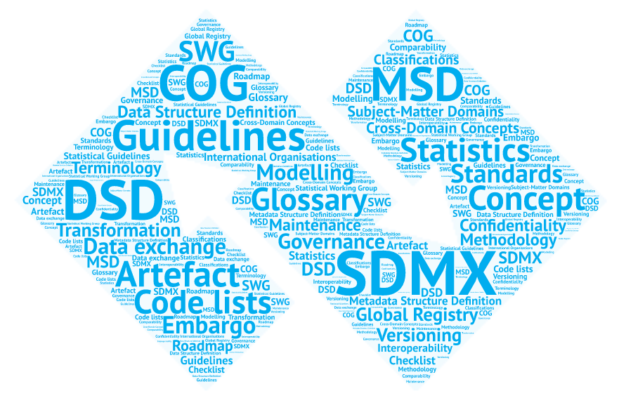
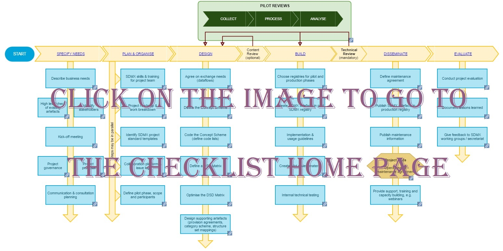

<table>
<colgroup>
<col style="width: 50%" />
<col style="width: 50%" />
</colgroup>
<tbody>
<tr>
<th><a href="images/SDMx_guidelines_page_word_cloud.png"> 
</a></th>
<th width="700">The SDMx Content-Oriented Guidelines (COG) recommend practices for creating interoperable data and metadata sets using the SDMx technical standards. They are intended to be applicable to all statistical domains.The guidelines focus on harmonising specific concepts and terminology that are common to a large number of statistical domains. Such harmonisation is useful for achieving an even more efficient exchange of comparable data and metadata, and builds on the experience gained in implementations to date.</th>
</tr>
&#10;</tbody>
</table>

The various categories of guidelines are described below.

These guidelines support SDMx design projects which follow the pattern shown in the diagram below.

  
**Checklist for SDMx Design Projects**

#### **Introduction**

This **[introductory document](01-introduction/cog-introduction/cog-introduction.md "Introduction")** (February 2016 version) provides a general description of the various components of the SDMx Content-Oriented Guidelines, namely: cross-domain concepts, code lists, subject-matter domains, glossary, and implementation-specific guidelines. This material is made available to users to enhance and make more efficient the exchange of statistical data and metadata using the SDMx standard.

#### **Concepts**

Cross-domain concepts in the SDMx framework describe concepts relevant to many, if not all, statistical domains. SDMx recommends using these concepts whenever feasible in SDMx structures and messages to promote the reuse and exchange of statistical information and related metadata between organisations. These cross-domain concepts can be found in the SDMx Glossary below (under attribute “Type: Cross-domain concept”).

#### **Code Lists**

Code lists are predefined sets of terms that serve as standardised values for statistical coded concepts. **[SDMx cross-domain code lists](https://sdmx.org/?page_id=3215 "SDMx cross-domain code lists")** facilitate interoperability by supporting cross-domain concepts. Using common code lists enhances efficiency, simplifies maintenance, and reduces the need for complex mapping systems and interfaces for data and metadata delivery. Consequently, selecting the right code lists significantly impacts the effectiveness of data sharing.

For best practices on designing code lists to improve integration and maximize interoperability, refer to the **[Guidelines for the Creation and Management of SDMx Code Lists](02-code-lists/code-lists-guidelines/code-lists-guidelines.md "Guidelines for the Creation and Management of SDMx Code Lists")**.

#### **Statistical subject-matter domains**

A statistical subject-matter domain refers to a statistical activity that has common characteristics with respect to variables, concepts and methodologies for data collection and the whole statistical data compilation process. Examples of statistical domains are price statistics, national accounts, and environment or education statistics. The **[Classification of Statistical Subject-Matter Domains](03-subject-matter-domains/subject-matter-domains/subject-matter-domains.md)** (January 2009 version) is based on the UN Economic Commission for Europe (UNECE) Classification of International Statistical Activities.

#### **Glossary**

The **[SDMx Glossary Version 2.1](04-glossary/glossary/glossary.md)** (published in December 2020) contains concepts and related definitions used in structural and reference metadata of international organisations and national data-producing agencies. This new version contains many new concept definitions which are coded so that they can be used as structural metadata in machine-to-machine statistical exchanges. All existing definitions have been reviewed with improvements to add to clarity and example use cases.

The SDMx Glossary recommends a common terminology that should be used in order to facilitate communication and understanding. The overall message of the SDMx Glossary is: if a term is used, then its precise meaning should correspond to the Glossary definition, and any reference to a particular phenomenon described in the Glossary should use the appropriate term.

Users interested in making direct links to specific terms in the Glossary (e.g. for citations, ease of navigation) are invited to use the **[html version of the Glossary](https://sdmx.org/wp-content/uploads/SDMx_Glossary_Version_2_1_December_2020.htm)**. Let us assume that you want your users to be directly referred to the concept “Content-oriented guidelines (COG)” without them having to search the whole Glossary. Once the Glossary page is open, go through the table of contents until you spot the entry “Content-oriented guidelines (COG)”. You then have two options: a) if you do not want to check the content of the entry (because you already know that it is the concept you are interested in), just do a right-click and select “Copy link address” in Chrome browser, “Copy Link Location” in Netscape, Opera and Firefox browsers, “Copy shortcut” in Internet Explorer browser, or similar functionality in other browsers; b) if you want to check the content of the entry before taking any action, click on the link; you will then be redirected to the place in the document where the entry “Content-oriented guidelines (COG)” is defined; if the entry meets your needs, simply copy the URL displayed in the address bar of your browser and paste it in your document. In the case of the “Content-oriented guidelines (COG)”, the link will be the following: **<https://sdmx.org/wp-content/uploads/SDMx_Glossary_Version_2_1_December_2020.htm#_Toc59116750>** (the segment “#\_Toc59116750” is the part of the address that makes the concept directly referenceable).

Please note that the SDMx Glossary is also available as a **[Cross-Domain Concept Scheme](https://registry.sdmx.org/items/conceptscheme.html)** from the SDMx Registry.

#### **Governance of SDMx artefacts**

The “[Reference Framework for SDMx Structural Metadata Governance](05-governance/structural-metadata-governance/structural-metadata-governance.md)” provides guidance to agencies for implementing the most appropriate governance architecture to maintain SDMx Structural Metadata. Thereby, agencies may improve the quality and maintenance of their structural metadata. Through use of this guideline, improvements may be achieved in reporting clarity, reviewing, resource management and structural metadata maintenance. The guideline includes variations on the reference framework to adapt to agencies different needs and resources. Each variation includes comparative indicators to help analyse which one may be the most suitable to implement.

The document “[Governance of commonly used SDMx metadata artefacts](05-governance/governance-commonly-used-artefacts/governance-commonly-used-artefacts.md)” (Version 1.3, September 2018) describes in more detail how the principles outlined in the reference framework mentioned above are implemented for artefacts owned and maintained by the SDMx Sponsors or for artefacts used for global data exchange and stored in the Global SDMx Registry.

#### **Other Guidelines**

- [**Guidelines on Using SDMx Annotations**](#Annotations)
- **<a href="#Standardising" id="ToC">Standardising Reference Metadata Reporting in SDMx</a>**
- **<a href="#Modelling" id="ToC">Modelling Statistical Domains in SDMx</a>**
- **<a href="#MethodologicalChanges" id="ToC">Guidelines for Representing Methodological Changes in Data Structure Definitions</a>**
- **<a href="#DSDGuideline" id="ToC">Guidelines for SDMx Data Structure Definitions</a>**
- **<a href="#CodeListGuideline" id="ToC">Guidelines for the Creation and Management of SDMx Code Lists</a>**
- **<a href="#Versioning" id="ToC">Guidelines on the Versioning of SDMx Artefacts</a>**
- **<a href="#NonCalendar" id="ToC">Guidelines on Non-Calendar Year Reporting of Data</a>**
- **<a href="#CLOBSSTATUS" id="ToC">Possible Ways of Implementing the Observation Status Concept</a>**
- **<a href="#Embargo" id="ToC">Guidelines for Confidentiality and Embargo in SDMx</a>**
- **<a href="#TimeTrans" id="ToC">Guidelines on Coding Time Transformations in SDMx</a>**
- **<a href="#ConceptRoles" id="ToC">Guidelines for SDMx Concept Roles</a>**
- **<a href="#ChecklistProviders" id="ToC">Checklist for SDMx Data Providers</a>**
- **<a href="#RegistryPolicy" id="ToC">SDMx Global Registry Content Policy</a>**
- **<a href="#Hierarchies" id="ToC">Guidelines for SDMx Hierarchies</a>**
- **<a href="#Vintages" id="ToC">Guidelines for Modelling Vintages in SDMx</a>**
- **<a href="#Units" id="ToC">Guidelines for Modelling Units of Measure in SDMx</a>**

<strong>Guidelines on using SDMx Annotations </strong>([Back to Table of Contents](#ToC))  
The aim of this guideline is to improve machine interactions by proposing a controlled vocabulary for the Type property of the SDMx Annotation construct and a recommended usage for the other properties that will greatly improve the interoperability of Annotations between SDMx-compliant organisations. **[Version 2.0](06-other-guidelines/annotations/annotations.md)** adapts the guideline to SDMx 3.0, extends the controlled vocabulary of annotations, and clarifies the text.

**Standardising Reference Metadata Reporting in SDMx** ([Back to Table of Contents](#ToC))  
The goal of this guideline is to increase the efficiency of reference metadata exchange between statistical agencies, and for dissemination (where the consumer may not be known). The quality and timeliness of reference metadata exchange may be improved and harmonised, thereby enabling statistical data to be described more thoroughly in a comparable way using automated, shared systems. This guideline on “**[Standardising Reference Metadata Reporting in SDMx](06-other-guidelines/reference-metadata-reporting/reference-metadata-reporting.md "Standardising Reference Metadata Reporting in SDMx")**” (Version 1.0, June 2019) includes a Global Reference Metadata Concept Scheme (MCS) that enumerates a standard list of reference metadata concepts. The Global MCS is not sufficient to implement an exchange; therefore, the document also describes how to derive implementation structures from the Global MCS.By following the guideline, the same tools and mappings may be used across separate metadata flows, agencies and domains using community-driven systems, thus saving on reinvention of the same functionality. Furthermore, the use of the Global MCS is intended to boost the automation of metadata exchange.

<strong>Modelling Statistical Domains in SDMx </strong>([Back to Table of Contents](#ToC))  
The document “**[Modelling Statistical Domains in SDMx](06-other-guidelines/modelling-statistical-domains/modelling-statistical-domains.md)**” (Version 2.0, June 2018) outlines general principles on how to design and create SDMx artefacts in a statistical domain, following a step-by-step approach to design based on the SDMx information model and, complementing the existing guidelines on Data Structure Definitions and Codelists.The document includes how to determine the number of Data Structure Definitions (DSDs) for a subject-matter domain and recommends that a decision on this should come after a discussion on all the parameters of the data collection exercise.

<strong>Guidelines for representing methodological changes in Data Structure Definitions </strong>([Back to Table of Contents](#ToC))  
The document “**[Guidelines for representing methodological changes in Data Structure Definitions](06-other-guidelines/methodological-changes-in-dsds/methodological-changes-in-dsds.md)**” (Version 1.0, April 2019) provides recommendations on how to represent methodological changes for several use cases. When designing SDMx artefacts for an implementation project, one major design choice is the dimensionality of the Data Structure Definition(s), that is, which and how many dimensions are used to uniquely identify the relevant time series. Various trade-offs related to this design choice, such as between DSD complexity and parsimony, are discussed in the Modelling Guidelines. One aspect that is mentioned in the Modelling Guidelines, but not elaborated in detail, is the one of structural stability in case of methodological changes. In other words, how future-proof is the DSD? How many and what kind of changes to the DSD are required when certain aspects of the underlying data change and the DSD needs to represent both, pre-change and post-change data, in different time series? If certain future changes are already expected when the DSD is originally designed, dimensions (or attributes) covering these changes will be included in the DSD. If the DSD was designed without expecting changes, additional dimensions or attributes will have to be introduced at a later stage.

<strong>Guidelines for SDMx Data Structure Definitions </strong>([Back to Table of Contents](#ToC))  
The development of SDMx Data Structure Definitions in many statistical domains raised the need for guidance on the design of DSDs. The SDMx initiative now releases such guidelines based on conceptual considerations and first hand experiences with the development of DSDs. The document “**[Guidelines for SDMx Data Structure Definitions](06-other-guidelines/dsd-guidelines/dsd-guidelines.md "Guidelines for SDMx Data Structure Definitions")**” (Version 1.0, June 2013) outlines general design principles for DSDs such as reuse of existing concepts and code lists, and principles such as keeping the DSDs simple. The guidelines describe the different uses of DSDs, based on different user needs. And discuss the advantages and disadvantages of data structures in different domains. They provide context-specific recommendations instead of prescribing “the best” one-size-fits-all approach. For DSD designers, a step-by-step guide for designing DSDs is also included.

<strong>Guidelines for the Creation and Management of SDMx Code Lists </strong>([Back to Table of Contents](#ToC))  
The “**[Guidelines for the creation and Management of SDMx Code Lists](02-code-lists/code-lists-guidelines/code-lists-guidelines.md "Guidelines for the Creation and Management of SDMx Cross-Domain Code Lists")**” provide best practices for developing code lists, particularly in SDMx implementations across statistical domains. Their use is strongly recommended when designing and implementing SDMx-compliant Data Structure Definitions (DSDs).

Version 4.0 (February 25, 2025) includes features from SDMx 3.0, along with new and updated recommendations.

<strong>Guidelines on the Versioning of SDMx Artefacts </strong>([Back to Table of Contents](#ToC))  
The “**[Guidelines on the Versioning of SDMx Artefacts](06-other-guidelines/versioning/versioning.md "Guidelines on the Versioning of SDMx Artefacts")**” (Version 1.0, November 2015) provide recommendations on how to version SDMx artefacts inspired by “semantic versioning”, i.e. a formal convention for specifying compatibility between the different versions of a “versionable” artefact (a SDMx artefact that has an associated version number). Versioning is central to SDMx because it guarantees the stability of references to SDMx artefacts. This is of the utmost importance given the sometimes strong dependencies between artefacts, especially in Data Structure Definitions (DSDs). The document contains three main recommendations: a) numbering system and syntax; b) types of artefact changes and their versioning impact; c) how versioning works for inter-dependent artefacts. The document’s appendix contains examples of several types of changes and their versioning impact.

<strong>Guidelines on Non-Calendar Year Reporting of Data </strong>([Back to Table of Contents](#ToC))  
​In many cases, data that are exchanged in SDMx data messages do not relate to the calendar year. However, many statistical system implementations require that data are mapped to and stored as the real calendar. The document “**[Guidelines on Non-Calendar Year Reporting of Data](06-other-guidelines/non-calendar-year-reporting/non-calendar-year-reporting.md)**” (Version 1.0, November 2016) provides recommendations for four use cases of such non-calendar year data: a) Reporting year is equal to the calendar year; b) Reporting year starts on the first day of a month different to January; c) Reporting year starts on a given day in the year, and d) Reporting year ends on a given day in the year.

<strong>Possible Ways of Implementing the Observation Status Concept </strong>([Back to Table of Contents](#ToC))  
The “Observation status” code list has a heterogeneous character as it mixes concepts which are not always mutually exclusive (e.g. a missing value can generate a break in time series). This means that several flags can be allocated to one statistical observation. The document “**[Possible Ways of Implementing the Observation Status Concept](06-other-guidelines/observation-status/observation-status.md)**” (Version 2.0, May 2019) describes the possible options for doing that, including the recommended solution, and explains their advantages and disadvantages.

<strong>Guidelines for Confidentiality and Embargo in SDMx </strong>([Back to Table of Contents](#ToC))  
The “**[Guidelines for Confidentiality and Embargo in SDMx](06-other-guidelines/confidentiality-and-embargo/confidentiality-and-embargo.md)**” (Version 2.0, 19 January 2018) cover the confidentiality aspects in SDMx data exchange, including embargo scenarios. The aim is to provide a consistent and practical way to represent these aspects in SDMx artefacts in order to promote cross-domain consistency and harmonise methodology and processes. The paper presents the use case scenarios related to confidentiality and embargo. Based on the use cases, recommendations are provided on how to represent both elements in the SDMx model.

**Guidelines on coding time transformations in SDMx**([Back to Table of Contents](#ToC))  
The “**[Guidelines on coding time transformations in SDMx](06-other-guidelines/time-transformations/time-transformations.md)**” (Version 1.0, September 2016) describe two methods that may be used to code a time transformation, defined as a time-related operation performed on a time series, solely involving observations of that time series. Examples of such time transformations are growth rates, cumulative sums over several periods and moving averages. Both of the methods described in the guideline are included as separate use cases. The aim of this document is to demonstrate that guidance and a standard approach is available and promoted for each use case.

**Guidelines for SDMx Concept Roles**([Back to Table of Contents](#ToC))  
The document “**[Guidelines for SDMx Concept Roles](06-other-guidelines/concept-roles/concept-roles.md)**” (Version 1.1, May 2022) describes SDMx Concept Roles and their use. It also proposes a cross-domain Concept scheme that defines the set of concept roles for SDMx 2.1, which also applies to SDMx 3.0, and gives examples on concept role implementation in both SDMx 2.0 and SDMx 2.1. A concept role gives a particular context to a concept for easy and systematic interpretation by machine processing and visualization tools. For example, the concepts REPORTING_AREA and COUNTERPART_AREA are different concepts but they are both geographical characteristics, therefore they can be associated with the same concept role ID: “GEO”. This allows visualization systems to interpret these concepts as geographical data in order to generate maps. The implementation of concept roles is different in versions 2.0 and 2.1 of the SDMx technical standard. Examples for both versions are included in the appendix. The Concept Roles are available as an SDMx Concept Scheme from the **[SDMx Global Registry](https://registry.sdmx.org/overview.html)**.

**Checklist for SDMx Data Providers**([Back to Table of Contents](#ToC))  
The aim of the **<a href="https://statswiki.unece.org/display/SDMxPM/Checklist+for+SDMx+Data+Providers" target="_blank" rel="noopener noreferrer">Checklist for SDMx Data Providers</a>** is to help statistical agencies implement the provision of SDMx data based on existing structures, such as Global DSDs. A prerequisite before starting SDMx implementation is to define and store SDMx structural metadata artefacts in a shared location (such as the **<a href="https://registry.sdmx.org/" target="_blank" rel="noopener noreferrer">SDMx Global Registry</a>**). For guidance and how to define SDMx artefacts, please refer to the **<a href="https://statswiki.unece.org/display/SDMxPM/Checklist%20for%20SDMx%20Design%20Projects%20Home" target="_blank" rel="noopener noreferrer">Checklist for SDMx Design Projects</a>**.

Examples for using the checklist may be reporting data to international organisations (e.g. **<a href="http://ec.europa.eu/eurostat/web/esa-2010" target="_blank" rel="noopener noreferrer">reporting of ESA 2010 to Eurostat</a>**), dissemination of national data using SDMx, or for international agreements (e.g. **<a href="https://dsbb.imf.org/" target="_blank" rel="noopener noreferrer">SDDS+ adherence in cooperation with IMF</a>**). It may be used by project managers to speed up implementations based on best practices. The checklist describes the various activities (the individual boxes) to be achieved, which are organised in process phases (the vertical pillars). The process phases are based on the UNECE **<a href="https://statswiki.unece.org/display/GSBPM/GSBPM+v5.1" target="_blank" rel="noopener noreferrer">Generic Statistical Business Process Model</a>**.

Each activity can be clicked through to view its details. Not all activities are compulsory: it depends on the statistical agencies starting point, such as on the level of technology available, and the statistical and SDMx knowledge. Furthermore, the order of activities do not require a sequential/waterfall implementation, and there will naturally be some feedback loops; for example, after the Test phase it could be necessary to return to the Design or Planning phases.

The checklist should be usable with most project management methodologies such as Waterfall, KANBAN, Scrum, etc.

The document “**[checklist for data provider story.docx](06-other-guidelines/data-provider-checklist-story/data-provider-checklist-story.md)**” contains a story on how to the checklist may be implemented.

<strong>SDMx Global Registry Content Policy </strong>([Back to Table of Contents](#ToC))  
The document “**[SDMx Global Registry Content Policy](06-other-guidelines/global-registry-content-policy/global-registry-content-policy.md)**” (Version 1.0, March 2015) proposes a policy for artefacts stored, maintained and disseminated from the SDMx global registry (GR). Defining precisely which artefacts should go into the GR and which ones should not is crucial as the GR will play a central role in providing SDMx implementers with final, reliable, up-to-date, harmonised and validated SDMx artefacts.

<strong>Guidelines for SDMx Hierarchies </strong>([Back to Table of Contents](#ToC))  
The “**[Guidelines for SDMx Hierarchies”](06-other-guidelines/hierarchies/hierarchies.md)** (Version 1.0, September 2025) illustrates the use case for hierarchies in SDMx, provide examples and recommend best practices for its implementation. Hierarchies are commonly used to represent various relationships among elements in the code list and classifications. They play a crucial role in data management systems for tasks such as data modelling and data dissemination.

**Guidelines for modelling Vintages in SDMx** ([Back to Table of Contents](#ToC))  
The “**[Guidelines for modelling Vintages in SDMx”](06-other-guidelines/vintages/vintages.md)** (Version 1.0, October 2025) provides recommendations on how to work with vintages for several use cases and present practical examples for its implementation. Vintage data allows academics to reproduce others’ research, build more accurate forecasting models, and analyse economic policy decisions using the data available at the time.

**Guidelines for Modelling Units of Measure in SDMx** ([Back to Table of Contents](#ToC))  
The role of units of measure in statistical data modelling is critical for ensuring consistency, accuracy, and interpretability. Measurement units provide a standardized way to quantify data, enabling immediate assessment of comparability and defining the scope for computations.

Accurate and consistent unit conversions are essential for maintaining data integrity and enabling meaningful analysis when comparing statistical indicators. This underscores the importance of “**[Guidelines for Modelling Units of Measure in SDMx”](06-other-guidelines/units-of-measure/units-of-measure.md)** (Version 1.0, November 2025). These guidelines establish a framework for organising and standardising how units of measure are represented and managed within SDMx data models. They are designed for statistical data modelers working with multidimensional data, primarily in SDMx, but they also extend to data-warehousing applications in general. The patterns proposed are rooted in well-established international standards in science and engineering.

This webpage is maintained by the SDMx Statistical Working Group (SWG), comprised of members coming from national and international banking and statistical organisations. The SWG uses Github for the maintenance and development of the SDMx Statistical Guidelines. For more information, see the SWG page on Github at **<https://github.com/sdmx-swg>**.

**LICENSE**

The SDMx content-oriented guidelines and their documentation are subject to the [CC BY-SA 4.0 (Attribution-Share-Alike)](https://nam10.safelinks.protection.outlook.com/?url=https%3A%2F%2Fcreativecommons.org%2Flicenses%2Fby-sa%2F4.0%2F&data=05%7C01%7CYVargas%40imf.org%7C08cf6968e2e642b7dbc808da6b1cc7da%7C8085fa43302e45bdb171a6648c3b6be7%7C0%7C0%7C637940068618815973%7CUnknown%7CTWFpbGZsb3d8eyJWIjoiMC4wLjAwMDAiLCJQIjoiV2luMzIiLCJBTiI6Ik1haWwiLCJXVCI6Mn0%3D%7C3000%7C%7C%7C&sdata=jPSsCT8l11x3qdgMdvdHpdJd4iNQ%2FXtUKqXtHqkHTtY%3D&reserved=0) license. You are free to:

- **Share**— copy and redistribute the material in any medium or format
- **Adapt**— remix, transform, and build upon the material for any purpose, even commercially.

**These are the terms of the license:**

- **Attribution**— You must give [appropriate credit](https://nam10.safelinks.protection.outlook.com/?url=https%3A%2F%2Fcreativecommons.org%2Flicenses%2Fby-sa%2F4.0%2F&data=05%7C01%7CYVargas%40imf.org%7C08cf6968e2e642b7dbc808da6b1cc7da%7C8085fa43302e45bdb171a6648c3b6be7%7C0%7C0%7C637940068618815973%7CUnknown%7CTWFpbGZsb3d8eyJWIjoiMC4wLjAwMDAiLCJQIjoiV2luMzIiLCJBTiI6Ik1haWwiLCJXVCI6Mn0%3D%7C3000%7C%7C%7C&sdata=jPSsCT8l11x3qdgMdvdHpdJd4iNQ%2FXtUKqXtHqkHTtY%3D&reserved=0), provide a link to the license, and [indicate if changes were made](https://nam10.safelinks.protection.outlook.com/?url=https%3A%2F%2Fcreativecommons.org%2Flicenses%2Fby-sa%2F4.0%2F&data=05%7C01%7CYVargas%40imf.org%7C08cf6968e2e642b7dbc808da6b1cc7da%7C8085fa43302e45bdb171a6648c3b6be7%7C0%7C0%7C637940068618815973%7CUnknown%7CTWFpbGZsb3d8eyJWIjoiMC4wLjAwMDAiLCJQIjoiV2luMzIiLCJBTiI6Ik1haWwiLCJXVCI6Mn0%3D%7C3000%7C%7C%7C&sdata=jPSsCT8l11x3qdgMdvdHpdJd4iNQ%2FXtUKqXtHqkHTtY%3D&reserved=0). You may do so in any reasonable manner, but not in any way that suggests the licensor endorses you or your use.
- **ShareAlike**— If you remix, transform, or build upon the material, you must distribute your contributions under the [same license](https://nam10.safelinks.protection.outlook.com/?url=https%3A%2F%2Fcreativecommons.org%2Flicenses%2Fby-sa%2F4.0%2F&data=05%7C01%7CYVargas%40imf.org%7C08cf6968e2e642b7dbc808da6b1cc7da%7C8085fa43302e45bdb171a6648c3b6be7%7C0%7C0%7C637940068618815973%7CUnknown%7CTWFpbGZsb3d8eyJWIjoiMC4wLjAwMDAiLCJQIjoiV2luMzIiLCJBTiI6Ik1haWwiLCJXVCI6Mn0%3D%7C3000%7C%7C%7C&sdata=jPSsCT8l11x3qdgMdvdHpdJd4iNQ%2FXtUKqXtHqkHTtY%3D&reserved=0) as the original.
- **No additional restrictions**— You may not apply legal terms or [technological measures](https://nam10.safelinks.protection.outlook.com/?url=https%3A%2F%2Fcreativecommons.org%2Flicenses%2Fby-sa%2F4.0%2F&data=05%7C01%7CYVargas%40imf.org%7C08cf6968e2e642b7dbc808da6b1cc7da%7C8085fa43302e45bdb171a6648c3b6be7%7C0%7C0%7C637940068618815973%7CUnknown%7CTWFpbGZsb3d8eyJWIjoiMC4wLjAwMDAiLCJQIjoiV2luMzIiLCJBTiI6Ik1haWwiLCJXVCI6Mn0%3D%7C3000%7C%7C%7C&sdata=jPSsCT8l11x3qdgMdvdHpdJd4iNQ%2FXtUKqXtHqkHTtY%3D&reserved=0) that legally restrict others from doing anything the license permits.

The full license text is [here](https://nam10.safelinks.protection.outlook.com/?url=https%3A%2F%2Fcreativecommons.org%2Flicenses%2Fby-sa%2F4.0%2Flegalcode&data=05%7C01%7CYVargas%40imf.org%7C08cf6968e2e642b7dbc808da6b1cc7da%7C8085fa43302e45bdb171a6648c3b6be7%7C0%7C0%7C637940068618815973%7CUnknown%7CTWFpbGZsb3d8eyJWIjoiMC4wLjAwMDAiLCJQIjoiV2luMzIiLCJBTiI6Ik1haWwiLCJXVCI6Mn0%3D%7C3000%7C%7C%7C&sdata=s9il4QcKXVkE4ua4LZkEXcAQYptf3KGnmr99X%2F7t06E%3D&reserved=0).

- ***For enquiries about the SDMx Statistical Guidelines**:* **[*swg@sdmx.org*](mailto:swg@sdmx.org)**
- ***To connect with SDMx users and experts**: [**SDMx User Forum**](https://www.linkedin.com/groups/13325027/)*
